# 001 · DevOps Introduction

> **DevOps = Development + Operations.**
> It is a methodology (culture + practices + tools) to **deliver applications speedily and reliably**.

---

## 1. Why DevOps? → Agility (speed)

Imagine you want to buy a product that costs ₹10,000. Flipkart delivers it in **10 days**, Amazon Prime delivers it in **2 days**. Same product, same price. Which one do you choose? The faster one, obviously.

Software works the same way. Companies invest **crores** in building applications. Every day the app is not in users' hands is lost money and lost customers to a competitor. So companies need to deliver applications **very speedily**. That speed is called **Agility**, and DevOps is how we get it.

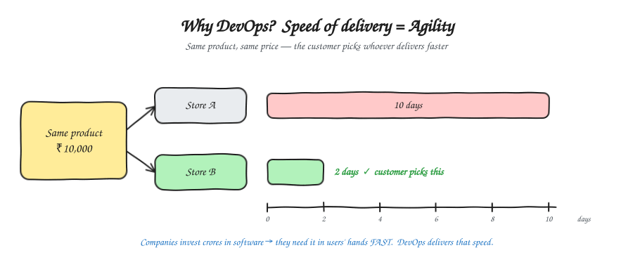

---

## 2. SDLC: Software Development Life Cycle

Every application has to go through several stages before (and after) it reaches users. Traditionally there were **2 teams**: **Development** and **Operations**.

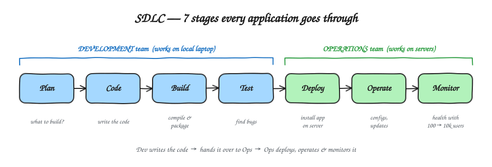

| # | Stage | Done by | What happens |
|---|-------|---------|--------------|
| 1 | **Plan** | Dev | Decide what to build, gather requirements |
| 2 | **Code** | Dev | Write the code on the local laptop/desktop |
| 3 | **Build** | Dev | Compile & package the code (e.g. a `.jar` / `.war` file) |
| 4 | **Test** | Dev | Find and fix bugs |
| 5 | **Deploy** | Ops | **Install the application on a server** |
| 6 | **Operate** | Ops | Change configurations, update the app, keep it running |
| 7 | **Monitor** | Ops | Check how the app behaves on the server with 100, 1,000, 10k users… |

### Deployment: the first job of DevOps

A developer writes code on their **local desktop**. But end users can't use your laptop! To give the application to end users, we put it on a **server** (a computer that is always on and reachable over the internet).

> **DEPLOYMENT = the process of installing an application on a server.**

After deployment comes **operations** (config changes, updates) and **monitoring** (is it healthy under load?). Deploy, operate and monitor were the Ops team's job.

---

## 3. The problem: the Wall of Confusion

The Dev team writes the code for the entire application and **"throws it over the wall"** to the Ops team for production.

Now suppose the code **works on the developer's laptop but stops working on the server**:

- **Dev:** "It works on my local machine, so the code is right. **Your deployment is wrong.**"
- **Ops:** "I don't know your code. I deployed exactly what you gave me. **Your code is wrong.**"

The real problem? The Dev team **never told Ops to install Java** (or the right Java version) on the server. Nobody owned the whole picture.

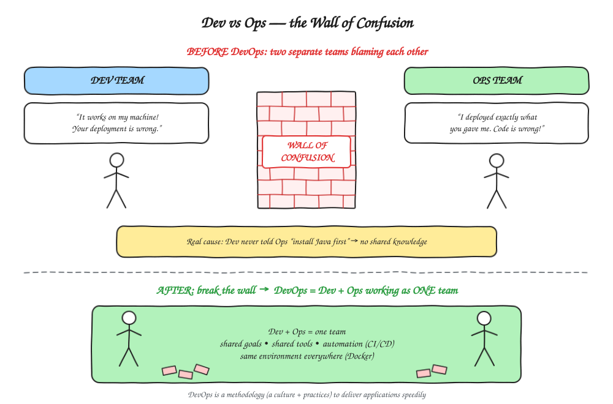

**So what if we break the wall?** Dev and Ops work as **one team**, with shared responsibility, shared tools, automation and the **same environment everywhere**. That is DevOps → **Dev + Ops**.

---

## 4. The DevOps lifecycle: an infinite loop ∞

The DevOps logo is an **infinity symbol** because DevOps is a **never-ending, continuous process**. Monitoring feedback goes straight back into planning the next version.

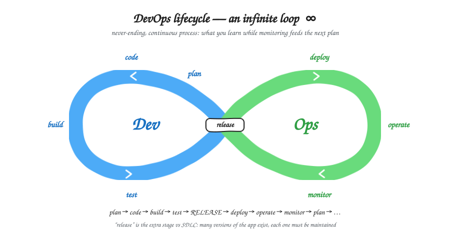

**DevOps adds an extra stage compared to SDLC: `Release`.**
After deployment there are **many versions** of the same application (v1, v2, v3…), and every version has to be released, tracked and maintained.

```
plan → code → build → test → RELEASE → deploy → operate → monitor → (back to plan)
```

---

## 5. Before DevOps: Waterfall → Agile → DevOps

### 5.1 Waterfall model (classic model)

- A **sequential** development process to build software systematically.
- Follows **step-by-step execution**. You can work on **only one step at a time**.
- Like water falling down steps, it only flows **downward**.

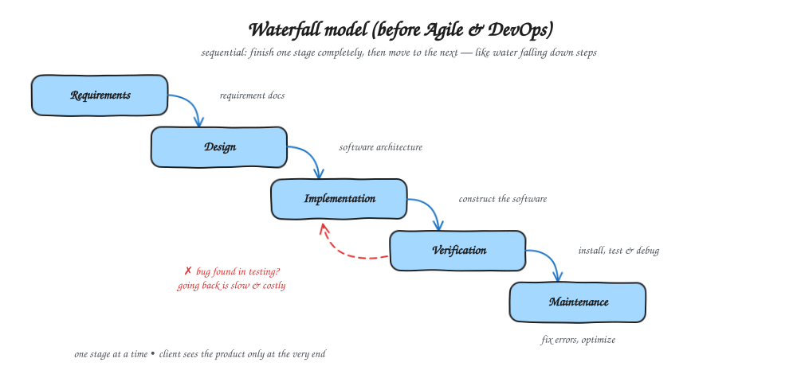

| Stage | Output |
|-------|--------|
| Requirements | Requirement documents |
| Design | Software architecture |
| Implementation | Construct the software (coding) |
| Verification | Install, test & debug |
| Maintenance | Check errors, optimize capabilities |

**Problem:** if testing (Verification) finds a bug, you **can't easily go back** to the Implementation stage. Going back is slow and costly. And the client sees the product only at the very end.

### 5.2 Agile methodology

After Waterfall came **Agile** (agile = *speedy*).

- Manage a project by **breaking it into several small phases** (sprints).
- Deliver **small pieces of working software quickly** → better customer satisfaction.
- **Development and testing happen at the same time.** Build one service, test it immediately, then the next one, until the full app is done.
- **No time gap** between development and testing.
- The project timeline is fixed.

**Limitation:** development and testing are fast, but the **client still receives the whole application at one time**, at the end, just like Waterfall.

### 5.3 DevOps

DevOps fixes that limitation: **release each part to the market as soon as it's developed.** The entire application is not released at once; **release is done in parts** (v1, v2, v3…). Users start getting value early and continuously.

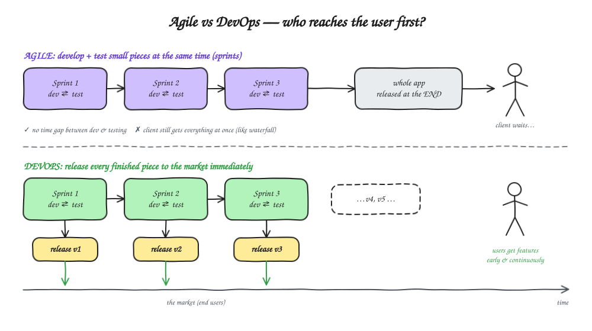

| | Waterfall | Agile | DevOps |
|---|---|---|---|
| Flow | Sequential, one stage at a time | Iterative sprints | Continuous loop |
| Dev & test | Separate phases | Together, in parallel | Together + automated |
| Delivery to client | Once, at the end | Once, at the end | **Continuously, in parts** |
| Going back to fix | Very costly | Easy (next sprint) | Easy (next release) |

---

## 6. DevOps history

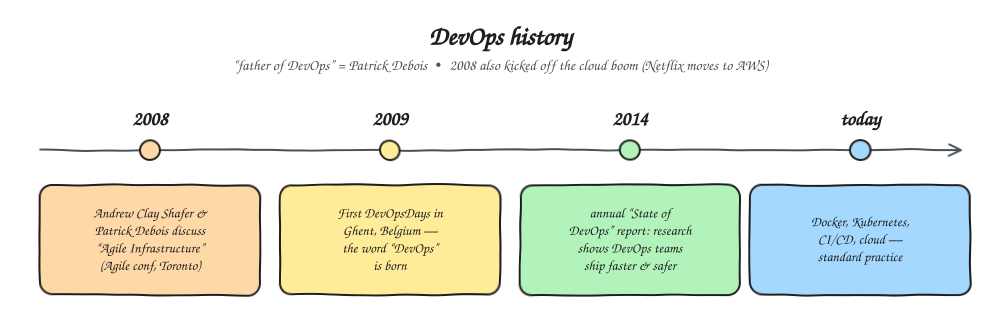

- **2008:** DevOps originated as a discussion between **Andrew Clay Shafer** and **Patrick Debois** about "Agile Infrastructure".
- **2009:** The first **DevOpsDays** summit was held in **Ghent, Belgium**, where they discussed bringing DevOps to the market. The term "DevOps" took off from here.
- **2014:** The annual **State of DevOps report** became the industry's go-to research on how DevOps teams perform.
- If DevOps had a birth certificate, the **father's name would be Patrick Debois**.

> 2008 was a huge year for IT: **Netflix started moving to AWS**, Google was working on **Go (Golang)**, and the **cloud market** started rising. DevOps and cloud grew up together.

---

## 7. DevOps toolchain: a tool for every stage

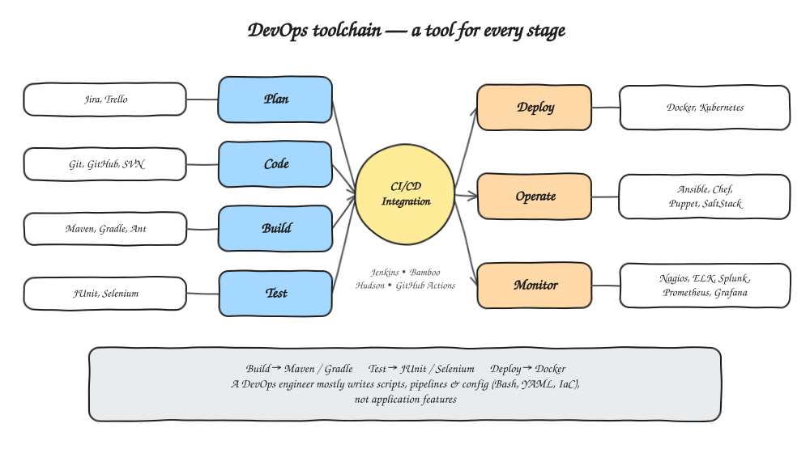

| Stage | Popular tools |
|-------|---------------|
| Plan | Jira |
| Code | Git, GitHub, SVN |
| Build | **Maven**, **Gradle**, Ant |
| Test | **JUnit**, **Selenium** |
| Integration (CI/CD) | **Jenkins**, Bamboo, Hudson, GitHub Actions |
| Deploy | **Docker**, Kubernetes |
| Operate | Ansible, Chef, Puppet, SaltStack, Vagrant |
| Monitor | Nagios, ELK stack, Splunk, Prometheus, Grafana |

> **Does a DevOps engineer write code?** Not application features. But they *do* write **scripts, pipelines and configuration** (Bash, YAML, Dockerfiles, Infrastructure-as-Code). Some companies expect app coding too.

---

## 8. Roles & responsibilities of a DevOps engineer

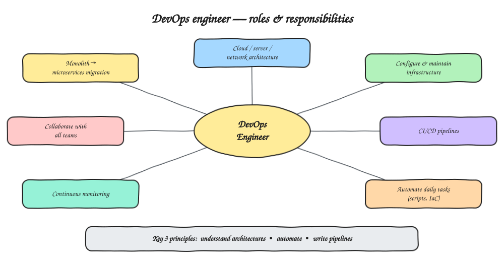

- Cloud / server / network **architectures**
- **Configuring & maintaining** infrastructure
- **CI/CD pipelines**
- **Automating** daily tasks
- **Continuous monitoring**
- **Collaboration** with all teams
- **Migrating** from monolithic to microservices

> **Key 3 principles for a DevOps engineer:** understanding architectures · automate · writing pipelines

### Quick definitions

- **Why DevOps?** To deliver applications very speedily.
- **SDLC:** Software Development Life Cycle.
- **Deployment:** Process of installing an application on a server.

---

## 9. Software architectures (tiers)

An **application is a collection of services**.
Example: **Paytm** → DTH service, recharge service, scanner service, payment service…

> **Tier = Server = Layer.** All three words mean the same thing here.

### 9.1 The 3 layers (servers)

A **server** serves services to the end user. Every application has 3 kinds of layers:

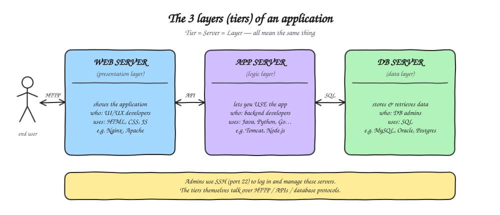

| Layer | Also called | Purpose | Who works on it | What they use | Examples |
|-------|-------------|---------|-----------------|---------------|----------|
| **Web server** | Presentation layer | To **show** the application (UI) | UI/UX developers | Web technologies | HTML, CSS, JS |
| **App server** | Logic layer | To **use** the application (business logic) | Backend developers | Programming languages | Java, Python, C, C++, .NET, Go |
| **DB server** | DB layer | To **store & retrieve** data | DB admins | DB languages | SQL, Oracle, Postgres, ArangoDB |

> ⚠️ **Correction to remember:** the web server and app server talk to each other over **HTTP / APIs**, not SSH. **SSH (port 22)** is what *admins* use to log in to a server and manage it (covered later).

### 9.2 1-tier, 2-tier, 3-tier, N-tier

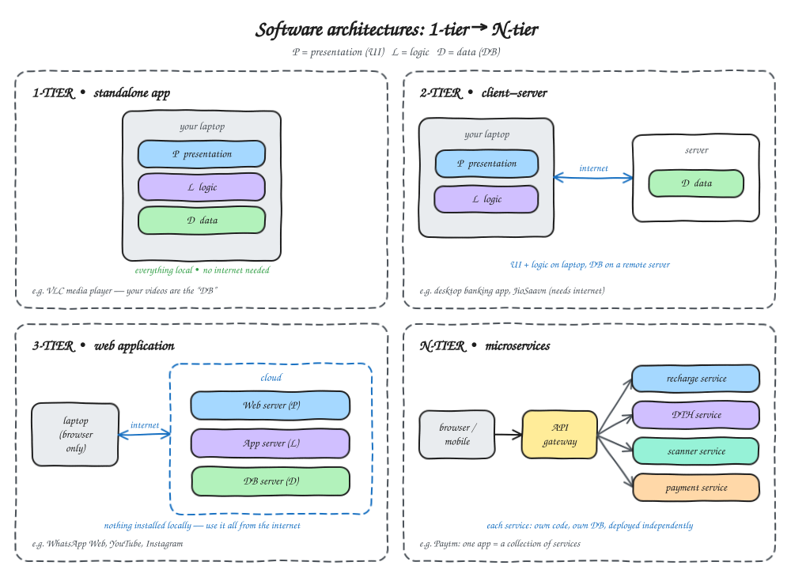

**1. One-tier: standalone application**
- The app works on a **local laptop**. **All layers are local.**
- **No internet connection required.**
- Example: **VLC media player.** You see the UI without internet (presentation local), you can play/pause videos (logic local), and your local videos are its "data" (DB local).
- The banking app many of us built in college (everything on the local machine) was also 1-tier.

**2. Two-tier: client–server application**
- The app is installed on the local laptop: **presentation + logic are local, the DB is on the internet** (on some server).
- **Requires an internet connection.**
- Examples: **desktop banking applications, JioSaavn.** The app is on your machine, but it must connect to a server to fetch your account data/songs.

**3. Three-tier: web application (real-time)**
- **Nothing needs to be on the local machine.** Everything is used from the internet.
- Examples: **WhatsApp Web, YouTube, Instagram.** You just open a URL in the browser and get the UI. (We're talking about the laptop/browser here, not the mobile app.)

**4. N-tier: microservices**
- The application is split into **many independent services**, each with its own code and often its own DB, deployed independently.
- Example: **Paytm**: recharge, DTH, scanner, payments… each is its own service.

---

## 10. Hands-on agenda: create a web server and show the live environment

### 10.1 What is a server? (the waiter analogy)

A server is like a **waiter in a restaurant**. User 1 asks for biryani, user 2 asks for sweets, user 3 asks for salad. The waiter (server) takes each request and serves exactly what was asked.

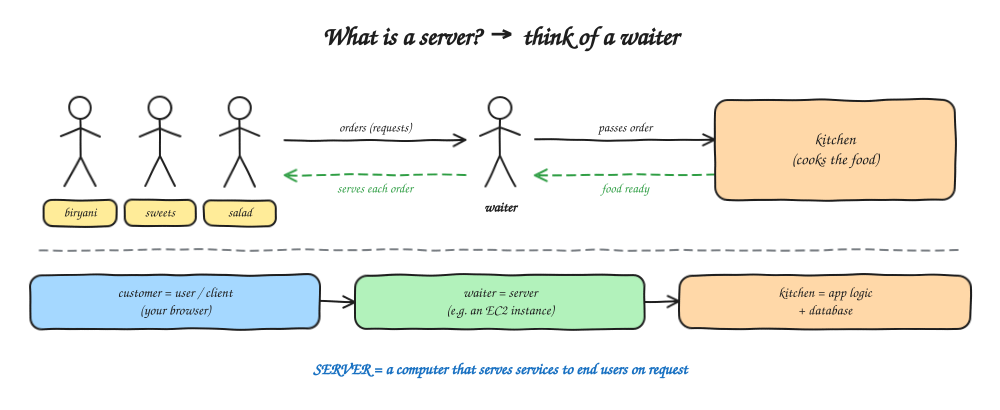

- **SERVER:** serves the services to the end user.
- **WEB SERVER:** shows the application.
- **Server = computer.** It's just a (usually remote, always-on) computer.

### 10.2 Server in the cloud = EC2

To create a server we need a **cloud account**.
In **AWS**, a server is called an **EC2 instance** (**E**lastic **C**ompute **C**loud).

### 10.3 The 7 steps to create an EC2 instance

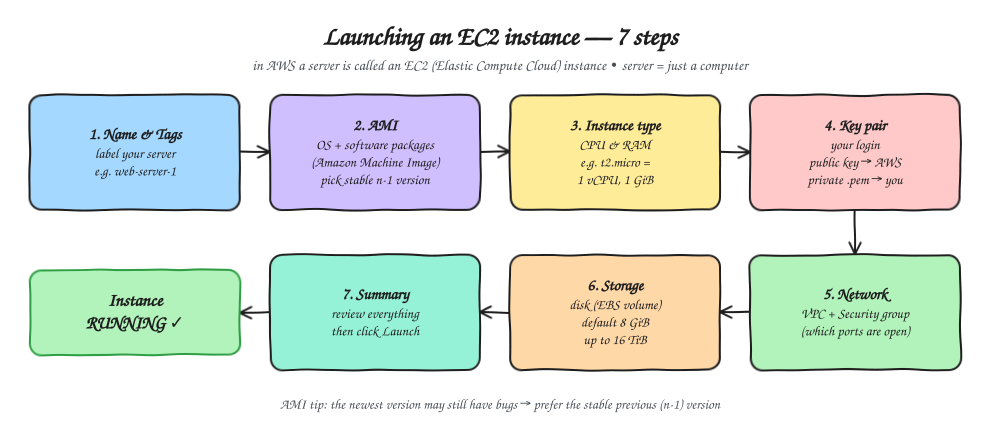

| Step | Setting | Meaning |
|------|---------|---------|
| 1 | **Tags** | **Name** of the server |
| 2 | **AMI** (Amazon Machine Image) | **OS + software packages.** Prefer the **n-1 (previous stable) version**: the latest one may still have bugs |
| 3 | **Instance type** | **CPU & RAM** (e.g. `t2.micro` = 1 vCPU, 1 GiB) |
| 4 | **Key pair** | **Login.** Two keys: the **public key is kept by AWS**, the **private key is kept by you** locally as a **`.pem` file** |
| 5 | **Network** | **VPC** + **Security groups** (port numbers 0–65535) |
| 6 | **Storage** | Disk size **8 GB to 16 TB**; default is **8 GB** |
| 7 | **Summary** | Review everything, then launch |

### 10.4 Network: VPC & Security Groups

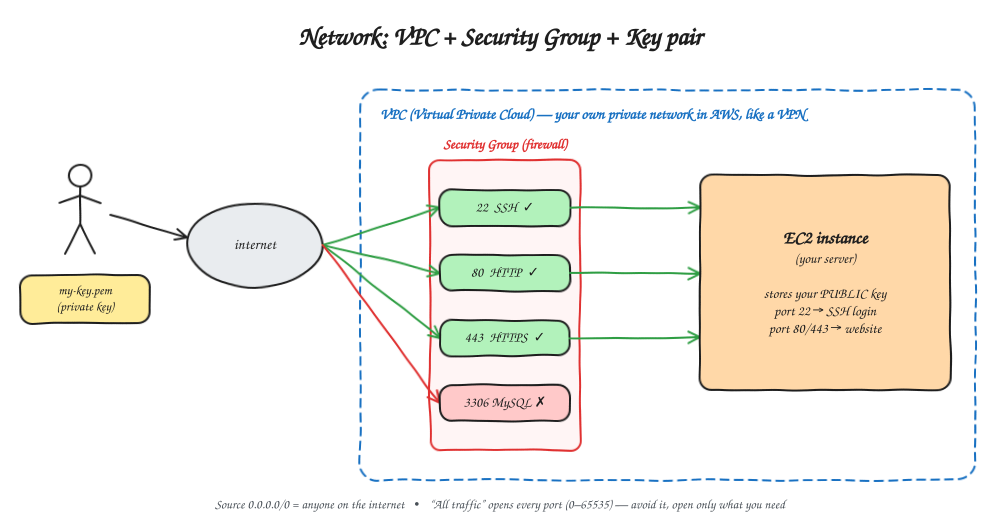

**VPC (Virtual Private Cloud)**
You know a **VPN** (Virtual Private Network): on my private network I decide who is allowed. I can allow anything, disallow anything.
A **VPC** is the same idea in the cloud: **a private cloud network where security is in our hands.**

**Security Groups** act as a **firewall** for the instance. Here we define **which port numbers we expose to the internet** so others can use them.

| Rule | Type | Protocol | Port | Source |
|------|------|----------|------|--------|
| Default rule | **SSH** | TCP | **22** | `0.0.0.0/0` (anywhere) |
| Example extra rule | All traffic | All | All | `0.0.0.0/0` |

- **SSH = Secure Shell (port 22):** used to **communicate with (log in to) servers**. It is the default rule.
- **`0.0.0.0/0`** means **any IP address** in the world. AWS warns: *"Rules with source of 0.0.0.0/0 allow all IP addresses to access your instance."* Restrict to known IPs where possible.
- **All traffic** opens **all ports**. Fine for a quick lab, but in real projects **we only allow the specific ports we need** (e.g. 22 for SSH, 80 for HTTP, 443 for HTTPS).

---

## 11. Summary

- **DevOps** = Dev + Ops working as one team to deliver apps **fast (agility)**.
- **SDLC** = plan → code → build → test → deploy → operate → monitor. **DevOps adds `release`** and makes it an **infinite loop**.
- **Waterfall** = sequential and slow. **Agile** = fast dev+test but one big delivery. **DevOps** = **continuous release in parts**.
- **Architectures:** 1-tier (all local) → 2-tier (DB remote) → 3-tier (all on internet) → N-tier (microservices).
- **Server** = a computer that serves requests. In AWS it's an **EC2 instance**, created in **7 steps**: tags, AMI, instance type, key pair, network (VPC + SG), storage, summary.
- **DevOps engineer's 3 principles:** understand architectures · automate · write pipelines.
