## Windows OS

=> Developed by Microsoft (Bill Gates)

=> It is GUI based OS (Graphical User Interface)

=> It is single user based OS

=> It is commercial OS (paid)

=> Security features are less (Anti-virus is required)

=> Windows OS is recommended for personal use

Ex: Play Games, Watch Movies, Internet Browsing, Store data, Online Classes...


>Note: Windows is not recommended for business use (servers, application deployment..)	

## Linux Operating System


=> Linux is a community based OS

=> Linux is free & Open Source

=> Linux is Multi User OS

=> Linux Provides High Security

=> Linux is highly recommended for project operations

=> Linux is CLI based OS (Command Line Interface)

> Note: In real-time we will use Linux machines to setup our infrastructure such as server like jenkins server ,nexus server ,k8 server etc.

### History


=> Developed by Linus Torvalds

=> Initially Linus Torvalds was using Unix OS and found some challenges in that and informed to that company but they did not accept his suggestions.

=> Linus started doing research and he found Minux OS is similar to his ideas.

=> He has taken Minux OS and made few changes to that and released into market as Linux OS.

		(Lin)us   + Min(ux) = Linux

### Distributions


- Linus Tarvalds given Linux os as free and open source

- Many companies downloaded Linux OS code and modified according to their requirement and released into market with different names. Those are called as Linux Distributions.

    - Ex: Amazon Linux, Red Hat Linux, Ubuntu Linux, Cent OS Linux, SuSe linux....

> Note: We have 200+ linux distributions

till now we have seen how to connect to a linux machine using aws!!

### Linux Machine Setup


1) Login into AWS cloud account

2) Create Linux Virtual Machine using AWS Ec2 service

3) Connect with Linux VM using MobaXterm / Putty using public ip


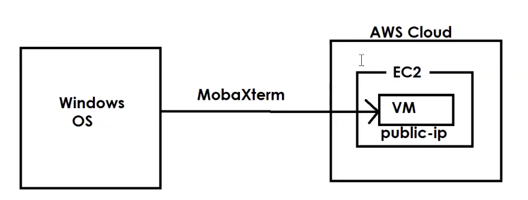


Connection with MobaXterm : https://youtu.be/uI2iDk8iTps?si=ZuZs0lQTxoRpbRMk

Connection with putty : https://youtu.be/GXc_bxmP0AA?si=HgSydrP89mPxv23s

### how to connect
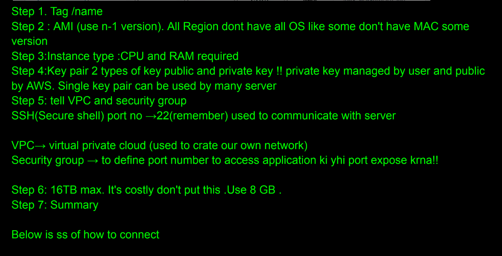

to connect to mobaxterm
#### using public ip
click on session then SSH

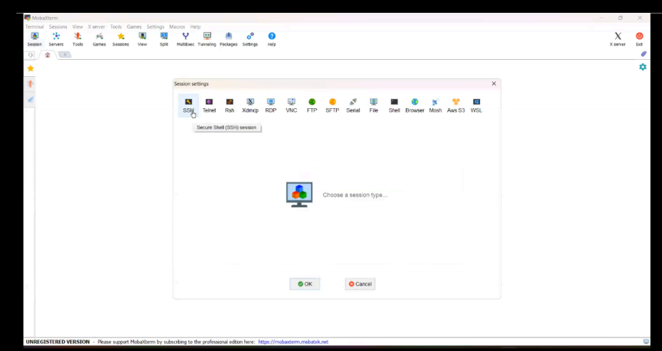

you need to put public ip which you get here in aws

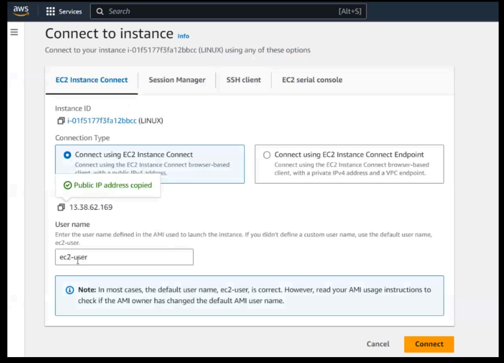

put username and ip (default username is ec2-user)
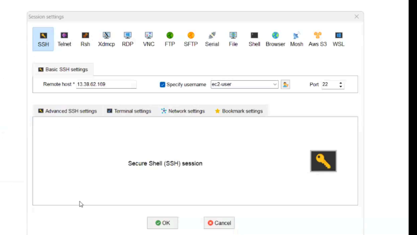

now need to put key pair

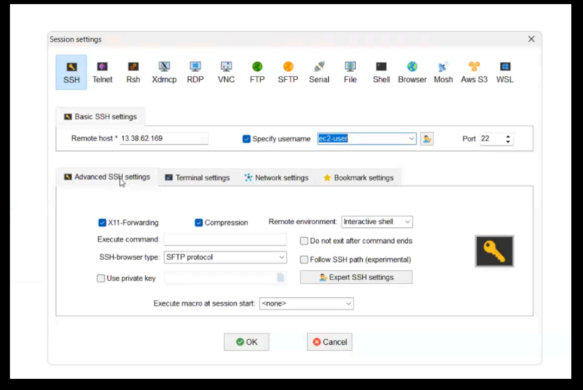

go to advanced ssh settings and tick private key
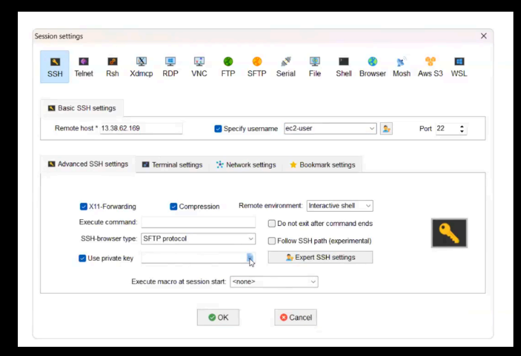

now tell private key(.pem file),now your server be running

#### using ssh command

go to folder having key pair and run ssh command you get on aws

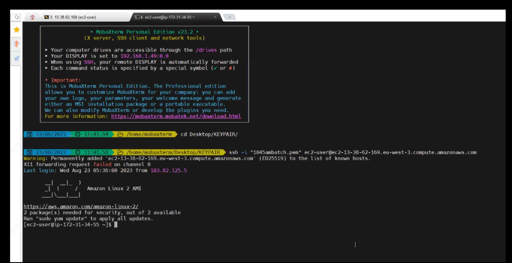

#### using aws online
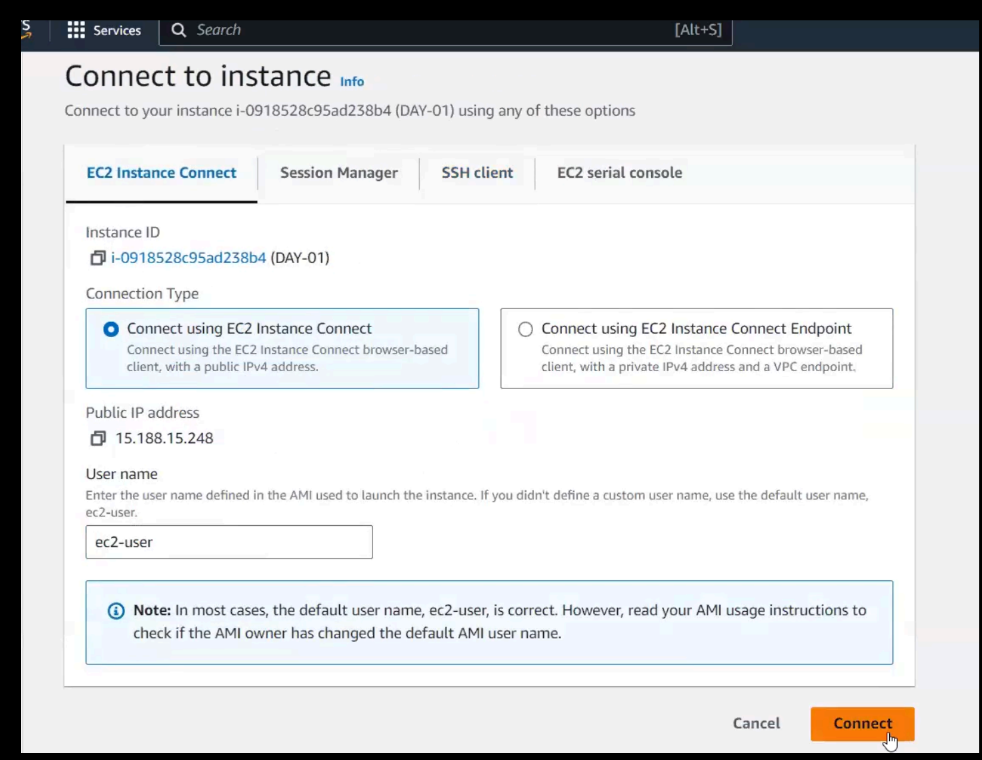

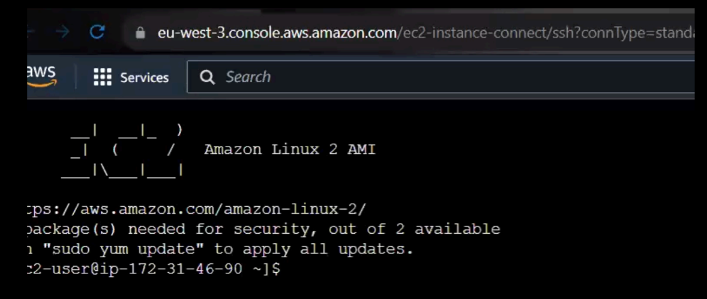

---
### Linux File System


=> Everything is represented as a file

=> 3 types of files

1) Ordinary file / Normal file (starts with -)

2) Directory file (Folder) (starts with d)

3) Link File (starts with l)(shortcut file we have desktop shortcut on windows)

---
### basic commands
- date : tells current date

- cal : shows calendar

- whoami : tells current user

- pwd : present working directory (shows the path where you are) 

default path is /home/ec2-user

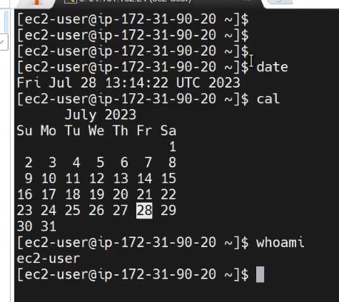

- clear : to clear the screen 
---

### Linux commands

ls : list content

- $ ls    (display files in present working directory)

- $ ls -l (display files in alphabetical order and displays in long format)(long listing)
        
- $ ls -lr (display files in reverse of alphabetical order)

- $ ls -lt (display latest files on top)

- $ ls -ltr (display old files on top)

- $ls -a (displays hidden file)

- $ ls -la (display hidden files in long fromat)

---

mkdir {dir-name} (make directory): To create directory (folder)

---
rmdir {dir-name}: To delete empty directory cant be used if directory has files in it

---
cd : change directory

- cd {dir-name} : To go inside directory

- cd .. : come out from directory

---
touch : To create empty files

- $ touch f1.txt f2.txt f3.txt : create f1.txt f2.txt f3.txt	

---
rm : To delete file & directories

- $ rm {file-name}

- $ rm *.txt : delete all .txt file

- $ rm a*.txt : delete all .txt file starting with a

- $ rm -rf {dir-name} : delete directory and files inside it

---

mv : To rename & to move

- $ mv  {present-name} {new-name} : to rename

- $ mv  {present-location}  {new-location}

----

cat : To create __file with data__ + append data to existing file + view file data

touch create empty file and cat create files with data

- $ cat > f1.txt :now it will ask for data to enter after entering data press ctrl+D to get out. The command cat > file.txt is used to create or overwrite a file named file.txt . >  operator redirects the output to a file. If the file already exists, it will be overwritten; if it doesn't exist, it will be created.

- $ cat >> f1.txt : >> operator redirects the output to a file, appending to it instead of overwriting it. If the file doesn’t exist, it will be created.

- $ cat f1.txt : print content of file

- $ cat -n f1.txt : The command cat -n file.txt is used to display the contents of file.txt with line numbers.

-----


cp : To copy one file data into another file

- $ cp f1.txt f2.txt (if f2.txt not exist it will create)

--- 
 > Note: To copy more than one file data into another file we will use cat command

- $ cat f1.txt f2.txt > f3.txt

---
tac : To print file content from bottom to top (opposite of cat in functionality  as well as name)

- $ tac f1.txt

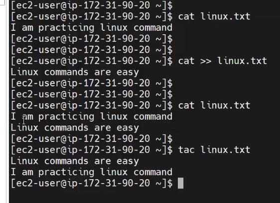

- see in reverse order it is printed
---

rev : To reverse each line of data

- $ rev f1.txt

---

head : To display file data from top (default 10 lines)

-  $ head f1.txt

- $ head -n 5 f1.txt   (print first 5 lines only)

- $ head -n 25 f1.txt (print first 25 lines only)

---

tail : To display file data from bottom (default 10 lines)

- $ tail f1.txt

-  $ tail -n 20 f1.txt  (print last 20 lines of file)

- $ tail -n 100 f1.txt (print last 100 lines of file)

- $ tail -n +2 f1.txt (from 2nd line to last everything is printed)

-  $ tail -f f1.txt (to get live data)

---

grep : grep stands for global regular expression print

- $ grep 'aws' f1.txt   (print lines having aws keyword)

- $ grep -i 'AWS' f1.txt (ignore case sensitive)

- $ grep -n 'aws' f1.txt (print lines having aws with line number)

- $ grep -v 'aws' f1.txt (print lines which doesn't have aws keyword)

- $ grep 'java' * (search for java keyword in all the files of pwd)

---

wc : word count command

-  $ wc f1.txt  (no.of lines, no.of words, no.of chars)

---

diff : To see difference between 2 files

- $ diff f1.txt f2.txt    

---

###  Text Editors in Linux

 These text editors are used to edit the file!!

### Vi

=> vi (visual editor) it is default editor in linux machines

=> Using 'vi' we can create new files and we can modify existing file data

=> vi command is having 3 modes

1) command mode  (just to open the file)  ($ vi <filename>)

2) insert mode (to edit the file ) ---> press 'i' in keyboard

3) esc mode (to come out from insert mode) --> press 'esc' in keyboard

- Save changes & close the file =>  :wq
    
- Without saving changes close the file => :q!


Note: vi command will open the file if it avilable otherwise it will create new file and it will open that file.


### file creation commands in linux


touch : to create empty file

cat  : create file with data

cp : copy one file into another file (cp f1.txt f2.txt)

vi : create and open fle for editing (vi f3.txt)

### Reading file data commands in linux

cat : print file data from top to bottom

tac  : print file data from bottom to top

rev : print each line in reverse order

head : print first 10 lines of file data

tail : print last 10 lines of file data

vi : open the file 

# File Permissions in Linux

In Linux, file permissions determine who can access, modify, or execute files and directories.

### Permission Types

| Permission | Symbol | Meaning for Files | Meaning for Directories | Binary / Octal Value |
| :--- | :---: | :--- | :--- | :---: |
| **Read** | `r` | View file content | List files inside directory (`ls`) | **4** ($2^2$) |
| **Write** | `w` | Modify/save file content | Create, delete, or rename files inside | **2** ($2^1$) |
| **Execute** | `x` | Run file as a program/script | Enter/navigate into directory (`cd`) | **1** ($2^0$) |
| **None** | `-` | No permission granted | No permission granted | **0** |

---

### Permission Target Categories

Every file and directory in Linux has permissions assigned to 3 distinct categories:

1. **User (Owner) (`u`)**: The user who owns the file.
2. **Group (`g`)**: The group of users sharing access to the file.
3. **Others (`o`)**: All other users on the system.
4. **All (`a`)**: Represents User, Group, and Others combined (`ugo`).

---

### Changing Permissions using `chmod` (Symbolic Method)

The `chmod` (change mode) command is used to modify file and directory permissions.

#### Syntax:
```bash
chmod <who><operation><permission> <filename>
```
- **`<who>`**: `u` (user), `g` (group), `o` (others), `a` (all)
- **`<operation>`**: `+` (add permission), `-` (remove permission), `=` (set exact permission)
- **`<permission>`**: `r` (read), `w` (write), `x` (execute)

#### Examples:
- **Giving execute permission for user:**
  ```bash
  chmod u+x f1.txt
  ```

- **Giving write permission for group:**
  ```bash
  chmod g+w f1.txt
  ```

- **Remove execute permission for others:**
  ```bash
  chmod o-x f1.txt
  ```

- **Remove all permissions for others:**
  ```bash
  chmod o-rwx f1.txt
  ```

- **Give all permissions for group:**
  ```bash
  chmod g+rwx f1.txt
  ```

---

## File Permissions in Numeric (Octal) Format

In addition to symbols, Linux allows specifying permissions using a 3-digit octal number, where each digit represents permissions for **User**, **Group**, and **Others** respectively.


### Understanding the 9-Character Permission String

When running `ls -l` (or `ll`), file permissions appear as a 9-character string (e.g., `rw-r--r--`):

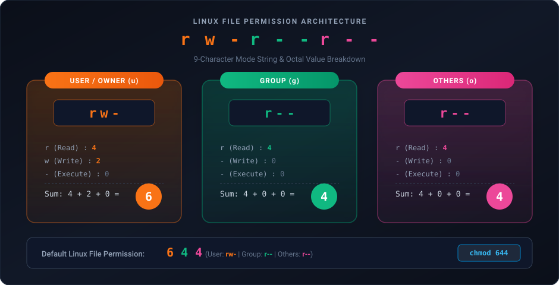

- `r` : Read = **4**
- `w` : Write = **2**
- `x` : Executable = **1**
- `-` : None = **0**

> [!NOTE]
> **Observation:** The permission values are powers of 2 ($2^2 = 4$, $2^1 = 2$, $2^0 = 1$).
>
> In the default file permission `rw-r--r--`:
> - **User** has `rw-` $\rightarrow 4 + 2 = 6$
> - **Group** has `r--` $\rightarrow 4$
> - **Others** has `r--` $\rightarrow 4$
> - **Total Default Permission:** **`644`**

---

### Numeric Values & Binary Representation Table


Since there are 3 independent permission bits (`r`, `w`, `x`), there are $2^3 = 8$ possible combinations ($0$ to $7$):

| Octal Value | Binary (`rwx`) | Permissions | Description | Calculation |
| :---: | :---: | :---: | :--- | :--- |
| **0** | `000` | `---` | No permissions | $0$ |
| **1** | `001` | `--x` | Execute | $1$ |
| **2** | `010` | `-w-` | Write | $2$ |
| **3** | `011` | `-wx` | Write + Execute | $2 + 1 = 3$ |
| **4** | `100` | `r--` | Read | $4$ |
| **5** | `101` | `r-x` | Read + Execute | $4 + 1 = 5$ |
| **6** | `110` | `rw-` | Read + Write | $4 + 2 = 6$ |
| **7** | `111` | `rwx` | Read + Write + Execute | $4 + 2 + 1 = 7$ |

---

### Comparison of Methods to Set Permissions

#### METHOD-1: Numeric / Octal Method
```bash
chmod 567 file1
```
- **User:** `5` $\rightarrow 101$ in binary $\rightarrow$ Read + Execute (`r-x`)
- **Group:** `6` $\rightarrow 110$ in binary $\rightarrow$ Read + Write (`rw-`)
- **Others:** `7` $\rightarrow 111$ in binary $\rightarrow$ All permissions (`rwx`)

#### METHOD-2: Explicit Symbolic Assignment
```bash
chmod u=rwx,g=rw,o=rx file2
```
- Explicitly sets User to `rwx`, Group to `rw-`, and Others to `r-x`.

#### METHOD-3: Shorthand Symbolic Addition


```bash
chmod +r file1
```
- Provides read permission (`r`) to all categories (**User**, **Group**, **Others**).

---

### Numeric Permission Examples & Important Caveats


#### Setting Read-Only for All (`444`):
```bash
[root@ip-172-31-34-181 ~]# chmod 444 file1
[root@ip-172-31-34-181 ~]# ll
total 4
-r--r--r-- 1 root root 667 Aug 24 06:00 file1
[root@ip-172-31-34-181 ~]# 
```

> [!WARNING]
> **Important Caveat on `chmod +w`:**
> `chmod +w` does **not** grant write permission to all users; by default, due to system `umask` security rules, `+w` only applies to the user/owner.
> To grant write permissions to everyone, do not use `chmod +w`. Instead, use:
> - **Method 1 (Numeric):** `chmod 666 file1` or `chmod 222 file1`
> - **Method 2 (Explicit Symbolic):** `chmod a+w file1` or `chmod ugo+w file1`

#### More Common Numeric Examples:
```bash
# ugo+x (Execute to User, Group, and Others)
$ chmod 111 f1.txt

# ugo+w (Write to User, Group, and Others)
$ chmod 222 f1.txt

# u+rwx (7), g+rw (6), o+rx (5)
$ chmod 765 f1.txt

# u+r (4), g+rx (5), o+rw (6)
$ chmod 456 f1.txt

# u+rwx (7), g+rwx (7), o+rwx (7) - Full permissions to everyone
$ chmod 777 f1.txt

# u-rwx, g-rwx, o+rwx (Equivalent to chmod 007 f1.txt)
$ chmod 7 f1.txt
```

---

### Frequently Asked Interview Questions

> [!IMPORTANT]
> **Q-1) What is the default permission for a file in Linux?**  
> **Answer:** **`644`** (`-rw-r--r--`) — Owner has read & write, group and others have read-only.
>
> **Q-2) What is the default permission for a directory in Linux?**  
> **Answer:** **`755`** (`drwxr-xr-x`) — Owner has read, write & execute (traverse), group and others have read & execute.

---

## SED Command

- **SED** stands for **Stream Editor**.
- SED is used to process text data non-interactively (**substitute**, **delete**, **insert**, **print**).
- Using the SED command, we can perform operations on files without opening them in an interactive editor.
- SED is a very powerful text-processing command in Linux.
- While `vi` requires manual editing, SED allows fast and automated stream replacements!

---

### 1. Substitute Operations (`s`)

#### A. Replace First Occurrence of Pattern per Line
```bash
$ sed 's/java/python/' f1.txt
```

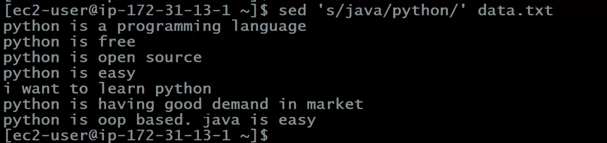

**Terminal Output Walkthrough:**
```bash
[ec2-user@ip-172-31-13-1 ~]$ sed 's/java/python/' data.txt
python is a programming language
python is free
python is open source
python is easy
i want to learn python
python is having good demand in market
python is oop based. java is easy
[ec2-user@ip-172-31-13-1 ~]$
```
> [!NOTE]
> Look closely at the last line: `python is oop based. java is easy`.
> The 2nd occurrence of `java` is **not replaced** because by default SED replaces only the **first** occurrence on each line!

#### B. Replace Specific Occurrence (2nd, 3rd, etc.)
- Replace only the **2nd occurrence** of `'java'` with `'python'` in every line:
  ```bash
  $ sed 's/java/python/2' f1.txt
  ```
  *(Here `s` means substitute, and `/2` targets only the 2nd match on each line)*

- Replace only the **3rd occurrence** of `'java'` with `'python'` in every line:
  ```bash
  $ sed 's/java/python/3' f1.txt
  ```

#### C. Replace All Occurrences Globally on Every Line (`g`)
```bash
$ sed 's/java/python/g' f1.txt
```
*(The `g` flag stands for global replacement across the entire line)*

#### D. Save Changes into Original File (`-i` Option)
> [!IMPORTANT]
> By default, SED does **not** change the original file; it only displays the modified result in terminal standard output.
> To modify and save changes directly into the original file, use the **`-i`** (in-place) option:
```bash
$ sed -i 's/java/python/g' f1.txt
```

---

### 2. Delete Operations (`d`)

- **Delete 4th line in the file (in-place):**
  ```bash
  $ sed -i '4d' f1.txt
  ```

- **Delete last line of the file:**
  ```bash
  $ sed -i '$d' f1.txt
  ```
  *(`$` represents the last line of the file)*

- **Delete from nth line to the last line:**
  ```bash
  $ sed -i 'n,$d' f1.txt
  ```

- **Delete from 2nd line to 10th line:**
  ```bash
  $ sed '2,10d' java.txt
  ```

- **Delete all lines matching a keyword (`python`):**
  ```bash
  $ sed '/python/d' ashokit.txt
  ```
  *(Here `d` stands for delete)*

---

### 3. Print Operations (`p` and `-n`)

- **Print lines matching a pattern:**
  ```bash
  $ sed '/python/p' ashokit.txt
  ```
  *(Similar to `grep`, but by default SED prints every input line. Adding `p` causes matching lines to print twice because SED outputs both the default stream and the matched print line!)*

- **Print ONLY matching lines (Suppress duplicates with `-n`):**
  ```bash
  $ sed -n '/python/p' ashokit.txt
  ```
  *(The `-n` flag suppresses default line printing, so only matched lines are displayed)*

- **Print specific line range (e.g., from 3rd line to 6th line):**
  ```bash
  $ sed -n '3,6p' ashokit.txt
  ```

---

### 4. Insert and Append Operations (`i` and `a`)

#### A. Insert Data Before a Specific Line (`i`)
```bash
$ sed '4i\i am from ashokit' data.txt
```
*(Here `4i` means insert before the 4th line, followed by `\` and the text to insert)*

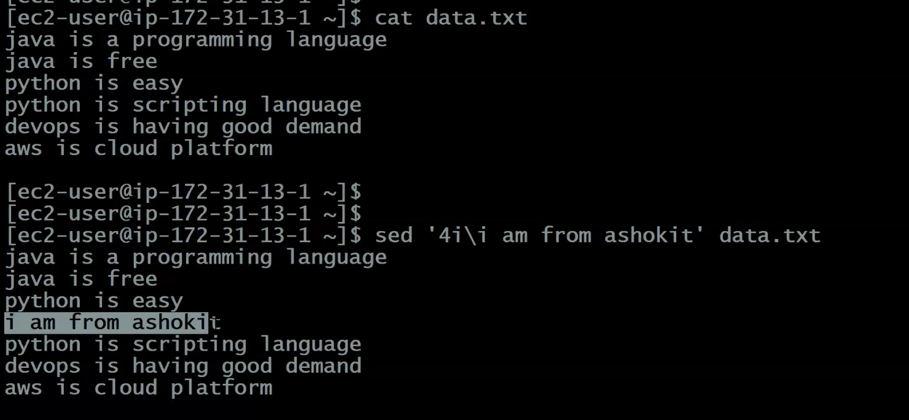

**Terminal Output Walkthrough:**
```bash
[ec2-user@ip-172-31-13-1 ~]$ cat data.txt
java is a programming language
java is free
python is easy
python is scripting language
devops is having good demand
aws is cloud platform

[ec2-user@ip-172-31-13-1 ~]$
[ec2-user@ip-172-31-13-1 ~]$ sed '4i\i am from ashokit' data.txt
java is a programming language
java is free
python is easy
i am from ashokit
python is scripting language
devops is having good demand
aws is cloud platform
```

#### B. Append Data After the Last Line (`a`)
```bash
$ sed '$a\i love linux' data.txt
```
*(Here `$a` means append after the last line, followed by `\` and the text to add)*

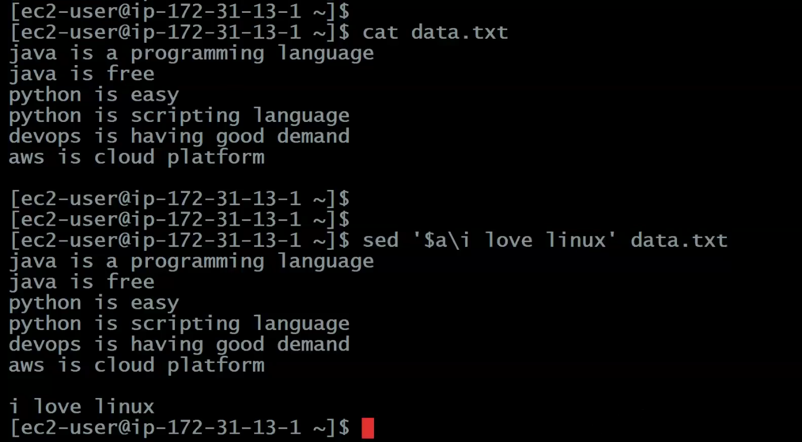

**Terminal Output Walkthrough:**
```bash
[ec2-user@ip-172-31-13-1 ~]$ cat data.txt
java is a programming language
java is free
python is easy
python is scripting language
devops is having good demand
aws is cloud platform

[ec2-user@ip-172-31-13-1 ~]$
[ec2-user@ip-172-31-13-1 ~]$ sed '$a\i love linux' data.txt
java is a programming language
java is free
python is easy
python is scripting language
devops is having good demand
aws is cloud platform

i love linux
[ec2-user@ip-172-31-13-1 ~]$
```

---

## AWK Command

The `awk` command is a powerful pattern scanning and text processing tool in Linux/Unix. It processes input line-by-line and allows extracting, transforming, and formatting text based on patterns and defined actions.

### Basic Syntax
```bash
awk 'pattern {action}' file
```
- If `pattern` is omitted, `action` applies to all lines.
- If `{action}` is omitted, matching lines are printed by default.

---

### Essential AWK Built-in Variables

| Variable | Description |
| :--- | :--- |
| **`$0`** | The entire current line / row |
| **`$1, $2, $3...`** | The 1st, 2nd, 3rd field (column) of the current line |
| **`NR`** | Number of Records (the current line number, 1-indexed) |
| **`NF`** | Number of Fields (column count in the current line) |
| **`-F`** | Field separator/delimiter (default is space/whitespace) |
| **`BEGIN`** | Action block executed once before any input files are read |
| **`END`** | Action block executed once after all input lines are processed |

---

### AWK Command Examples

- **Example File (`ashokit.txt`):**
  ```text
  101 John python 85
  102 Alice java 90
  103 Bob python 78
  104 Eve c++ 92
  105 Charlie javascript 88
  ```

#### 1. Print Lines Containing a Specific Word (Pattern Search)


- **Command:**
  ```bash
  awk '/python/' ashokit.txt
  ```

- **Output:**
  ```text
  101 John python 85
  103 Bob python 78
  ```
  *(Prints all lines in `ashokit.txt` that contain the word `python`)*

---

#### 2. Print Specific Fields (Columns)


- **Command:**
  ```bash
  awk '{print $2, $3}' ashokit.txt
  ```
  *(Prints the 2nd and 3rd columns: Name and Subject. Default field delimiter is space)*

- **Output:**
  ```text
  John python
  Alice java
  Bob python
  Eve c++
  Charlie javascript
  ```

*(To print ID and Name instead, use `awk '{print $1, $2}' ashokit.txt`)*

---

#### 3. Lines Matching a Pattern and Performing an Action (`$0`)


- **Input File (`ashokit.txt`):**
  ```text
  I love python programming.
  JavaScript is popular too.
  python is versatile and powerful.
  C++ is also widely used.
  ```

- **Command:**
  ```bash
  awk '/python/ {print $0}' ashokit.txt
  ```

- **Output:**
  ```text
  I love python programming.
  python is versatile and powerful.
  ```
  *(Matches lines containing `python` and explicitly prints the entire line using `$0`)*

---

#### 4. Using a Custom Delimiter (`-F`)


- **Input File (`/etc/passwd`):**
  ```text
  root:x:0:0:root:/root:/bin/bash
  user1:x:1001:1001:User One:/home/user1:/bin/bash
  user2:x:1002:1002:User Two:/home/user2:/bin/zsh
  ```

- **Command:**
  ```bash
  awk -F ':' '{print $1, $3}' /etc/passwd
  ```
  *(`-F ':'` specifies `:` as the field delimiter)*

- **Output:**
  ```text
  root 0
  user1 1001
  user2 1002
  ```

---

#### 5. Count Total Number of Lines (`NR` with `END`)


- **Input File (`ashokit.txt`):**
  ```text
  I love python programming.
  JavaScript is popular too.
  python is versatile and powerful.
  C++ is also widely used.
  ```

- **Command:**
  ```bash
  awk 'END {print NR}' ashokit.txt
  ```
  *(`NR` is the number of records. `END` executes only after processing all lines)*

- **Output:**
  ```text
  4
  ```

---

#### 6. Sum Numbers in a Specific Column


- **Input File (`ashokit.txt`):**
  ```text
  John 25
  Alice 30
  Bob 45
  Eve 20
  ```

- **Command:**
  ```bash
  awk '{sum += $2} END {print sum}' ashokit.txt
  ```
  *(Iterates through each row, adds column 2 to variable `sum`, and prints total in `END` block)*

- **Output:**
  ```text
  120
  ```

---

#### 7. Print Line Numbers with Content


- **Input File (`ashokit.txt`):**
  ```text
  I love python programming.
  JavaScript is popular too.
  python is versatile and powerful.
  C++ is also widely used.
  ```

- **Command:**
  ```bash
  awk '{print NR ": " $0}' ashokit.txt
  ```
  *(Prefixes each entire line `$0` with its line number `NR`)*

- **Output:**
  ```text
  1: I love python programming.
  2: JavaScript is popular too.
  3: python is versatile and powerful.
  4: C++ is also widely used.
  ```

#### Custom Formatted Output (Numbering Specific Columns):


- **Input File (`ashokit.txt`):**
  ```text
  Alice is a developer.
  Bob is a manager.
  Carol is a designer.
  Dave is a leader.
  ```

- **Command:**
  ```bash
  awk '{print NR ": " $1}' ashokit.txt
  ```

- **Output:**
  ```text
  1: Alice
  2: Bob
  3: Carol
  4: Dave
  ```
  *(Used to format and represent structured data in numbered columns)*

---

#### 8. Filter and Process Based on Conditions (`$3 > 50`)


- **Input File (`ashokit.txt`):**
  ```text
  Alice 25 40
  Bob 30 55
  Carol 35 60
  Dave 28 45
  ```

- **Command:**
  ```bash
  awk '$3 > 50 {print $1, $3}' ashokit.txt
  ```
  *(Filters rows where column 3 is strictly greater than 50 and prints column 1 and column 3)*

- **Output:**
  ```text
  Bob 55
  Carol 60
  ```

---

#### 9. Search Like Grep (`awk '/pattern/ {print}'`)


- **Input File (`ashokit.txt`):**
  ```text
  Alice is a developer.
  Bob is a manager.
  Carol is a designer.
  Dave is a manager and leader.
  Eve works as an analyst.
  ```

- **Command:**
  ```bash
  awk '/manager/ {print}' ashokit.txt
  ```

- **Output:**
  ```text
  Bob is a manager.
  Dave is a manager and leader.
  ```
  *(Extracts and displays all lines where the word `manager` appears)*

---

### Structured Data Processing in AWK

The `awk` command works perfectly on structured data, such as files with rows and columns where fields are separated by spaces, tabs, commas, or any other delimiter. It is especially useful for processing structured data because it can filter, extract, and manipulate fields easily.

#### 1. Space-Separated Data


- **Input File (`file.txt`):**
  ```text
  ID Name Role Salary
  1 Alice Developer 5000
  2 Bob Designer 4500
  3 Carol Manager 6000
  ```

- **Command:**
  ```bash
  awk '$4 > 5000 {print $2, $4}' file.txt
  ```

- **Output:**
  ```text
  Carol 6000
  ```

---

#### 2. Comma-Separated Data (CSV)


- **Input File (`file.csv`):**
  ```csv
  ID,Name,Role,Salary
  1,Alice,Developer,5000
  2,Bob,Designer,4500
  3,Carol,Manager,6000
  ```

- **Command:**
  ```bash
  awk -F ',' '$4 > 5000 {print $2, $4}' file.csv
  ```
  *(Here `-F ','` tells `awk` to use a comma as the field delimiter)*

- **Output:**
  ```text
  Carol 6000
  ```

---

#### 3. Colon-Separated Data (`/etc/passwd`)


- **Input File (`/etc/passwd`):**
  ```text
  root:x:0:0:root:/root:/bin/bash
  user1:x:1000:1000:User One:/home/user1:/bin/bash
  user2:x:1001:1001:User Two:/home/user2:/bin/zsh
  ```

- **Command:**
  ```bash
  awk -F ':' '$7 == "/bin/bash" {print $1, $6}' /etc/passwd
  ```

- **Output:**
  ```text
  root /root
  user1 /home/user1
  ```

---

### General Tips:
- Variables like `$0`, `$1`, `$2` refer to the whole line, first field, second field, etc.
- Patterns and conditions can use regular expressions (`/regex/`) or relational operators (`<`, `>`, `==`, `!=`, `<=`, `>=`).
- You can combine multiple actions, process complex text files, or create scripts using `awk`.

> [!NOTE]
> **SED** and **AWK** commands are known as **filter commands** in Linux!
