# Docker · Lecture 1: Docker, Kubernetes & Jenkins

## 1. The three core DevOps tools

| Tool | Category | One-line job |
|------|----------|--------------|
| **Docker** | Containerization software | Packages an app + all its dependencies into an image and runs it as a container, anywhere |
| **Kubernetes** | Orchestration software | Runs and manages *many* containers across *many* servers (scaling, healing, load balancing) |
| **Jenkins** | CI/CD software | Automatically builds, tests and deploys the app on every code change |

Together, these three **automate the project build and deployment process**.

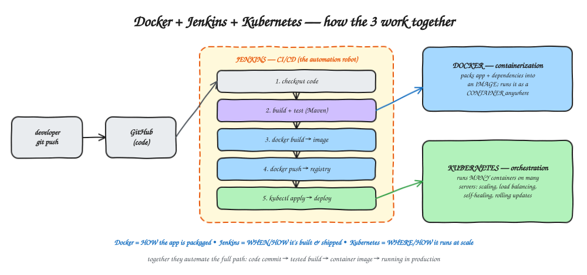

### 1.1 Docker: containerization

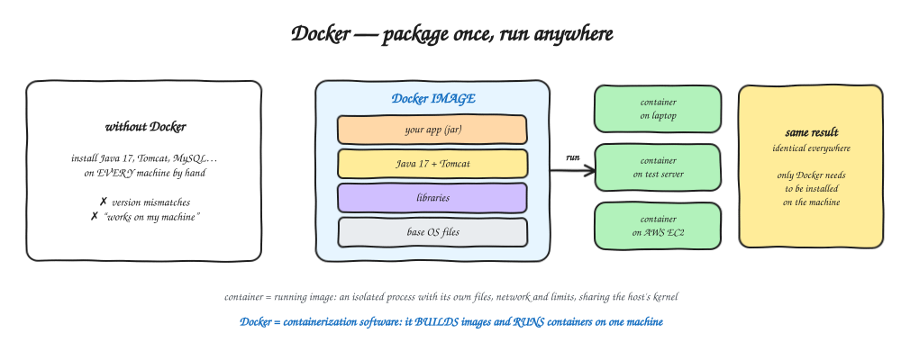

- **Problem:** an app needs specific software to run (Java 17, Tomcat 9, MySQL client…). Installing the right versions by hand on every machine is slow and error-prone, and leads to the classic *"it works on my machine"*.
- **Docker's answer:** put the **app code + its dependencies** into one package, the **image**. Running the image creates a **container**, an isolated environment where the app runs exactly the same on a laptop, a test server or AWS.
- The only thing a machine needs is **Docker itself**.
- **Scope:** Docker works on **one machine** at a time: build images, run / stop / delete containers.

### 1.2 Kubernetes: orchestration

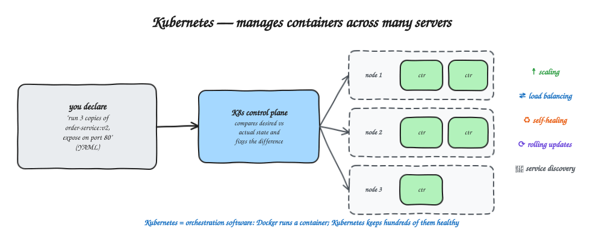

- **Problem:** in production you have dozens of microservices, each with several container copies, spread across many servers. Who restarts a crashed container, adds more copies under load, or spreads traffic between them?
- **Kubernetes' answer:** you **declare the desired state** in YAML ("3 copies of order-service v2 on port 80"), and Kubernetes **continuously makes reality match it**:
  - **Scaling**: more / fewer copies based on load
  - **Load balancing**: spreads requests across copies
  - **Self-healing**: replaces crashed containers and failed nodes
  - **Rolling updates**: new versions with zero downtime, plus rollback
  - **Service discovery**: services find each other by name
- **Docker runs a container; Kubernetes manages hundreds of them.**

### 1.3 Jenkins: CI/CD

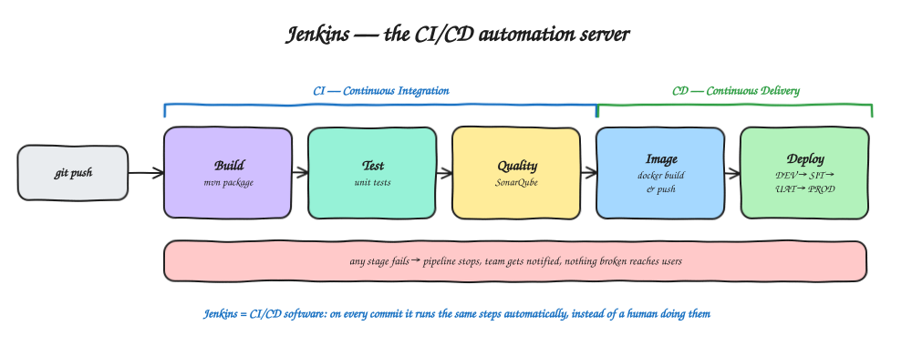

- **Problem:** developers push code many times a day. Building, testing, creating images and deploying by hand every time is slow and mistakes slip through.
- **Jenkins' answer:** an automation server that runs a **pipeline** on every commit:
  1. **CI (Continuous Integration):** pull code → build (Maven) → run tests → code-quality checks (SonarQube)
  2. **CD (Continuous Delivery):** build the Docker image → push it to a registry → deploy to DEV → SIT → UAT → PROD (usually via Kubernetes)
- If any stage fails, the pipeline **stops** and the team is notified, so broken code doesn't reach users.

> **In short:** Docker = *how* the app is packaged. Jenkins = *when and how* it's built and shipped. Kubernetes = *where and how* it runs at scale.

---

## 2. Application environments

In real projects an application passes through several environments before customers see it:

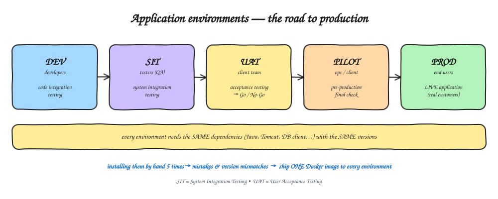

| # | Environment | Used by | Purpose |
|---|-------------|---------|---------|
| 1 | **DEV** | Developers | Code integration testing |
| 2 | **SIT** | Testers (QA) | System Integration Testing |
| 3 | **UAT** | Client-side team | User Acceptance Testing: **Go / No-Go** decision |
| 4 | **PILOT** | Ops / client | Pre-production testing |
| 5 | **PROD** | End users | Live deployment: real customers use the app |

We never deploy code straight to the client; it's tested in these staging environments first.

- As a DevOps engineer you **set up the infrastructure** to run the application in every environment.
- That means installing **all required software (dependencies)** in **every** environment.
- ⚠ Doing that by hand invites mistakes, especially **version compatibility issues** (DEV has Java 17, SIT accidentally gets Java 11…).

---

## 3. The dependency problem → Docker

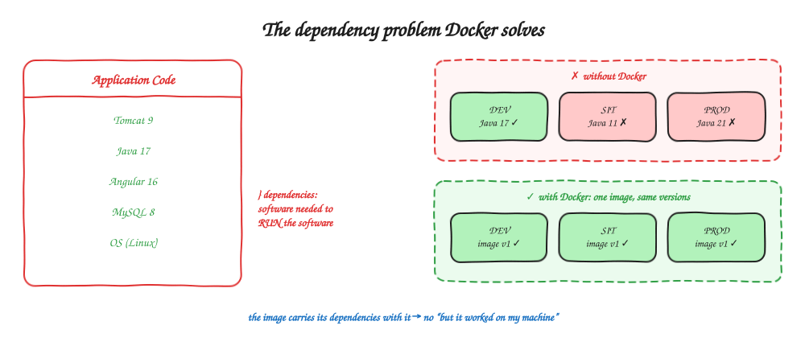

**Dependencies** = the software required to run your software (OS, Java, Tomcat, Angular, MySQL…). Each must be the **right version**, because version compatibility is very important.

**Docker** takes the application **plus its dependencies** as one unit, so the same thing runs on any machine, in every environment.

---

## 4. What is Docker?

- **Free & open-source** software.
- Used for **containerization**.
- Lets us **run our application on any machine**.
- **Container = package (app code + app dependencies)**, running in isolation.
- Docker takes care of the dependencies needed for app execution.
- Makes our application **portable**.

---

## 5. Docker architecture

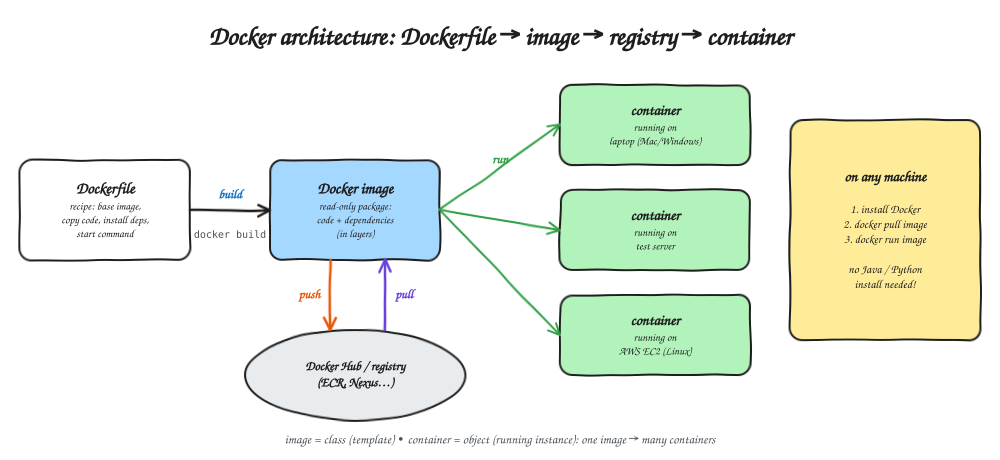

| Part | What it is |
|------|-----------|
| **Dockerfile** | A text file of instructions: which base image, where the app code is, which dependencies to install, how to start the app. Required to build an image. |
| **Docker image** | The built **package**: code + dependencies, read-only, made of layers. |
| **Docker registry** (Docker Hub, AWS ECR, Nexus…) | Stores and shares images (`docker push` / `docker pull`). Docker Hub is like a **Play Store for images**. |
| **Docker container** | A **running instance** of an image. This is where the app actually runs, on any machine with Docker. |

Flow: **Dockerfile → `docker build` → image → `docker push` → registry → `docker pull` → `docker run` → container**.

On a new machine you just install Docker, pull the image and run it. **No need to install Java, Python, etc.** on that machine.

### Container vs virtual machine

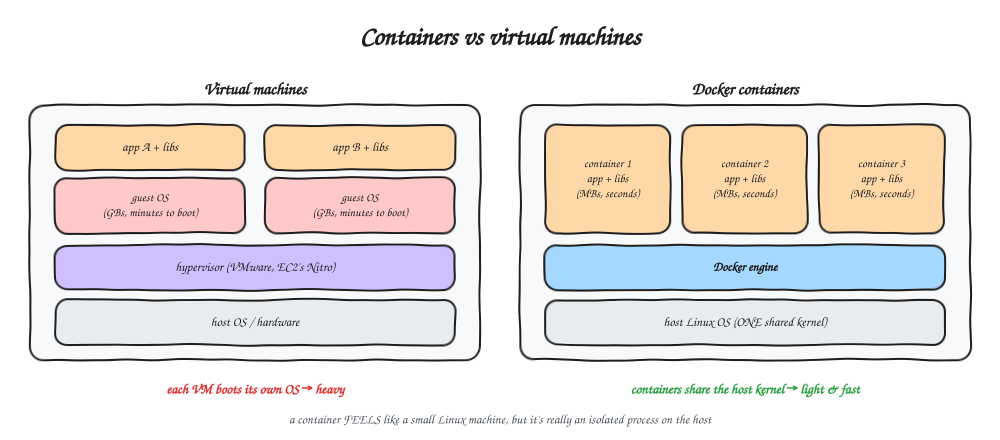

A container *feels* like a small Linux machine (it has its own files, processes and network), but it is **not a full VM**:

| | Virtual machine | Container |
|---|---|---|
| Includes | Full guest OS | Only app + libraries |
| Kernel | Its own | **Shares the host's kernel** |
| Size | GBs | MBs |
| Start time | Minutes | Seconds |
| Per server | A few | Dozens to hundreds |

The machine running Docker is called the **host** (here, the EC2 VM); the containers run on top of the **Docker engine**.

---

## 6. Installing Docker on EC2 (Amazon Linux)

**Step 1:** Create an EC2 VM (Amazon Linux) and connect to it with an SSH client.

**Step 2:** Run:
```bash
# install Docker
sudo yum update -y
sudo yum install docker -y
sudo service docker start          # or: sudo systemctl start docker
sudo systemctl enable docker       # start automatically after reboot

# let ec2-user run docker without sudo
sudo usermod -aG docker ec2-user

# log out and back in so the group change takes effect
exit

# verify
docker -v
```

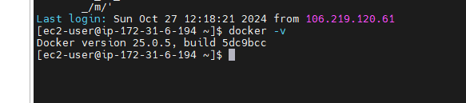

---

## 7. Docker commands

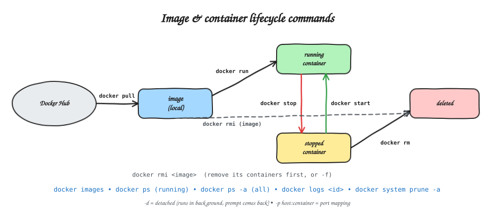

| Command | What it does |
|---------|-------------|
| `docker images` | List images on this machine |
| `docker pull <image>` | Download an image from Docker Hub |
| `docker run <image>` | Create **and** start a container |
| `docker ps` | List **running** containers |
| `docker ps -a` | List running **+ stopped** containers |
| `docker logs <container-id>` | Show a container's logs (`-f` to follow) |
| `docker stop <container-id>` | Stop a running container (graceful) |
| `docker start <container-id>` | Start a stopped container |
| `docker rm <container-id>` | Delete a container (stop it first, or use `-f`) |
| `docker rmi <image>` | Delete an image (delete its containers first, or use `-f`) |
| `docker system prune -a` | Delete stopped containers + unused images + build cache |

> You only need the first few characters of an ID: `docker stop 3fa`.

---

## 8. Running real applications from Docker Hub

Many containers can run on one machine. Each is isolated, with its own files and network:

```bash
# Spring Boot app (Java not installed on the VM!)
docker pull ashokit/spring-boot-rest-api
docker run -d -p 9090:9090 ashokit/spring-boot-rest-api
# URL: http://<public-ip>:9090/welcome/{name}

# Python Flask app (Python not installed on the VM!)
docker pull ashokit/python-flask-app
docker run -d -p 5000:5000 ashokit/python-flask-app
# URL: http://<public-ip>:5000/
```

Pulling the image and listing it:

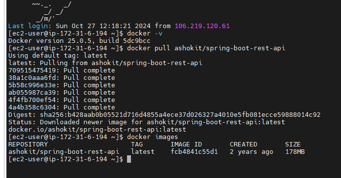

- `-d` = **detached mode**: the container runs in the background and you get your prompt back. Use `docker logs <id>` to see its output.
- `-p host-port:container-port` = **port mapping**.

### Port mapping

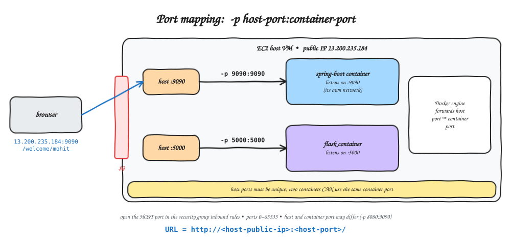

The app listens on a port **inside** the container, which is not reachable from outside by itself. `-p` connects a **port on the host VM** to the **container's port**, so users reach it through the EC2's public IP.

- Format: **`-p host-port:container-port`**. They don't have to be the same (`-p 8080:9090` is fine).
- **Host ports must be unique**, but two containers *can* use the same container port, because each container has its own network.
- A machine has **65,535 port numbers** (0–65535).
- **Open the host port in the EC2 security group** (inbound rules), or the browser can't connect:

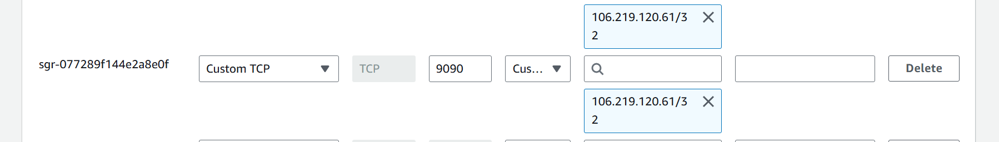

- Access the app at **`http://<host-vm-public-ip>:<host-port>/`**:

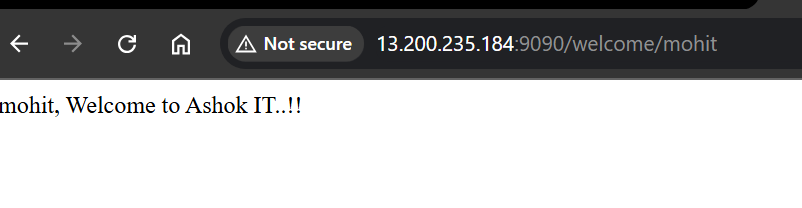

> Java and Python aren't installed on the EC2 VM, yet both apps run, because they're inside their containers' images.

---

## 9. Dockerfile

A **Dockerfile** contains the set of instructions to build a Docker image. The file must be named **`Dockerfile`**.

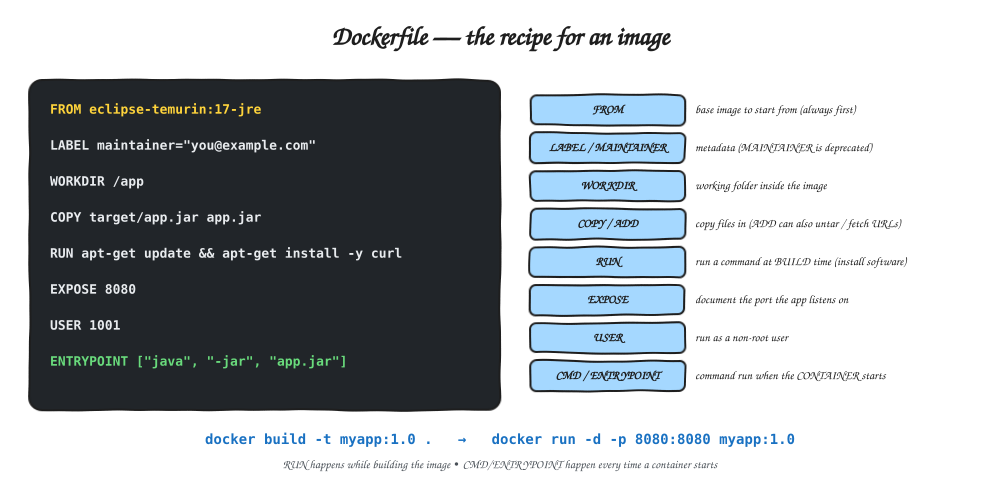

| Keyword | Purpose |
|---------|---------|
| `FROM` | Base image to start from (must be first) |
| `MAINTAINER` | Author info (**deprecated**, use `LABEL maintainer="…"`) |
| `RUN` | Run a command **while building** the image (e.g. install software) |
| `CMD` | Default command run **when the container starts** (can be overridden) |
| `ENTRYPOINT` | Fixed command run when the container starts |
| `COPY` | Copy files from your machine into the image |
| `ADD` | Like COPY, but can also extract `.tar` files and download URLs |
| `WORKDIR` | Set the working directory inside the image |
| `EXPOSE` | Document which port the app listens on |
| `USER` | Run as this (non-root) user |

```bash
docker build -t myapp:1.0 .                 # build an image from the Dockerfile in this folder
docker run -d -p 8080:8080 myapp:1.0        # run it
```

> Create a free account on **Docker Hub** (hub.docker.com) to browse thousands of ready-made images and push your own.

---

## 10. Quick revision

| Term | Meaning |
|------|---------|
| Docker | Containerization: package & run apps anywhere |
| Kubernetes | Orchestration: manage many containers across servers |
| Jenkins | CI/CD: automate build → test → deploy |
| Dependencies | Software needed to run your software, in the right versions |
| Image | Package of code + dependencies (template) |
| Container | Running instance of an image |
| Registry | Image storage (Docker Hub, ECR, Nexus) |
| Dockerfile | Instructions to build an image |
| `-d` | Run detached (background) |
| `-p host:container` | Port mapping; open the host port in the security group |
