# Docker · Lecture 2: Dockerfile & Building Images

## 1. What is a Dockerfile?

A **Dockerfile** is a plain text file containing a **set of instructions to build a Docker image**: which base software to start from, which files to copy in, what to install, and how to start the app.

- Default file name: **`Dockerfile`** (capital **D**, no extension).
- Docker reads it **top to bottom**, one instruction per line.

---

## 2. Building an image: `docker build`

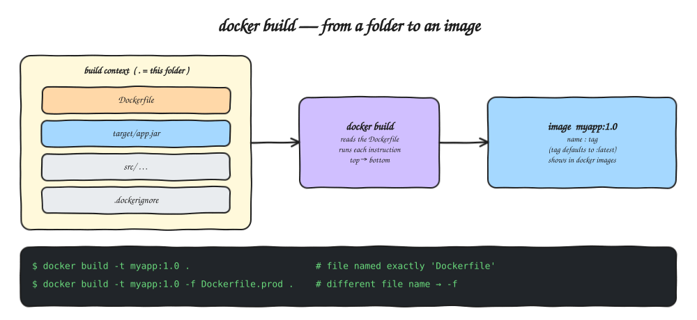

```bash
# Syntax 1: file is named exactly "Dockerfile"
docker build -t <image-name> .

# Syntax 2: file has a different name
docker build -t <image-name> -f <dockerfile-name> .
```

| Part | Meaning |
|------|---------|
| `-t` | **Tag**: the image name, optionally with a version: `myapp:1.0` (no version means `:latest`) |
| `.` | **Build context**: the current folder. Docker sends this folder to the build, so `COPY` can only use files inside it |
| `-f` | **File**: use a Dockerfile with another name, e.g. `Dockerfile.prod` |

> Add a **`.dockerignore`** file (like `.gitignore`) to keep `target/`, `.git`, `node_modules` etc. out of the build context → faster builds, smaller images.

```bash
docker images                     # see the new image
docker history myapp:1.0          # see its layers
```

---

## 3. Build time vs run time

The most important idea in a Dockerfile: **some instructions run once while building the image; others run every time a container starts.**

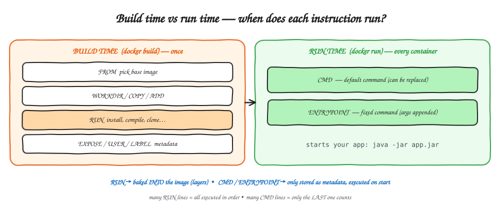

| When | Instructions |
|------|-------------|
| **Build time** (`docker build`) | `FROM`, `WORKDIR`, `COPY`, `ADD`, `RUN`, plus metadata `EXPOSE`, `USER`, `LABEL` |
| **Run time** (`docker run`) | `CMD`, `ENTRYPOINT` |

### Layers and caching

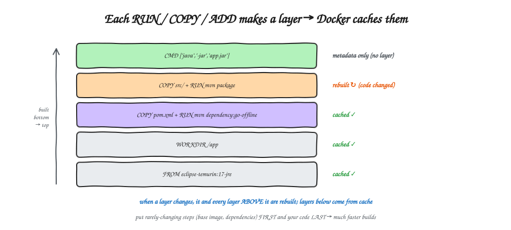

- Each `RUN`, `COPY` and `ADD` creates a new **layer** in the image.
- On the next build, Docker **reuses unchanged layers from cache**. When a layer changes, it and everything **after** it is rebuilt.
- So put things that **rarely change first** (base image, dependency installs) and your **code last**.

---

## 4. Dockerfile keywords

| # | Keyword | Purpose |
|---|---------|---------|
| 1 | `FROM` | Base image |
| 2 | `MAINTAINER` / `LABEL` | Author / metadata |
| 3 | `RUN` | Command at **build** time |
| 4 | `CMD` | Default command at **container start** |
| 5 | `COPY` | Copy files into the image |
| 6 | `ADD` | Copy + extract tar + download URL |
| 7 | `WORKDIR` | Set the working directory |
| 8 | `EXPOSE` | Document the app's port |
| 9 | `ENTRYPOINT` | Fixed command at container start |
| 10 | `USER` | User that runs the commands |

### 4.1 FROM

Specifies the **base image**: the software your app needs to run. It **must be the first instruction**.

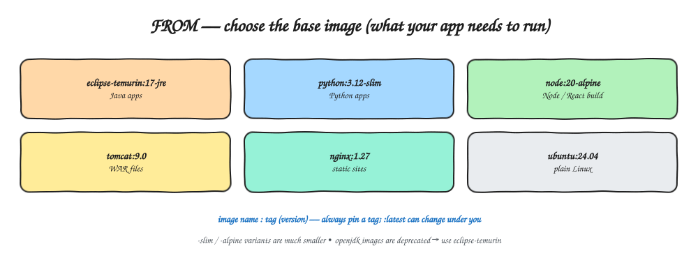

```dockerfile
FROM eclipse-temurin:17-jre   # Java 17 runtime  (openjdk:17 also works but is deprecated)
FROM python:3.12-slim         # Python
FROM node:20-alpine           # Node.js
FROM mysql:8.0                # MySQL database
FROM tomcat:9.0               # Tomcat server for .war files
```
Format is **`name:tag`**. Always pin a tag (version); `:latest` can change without warning.

### 4.2 MAINTAINER → LABEL

Says **who is the author** of the Dockerfile.
```dockerfile
MAINTAINER Ashok <ashok.b@oracle.com>          # old, deprecated
LABEL maintainer="ashok.b@oracle.com"         # modern way
```

### 4.3 RUN: executes at **image build** time

Used to run commands **while the image is being created**: install software, clone code, compile.
```dockerfile
RUN apt-get update && apt-get install -y git
RUN git clone https://github.com/user/repo.git
RUN mvn clean package
```
- You can have **many RUN instructions**; all of them run **in order**.
- Their results are **saved into the image** as layers.
- Tip: join related commands with `&&` to make fewer layers.

### 4.4 CMD: executes at **container start** time

Specifies the **default command to run when a container is created/started**.
```dockerfile
CMD ["java", "-jar", "app.jar"]
CMD ["python", "app.py"]
```
- You can write **multiple CMD** lines, but **only the last one is used**, so there's no point having more than one.
- It's a **default**: anything you type after the image name in `docker run` **replaces** it.

### 4.5 COPY

Copies files from **your machine (the build context)** into the **image** at build time. Mostly used to copy your built app / source code.
```dockerfile
COPY <path-on-your-machine> <path-in-image>

COPY target/app.jar  /usr/app/app.jar
COPY target/app.war  /usr/local/tomcat/webapps/app.war
COPY app.py          /usr/app/app.py
```

### 4.6 ADD

Also copies files from source to destination, **like COPY**, with two extras:

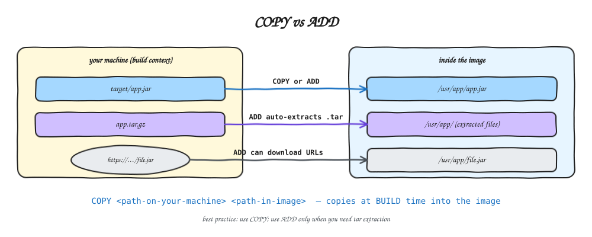

| | COPY | ADD |
|---|---|---|
| Copy local files | ✓ | ✓ |
| Download from a URL | ✗ | ✓ |
| Auto-extract `.tar` archives | ✗ | ✓ |

```dockerfile
ADD target/app.jar         /usr/app/app.jar
ADD https://example.com/app.jar  /usr/app/app.jar
```
> Best practice: use **COPY** by default; use ADD only when you need tar extraction. For URLs, `RUN curl …` is clearer.

### 4.7 WORKDIR

Sets the **working directory** for all following instructions, just like `cd` in Linux.

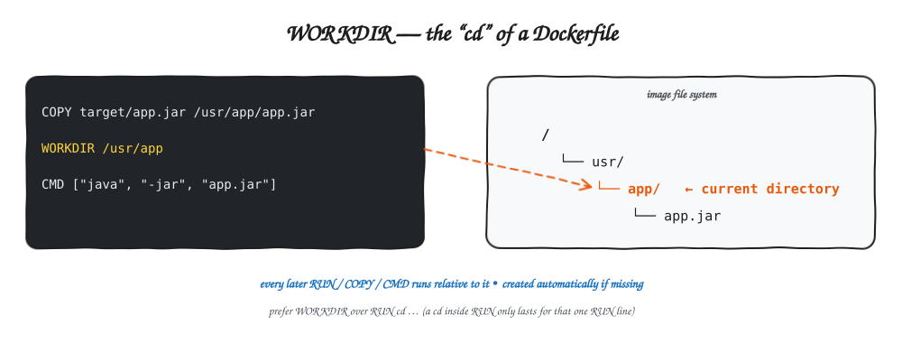

```dockerfile
COPY target/app.jar /usr/app/app.jar
WORKDIR /usr/app                    # now "inside" /usr/app
CMD ["java", "-jar", "app.jar"]     # runs in /usr/app
```
- The directory is created if it doesn't exist.
- Prefer `WORKDIR` to `RUN cd …`, because a `cd` inside a RUN only lasts for that one line.

### 4.8 ENTRYPOINT

Also runs **when the container starts** (like CMD), but it's the **fixed** command.
```dockerfile
ENTRYPOINT ["java", "-jar", "app.jar"]
ENTRYPOINT ["python", "app.py"]
```

### CMD vs ENTRYPOINT

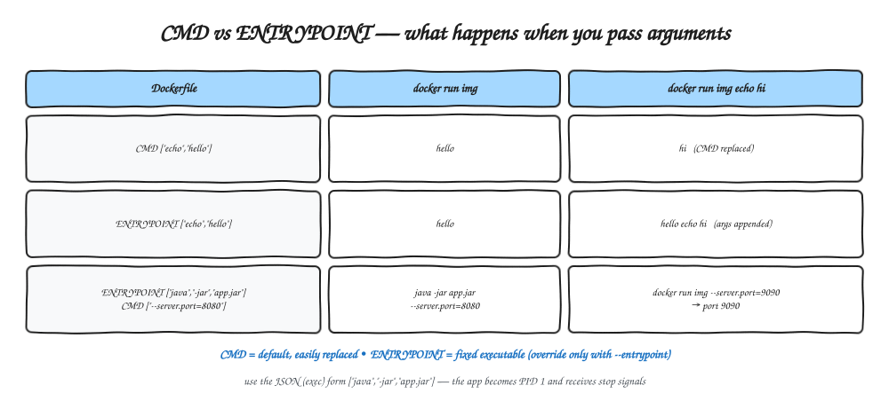

| | CMD | ENTRYPOINT |
|---|---|---|
| Runs at | Container start | Container start |
| Extra `docker run` args | **Replace** it | Are **appended** as arguments |
| Override | `docker run img <new command>` | Only with `docker run --entrypoint <cmd> img` |
| Typical use | Default command / default arguments | The main executable of the image |

```bash
# CMD ["echo","hello"]
docker run img            # → hello
docker run img echo hi    # → hi          (CMD replaced)

# ENTRYPOINT ["echo","hello"]
docker run img echo hi    # → hello echo hi   (arguments appended)
```
**Combined pattern:** `ENTRYPOINT` = what to run, `CMD` = default arguments:
```dockerfile
ENTRYPOINT ["java", "-jar", "app.jar"]
CMD ["--server.port=8080"]
# docker run img --server.port=9090   → overrides only the argument
```

> **Exec form vs shell form:** write `["java", "-jar", "app.jar"]` (JSON array, *exec form*), not `java -jar app.jar` (*shell form*). In exec form your app is the main process (PID 1) and receives the stop signal from `docker stop`, so it can shut down gracefully.

### 4.9 USER

Sets **which user** runs the following `RUN`, `CMD` and `ENTRYPOINT` commands.
```dockerfile
RUN useradd -m appuser
USER appuser
```
By default containers run as **root**. Running as a normal user is a security best practice (rarely used in simple demos).

### 4.10 EXPOSE

Documents **which port the application listens on** inside the container.

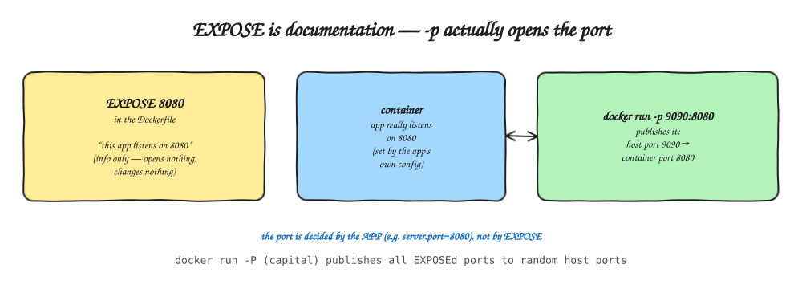

```dockerfile
EXPOSE 8080
```
- **Optional but recommended**: it tells anyone reading the Dockerfile which port to map.
- It **does not open or change any port**. The app's own config decides the port (e.g. `server.port=8080`), and **`docker run -p host:container`** actually publishes it.

---

## 5. Example Dockerfile: what prints when?

```dockerfile
FROM ubuntu
LABEL maintainer="Ashok <ashok.b@oracle.com>"

RUN echo 'hello from run instruction-1'
RUN echo 'hello from run instruction-2'

CMD echo 'hi from cmd-1'
CMD echo 'hi from cmd-2'
```

```bash
docker build -t img-1 .     # build the image (RUN lines execute here)
docker run img-1            # run a container (CMD executes here)
```

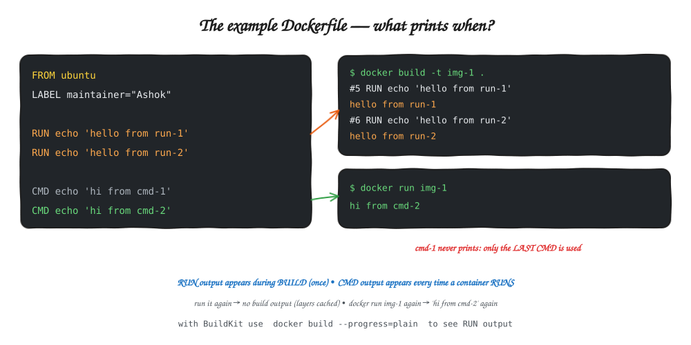

- During **build**, both RUN lines execute and print their messages.
- During **run**, only `hi from cmd-2` prints, because only the **last CMD** counts.
- Build again without changes and the RUN output doesn't appear (layers come from **cache**).

> Newer Docker (BuildKit) hides RUN output by default; add `--progress=plain` to see it.

---

## 6. A real-world Dockerfile (Spring Boot)

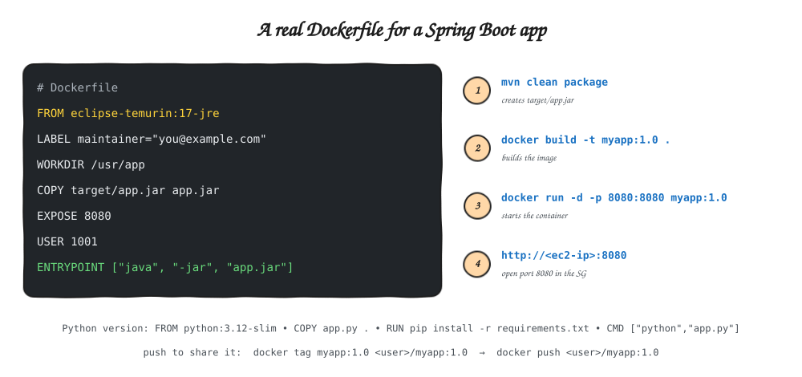

```dockerfile
FROM eclipse-temurin:17-jre
LABEL maintainer="you@example.com"
WORKDIR /usr/app
COPY target/app.jar app.jar
EXPOSE 8080
ENTRYPOINT ["java", "-jar", "app.jar"]
```
```bash
mvn clean package                              # 1. build the jar
docker build -t myapp:1.0 .                    # 2. build the image
docker run -d -p 8080:8080 myapp:1.0           # 3. run it
# 4. open http://<ec2-public-ip>:8080 (allow port 8080 in the security group)
```

Python equivalent:
```dockerfile
FROM python:3.12-slim
WORKDIR /usr/app
COPY requirements.txt .
RUN pip install -r requirements.txt
COPY app.py .
EXPOSE 5000
CMD ["python", "app.py"]
```

Share your image on Docker Hub:
```bash
docker login
docker tag myapp:1.0 <dockerhub-user>/myapp:1.0
docker push <dockerhub-user>/myapp:1.0
```

---

## 7. Dockerfile vs Docker Compose file

A real application is rarely one container: a Spring Boot app usually needs a **database**, maybe a cache. A **Dockerfile** builds *one* image; a **Docker Compose file** (`docker-compose.yml` or `compose.yaml`) describes how to **run several containers together** as one application.

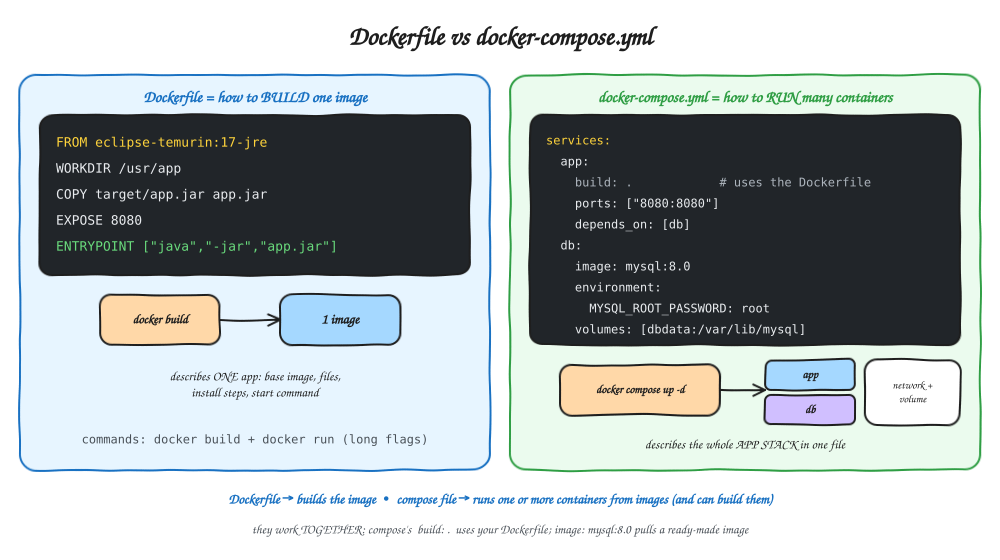

| | Dockerfile | docker-compose.yml |
|---|---|---|
| **Purpose** | How to **build ONE image** | How to **run MANY containers** together |
| **Describes** | Base image, files to copy, install steps, start command | Services (containers), ports, environment variables, volumes, networks, start order |
| **Format** | Docker instructions (`FROM`, `COPY`, `RUN`…) | YAML |
| **Command** | `docker build -t app .` | `docker compose up -d` |
| **Output** | An **image** | Running **containers** + a network (+ volumes) |
| **Scope** | One app / service | Whole application stack (app + DB + cache…) |
| **Needs the other?** | No | Can use Dockerfiles (`build: .`) or ready images (`image: mysql:8.0`) |

> **They work together:** the Dockerfile says *how to make the app image*; the compose file says *which containers to run from which images, and how they connect*.

### Example: Spring Boot app + MySQL

**Dockerfile** (builds the app image):
```dockerfile
FROM eclipse-temurin:17-jre
WORKDIR /usr/app
COPY target/app.jar app.jar
EXPOSE 8080
ENTRYPOINT ["java", "-jar", "app.jar"]
```

**docker-compose.yml** (runs the app *and* the database):
```yaml
services:
  app:
    build: .                      # build the image from the Dockerfile in this folder
    ports:
      - "8080:8080"               # host:container
    environment:
      SPRING_DATASOURCE_URL: jdbc:mysql://db:3306/shop   # "db" = the service name below
      SPRING_DATASOURCE_PASSWORD: root
    depends_on:
      - db                        # start db before app

  db:
    image: mysql:8.0              # ready-made image from Docker Hub, no Dockerfile needed
    environment:
      MYSQL_ROOT_PASSWORD: root
      MYSQL_DATABASE: shop
    volumes:
      - dbdata:/var/lib/mysql     # keep DB data when the container is removed

volumes:
  dbdata:
```

### Why use Compose?

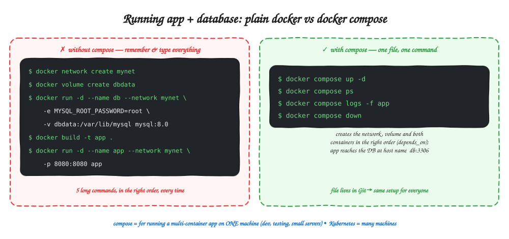

- **One command instead of many:** without Compose you'd create a network, a volume, then run each container with long `-e`, `-v`, `-p`, `--network` flags, in the right order.
- **Automatic networking:** all services join one network and reach each other **by service name** (`db:3306`), with no IP addresses.
- **Start order:** `depends_on` starts the database before the app (it only waits for the container to *start*; add a `healthcheck` to wait until it's *ready*).
- **Reproducible:** the file lives in Git, so every developer and test server gets the identical setup.

### Compose commands

| Command | What it does |
|---------|-------------|
| `docker compose up -d` | Build (if needed) and start all services in the background |
| `docker compose up -d --build` | Force a rebuild of images, then start |
| `docker compose ps` | List this project's containers |
| `docker compose logs -f app` | Follow the logs of one service |
| `docker compose stop` / `start` | Stop / start without removing |
| `docker compose down` | Stop and remove containers + network (add `-v` to also delete volumes) |

> Older installs use the standalone binary **`docker-compose`** (with a hyphen); newer Docker has it built in as **`docker compose`**. The file format is the same.

**When to use what:** Dockerfile → always, to package each app. Compose → to run a multi-container app on **one machine** (local dev, testing, small servers). **Kubernetes** → to run containers across **many machines** in production.

---

## 8. Quick revision

| Keyword | When | Remember |
|---------|------|----------|
| `FROM` | build | First line; base image `name:tag` |
| `LABEL` (`MAINTAINER`) | build | Metadata / author |
| `RUN` | build | Many allowed, all run in order, saved as layers |
| `COPY` | build | Your machine → image |
| `ADD` | build | COPY + URL download + tar extract |
| `WORKDIR` | build | `cd` for following instructions |
| `EXPOSE` | metadata | Documents the port, opens nothing |
| `USER` | build/run | Run as non-root |
| `CMD` | run | Default command; last one wins; replaced by run args |
| `ENTRYPOINT` | run | Fixed command; args are appended |
| `docker build -t name .` | | `-f` for another file name |
| Dockerfile vs compose | | Dockerfile builds ONE image • compose runs MANY containers (`docker compose up -d`) |
