# Docker · Lecture 3: Build, Push & Dockerize Java, Spring Boot and Python Apps

We've already seen the main Docker commands. Open the **Docker VM** (EC2 instance) and let's build images.

---

## 1. First Dockerfile: RUN vs CMD

We name the file **`Dockerfile`** (capital D only; `DockerFile` works only if you pass `-f DockerFile`).

```bash
vi Dockerfile
```

```dockerfile
FROM ubuntu

# old style: MAINTAINER mohit <email>
LABEL maintainer="mohit"

RUN echo 'hello from run instruction-1'
RUN echo 'hello from run instruction-2'

CMD echo 'hi from cmd-1'
CMD echo 'hi from cmd-2'
```

There's no logic here, just the basic keywords; `echo` prints a message.
- **All `RUN` instructions execute, top to bottom**, while the image is **built**.
- **Only the last `CMD` executes**, when a **container starts**.

### Build the image
```bash
docker build -t img-1 .
```
- `img-1` is the image name (anything you like); `-t` = **tag** (name[:version]).
- `.` = the **build context**: the current folder, where the Dockerfile is.

While the image is being created you see the **RUN instructions executing**:

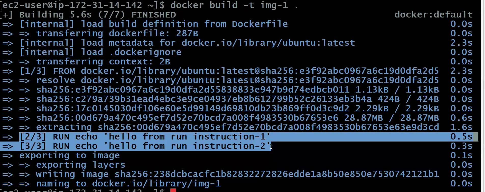

The highlighted lines are steps `[2/3]` and `[3/3]`, the two `RUN echo` instructions. Step `[1/3]` pulled the `ubuntu` base image.

### Run a container
```bash
docker images                       # img-1 appears in the list
docker run <image-name or image-id>
```

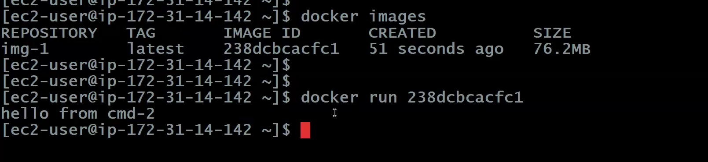

`docker images` lists `img-1` (ID `238dcbcacfc1`). We ran it **by image ID** and only the **last CMD** printed. (The message text in the screenshot is from a slightly different version of the file; the behaviour is the same.)

> For the full RUN / CMD / ENTRYPOINT explanation, see Lecture 2 (`004.docker-2`).

---

## 2. Pushing a Docker image to Docker Hub

You need a **Docker Hub account** (hub.docker.com) to store images there.

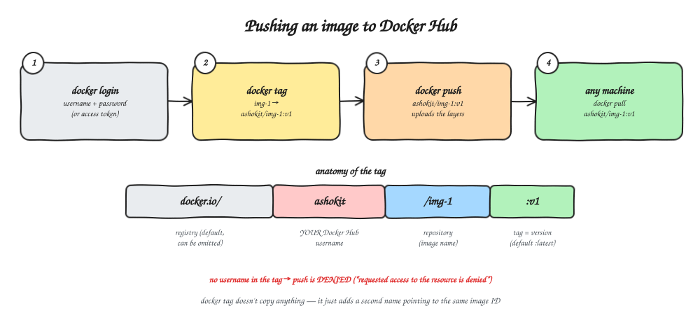

**1. Log in**
```bash
docker login
```
It asks for your username and password (or an access token), then shows **Login Succeeded**.

**2. Tag the image** with your Docker Hub username
```bash
docker tag <image-name> <tag-name>

docker tag img-1 ashokit/img-1:latest    # Ex 1
docker tag img-1 ashokit/img-1:v1        # Ex 2
```
`v1` and `latest` are **versions** (tags).

> ⚠ The tag name **must start with your username** (`ashokit/...`). Without it, Docker Hub **denies the push**.

Now `docker images` shows the same image under the new name too (same IMAGE ID).

**3. Push**
```bash
docker push <tag-name>
docker push ashokit/img-1:v1
```

**4. Use it anywhere:** `docker pull ashokit/img-1:v1` on any machine.

---

## 3. Dockerizing a Java web app (.war)

- A Java web app is packaged as a **`.war`** file, created inside the **`target/`** directory.
- To deploy a war file we need a **web server**, e.g. **Tomcat**.
- The war file must be placed inside Tomcat's **`webapps`** directory to run the application.

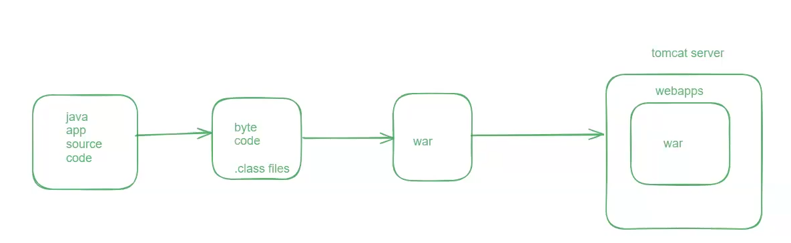

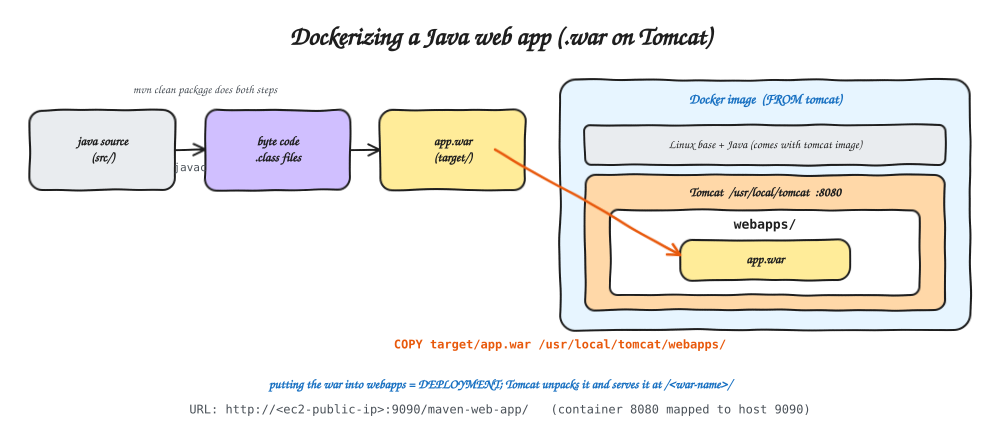

### Dockerfile
```dockerfile
FROM tomcat:latest

LABEL maintainer="Ashok"

EXPOSE 8080

COPY target/app.war /usr/local/tomcat/webapps/
```

| Line | Meaning |
|------|---------|
| `FROM tomcat:latest` | The dependency. The Tomcat image already contains a **Java** version that can run that Tomcat |
| `LABEL` / `MAINTAINER` | Author (optional) |
| `EXPOSE 8080` | Documents that Tomcat uses port 8080 (optional) |
| `COPY target/app.war /usr/local/tomcat/webapps/` | Copies the war **from the host machine into the image**, into Tomcat's `webapps`. Copying the war into webapps **is the deployment** |

> Search Docker Hub for the `tomcat` image to see the available tags (e.g. `tomcat:9.0`, `tomcat:10-jdk17`). Pin a version rather than `latest`.
>
> No need to specify `ubuntu`: the Tomcat image is already built on a Linux base.

### Hands-on

Java web app Git repo: https://github.com/ashokitschool/maven-web-app.git

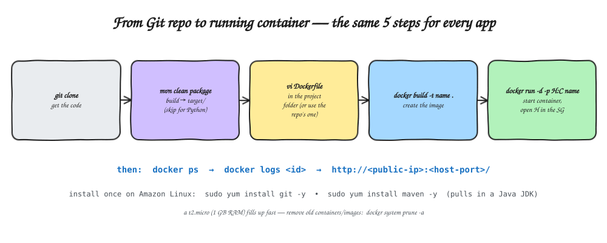

```bash
sudo yum install git -y
sudo yum install maven -y          # installing maven also installs a Java JDK

git clone https://github.com/ashokitschool/maven-web-app.git
cd maven-web-app

mvn clean package                  # generates target/
ls -l target                       # the .war file is here

vi Dockerfile                      # write the Dockerfile above in the project directory

docker build -t  .       # build the image
docker images

docker run -d -p <host-port>:<container-port> 
docker run -d -p 9090:8080 
```

- Tomcat runs on port **8080 in the container**, mapped to port **9090 on the EC2 machine** (different numbers just to show they can differ).
- **Enable port 9090** in the EC2 security group inbound rules, then open:

```
URL: http://<public-ip>:<host-port>/<war-file-name>/
```

> This approach is for normal Java web apps, **not Spring Boot**.

To see logs:
```bash
docker logs <container-id>         # add -f to follow
```

---

## 4. Dockerizing a Spring Boot application (.jar)

- **Every Spring Boot app is packaged as a `.jar`**, whether standalone or web. There's no war file in Spring Boot.
- To run a Spring Boot app, execute the jar:
  ```bash
  java -jar <jar-file-name>
  ```

> When the jar runs, Spring Boot starts an **embedded Tomcat server on port 8080**, so there's **no need to install Tomcat**.

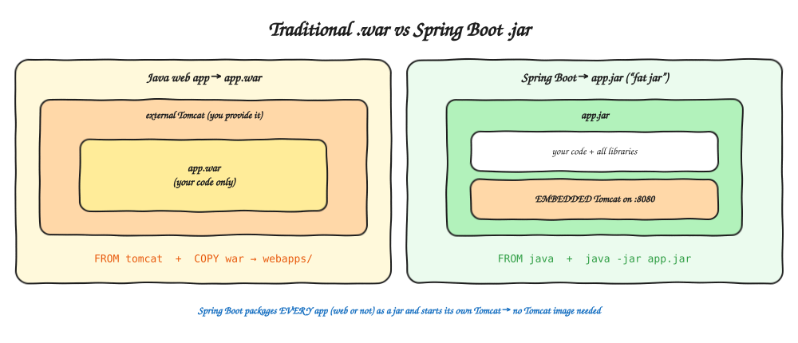

### Dockerfile for Spring Boot
```dockerfile
# original: FROM openjdk:17 (that image is deprecated)
FROM eclipse-temurin:17-jre

LABEL maintainer="Ashok"

COPY target/app.jar /usr/app/

WORKDIR /usr/app/

EXPOSE 8080

ENTRYPOINT ["java", "-jar", "app.jar"]
```

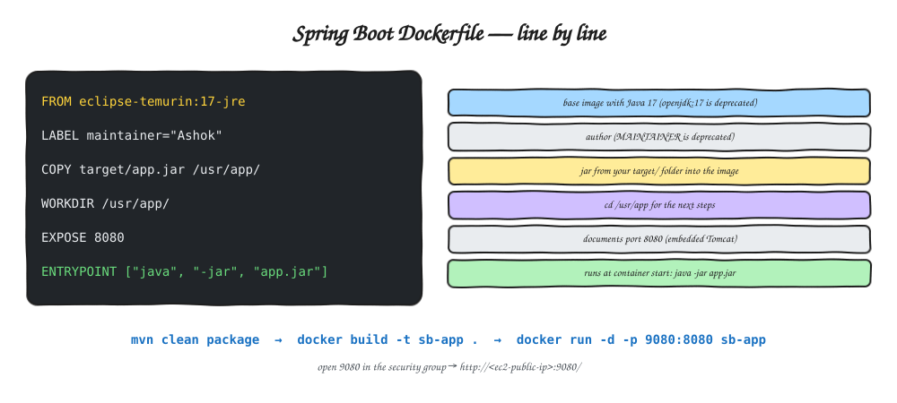

- The jar is copied to `/usr/app`. To run it we first go into `/usr/app` with **`WORKDIR`**.
- Then we execute the jar with **`CMD` or `ENTRYPOINT`** (both run a command when the container starts; ENTRYPOINT can't be accidentally replaced by `docker run` arguments).

### Hands-on

Spring Boot app Git repo: https://github.com/ashokitschool/spring-boot-docker-app.git

```bash
git clone https://github.com/ashokitschool/spring-boot-docker-app.git
cd spring-boot-docker-app
ls -l
```

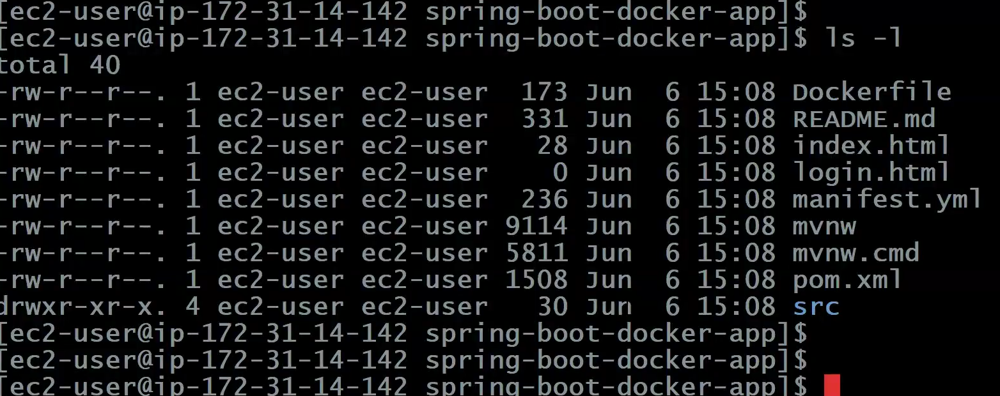

There's `src`, `pom.xml` and a `Dockerfile`, but **no `target`**, so we create it:

```bash
mvn clean package
ls -l target                        # now the jar file is here

docker build -t sb-app .
docker run -d -p 9080:8080 sb-app
```

- The app runs on **port 9080 on the EC2**, so open **9080** in the inbound rules; inside the container it's on 8080.
- Once the container is created, **check its logs**:
  ```bash
  docker logs <container-id>
  ```
- Access the app with the host VM's public IP and host port (9080 here):
  ```
  URL: http://<host-vm-public-ip>:9080/
  ```
  (`http://localhost:9080/` works only from the EC2 machine itself.)

---

## 5. Dockerizing a Python Flask application

- Python is a **scripting (interpreted) language**.
- We **don't need a build tool**; Python programs run directly: `python app.py`
- **Flask** is a Python library used to develop **REST APIs**.
- To download Flask we use **pip** (Python's package installer).

> Dependencies go in **`requirements.txt`**, just as `pom.xml` lists them in Java: where pom.xml says "we need Spring Boot", requirements.txt says "we need Flask".
>
> **Maven** both **builds** and **downloads dependencies**; Python needs no build, so **pip only downloads** dependencies.

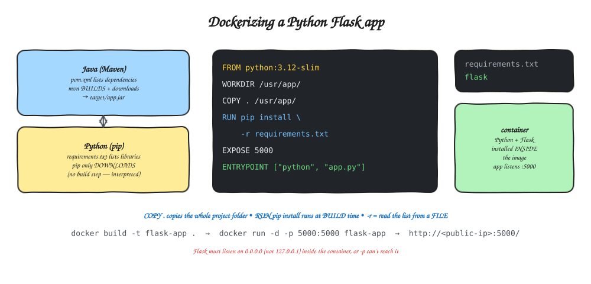

### Dockerfile for Python Flask
```dockerfile
# original: FROM python:3.6 (very old, end-of-life)
FROM python:3.12-slim

LABEL maintainer="Ashok"

COPY . /usr/app/

WORKDIR /usr/app/

RUN pip install -r requirements.txt

EXPOSE 5000

ENTRYPOINT ["python", "app.py"]
```

`requirements.txt`
```text
flask
```

- `COPY . /usr/app/` copies the **entire current directory** into `/usr/app`.
- `RUN pip install -r requirements.txt`: **`-r` means "read the packages from this requirements file"** (not "recursive"). It runs at **build** time, so Flask is baked into the image.

### Hands-on

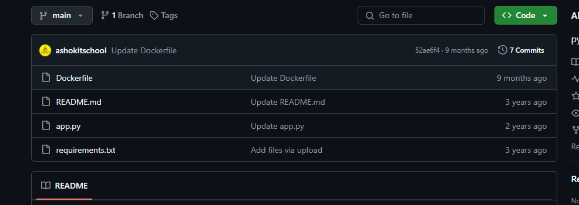

The repo has a `Dockerfile`, `app.py` and `requirements.txt`.

Python app Git repo: https://github.com/ashokitschool/python-flask-docker-app.git

```bash
git clone https://github.com/ashokitschool/python-flask-docker-app.git
cd python-flask-docker-app

docker build -t  .       # any image name
docker run -d -p 5000:5000 
docker ps
```

> Enable port **5000** in the security group inbound rules.

```
URL: http://<public-ip>:<host-port>/
```

### The three apps compared

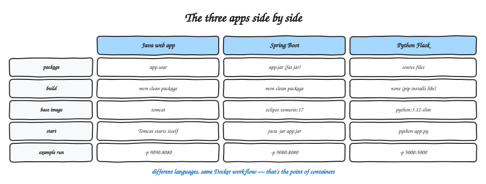

| | Java web app | Spring Boot | Python Flask |
|---|---|---|---|
| Package | `.war` | `.jar` (fat jar) | Source files |
| Build | `mvn clean package` | `mvn clean package` | None |
| Base image | `tomcat` | `eclipse-temurin:17` | `python:3.12-slim` |
| Start | Tomcat starts itself | `java -jar app.jar` | `python app.py` |
| Example run | `-p 9090:8080` | `-p 9080:8080` | `-p 5000:5000` |

---

## 6. Can we get inside a container?

Yes:

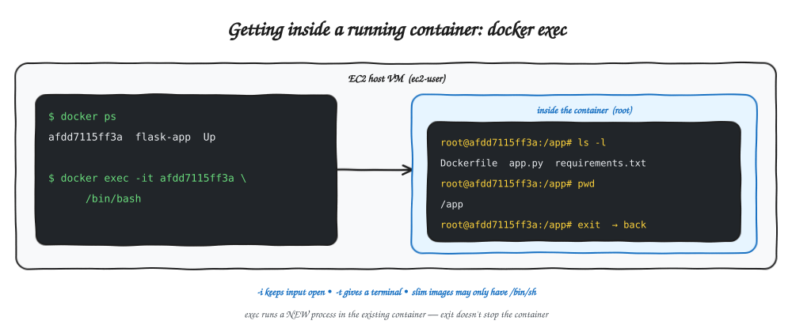

```bash
docker ps                                    # running containers + IDs
docker exec -it <container-id> /bin/bash     # open a shell inside the container
ls -l                                        # files in the current directory
exit                                         # back to the host VM
```

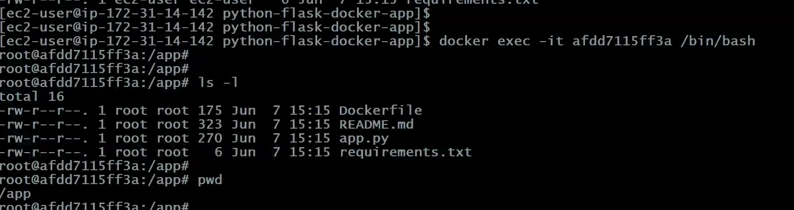

Inside the Flask container we're `root` in `/app`, with `Dockerfile`, `README.md`, `app.py` and `requirements.txt`. (The repo's own Dockerfile uses `WORKDIR /app`, not `/usr/app` as in our version.)

- `-i` keeps input open, `-t` gives a terminal. Slim images may only have `/bin/sh`.
- `exit` leaves the shell; the **container keeps running**.

> We're using a **t2.micro** (1 GB RAM), so delete previous images and containers before running new ones. In real projects, bigger machines are used.

---

## 7. Tasks

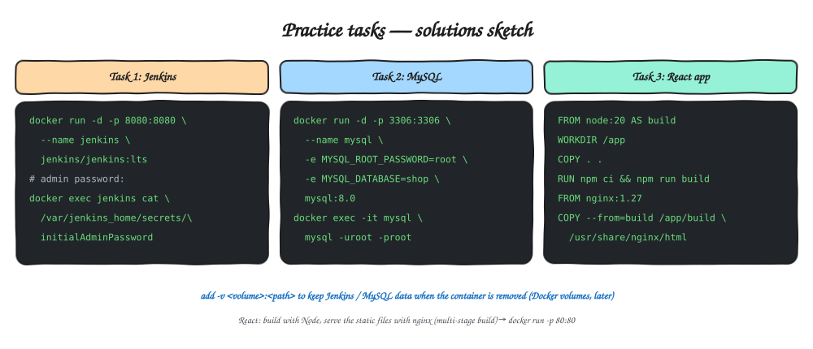

| Task | Hint |
|------|------|
| **Task 1:** Run a Jenkins server using Docker | `docker run -d -p 8080:8080 --name jenkins jenkins/jenkins:lts`; get the password with `docker exec jenkins cat /var/jenkins_home/secrets/initialAdminPassword` |
| **Task 2:** Set up a MySQL DB using Docker | `docker run -d -p 3306:3306 -e MYSQL_ROOT_PASSWORD=root mysql:8.0`; connect with `docker exec -it <id> mysql -uroot -proot` |
| **Task 3:** Write a Dockerfile to run a React JS app | Multi-stage: build with `node`, serve the `build/` folder with `nginx` |

---

## 8. Most used cleanup command

```bash
docker system prune -a      # delete stopped containers + unused images + unused networks + build cache
```

### Not that important for now
- Docker network
- Docker volumes
- Docker Compose (see Lecture 2: Dockerfile vs Compose)
- Docker Swarm

> In real projects we use an **orchestration tool like Kubernetes**; we never create containers manually in production. We'll see these in the next classes.

---

## 9. Quick revision

| Topic | Key point |
|-------|-----------|
| RUN vs CMD | All RUNs at build time; only the last CMD at container start |
| Push | `docker login` → `docker tag img user/img:v1` → `docker push user/img:v1` |
| War app | `FROM tomcat` + `COPY target/app.war /usr/local/tomcat/webapps/` |
| Spring Boot | Jar with embedded Tomcat; `ENTRYPOINT ["java","-jar","app.jar"]` |
| Flask | `requirements.txt` + `RUN pip install -r requirements.txt` |
| Port mapping | `-p host:container`; open the host port in the security group |
| Inside a container | `docker exec -it <id> /bin/bash` |
| Cleanup | `docker system prune -a` |
