# Docker · Lecture 4: Docker Network, Docker Compose & Stateful Containers

> **Developers** usually write the Dockerfile, because they know what environment the app needs. When using Kubernetes we don't need Docker networks or Compose (Kubernetes handles networking and multi-container apps).

---

## 1. Docker Network

So far we ran **independent containers**. To let containers **communicate with each other**, we need a **Docker network**.

- A network is all about **communication**.
- A Docker network provides an **isolated network** for containers.
- If **2 containers run on the same network**, one can communicate with the other.

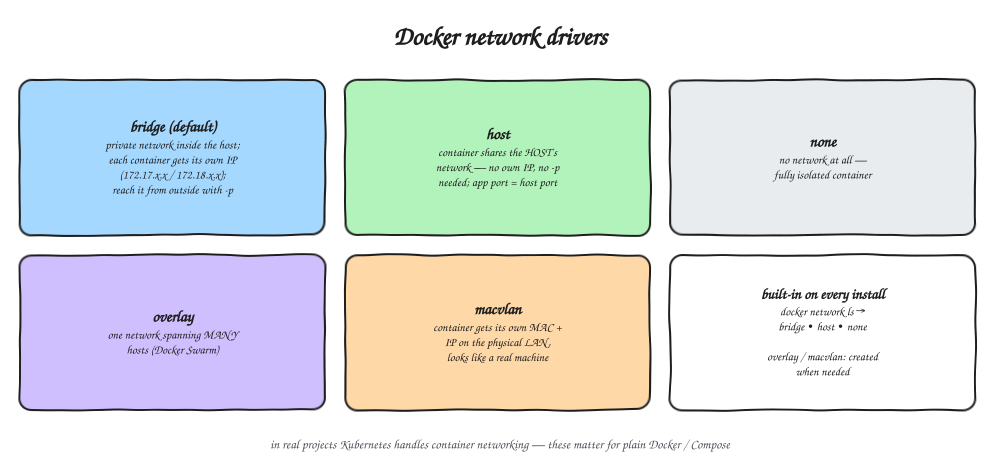

**3 networks exist by default:**

| Network | Meaning |
|---------|---------|
| **bridge** (default) | For standalone containers. **Assigns an IP** to each container on a private network inside the host. Default for every container |
| **host** | Also for standalone containers. **No separate IP**: the container shares the host's network directly (no `-p` needed) |
| **none** | **No network** at all |

**2 other network types:**

| Network | Meaning |
|---------|---------|
| **overlay** | For **orchestration** (Docker Swarm): one network across many hosts |
| **macvlan** | Assigns a **physical IP** (and MAC) on your LAN to the container |

> In real projects we don't create Docker containers directly; we use **Kubernetes**.

### Containers talking by name

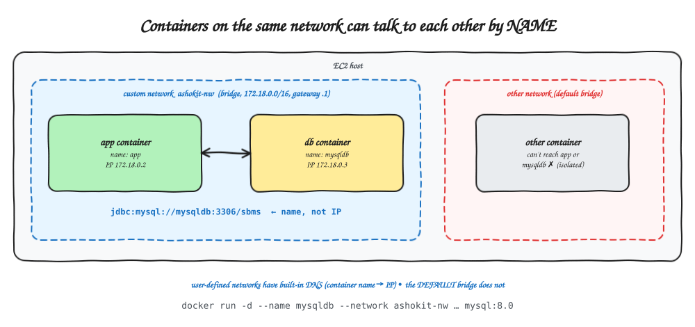

On a **user-defined** network (one you create), containers can reach each other by **container name**: Docker provides built-in DNS. The **default `bridge`** network doesn't have this, which is a key reason to create your own.

### Network commands

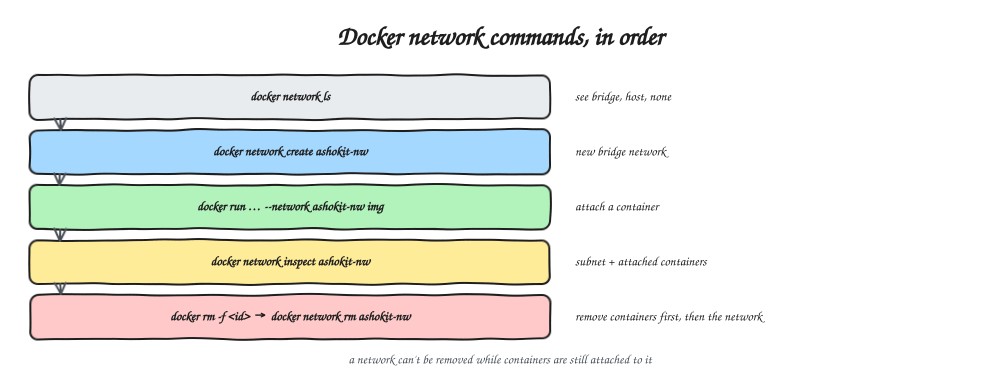

```bash
docker network ls                                          # display docker networks
docker network create ashokit-nw                           # create a network (bridge driver)
docker network inspect ashokit-nw                          # details + which containers are attached
docker run -d -p 8080:8080 --network <network-name>   # run a container on a custom network
docker network rm ashokit-nw                               # delete the network
```

`docker network ls` shows the 3 default networks; after `docker network create ashokit-nw` there's a 4th, also using the `bridge` driver:

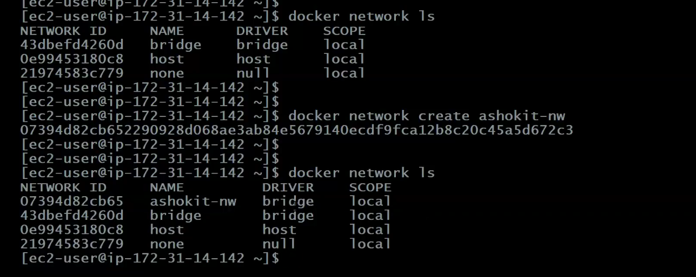

`docker network inspect ashokit-nw` shows the subnet `172.18.0.0/16`, gateway `172.18.0.1`, and **no containers yet** (`"Containers": {}`):

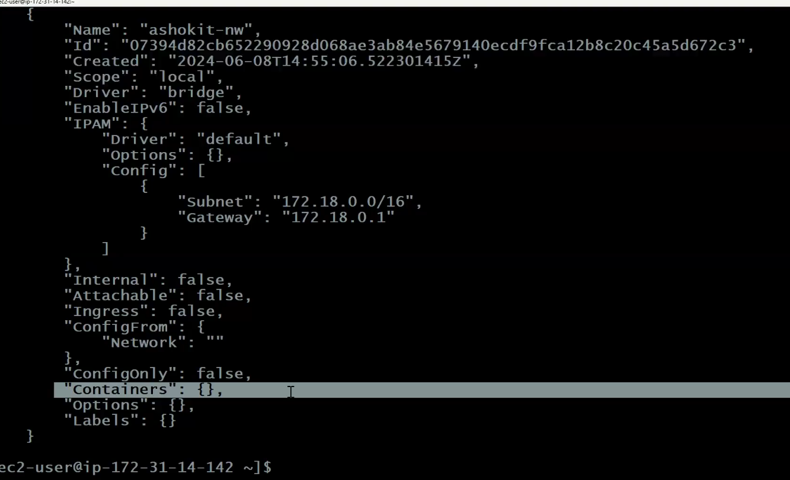

Let's run a container on that network:

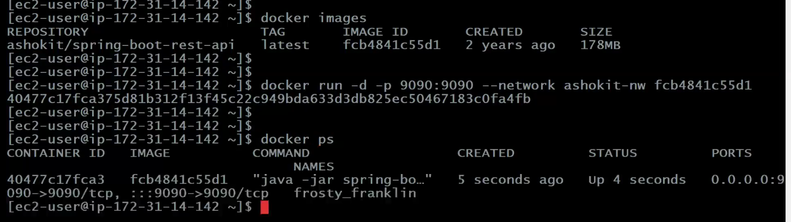

Now `inspect` shows the container attached, with IP **172.18.0.2**:

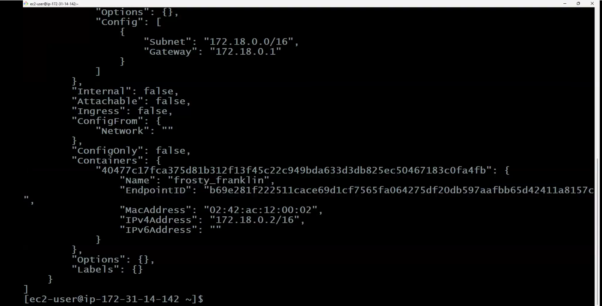

> The container got the random name `frosty_franklin`, because if you don't name it (`--name app`), Docker assigns a name itself.

Afterwards, stop and remove the container, then remove the network (a network can't be removed while containers are attached).

---

## 2. Docker Compose

- Earlier, projects were built as a **monolithic architecture** (everything in a single app).
- Nowadays projects are built as **microservices**: multiple backend APIs, e.g. `hotels-api`, `flights-api`, `trains-api`, `cabs-api`…
- **Every API needs a separate container.**

> With many containers, **management becomes very difficult** (create / stop / start each one).

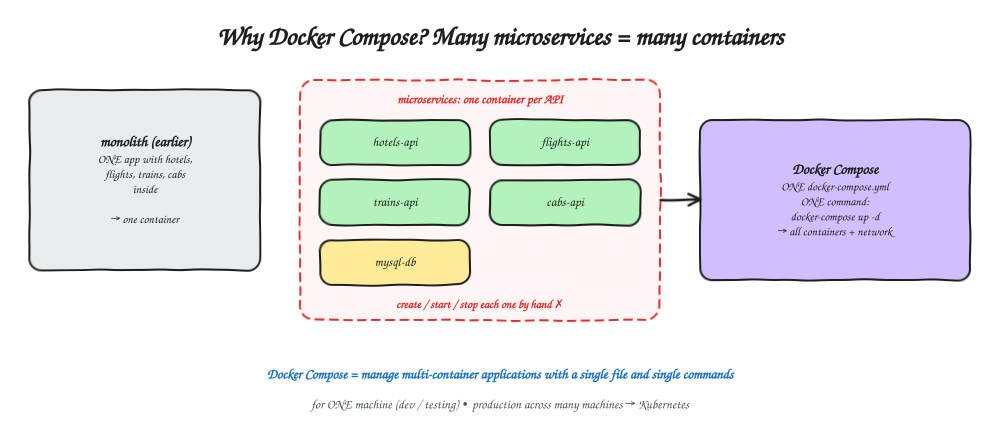

- **Docker Compose** solves this: it manages **multi-container applications**.
- With **a single command** we can **create / stop / start multiple containers** at once.

### What is the docker-compose.yml file?

- `docker-compose.yml` specifies the **containers' information**.
- The default file name is **`docker-compose.yml`** (you can change it and use `-f <file>`).
- It contains up to **4 sections**:

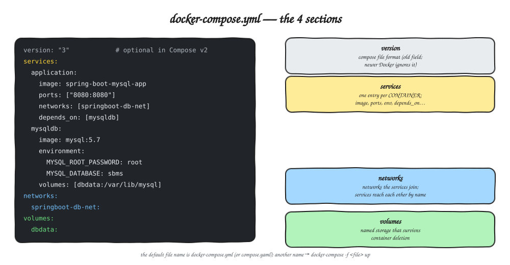

| Section | Represents |
|---------|-----------|
| `version` | Compose file format version (old field; newer Docker ignores it) |
| `services` | The **containers**: image name, port mapping, environment, depends_on… |
| `networks` | Docker networks the containers run on |
| `volumes` | Containers' **storage** locations |

### Docker Compose setup

```bash
# install docker compose (standalone v1 binary used in class)
sudo curl -L "https://github.com/docker/compose/releases/download/1.24.0/docker-compose-$(uname -s)-$(uname -m)" -o /usr/local/bin/docker-compose
sudo chmod +x /usr/local/bin/docker-compose

# check it's installed
docker-compose --version
```

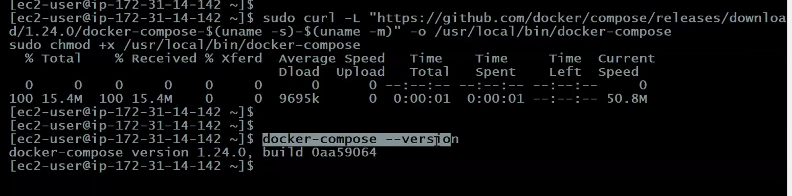

> 💡 1.24.0 is very old. Newer Docker includes **Compose v2** as a plugin: the command is `docker compose` (with a space). On Amazon Linux, `sudo yum install docker-compose-plugin` or download a v2 release; the YAML is the same.

---

## 3. Spring Boot with MySQL using docker-compose

We run **two services (containers)**: the Spring Boot **application** and **MySQL**.

```yml
version: "3"
services:                    # two services used here
  application:
    image: spring-boot-mysql-app
    ports:
      - "8080:8080"
    networks:
      - springboot-db-net
    depends_on:
      - mysqldb
    volumes:
      - /data/springboot-app

  mysqldb:
    image: mysql:5.7
    networks:
      - springboot-db-net
    environment:             # credentials
      - MYSQL_ROOT_PASSWORD=root
      - MYSQL_DATABASE=sbms
    volumes:
      - /data/mysql

networks:
  springboot-db-net:
```

> ⚠ Fixed two syntax issues from the original notes: YAML comments use `#` (not `/* … */`), and under `networks:` the name needs a trailing colon (`springboot-db-net:`), since it's a key, not a plain value.

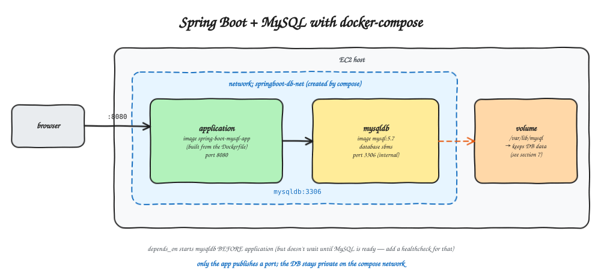

- `image: spring-boot-mysql-app`: the image we build ourselves from the Dockerfile.
- `depends_on: mysqldb`: starts the DB container **before** the app (it doesn't wait until MySQL is *ready*; add a `healthcheck` for that).
- Both services join `springboot-db-net`, so the app reaches the DB at **`mysqldb:3306`** (service name).
- `environment` passes the MySQL root password and creates the `sbms` database.
- Only the app publishes a port (`8080:8080`); the DB stays private.

With **4 applications**, just add more entries under `services`:

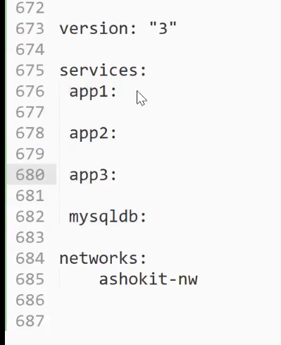

### Dockerfile vs docker-compose file

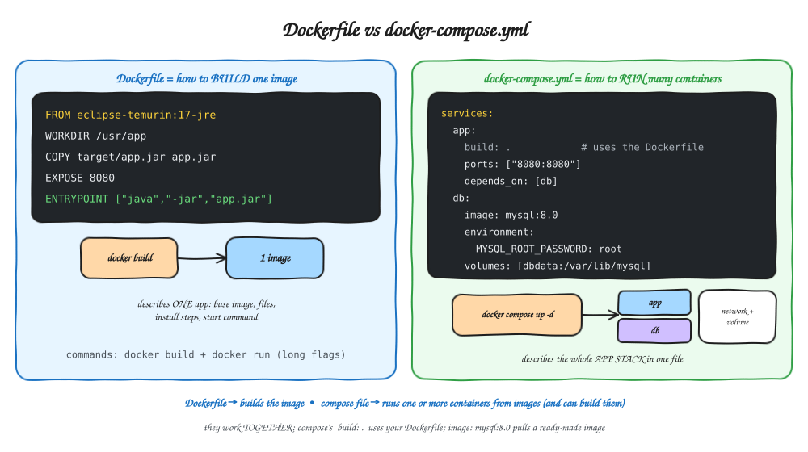

- **Dockerfile** is used to **create an image** (one app).
- **docker-compose.yml** is used to **run and connect multiple containers** (single-machine orchestration). See Lecture 2 for a full comparison.

---

## 4. Application execution process

```bash
# clone the git repo
git clone https://github.com/ashokitschool/spring-boot-mysql-docker-compose.git

# go inside the project directory
cd spring-boot-mysql-docker-compose

# build the project using maven
mvn clean package
```

The project's Dockerfile:

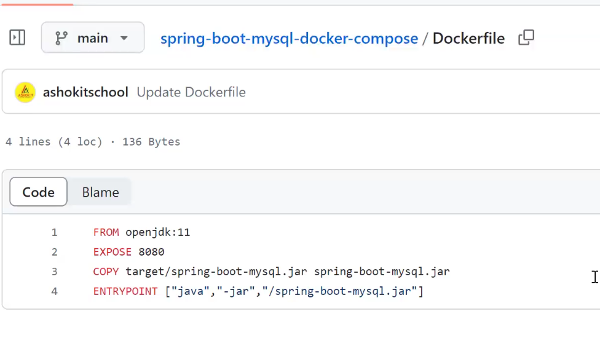

It uses `FROM openjdk:11` (deprecated image; `eclipse-temurin:11-jre` is the replacement), copies the jar and runs it with `java -jar`.

```bash
# build the docker image (using the Dockerfile)
docker build -t spring-boot-mysql-app .

# check docker images
docker images

# create the containers with docker-compose (no manual docker run!)
docker-compose up -d
```

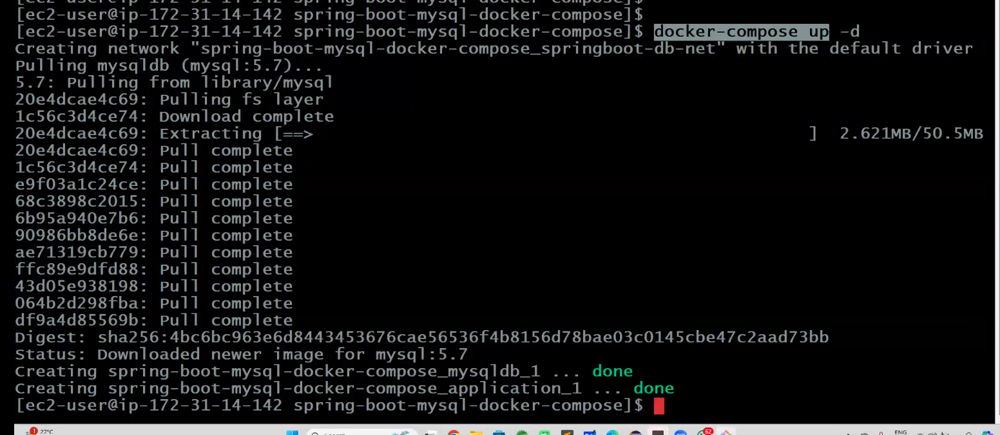

Compose **created the network** `spring-boot-mysql-docker-compose_springboot-db-net`, **pulled `mysql:5.7`**, then created `mysqldb_1` and `application_1`, in that order because of `depends_on`.

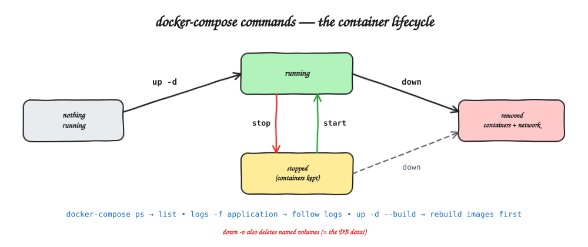

```bash
docker-compose ps       # check running containers
docker-compose stop     # stop containers (they're kept)
docker-compose start    # start them again
docker-compose down     # delete containers + network
```

---

## 5. Stateful vs stateless containers

| Type | Meaning |
|------|---------|
| **Stateless** | Data is **deleted** when the container is deleted |
| **Stateful** | Data is available **permanently** |

> Docker containers are **stateless by default**.

> In the spring-boot-mysql app, MySQL runs as a container and stores the application data. When we **re-create the containers, the DB is re-created too, and we lose the data**. That's not acceptable in real projects.

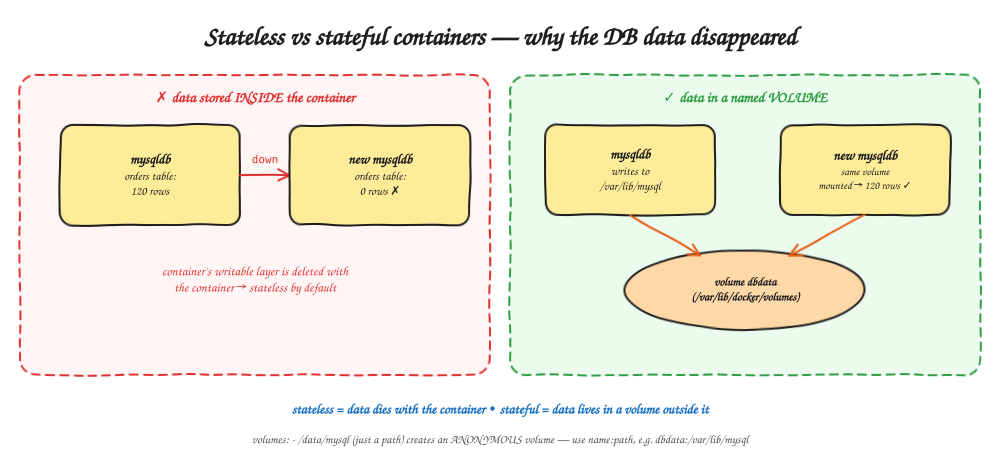

- To keep data permanently, the container must be **stateful**.
- To make a container stateful, we use **Docker volumes** (next lecture).

> Note: in the compose file above, `volumes: - /data/mysql` (only a container path) creates an **anonymous** volume. A new one is created after `down` + `up`, so data still appears lost. Also, MySQL keeps its data in **`/var/lib/mysql`**, not `/data/mysql`. The working version uses a **named volume**:
> ```yaml
>   mysqldb:
>     volumes:
>       - dbdata:/var/lib/mysql
> volumes:
>   dbdata:
> ```
> `docker-compose down` keeps named volumes; `docker-compose down -v` deletes them.

---

## 6. Quick revision

| Topic | Key point |
|-------|-----------|
| Default networks | bridge (default, own IP), host (shares host network), none |
| Other networks | overlay (Swarm, multi-host), macvlan (physical IP) |
| Custom network | Containers talk by **name** (built-in DNS) |
| Network commands | `ls`, `create`, `inspect`, `run --network`, `rm` |
| Docker Compose | Manage multi-container apps with one YAML + one command |
| Compose sections | version, services, networks, volumes |
| Commands | `up -d`, `ps`, `stop`, `start`, `down` (`-v` deletes volumes) |
| Stateless | Default: data dies with the container |
| Stateful | Use **named volumes** for data that must survive |
