# Docker · Lecture 5: Volumes, Stateful Containers & Docker Swarm

---

## 1. Stateful vs stateless containers (recap)

| Type | Meaning |
|------|---------|
| **Stateless container** | Data is **deleted** when the container is deleted |
| **Stateful container** | Data is available **permanently** |

> Docker containers are **stateless by default**.

> In the spring-boot-mysql app, MySQL runs as a container and stores the application data. When we re-create the containers, the DB is re-created too and **we lose the data**, which isn't acceptable in real projects.

- To keep data permanently, we make the container **stateful**.
- To make a container stateful, we use **Docker volumes**.

---

## 2. Docker volumes

- Volumes **persist data generated by a container**.
- Volumes **avoid data loss**: the data lives **outside** the container, so deleting the container doesn't delete it.
- With volumes, a container becomes **stateful**.

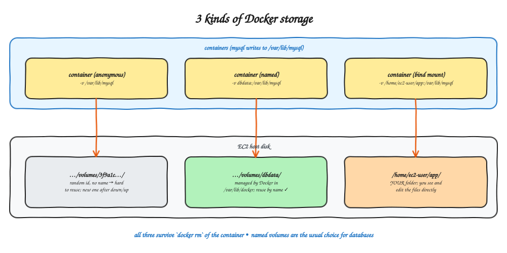

**3 types:**

| Type | Syntax | Where data lives | Notes |
|------|--------|------------------|-------|
| **Anonymous volume** (no name) | `-v /var/lib/mysql` | `/var/lib/docker/volumes/<random-id>/` | Hard to find/reuse; `docker-compose down` + `up` creates a new empty one |
| **Named volume** | `-v dbdata:/var/lib/mysql` | `/var/lib/docker/volumes/dbdata/` | Managed by Docker, reused by name. **Best choice for databases** |
| **Bind mount** | `-v /home/ec2-user/app:/var/lib/mysql` | The host folder **you** choose | You can see/edit the files directly; good for config files or code during development |

### Volume commands

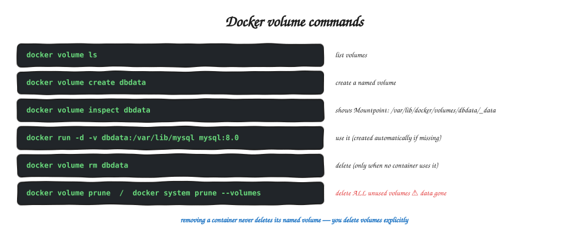

```bash
docker volume ls                      # display docker volumes
docker volume create <vol-name>       # create a named volume
docker volume inspect <vol-name>      # details (Mountpoint = where data is on the host)
docker volume rm <vol-name>           # remove a volume (not while a container uses it)
docker system prune --volumes         # remove all unused volumes (plus stopped containers, unused networks…) ⚠ data is gone
```

---

## 3. Making the MySQL container stateful

**Step 1:** Create a mount directory on the host machine (in `/home/ec2-user/`, next to the compose file):
```bash
mkdir app
```

**Step 2:** Map this `app` directory in `docker-compose.yml`:

```yml
version: "3"
services:
  application:
    image: spring-boot-mysql-app
    ports:
      - "8080:8080"
    networks:
      - springboot-db-net
    depends_on:
      - mysqldb
    volumes:
      - /data/springboot-app
  mysqldb:
    image: mysql:5.7
    networks:
      - springboot-db-net
    environment:
      - MYSQL_ROOT_PASSWORD=root
      - MYSQL_DATABASE=sbms
    volumes:
      - ./app:/var/lib/mysql
networks:
  springboot-db-net:
```

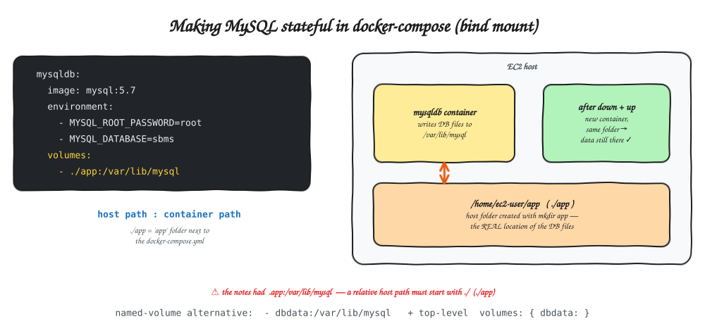

- **`/var/lib/mysql`**: the path **inside the container** where MySQL stores the database.
- **`./app`**: the folder **on the host** where we want that data to really live.
- Format: **`host-path:container-path`**.

> ⚠ The original notes had `.app:/var/lib/mysql`. A relative host path must start with `./`, so it's **`./app`**. Without the `/`, `.app` would be treated as the name of a **named volume** called `.app`, not your folder.

Now `docker-compose down` → `docker-compose up -d` creates a new MySQL container that mounts the same `./app` folder, so **the data is still there**.

**Named-volume alternative** (Docker manages the folder):
```yaml
  mysqldb:
    volumes:
      - dbdata:/var/lib/mysql
volumes:
  dbdata:
```

---

## 4. Docker Swarm

- Docker Swarm is an **orchestration platform**, like Kubernetes.
- **Orchestration** = managing the processes (containers).
- Docker Swarm is used to set up a **Docker cluster**.
- **Cluster** = a group of servers.

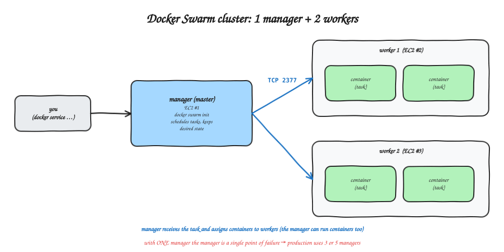

- **1 master (manager) node** and **2 worker nodes**.
- We send tasks to the **manager**, the manager **assigns them to workers**, and the workers run the containers.
- Because it's a cluster, if one worker fails its containers are recreated on another node, so there's **no single point of failure for the containers**.
- ⚠ With only **one manager**, the manager itself *is* a single point of failure for managing the cluster. Production uses **3 or 5 managers**.

### Swarm cluster setup

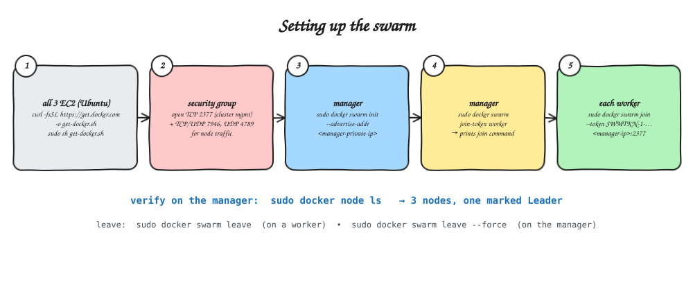

**1. Create 3 EC2 instances (Ubuntu) and install Docker on all 3:**
```bash
curl -fsSL https://get.docker.com -o get-docker.sh
sudo sh get-docker.sh
```

> Enable port **2377** (TCP) in the security group for swarm cluster communication. Also open **7946** (TCP+UDP) and **4789** (UDP) between nodes; these carry node-to-node and container network traffic.

**2. On the master machine, initialize the swarm:**
```bash
sudo docker swarm init --advertise-addr <private-ip-of-master-node>
# Ex:
sudo docker swarm init --advertise-addr 172.31.41.217
```

**3. Get the join token from the master** (workers use it to join):
```bash
sudo docker swarm join-token worker
```
> The original notes had `docker swarm <join-token> worker`; the actual command is `docker swarm join-token worker`. It prints the full join command.

**4. Copy that command and run it on every worker with sudo:**
```bash
sudo docker swarm join --token SWMTKN-1-4pkn4fiwm09haue0v633s6snitq693p1h7d1774c8y0hfl9yz9-8l7vptikm0x29shtkhn0ki8wz 172.31.37.100:2377
```

**Verify** on the master:
```bash
sudo docker node ls          # 3 nodes, the manager marked "Leader"
```

> In Docker Swarm, we deploy our application **as a service**.

---

## 5. Docker Swarm service

- A **service** is a collection of **one or more containers of the same image** (each container is called a *task*).

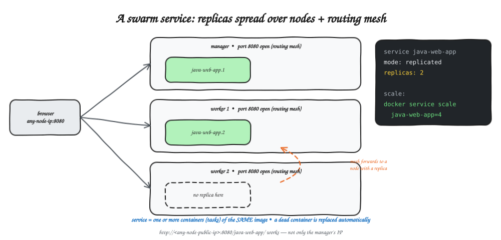

```bash
sudo docker service create --name <serviceName> -p <hostPort>:<containerPort> <imageName>
# Ex:
sudo docker service create --name java-web-app -p 8080:8080 ashokit/javawebapp
```

> By default **1 replica** is created (`--replicas N` to start with more).

Access the app:
```
URL: http://<master-node-public-ip>:8080/java-web-app/
```
Thanks to the swarm **routing mesh**, the published port is open on **every** node, so any node's public IP works, even one with no replica.

### Two service modes

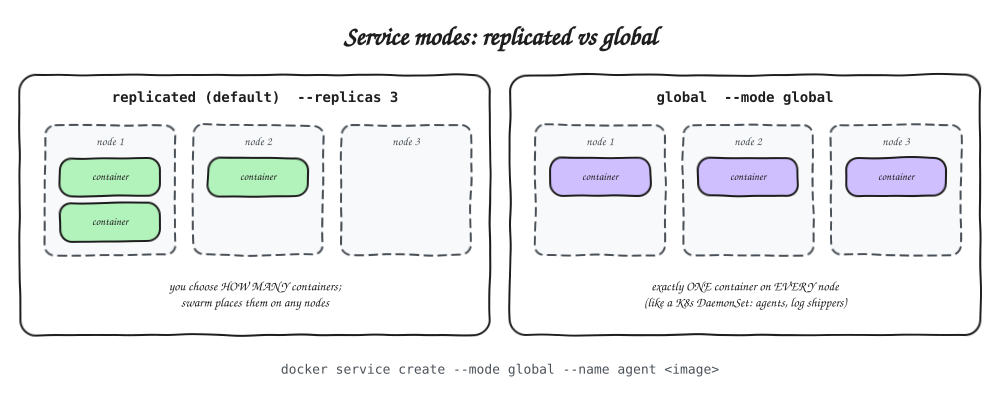

| Mode | Meaning |
|------|---------|
| **Replicated** (default) | You choose how many replicas; swarm spreads them over nodes |
| **Global** | Exactly one container on **every** node (`--mode global`), e.g. monitoring agents |

### Service commands

```bash
sudo docker service ls                                  # services created
sudo docker service scale <serviceName>=<no.of.replicas>  # scale
```

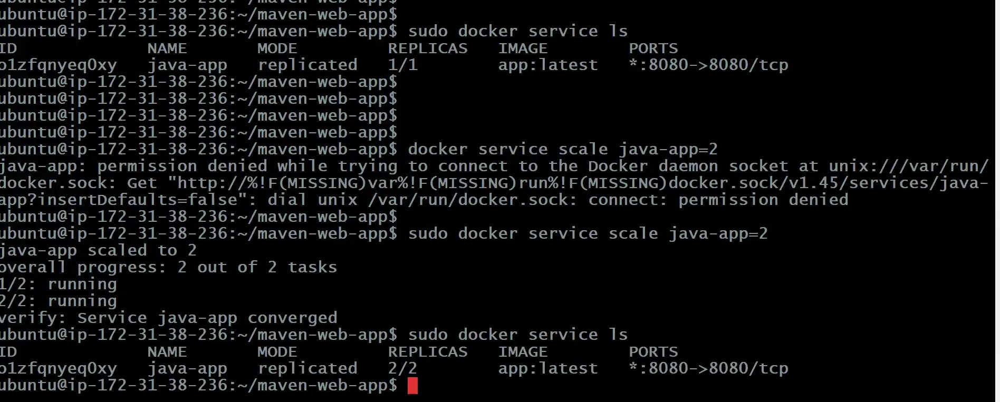

The service `java-app` went from **1/1 to 2/2 replicas**. Note the first `docker service scale` failed with **"permission denied … docker.sock"** because it ran without `sudo`; with `sudo` it worked. (To drop `sudo`, add the user to the docker group: `sudo usermod -aG docker ubuntu`, then log out and in.)

```bash
sudo docker service inspect --pretty <service-name>     # inspect the service
sudo docker service ps <service-name>                   # where each replica runs
sudo docker swarm leave                                 # remove this node from the cluster (manager: --force)
sudo docker service rm <service-name>                   # delete the service and all its containers
```

> **Scaling up/down here is manual.** We want it to be **automatic based on load**; that's the big **drawback of Docker Swarm**. In Kubernetes it's automatic (HPA).

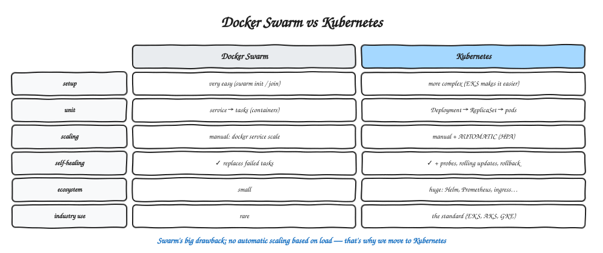

---

## 6. Docker Compose explained (recap)

A Docker Compose file (`docker-compose.yml` or `compose.yaml`) is a YAML file that describes **all the containers of your application, and how they should run together**, in one place. You then start everything with a single command: `docker compose up`.

### Why pulling images isn't enough

Pulling an image only gives you the *blueprint*. To actually use it, you still have to run it with the right settings. For a real app, that gets messy fast.

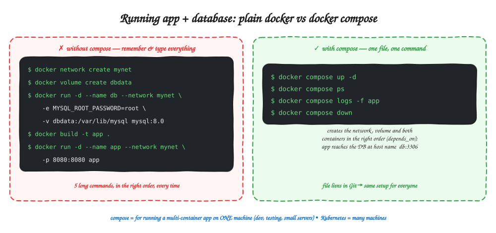

Say you have a web app, a database, and a cache. Without Compose you'd run something like:

```bash
docker network create myapp-net
docker volume create dbdata

docker run -d --name db --network myapp-net \
  -e POSTGRES_PASSWORD=secret \
  -v dbdata:/var/lib/postgresql/data \
  postgres:16

docker run -d --name cache --network myapp-net redis:7

docker run -d --name web --network myapp-net \
  -p 8080:80 \
  -e DATABASE_URL=postgres://postgres:secret@db:5432/app \
  myapp:latest
```

That's a lot to type, remember, and share with teammates. With Compose, the same thing is a file:

```yaml
services:
  db:
    image: postgres:16
    environment:
      POSTGRES_PASSWORD: secret
    volumes:
      - dbdata:/var/lib/postgresql/data

  cache:
    image: redis:7

  web:
    build: .
    ports:
      - "8080:80"
    environment:
      DATABASE_URL: postgres://postgres:secret@db:5432/app
    depends_on:
      - db
      - cache

volumes:
  dbdata:
```

Then:

```bash
docker compose up -d     # start everything
docker compose down      # stop and remove everything
```

### What Compose gives you

- **One command for the whole stack.** Start, stop, and rebuild multiple containers together.
- **Configuration as code.** Ports, environment variables, volumes, and restart policies live in a file you can commit to Git. Anyone can reproduce your setup exactly.
- **Automatic networking.** Services reach each other by name (`db`, `cache`), with no manual network setup or IP addresses.
- **Startup ordering.** `depends_on` controls which services start first.
- **Build and pull together.** A service can use a prebuilt `image:` or build from your own Dockerfile with `build:`.
- **Persistent data.** Named volumes are declared once and reused across restarts.
- **Easy environments.** Use `.env` files and override files (e.g. a dev vs. prod setup) without retyping flags.
- **Scaling and logs.** `docker compose up --scale web=3` and `docker compose logs -f` work across the whole stack.

### Compose vs a Dockerfile

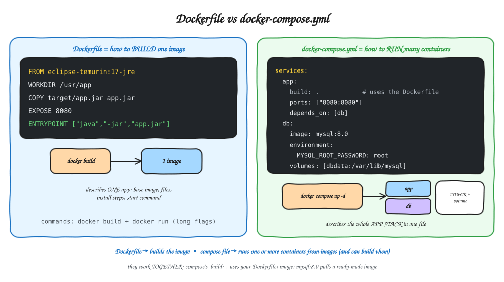

These are often confused:

| | Dockerfile | Compose file |
|---|---|---|
| Purpose | How to **build one image** | How to **run multiple containers together** |
| Scope | Single container | Whole application |

They work together: Compose can build images from your Dockerfile and then run them alongside the pulled ones.

### When you don't need it

If you're running a single container with one or two flags (e.g. `docker run -p 80:80 nginx`), plain `docker run` is fine. Compose pays off as soon as you have multiple services, many options, or need others to reproduce your setup.

It's mainly used for local development, testing, and small deployments. For large production clusters, people typically move to Kubernetes or Docker Swarm.

---

## 7. Quick revision

| Topic | Key point |
|-------|-----------|
| Stateless | Default; data dies with the container |
| Volume types | Anonymous, named (best for DBs), bind mount (host folder) |
| Mount syntax | `host-path-or-volume:container-path` (`./app:/var/lib/mysql`) |
| Volume commands | `ls`, `create`, `inspect`, `rm`, `system prune --volumes` |
| Swarm | Docker's own orchestrator: manager + workers |
| Setup | `swarm init --advertise-addr` → `swarm join-token worker` → `swarm join` on workers; port 2377 |
| Service | Containers of one image; `service create / ls / scale / ps / rm` |
| Modes | Replicated (default) / global |
| Drawback | Manual scaling only → Kubernetes has HPA |
| Compose | One YAML + one command for a multi-container app on one machine |
