# Kubernetes · Lecture 1: What, Why & Architecture

---

## 1. What is Kubernetes?

**Kubernetes** is often written **K8s**: "K", then **8** letters ("ubernete"), then "s".

- **Free & open-source** software.
- **Developed by Google**, later donated to the **CNCF** (Cloud Native Computing Foundation).
- Written in the **Go** programming language.
- An **orchestration** (management) platform for **containers**: it can **create, start, stop, delete, scale up and scale down** containers.

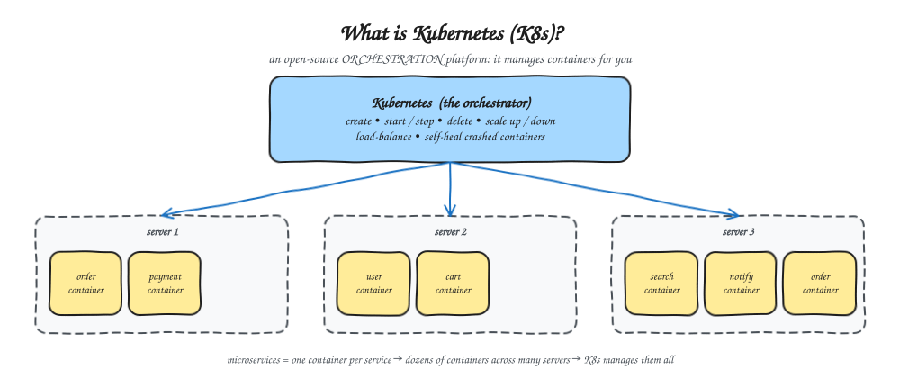

> In a microservices project there is **one container per service** (order, payment, user, cart…), often several copies of each, spread over many servers. Managing them by hand is impossible, so we use Kubernetes.

---

## 2. Why Kubernetes? Advantages

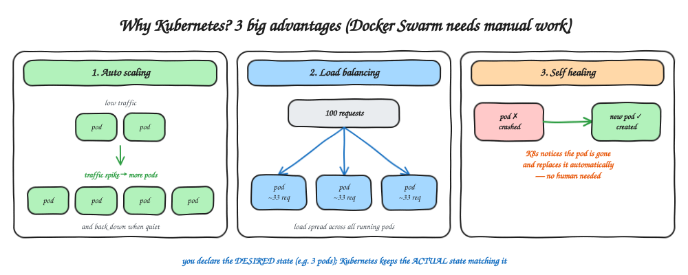

| Advantage | What it means |
|-----------|---------------|
| **Auto scaling** | Based on demand, the number of containers (pods) is **increased or decreased automatically**. In Docker Swarm you scale manually. |
| **Load balancing** | Incoming load is **distributed across all running containers**. |
| **Self healing** | If a container **crashes**, K8s **replaces it with a new one** automatically. |

These are the reasons companies choose Kubernetes over Docker Swarm.

> The core idea: you declare the **desired state** ("I want 3 copies of order-service") and Kubernetes keeps the **actual state** matching it.

---

## 3. Docker vs Kubernetes

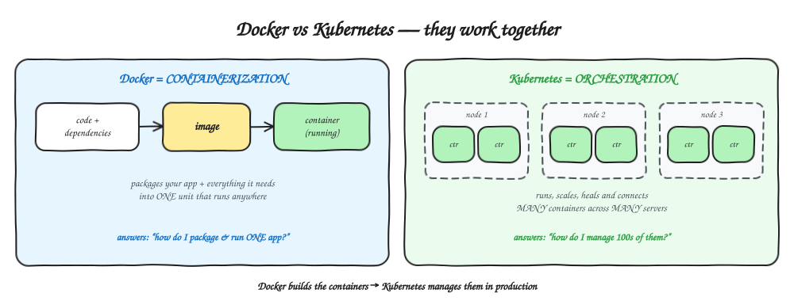

| | Docker | Kubernetes |
|---|---|---|
| Type | **Containerization** platform | **Orchestration** platform |
| Meaning | Packaging app code + dependencies as a single unit for execution | Managing (running, scaling, healing) the containers |
| Scope | One container / one machine | Hundreds of containers across many machines |

They are **not competitors**: Docker *builds* the containers, Kubernetes *manages* them.

---

## 4. Kubernetes architecture

> Every orchestration tool follows a **cluster architecture**.

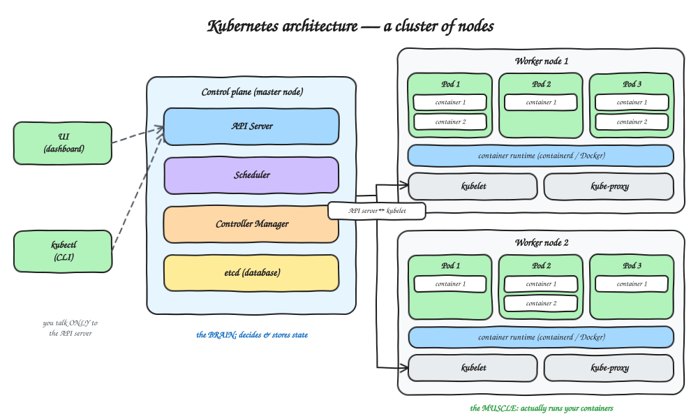

- A **cluster** = a group of servers (**nodes**) working together, so K8s needs **multiple machines**.
- Nodes can be physical servers, VMs, cloud instances (EC2), even a laptop or Raspberry Pi.
- A cluster has two types of nodes:
  - **Control plane / master node**: the **brain**, which decides and stores state.
  - **Worker nodes**: the **muscle**, which actually run your containers.
- Typical setup: **one (or more) master node + multiple worker nodes**.

> **Analogy:** the control plane is the **manager** and worker nodes are the **employees**. You give tasks to the manager using **kubectl** (CLI) or a **UI** (dashboard); the manager assigns them to employees.

| Node type | Components |
|-----------|-----------|
| **Control plane (master)** | API Server, Scheduler, Controller Manager, etcd |
| **Worker node** | kubelet, kube-proxy, container runtime (Docker / containerd), Pods → containers |

---

## 5. Control plane components (the brain)

The master node **manages the entire cluster**: it monitors the health of all nodes, stores cluster information, decides which worker node runs which containers, and if a worker node fails, **moves its workload to a healthy node**.

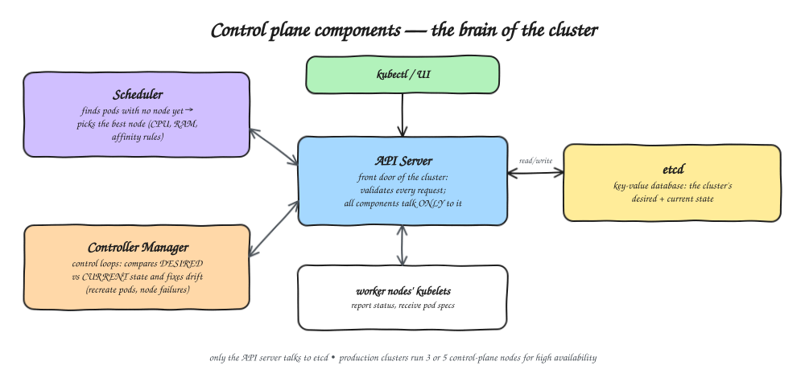

| Component | Role |
|-----------|------|
| **API Server** | The **front door** of the cluster. Every request (from kubectl, UI, or other components) goes through it; it validates and processes them. **All components talk only to the API server.** |
| **Scheduler** | Places **pods onto nodes**. Looks at resource needs (CPU / RAM), affinity / anti-affinity and other constraints to pick the best node. |
| **Controller Manager** | Runs **control loops**: continuously compares **desired state vs current state** and fixes differences (recreates crashed pods, handles node failures, keeps the right number of replicas). |
| **etcd** | A distributed **key-value database**: the cluster's single source of truth (config, desired state, info about pods, services…). Only the API server reads/writes it. |

> The name **etcd** comes from the Linux `/etc` config folder + **d** for *distributed*.

### High availability: more than one master

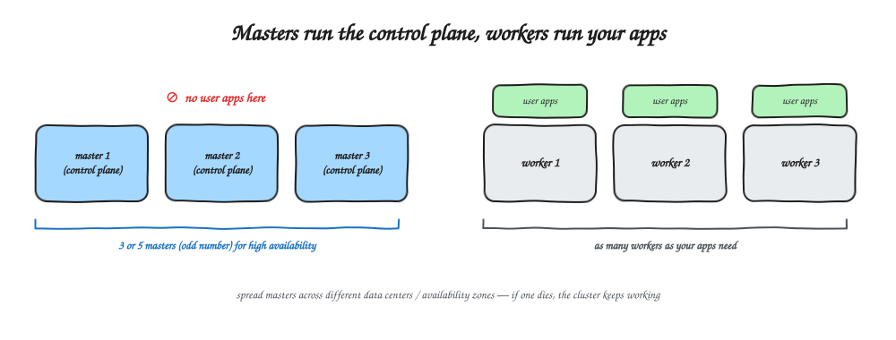

- Masters host the control plane; **user apps run only on worker nodes**.
- In production, run **3 or 5 masters** (an odd number, so they can agree by majority) so the cluster survives if one fails.
- Spread them across **different failure domains** (data centers / availability zones), not all in the same room with the same leaky AC and the same power supply!

---

## 6. Worker node components (the muscle)

A worker node is just a **VM or physical server** capable of running containers. It provides compute, storage and networking to your applications.

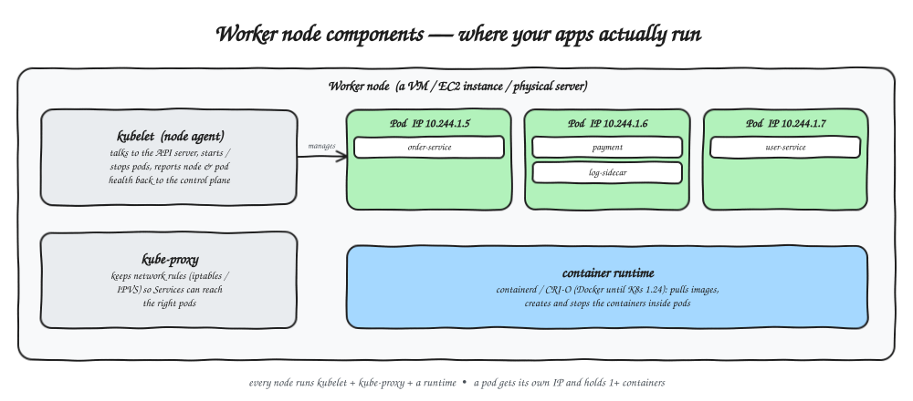

| Component | Role |
|-----------|------|
| **kubelet** | The **node agent** on every worker. Talks to the API server, receives pod specs, **starts / stops / monitors containers**, and reports node & pod health back to the control plane. |
| **kube-proxy** | Maintains **network rules** (iptables / IPVS) on each node so traffic for a Service reaches the right pods, from inside or outside the cluster. |
| **Container runtime** | Actually **pulls images and runs containers**. Docker was the classic choice; since K8s 1.24, **containerd** or **CRI-O** are used directly (Docker-built images still work). |
| **Pod** | Wraps one or more containers; gets its own IP. |

---

## 7. How Kubernetes works (step by step)

To deploy an application we talk to the **control plane** using **kubectl**.

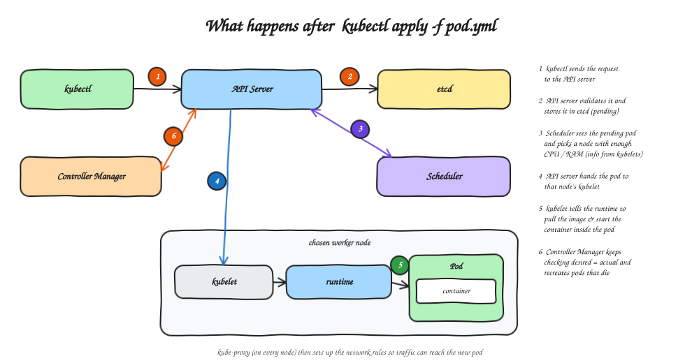

1. **kubectl** sends the request (e.g. `kubectl apply -f pod.yml`) to the **API Server**.
2. The **API Server** validates it and **stores it in etcd** with a *pending* status.
3. The **Scheduler** sees the pending (unscheduled) pod and **picks a worker node** with enough resources, using the node information that each **kubelet** reports.
4. The API Server hands the pod to that node's **kubelet**.
5. The **kubelet** tells the **container runtime** to pull the image and **start the container inside a pod**.
6. The **Controller Manager** keeps checking that everything runs as expected (desired = actual) and recreates pods that die.
7. **kube-proxy** sets up the network rules so the pod can be reached.

> When you "deploy an application" to Kubernetes, you are really asking it to **create Pods** for that application. Pods are described in **YAML** files.

---

## 8. What is a Pod?

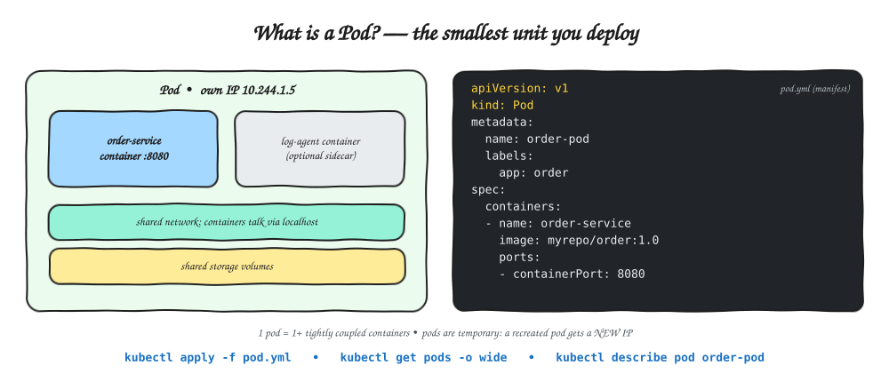

- A **Pod is the smallest building block** you can create in a K8s cluster. In K8s, everything runs as a Pod.
- A Pod **represents a running process** in the cluster.
- A Pod **encapsulates one or more containers**, gives them a **unique IP address**, attaches **storage**, and defines how the containers should run. Containers in a pod are tightly coupled: they share the network (talk via `localhost`) and volumes.
  - Think of it as *one more layer around the container, with its own IP*.
- Containers in a pod don't have to be made by Docker; any supported runtime works.
- Your **application is deployed as a pod**, and **one application can have many pods** (replicas).
- Pods are created from a **manifest YAML** file in which you configure your **Docker image**.
- **Self-healing:** if a pod is damaged / crashed / deleted, K8s creates a new one.
- **Load balancing:** if the app runs in multiple pods, K8s distributes load across them.
- **Scalability:** the number of pods can increase or decrease automatically with load.
- Pods can **communicate with each other** using their IPs (but a recreated pod gets a **new IP**, which is why we later use *Services*).

```bash
kubectl apply -f pod.yml          # create the pod from the manifest
kubectl get pods -o wide          # list pods with their IP and node
kubectl describe pod order-pod    # details + events
```

---

## 9. K8s cluster setup options

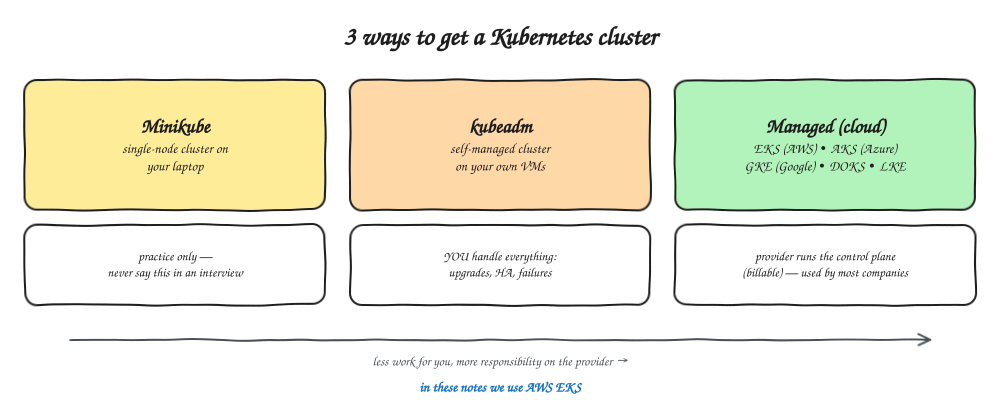

| Option | Type | Notes |
|--------|------|-------|
| **Minikube** | Single-node cluster (control plane + worker on one machine) | **Practice only**, never used in real projects |
| **Kubeadm** | **Self-managed** cluster on your own VMs | You are responsible for **everything**: setup, upgrades, HA, failures |
| **Provider-managed** | **Ready-made** cluster from a cloud provider | Provider takes care of the control plane. **Billable** |

Popular managed Kubernetes services:

| Cloud | Service |
|-------|---------|
| AWS | **EKS**: Elastic Kubernetes Service |
| Azure | **AKS**: Azure Kubernetes Service |
| Google Cloud | **GKE**: Google Kubernetes Engine |
| DigitalOcean | **DOKS**: DigitalOcean Kubernetes Service |
| Linode | **LKE**: Linode Kubernetes Engine |

### Hosted ("Kubernetes as a Service"): who manages what?

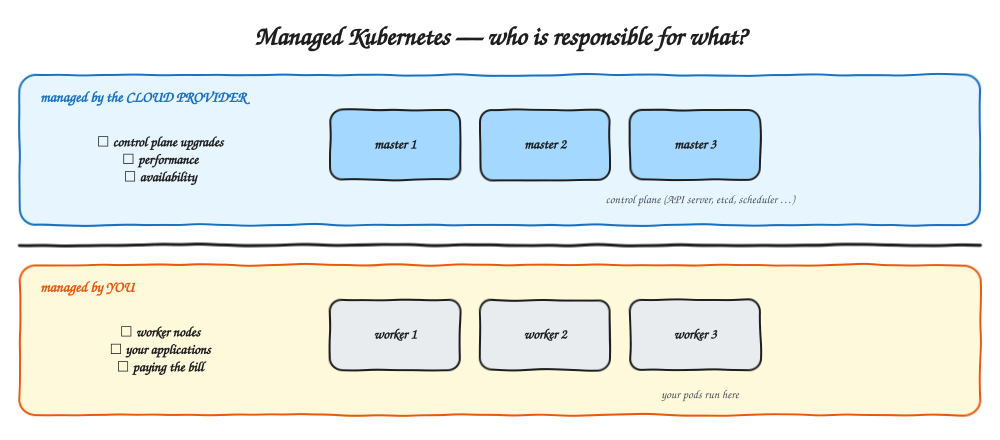

| Cloud provider is responsible for | You are responsible for |
|-----------------------------------|------------------------|
| Control plane **performance** | **Worker nodes** |
| Control plane **availability** | **Your applications** |
| Control plane **updates / upgrades** | **Paying the bill** |

> Most companies use **provider-managed clusters**. With a self-managed cluster, every problem is the company's to fix; with a managed one, the provider handles the control plane.
>
> In interviews, **never say you use Minikube**. In these notes we use **AWS EKS**.

---

## 10. How AWS EKS works

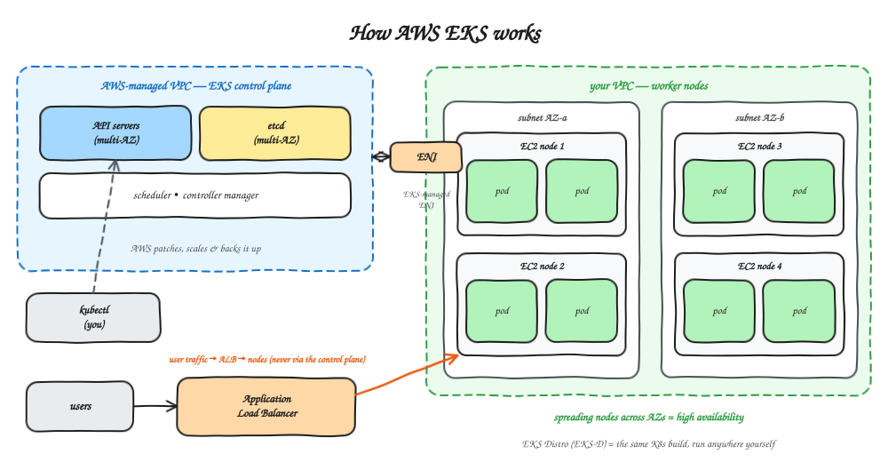

An EKS cluster has two major parts:

| Part | Where it runs | Managed by |
|------|---------------|-----------|
| **Control plane** (API servers, etcd, scheduler, controllers), spread across multiple AZs | **AWS-managed VPC** | AWS |
| **Worker nodes** (EC2 instances) + other infrastructure | **Your (customer-managed) VPC** | You |

- Worker nodes talk to the control plane through the **managed API endpoint**, connected via an **EKS-managed ENI** (elastic network interface) placed in your subnets.
- You use **kubectl** against the same API endpoint.

### Example: hosting a highly available web application
- The **control plane** (in AWS's VPC) assigns work to the worker nodes through the EKS-managed ENI and keeps track of their health.
- **User traffic never goes through the control plane.** An **Application Load Balancer (ALB)** forwards user requests directly to the worker nodes / pods.
- Placing worker nodes in **multiple Availability Zones** keeps the app up even if one AZ fails.

### EKS Distro (EKS-D)
- An **open-source distribution of Kubernetes** from AWS, with the **same core components** that power Amazon EKS.
- Difference: **EKS** is fully managed by AWS; **EKS-D** you install and manage **yourself**: on-premises, in any cloud, or any system.
- Gives a consistent, reproducible Kubernetes build everywhere, with security patches even after community support for a version ends.

---

## 11. Quick revision

| Term | One-liner |
|------|-----------|
| Kubernetes (K8s) | Open-source container orchestration platform by Google (written in Go) |
| Orchestration | Managing containers: create, scale, heal, load-balance |
| Cluster | Control plane (master) + worker nodes |
| API Server | Front door; everything talks to it |
| Scheduler | Chooses the node for each pod |
| Controller Manager | Keeps desired state = actual state |
| etcd | Key-value DB storing cluster state |
| kubelet | Node agent; runs and reports pods |
| kube-proxy | Network rules so Services reach pods |
| Container runtime | Pulls images, runs containers (containerd / Docker) |
| Pod | Smallest deployable unit; 1+ containers with one IP |
| Managed K8s | Provider runs the control plane (EKS, AKS, GKE) |
