# Kubernetes · Lecture 2: EKS Cluster Setup, Services & Namespaces

In Kubernetes everything runs as a **Pod**, and pods need a **cluster** to run in. We'll use a ready-made cluster from AWS: **EKS (Elastic Kubernetes Service)**.

> Kubernetes itself is free, but the cloud services that run it (control plane, EC2 worker nodes) are **not free**.

---

## 1. The setup plan

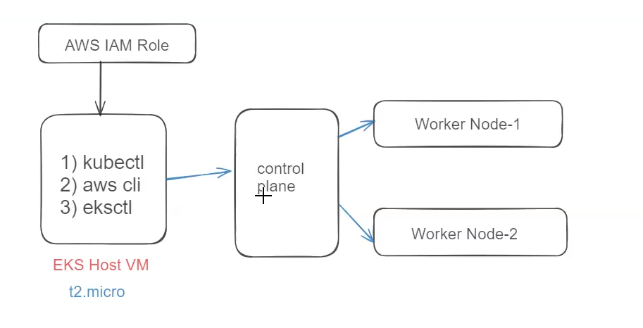

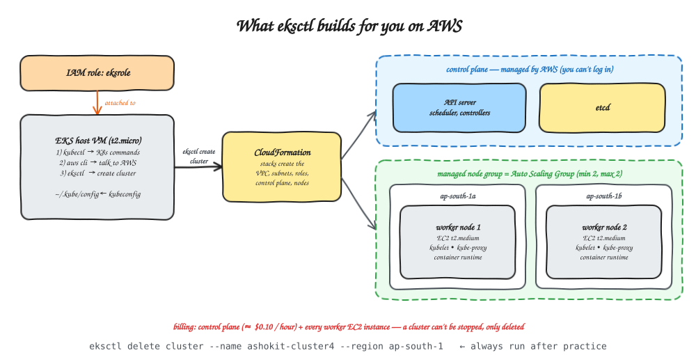

We create one small **EKS host machine** (an EC2 instance, `t2.micro` is enough) and install 3 tools on it:

| Tool | Purpose |
|------|---------|
| **kubectl** | Run Kubernetes commands (talk to the cluster's API server) |
| **AWS CLI** | Talk to AWS from the command line |
| **eksctl** | Create / delete EKS clusters with one command |

Then:
1. Create an **IAM role** with the permissions needed to build a cluster and attach it to the host machine.
2. Use `eksctl` to create the **control plane** (managed by AWS) and the **worker nodes** (EC2 instances).

> ⚠ **A cluster cannot be stopped, only deleted.** As long as it exists, it generates a bill (the control plane is roughly **$0.10/hour** plus every worker EC2 instance). Delete it after every practice session.

---

## 2. Step 1: create the host machine and install the tools

Create an **Ubuntu** EC2 instance and connect to it.

> Default usernames: Ubuntu → `ubuntu` • Amazon Linux → `ec2-user`.

### 2.1 Install kubectl
```bash
curl -o kubectl https://amazon-eks.s3.us-west-2.amazonaws.com/1.19.6/2021-01-05/bin/linux/amd64/kubectl
chmod +x ./kubectl                 # make it executable
sudo mv ./kubectl /usr/local/bin   # put it on the PATH
kubectl version --short --client
```
> 💡 That URL installs an old kubectl (1.19). kubectl should be within **one minor version** of the cluster (the cluster in the screenshots is 1.30). For a current version use:
> ```bash
> curl -LO "https://dl.k8s.io/release/$(curl -L -s https://dl.k8s.io/release/stable.txt)/bin/linux/amd64/kubectl"
> chmod +x kubectl && sudo mv kubectl /usr/local/bin
> kubectl version --client
> ```

### 2.2 Install AWS CLI v2
```bash
sudo apt install unzip
curl "https://awscli.amazonaws.com/awscli-exe-linux-x86_64.zip" -o "awscliv2.zip"
unzip awscliv2.zip
sudo ./aws/install
aws --version
```

### 2.3 Install eksctl (used to create the cluster)
```bash
curl --silent --location "https://github.com/weaveworks/eksctl/releases/latest/download/eksctl_$(uname -s)_amd64.tar.gz" | tar xz -C /tmp
sudo mv /tmp/eksctl /usr/local/bin
eksctl version
```
> eksctl has since moved to `github.com/eksctl-io/eksctl`; the old URL still redirects.

---

## 3. Step 2: IAM role for the host machine

The host machine will create a cluster, so it needs **permission to create AWS resources**.

**IAM → Roles → Create role**
1. Trusted entity type: **AWS service**, use case: **EC2**.
2. Add permissions:
   - IAM full access
   - VPC full access
   - EC2 full access
   - CloudFormation full access
   - Administrator access
3. Role name: `eksrole`.
4. Attach it to the host: **EC2 → select instance → Actions → Security → Modify IAM role → `eksrole`**.

**Why these permissions?** `eksctl` builds everything through **CloudFormation**, which creates **VPCs/subnets**, **IAM roles** for the cluster and nodes, and **EC2 instances** for the workers.

> 🔐 *AdministratorAccess* already includes all the others; it's fine for a practice account but far too broad for real projects. In companies, use the minimum permissions eksctl needs.

---

## 4. Step 3: create the EKS cluster

**Syntax**
```bash
eksctl create cluster --name <cluster-name> \
  --region <region> \
  --node-type <instance-type> \
  --nodes-min 2 \
  --nodes-max 2 \
  --zones <AZ-1>,<AZ-2>
```

| Flag | Meaning |
|------|---------|
| `--name` | Cluster name |
| `--region` | AWS region |
| `--node-type` | EC2 type for worker nodes |
| `--nodes-min / --nodes-max` | Size limits of the worker node group (default: **2 nodes**) |
| `--zones` | Availability zones to spread nodes across |

```bash
# N. Virginia
eksctl create cluster --name ashokit-cluster4 --region us-east-1  --node-type t2.medium --zones us-east-1a,us-east-1b

# Mumbai (used here)
eksctl create cluster --name ashokit-cluster4 --region ap-south-1 --node-type t2.medium --zones ap-south-1a,ap-south-1b
```

We didn't pass min/max, so eksctl creates **2 worker nodes** by default.

On the **EKS console** the cluster shows as *Creating*:

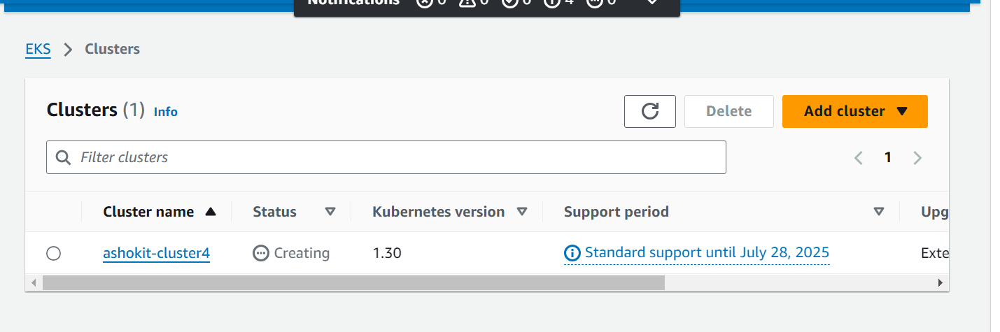

> ⏳ Cluster creation takes **10–20 minutes**. First the control plane is created, then the worker nodes.

When the control plane is ready the console shows *Active*:

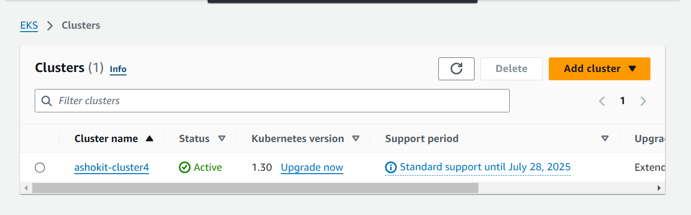

But **wait until the terminal command finishes**. *Active* in the console only means the control plane is ready; the worker nodes are still being created. When the terminal is free, the whole cluster is done:

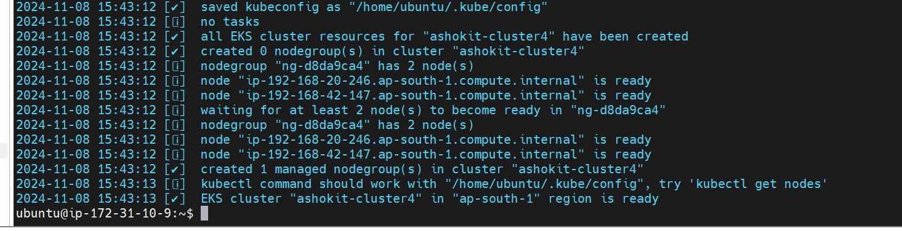

---

## 5. kubeconfig: the key to the cluster

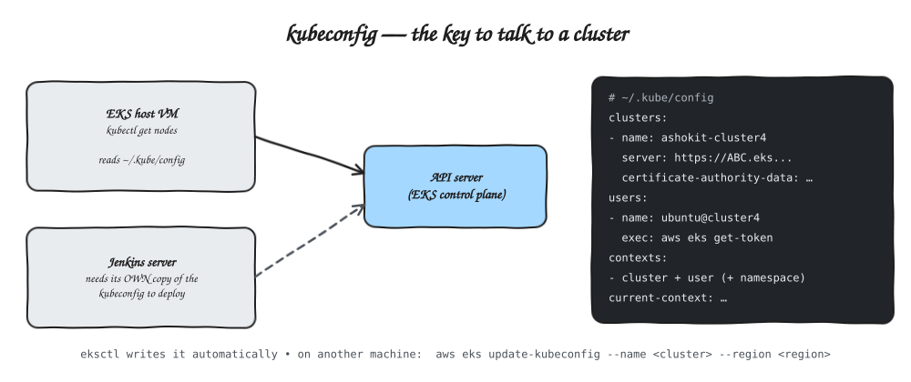

- eksctl saves a **kubeconfig** file at `~/.kube/config` on the host machine.
- It contains the **cluster API endpoint**, its **certificate**, and **how to authenticate** (via `aws eks get-token`). kubectl reads it to know *which* cluster to talk to and *as whom*.
- **Any other machine** that wants to talk to the control plane needs this config too, e.g. a **Jenkins** server that deploys to the cluster.

```bash
# generate a kubeconfig on another machine (needs AWS credentials with EKS access)
aws eks update-kubeconfig --name ashokit-cluster4 --region ap-south-1

kubectl config get-contexts    # which clusters this kubeconfig knows
kubectl config current-context # which one kubectl is using now
```

Check the worker nodes:
```bash
kubectl get nodes
```

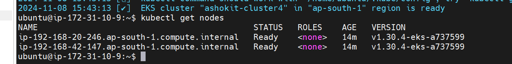

Both nodes are `Ready`. `ROLES` shows `<none>` because these are worker nodes; on EKS you never see the control plane nodes (AWS manages them).

---

## 6. Worker nodes are EC2 instances in an Auto Scaling Group

The worker nodes appear in the **EC2 console** as normal `t2.medium` instances, next to the small host machine (`eks-machine`):

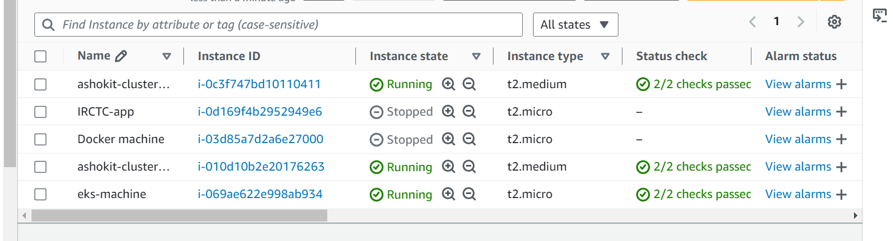

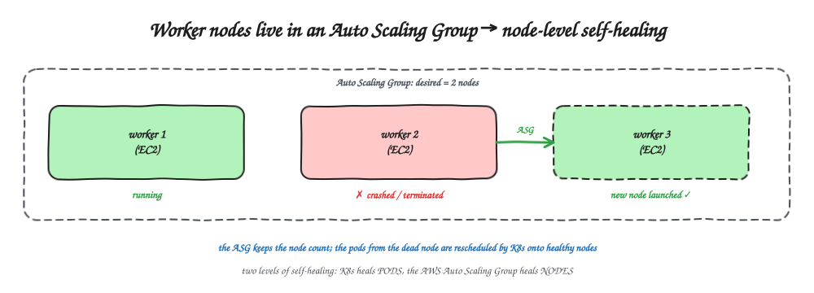

- They belong to a **managed node group**, backed by an **Auto Scaling Group (ASG)**.
- If a worker node dies, the ASG **launches a replacement**, and Kubernetes reschedules the pods from the dead node onto healthy ones.
- So there are **two levels of self-healing**: Kubernetes heals **pods**, the AWS ASG heals **nodes**.

**Cost notes**
- Billable here: the **control plane** + the **2 × t2.medium** worker nodes (+ the host machine).
- t2.medium = 4 GB RAM. In real projects worker nodes usually have **at least 8 GB**.
- You have **no access to the control plane**: AWS manages it. In a provider-managed cluster you get exactly one managed control plane.

---

## 7. Step 4: delete the cluster after practice

```bash
eksctl delete cluster --name ashokit-cluster4 --region ap-south-1
```
Pass the cluster name and region. Deletion also takes several minutes, because CloudFormation removes the nodes, node group, VPC and roles. Also stop/terminate the host machine if you don't need it.

> In this course we create a new cluster before each class and delete it afterwards.

---

## 8. First look at pods

```bash
kubectl get pod
```

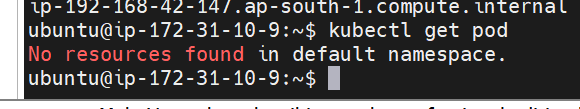

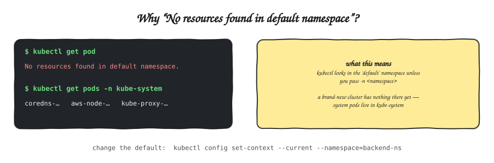

The cluster is brand new, so there are no application pods. kubectl looks in the **`default` namespace** unless told otherwise. The system pods (CoreDNS, aws-node, kube-proxy…) live in **`kube-system`**:
```bash
kubectl get pods -n kube-system
kubectl get pods -A          # pods in ALL namespaces
```

---

## 9. Kubernetes resources (roadmap)

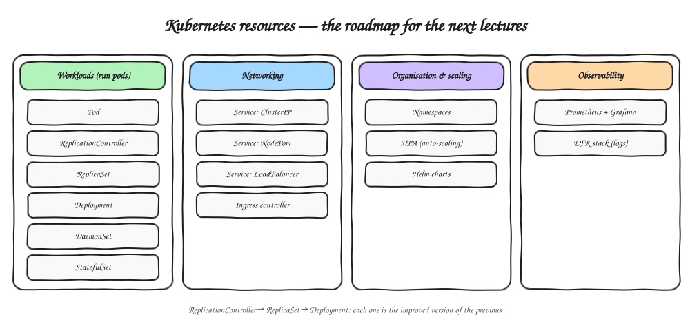

| # | Resource | One-line purpose |
|---|----------|------------------|
| 1 | **Pod** | Runs your containers |
| 2 | **Service** (ClusterIP, NodePort, LoadBalancer) | Stable access to pods |
| 3 | **Namespace** | Group resources logically |
| 4 | **ReplicationController (RC)** | Keeps N copies of a pod running (old) |
| 5 | **ReplicaSet (RS)** | Improved RC (set-based selectors) |
| 6 | **Deployment** | Manages ReplicaSets, rolling updates & rollbacks |
| 7 | **DaemonSet** | One pod on every node (log/monitoring agents) |
| 8 | **StatefulSet** | Pods with stable identity & storage (databases) |
| 9 | **Ingress controller** | One entry point, routing by host/path |
| 10 | **HPA** (Horizontal Pod Autoscaler) | Auto-scale pods by CPU/memory |
| 11 | **Helm charts** | Package & template K8s YAML |
| 12 | **Monitoring** | Prometheus + Grafana |
| 13 | **EFK stack** | Elasticsearch + Fluentd + Kibana for app logs |

- Pods run on worker nodes, but you **don't access pods directly**: you go through a **Service**.
- **Namespaces** are like packages: they group pods logically.
- Pods can be created directly or through a controller (RC / ReplicaSet / Deployment), which recreates them if they die.

---

## 10. Kubernetes Services

Customers **cannot access pods directly**. To expose pods we use a **Service**.

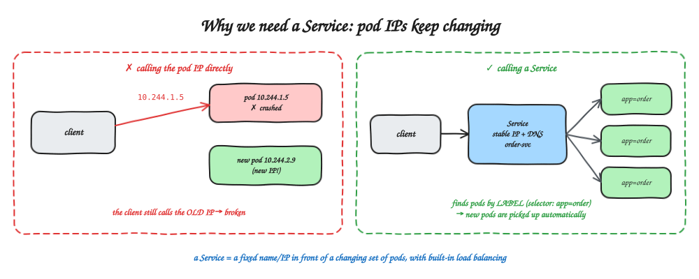

**Why not just use the pod IP?**
- A pod is **short-lived**: it can crash or be deleted.
- When that happens K8s replaces it with a new pod, and **the new pod gets a new IP**.
- So accessing pods by pod IP is **not recommended**.

A Service gives a **fixed IP + DNS name** in front of a group of pods. It finds its pods by **label** (`selector: app=order`), so new pods are picked up automatically, and it **load-balances** between them.

There are 3 types:
1. **ClusterIP**
2. **NodePort**
3. **LoadBalancer**

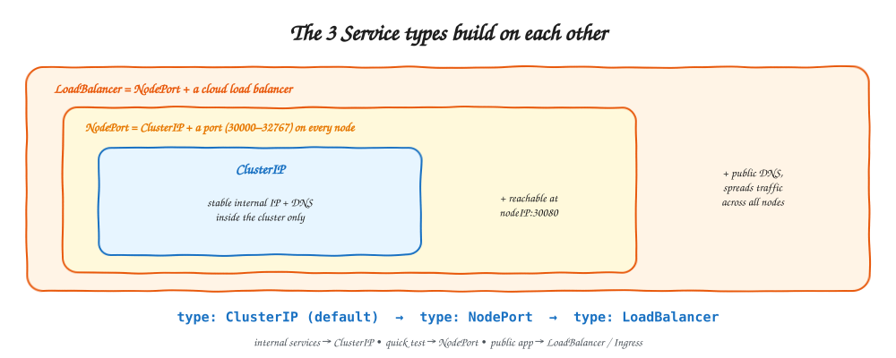

### 10.1 ClusterIP (default)

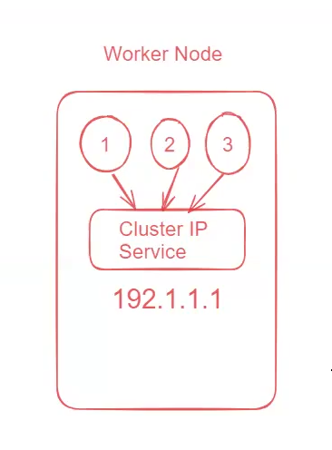

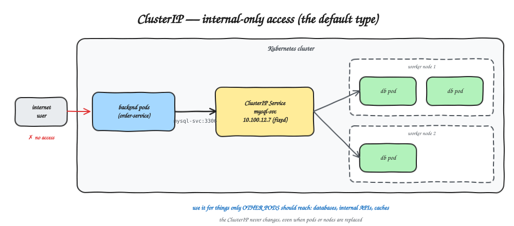

- Links all matching pods behind **one static IP**.
- That IP **does not change**, even if pods or worker nodes are replaced.
- Reachable **only inside the cluster**, so it is an **internal** service.
- Use it for things customers must **not** reach directly, e.g. **database pods**, internal APIs, caches.
- Not for customer-facing apps, because it can't be reached from outside.

```yaml
apiVersion: v1
kind: Service
metadata:
  name: mysql-svc
spec:
  type: ClusterIP        # default, can be omitted
  selector:
    app: mysql           # sends traffic to pods with this label
  ports:
    - port: 3306         # the service's port
      targetPort: 3306   # the container's port
```
Other pods connect with `mysql-svc:3306` (DNS name), not an IP.

### 10.2 NodePort

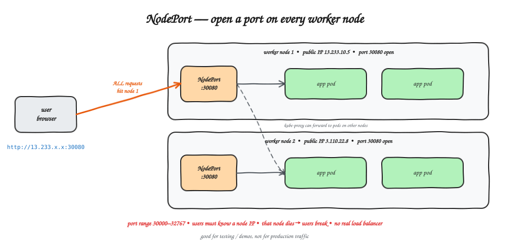

- Exposes pods **outside the cluster** by opening the same port (range **30000–32767**) on **every worker node**.
- Access the app at `http://<worker-node-public-IP>:<nodePort>`.
- Problem: if users call one node's IP, **all requests go to that node** (more load on it), and if that node dies the URL stops working.
- Fine for testing; for real traffic, use a LoadBalancer.

> Remember to allow the NodePort in the worker nodes' **security group** (inbound rule), or the browser can't reach it.

### 10.3 LoadBalancer

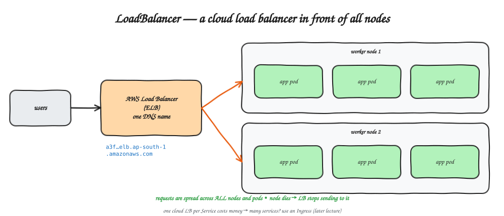

- Exposes pods outside the cluster using a **cloud load balancer** (on EKS, an AWS ELB is created automatically).
- Users access **one LB URL**, and requests are **distributed to all pods on all worker nodes**.
- Each LoadBalancer Service creates its own cloud LB (costs money). With many services, an **Ingress** is used instead (later lecture).

| | ClusterIP | NodePort | LoadBalancer |
|---|---|---|---|
| Reachable from | Inside the cluster only | `nodeIP:30000-32767` | Public LB DNS name |
| Load balancing across nodes | ✓ (internal) | ✗ (user picks a node) | ✓ |
| Typical use | Databases, internal APIs | Testing / demos | Public-facing apps |
| Extra cost | None | None | Cloud load balancer |

---

## 11. Namespaces

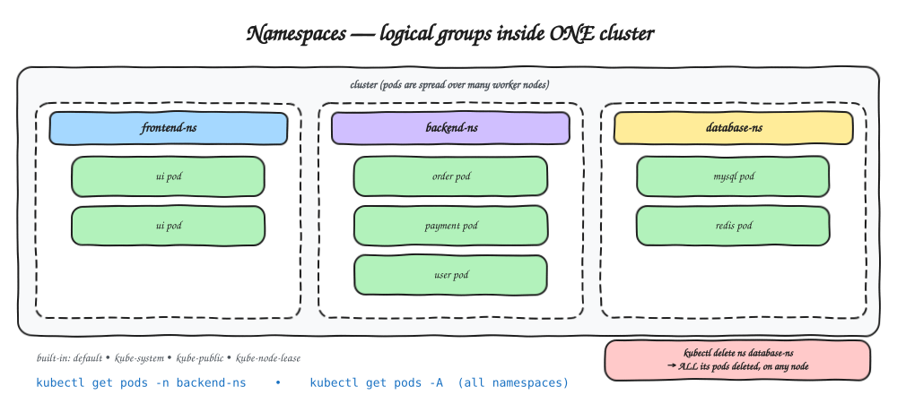

Pods of many apps are spread over many worker nodes. **Namespaces** group related resources logically, no matter which node they run on:

| Pods | Namespace |
|------|-----------|
| frontend app pods | `frontend-app-ns` |
| backend app pods | `backend-app-ns` |
| database pods | `database-ns` |

**Use cases**
- Act on a whole group at once: e.g. `kubectl delete namespace database-ns` deletes **all database pods**, whichever worker node they're on.
- Separate teams or environments, and apply resource quotas / access rules per namespace.

```bash
kubectl get namespaces
kubectl create namespace backend-app-ns
kubectl get pods -n backend-app-ns
kubectl config set-context --current --namespace=backend-app-ns   # change the default
```

Built-in namespaces: `default`, `kube-system`, `kube-public`, `kube-node-lease`.

> In real projects companies usually have **two clusters**: **prod** and **non-prod** (dev/QA/UAT, often separated by namespaces).

---

## 12. Quick revision

| Topic | Key point |
|-------|-----------|
| EKS host | EC2 with kubectl + AWS CLI + eksctl, IAM role attached |
| Create cluster | `eksctl create cluster --name … --region … --node-type … --zones …` |
| Delete cluster | `eksctl delete cluster --name … --region …` (clusters can't be stopped) |
| kubeconfig | `~/.kube/config`; any machine using kubectl needs it |
| Worker nodes | EC2 instances in an Auto Scaling Group |
| `kubectl get pod` | Looks in `default` namespace unless `-n` is given |
| ClusterIP | Internal static IP for pods (DBs) |
| NodePort | `nodeIP:30000-32767`, testing only |
| LoadBalancer | Cloud LB spreads traffic across all nodes |
| Namespace | Logical group of resources |
