# Kubernetes · Lecture 3: Manifest YAML, Pods & LoadBalancer Service

> We created the cluster from an **Ubuntu** host machine, so the SSH username is **`ubuntu`**.

---

## 1. Cluster commands (recap)

```bash
# create the cluster (takes ~15 minutes)
eksctl create cluster --name ashokit-cluster4 --region ap-south-1 --node-type t2.medium --zones ap-south-1a,ap-south-1b

# delete the cluster after practice (avoid billing)
eksctl delete cluster --name ashokit-cluster4 --region ap-south-1
```

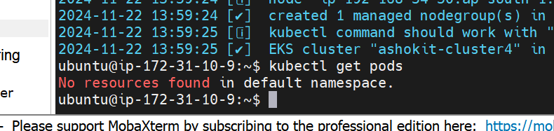

The cluster is ready, but `kubectl get pods` finds nothing: we haven't created any pods yet, and kubectl looks in the **`default`** namespace.

---

## 2. Manifest YAML

- In Kubernetes we use **manifest YAML files** to deploy applications, or to do almost anything in the cluster.
- The whole of Kubernetes depends on these files; being able to **write them confidently** is a key skill.

### Manifest syntax

```yml
---
apiVersion: <version-number>
kind: <resource-type>
metadata:
  name: <name>
spec:
  <desired state, e.g. containers>
...
```

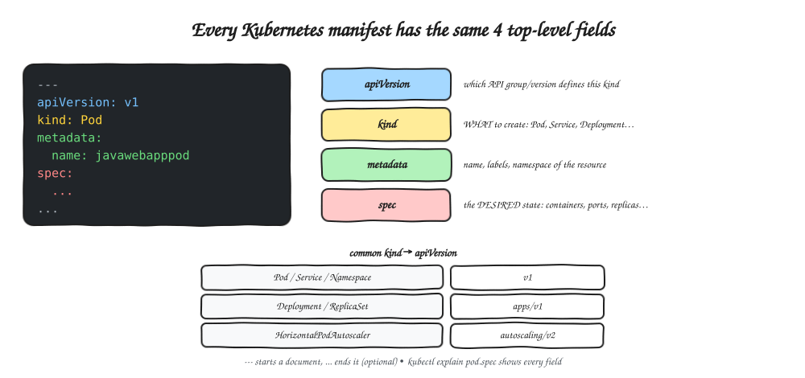

| Field | Meaning |
|-------|---------|
| `apiVersion` | API version of the resource you're creating (`v1` for Pod/Service, `apps/v1` for Deployment…) |
| `kind` | **Type** of resource: `Pod`, `Service`, `Deployment`, `Namespace`… (case-sensitive: `Pod`, not `POD`) |
| `metadata` | Name (and labels, namespace) of the resource |
| `spec` | The **specification**: for a pod, the containers, Docker image, ports… |

- A file starts with `---` (three hyphens) and may end with `...` (three dots).
- Run a manifest with:
  ```bash
  kubectl apply -f <manifest-yml>
  ```

**Multiple resources in one file** are separated by `---`:
```yml
---
apiVersion: <version-number>
kind: <resource-type>
metadata: ...
spec: ...
---
apiVersion: <version-number>
kind: <resource-type>
metadata: ...
spec: ...
...
```

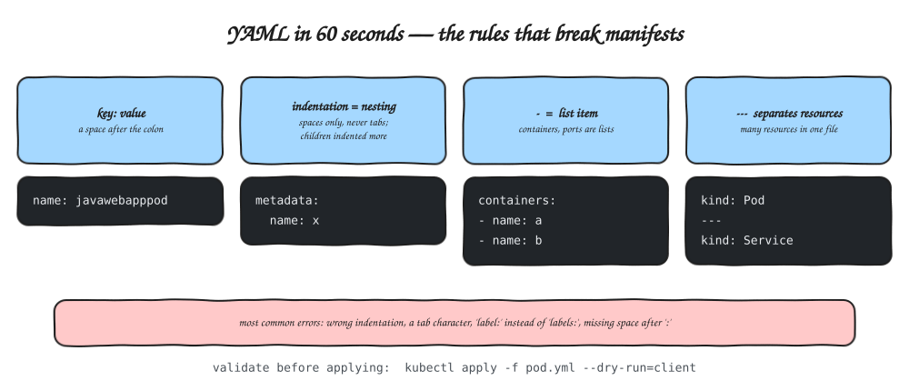

> You can find manifest templates online or ask ChatGPT, but **understand every line** before applying. `kubectl explain pod.spec.containers` documents every field.

---

## 3. Pod manifest

```yml
---
apiVersion: v1
kind: Pod
metadata:
 name: javawebapppod
 labels:
  app: javawebapp
spec:
 containers:
 - name: javawebappcontainer
   image: ashokit/javawebapp
   ports:
   - containerPort: 8080
...
```

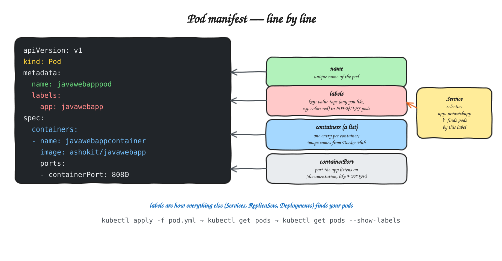

- In `metadata` we give the pod a **name** and **labels**. A label is any `key: value` pair, e.g. `app: javawebapp` or `color: red`.
- **Labels identify pods**: Services (and later ReplicaSets/Deployments) find pods by their labels.
- `containers` is a **list**: a pod can have **multiple containers**. The `image` is pulled from Docker Hub.
- To add another container, add another `- name:` entry under `containers`:

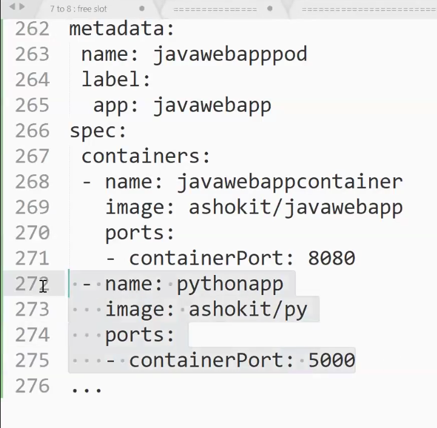

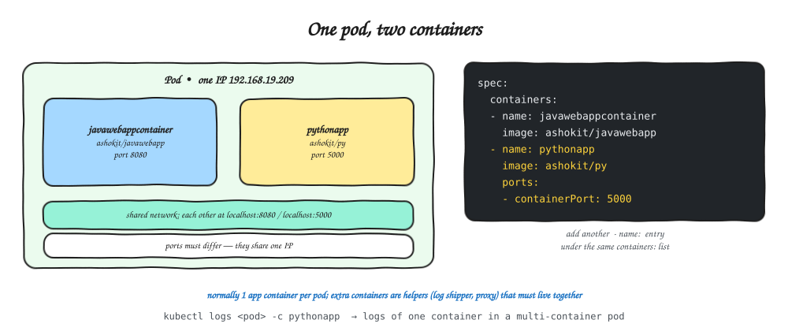

> ⚠ The screenshot has `label:` (singular). The correct field is **`labels:`**; with `label:` kubectl rejects the file (or the label is ignored), and the Service would never find the pod.

---

## 4. Creating and inspecting the pod

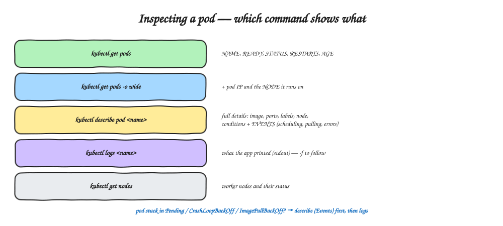

**Check pods and nodes**
```bash
kubectl get pods
kubectl get nodes
```

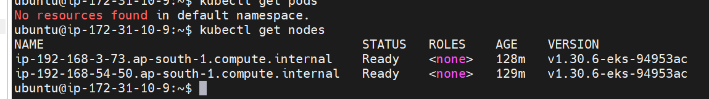

**Create the pod from the manifest**
```bash
kubectl apply -f <manifest-yml>
```

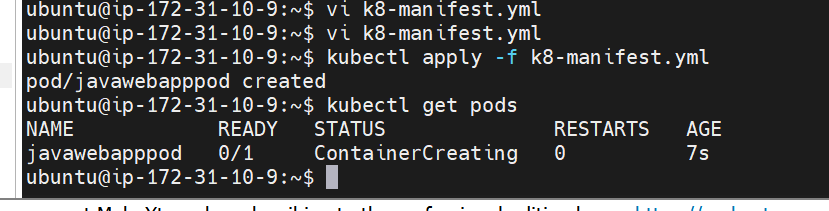

The pod is created.

**Which worker node runs the pod?**
```bash
kubectl get pods -o wide
```

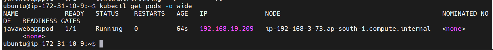

```
192.168.19.209   ip-192-168-3-73.ap-south-1.compute.internal
```
- `192.168.19.209` is the **pod's IP**.
- `ip-192-168-3-73.ap-south-1.compute.internal` is the **worker node's name**, which contains its **private IP**, `192.168.3.73`.

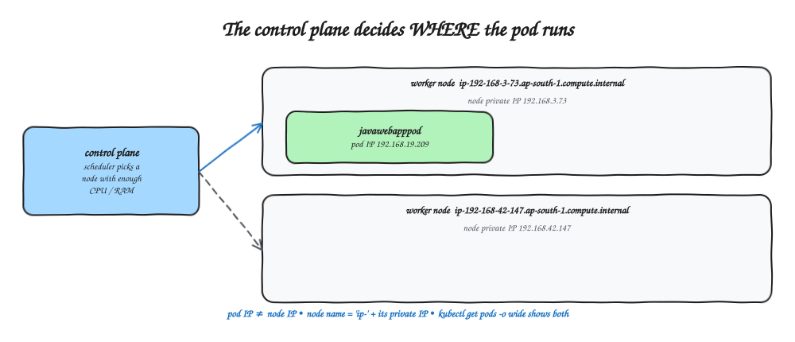

In the EC2 console, that worker node has private IP **192.168.3.73**, so the pod was created on this node:

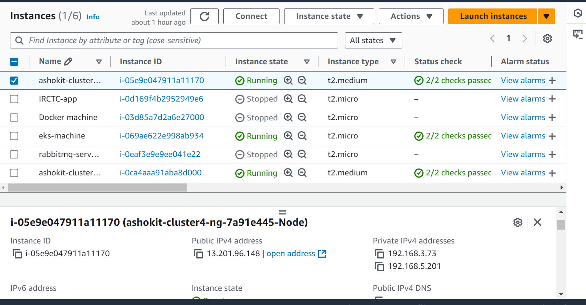

> The **control plane (scheduler) decides** which worker node a pod runs on.

**Describe the pod**
```bash
kubectl describe pod <pod-name>
```

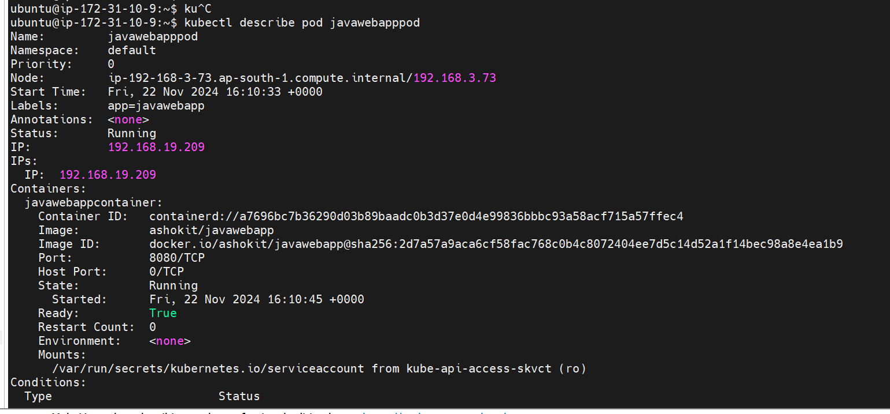

All pod details: image, node, IP, labels, container state. **Restart Count** shows how many times the container has been restarted.

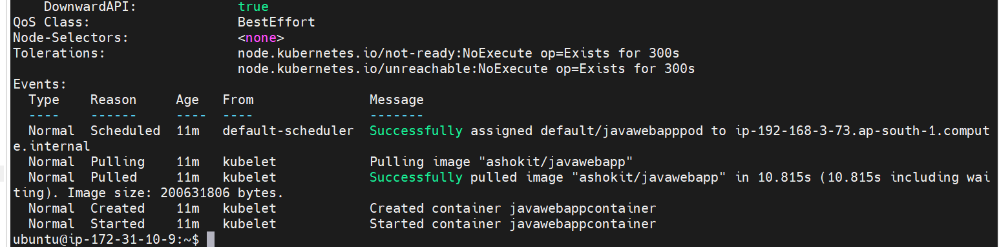

The **Events** at the bottom show what happened: scheduled → pulling image → created → started. This is the first place to look when a pod is stuck.

**Pod logs**
```bash
kubectl logs <pod-name>
```

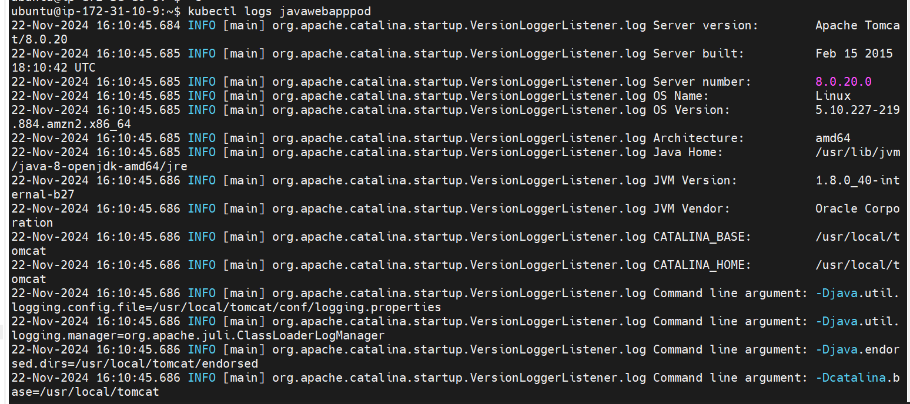

Tomcat started inside the container.

---

## 5. Can we access the application now?

**No.** Pods live on the cluster's private network and can't be reached from outside. To access pods from outside, we need a **Service**.

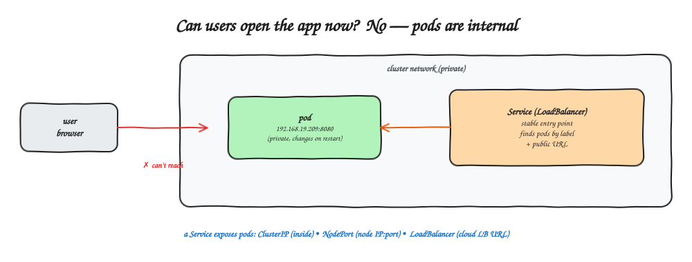

---

## 6. Service manifest

A **Service is used to expose pods**.

```yml
---
apiVersion: v1
kind: Service
metadata:
 name: javawebappsvc
spec:
 type: LoadBalancer
 selector:
  app: javawebapp
 ports:
  - port: 80
    targetPort: 8080
...
```

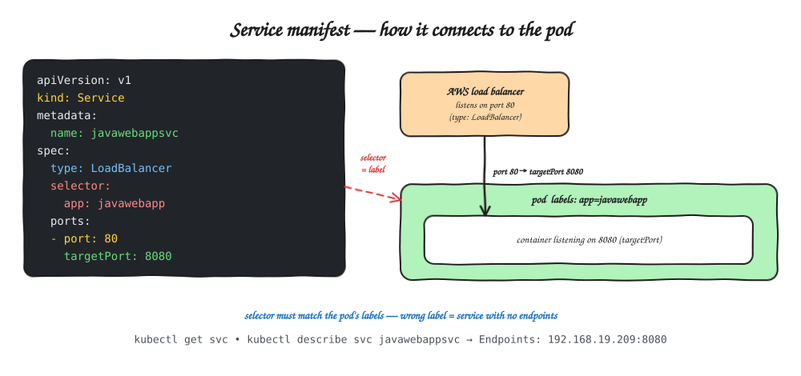

- `javawebappsvc` is the **name** of the service.
- `spec` is the service specification:
  - `type: LoadBalancer`: create an **AWS load balancer** (the other two types, ClusterIP and NodePort, come next lecture).
  - `selector`: picks the pods **by their labels**. That's why pod labels are so important: the selector must match `app: javawebapp`.
  - `port: 80`: port the **load balancer** listens on (default HTTP port).
  - `targetPort: 8080`: the **container port** where the app runs.

```bash
kubectl get service
kubectl apply -f <service-manifest-yml>
```

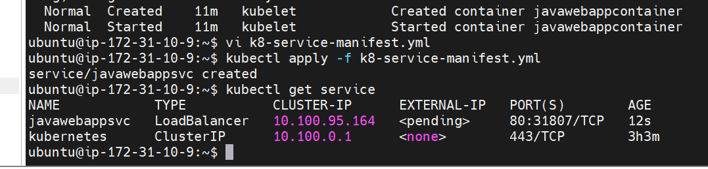

Our service is listed. The other one, `kubernetes`, is a **default service** (it points to the API server); don't delete it.

> Once the service is created, the load balancer appears in the **EC2 → Load Balancers** dashboard:

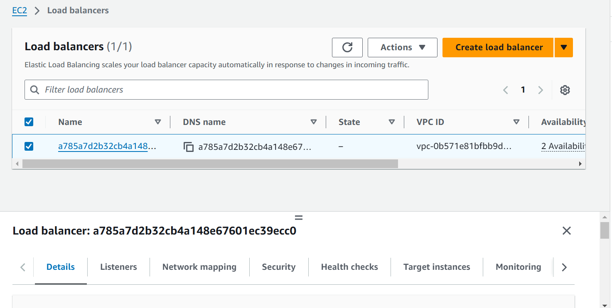

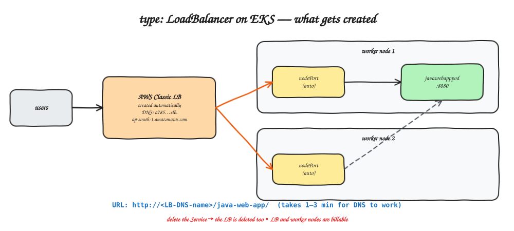

**Access the application with the load balancer's DNS URL:**
```
http://<LBR-DNS-URL>/java-web-app/
```
(It can take 1–3 minutes before the DNS name starts working.)

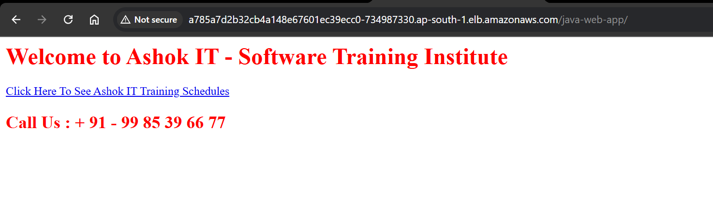

It works: Tomcat is serving the app on the load balancer's DNS URL.

```bash
kubectl get svc        # short for kubectl get service
```

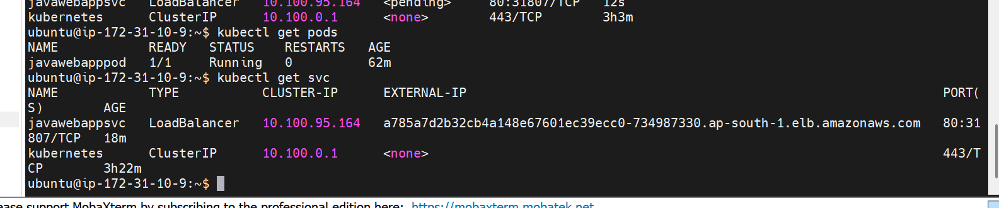

**Delete everything we created:**
```bash
kubectl delete all --all
```

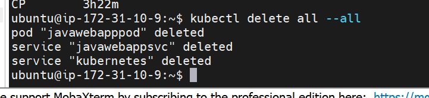

> Deleting the service also **deletes the load balancer** in AWS.

---

## 7. Pod and Service in a single YAML

Running two files every time (pod first, then service) is tedious, so we put both in **one file**, separated by `---`:

```yml
---
apiVersion: v1
kind: Pod
metadata:
 name: javawebapppod
 labels:
  app: javawebapp
spec:
 containers:
 - name: javawebappcontainer
   image: ashokit/javawebapp
   ports:
   - containerPort: 8080
---
apiVersion: v1
kind: Service
metadata:
 name: javawebappsvc
spec:
 type: LoadBalancer
 selector:
  app: javawebapp
 ports:
  - port: 80
    targetPort: 8080
...
```

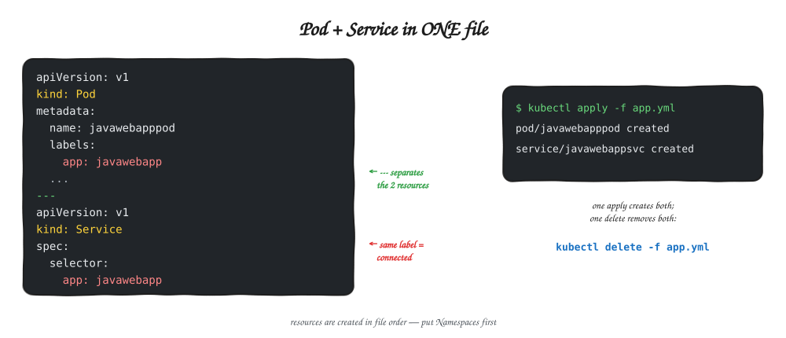

> We just joined the two files with `---`. The **pod label equals the service selector** (`app: javawebapp`), which is what connects them.

```bash
kubectl apply -f <manifest-yml>
kubectl get pods
kubectl get service
kubectl delete -f <manifest-yml>    # removes exactly what the file created
```

> 💰 The **load balancer** and the **worker nodes** are billable. Here EKS created a **Classic Load Balancer** (the default for `type: LoadBalancer` without the AWS Load Balancer Controller).

---

## 8. Quick revision

| Topic | Key point |
|-------|-----------|
| Manifest | `apiVersion`, `kind`, `metadata`, `spec` |
| `---` | Separates multiple resources in one file |
| Labels | `metadata.labels`: how Services find pods |
| Multi-container pod | Several `- name:` entries under `containers`; they share one IP |
| `kubectl get pods -o wide` | Pod IP + node it runs on |
| `kubectl describe pod` | Details + Events (troubleshooting) |
| `kubectl logs` | App output |
| Service | Exposes pods; `selector` must match pod labels |
| LoadBalancer | AWS LB, `port: 80` → `targetPort: 8080`; URL = LB DNS |
| `kubectl delete all --all` | Deletes pods + services (and the LB) in the current namespace |
