# Kubernetes · Lecture 4: NodePort, ClusterIP & Namespaces

> We created the cluster from an **Ubuntu** host machine, so the SSH username is **`ubuntu`**.

---

## 1. Cluster commands (recap)

```bash
# create the cluster (takes ~15 minutes)
eksctl create cluster --name ashokit-cluster4 --region ap-south-1 --node-type t2.medium --zones ap-south-1a,ap-south-1b

# delete the cluster after practice (avoid billing)
eksctl delete cluster --name ashokit-cluster4 --region ap-south-1

# delete all pods, services etc. in the current (default) namespace
kubectl delete all --all
```

---

## 2. NodePort Service

Last lecture we exposed pods with a **LoadBalancer** Service. **NodePort** is another way to expose pods outside the cluster.

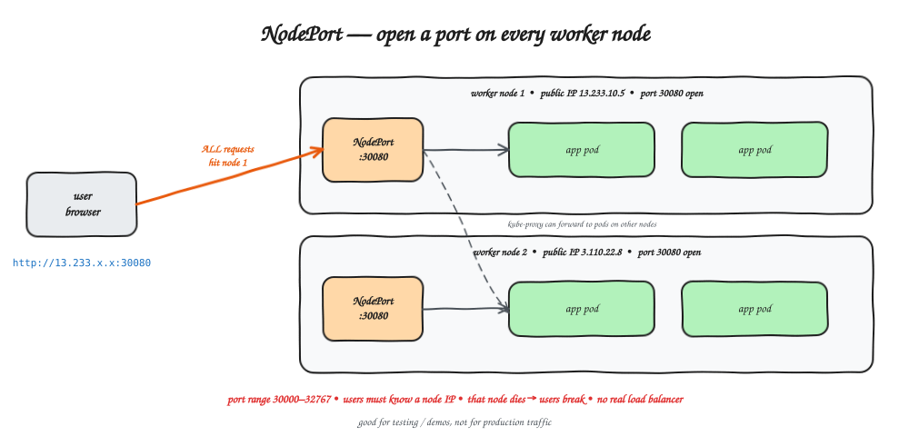

NodePort opens the **same port (30000–32767) on every worker node**, so the app is reachable at `http://<node-public-ip>:<nodePort>`.

```yml
---
apiVersion: v1
kind: Service
metadata:
 name: javawebappsvc
spec:
 type: NodePort
 selector:
  app: javawebapp
 ports:
  - port: 80
    targetPort: 8080
...
```

We reuse last lecture's Pod + Service file and only change the service `type` to `NodePort`:

```yml
---
apiVersion: v1
kind: Pod
metadata:
 name: javawebapppod
 labels:
  app: javawebapp
spec:
 containers:
 - name: javawebappcontainer
   image: ashokit/javawebapp
   ports:
   - containerPort: 8080
---
apiVersion: v1
kind: Service
metadata:
 name: javawebappsvc
spec:
 type: NodePort
 selector:
  app: javawebapp
 ports:
  - port: 80
    targetPort: 8080
...
```

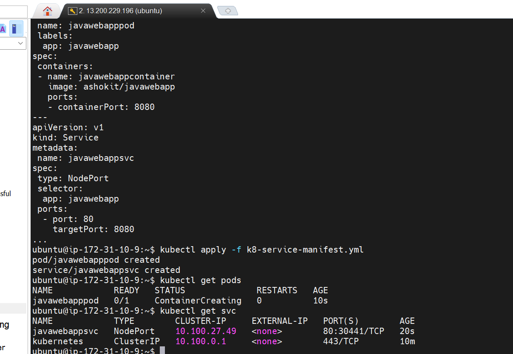

The pod and service are created, and the service type is **NodePort**.

### The port numbers

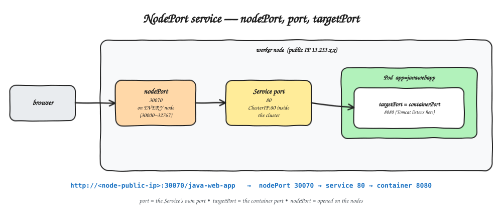

| Field | Meaning | Example |
|-------|---------|---------|
| `nodePort` | Port opened on **every worker node** (30000–32767) | 30441 / 30070 |
| `port` | The **Service's** own port (its ClusterIP inside the cluster) | 80 |
| `targetPort` | The **container's** port that traffic is forwarded to | 8080 |
| `containerPort` | The port the app listens on inside the container (should equal `targetPort`) | 8080 |

### Accessing the app

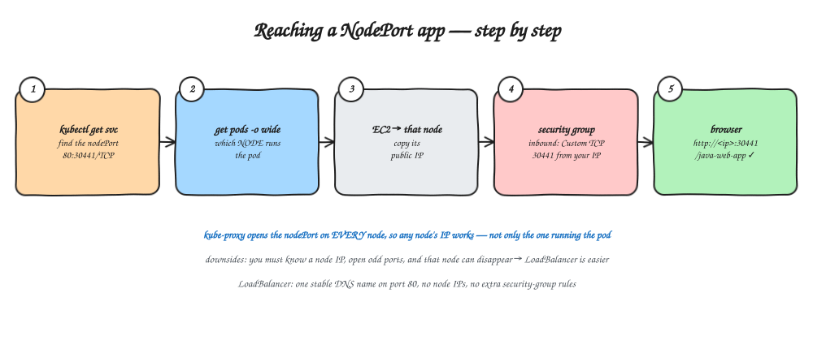

```bash
kubectl get svc               # PORT(S) shows 80:<nodePort>/TCP
kubectl get pods -o wide      # which worker node runs the pod (+ its IP)
```

> Open the **nodePort** in the **security group inbound rules** of the worker nodes, or the browser can't reach it.

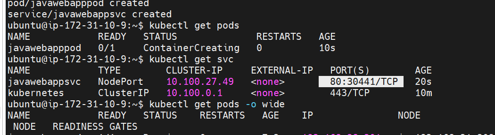

Here the nodePort is **30441**, so add an inbound rule for TCP 30441 (from *anywhere* for practice; your own IP is safer).

**URL:** `http://<node-public-ip>:<node-port>/java-web-app`


> We used the public IP of the worker node running the pod. Actually **any** worker node's IP works: kube-proxy opens the nodePort on every node and forwards the traffic to the pod.

### Random vs fixed nodePort

Every time you delete and re-create the NodePort Service you get a **new random port**. We want a fixed one.

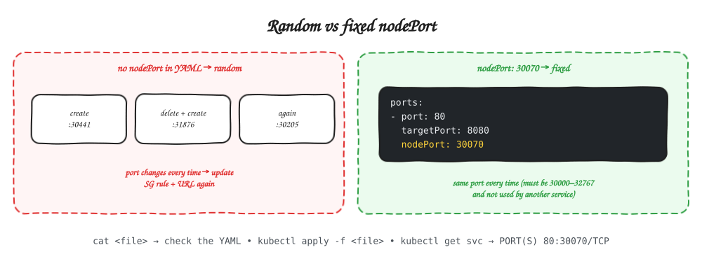

- If `nodePort` isn't specified, Kubernetes picks a **random** port in **30000–32767**.
- To get a fixed port, set `nodePort` yourself (it must be in that range and unused).

```yml
---
apiVersion: v1
kind: Service
metadata:
 name: javawebappsvc
spec:
 type: NodePort
 selector:
  app: javawebapp
 ports:
  - port: 80
    targetPort: 8080
    nodePort: 30070
...
```

```bash
cat <file-name>               # check the file content
kubectl apply -f <yml-file-name>
kubectl get pods
kubectl get service           # PORT(S) → 80:30070/TCP
```
**URL:** `http://<node-public-ip>:30070/java-web-app`

> **NodePort vs LoadBalancer:** with a LoadBalancer you get **one stable URL on port 80**, with nothing to look up. With NodePort you must find a worker node's public IP, open the nodePort in the security group, and the node can be replaced (new IP). So NodePort is fine for testing; LoadBalancer is used for real traffic.

---

## 3. ClusterIP Service

With type **ClusterIP**, one **static (fixed) IP** is created to reach all matching pods **from inside the cluster**.

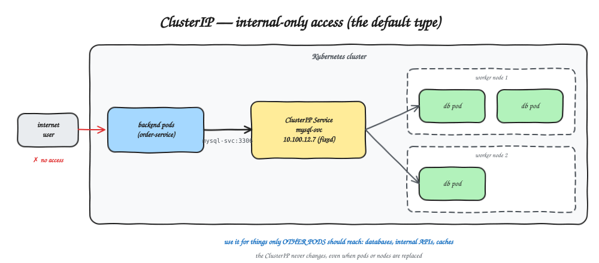

```yml
---
apiVersion: v1
kind: Service
metadata:
 name: javawebappsvc
spec:
 type: ClusterIP
 selector:
  app: javawebapp
 ports:
  - port: 80
    targetPort: 8080
...
```

- All pods with the label are mapped behind the cluster IP.
- **Not for outside access**, only internal. Typical use: **database pods**, which must be reachable by other pods but **not** by the outside world.
- ClusterIP is also the **default** type when `type` isn't specified.

### Changing the type

To change the service type, edit the YAML and apply it again:

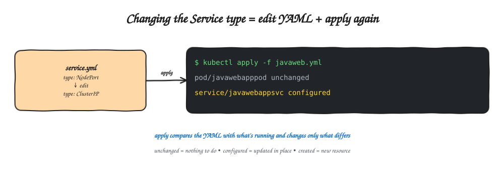

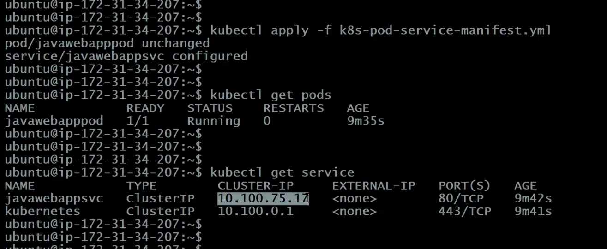

The pod is `unchanged`; the service is `configured` and now shows `TYPE ClusterIP`, `CLUSTER-IP 10.100.75.17`, `EXTERNAL-IP <none>`.

> You **can't** open a ClusterIP from outside. It gives pods a **fixed internal address**, reachable only inside the cluster.

### Testing a ClusterIP from inside

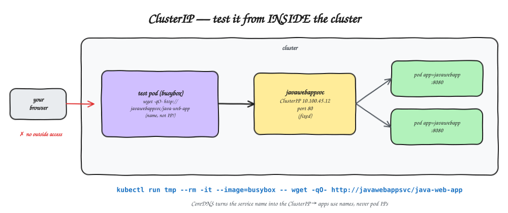

```bash
kubectl run tmp --rm -it --image=busybox -- wget -qO- http://javawebappsvc/java-web-app
```
Pods call the **service name** (`javawebappsvc`); CoreDNS turns it into the ClusterIP.

### The 3 service types together

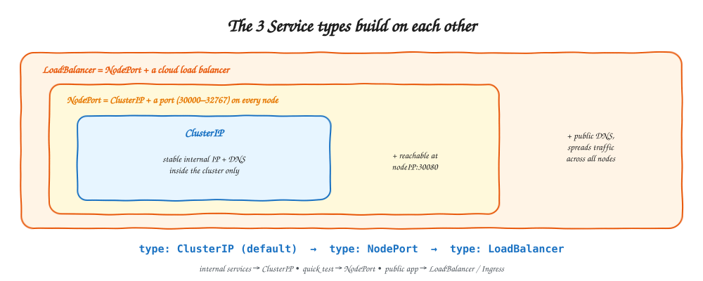

| | ClusterIP | NodePort | LoadBalancer |
|---|---|---|---|
| Reachable from | Inside the cluster | `nodeIP:30000-32767` | Public LB URL |
| Use for | Databases, internal APIs | Testing / demos | Public apps |
| Extra setup | None | Open nodePort in security group | None (cloud LB created automatically) |

---

## 4. Kubernetes Namespaces

**Namespaces group Kubernetes resources** logically:

| Pods | Namespace |
|------|-----------|
| frontend app pods | one namespace |
| backend app pods | one namespace |
| database pods | one namespace |

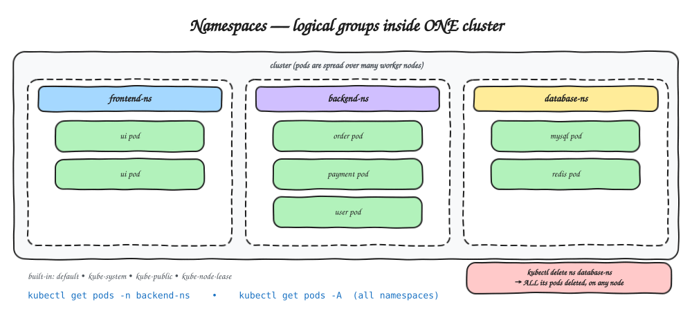

- You can create **many namespaces** in a cluster, e.g. `ashokit-a1-ns`, `ashokit-a2-ns`.
- Each namespace is **isolated** from the others: names only have to be unique within a namespace, and permissions/quotas can be set per namespace.

> ⚠ **Deleting a namespace deletes all resources in it.**

```bash
kubectl get ns          # list namespaces
```

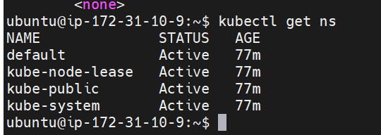

Some namespaces already exist. Apart from `default`, they're used by Kubernetes itself.

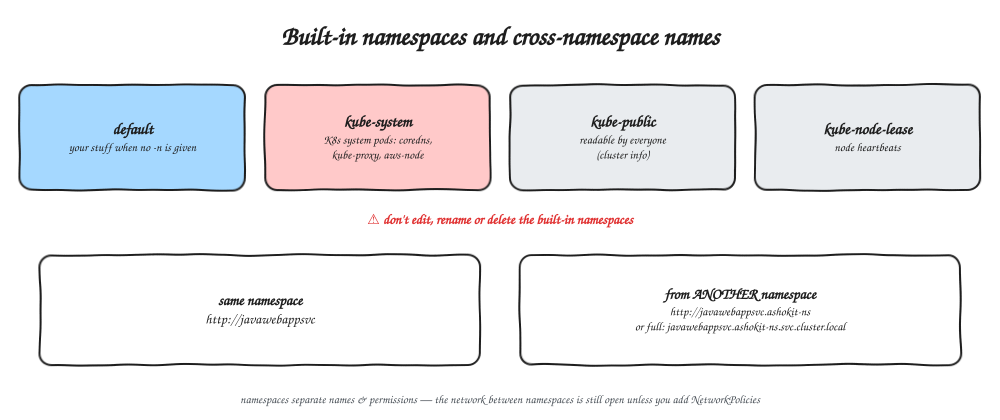

```bash
kubectl get pods -n <namespace-name>
```

`kubectl get pods -n default`: our `javawebapppod` is in `default`:

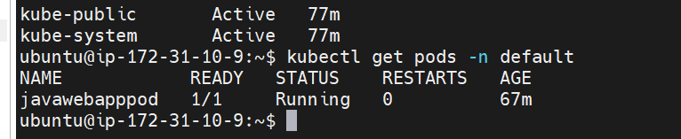

`kubectl get pods -n kube-system`: the system pods (`aws-node`, `coredns`, `kube-proxy`):

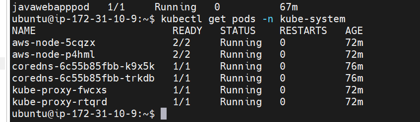

> `kubectl get pods` without `-n` shows the **default** namespace. If no namespace is given, Kubernetes uses `default`.

### Creating namespaces

**Approach 1: command**
```bash
kubectl create ns ashokit-ns
```

**Approach 2: manifest YAML**
```yml
---
apiVersion: v1
kind: Namespace
metadata:
 name: ashokit-ns-2
...
```
```bash
kubectl apply -f <yml-file>
```

**Delete a namespace**
```bash
kubectl delete ns <namespace-name>
```

### Pod and Service inside our namespace

Previously the pod and service were in `default`; now we put them in our own namespace by adding `namespace:` under each resource's `metadata`:

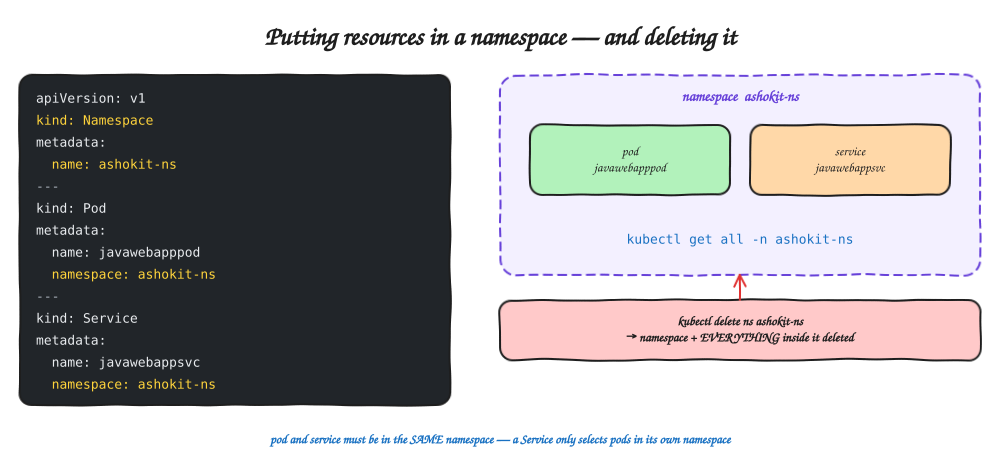

```yml
---
apiVersion: v1
kind: Namespace
metadata:
 name: ashokit-ns
---
apiVersion: v1
kind: Pod
metadata:
 name: javawebapppod
 namespace: ashokit-ns
 labels:
  app: javawebapp
spec:
 containers:
 - name: javawebappcontainer
   image: ashokit/javawebapp
   ports:
   - containerPort: 8080
---
apiVersion: v1
kind: Service
metadata:
 name: javawebappsvc
 namespace: ashokit-ns
spec:
 type: LoadBalancer
 selector:
  app: javawebapp
 ports:
  - port: 80
    targetPort: 8080
...
```
> The Namespace must be listed **first** in the file so it exists before the pod and service are created in it. Pod and Service must be in the **same** namespace, because a Service only selects pods in its own namespace.

```bash
kubectl apply -f <yml-file>
kubectl get ns
kubectl get pods -n ashokit-ns
```

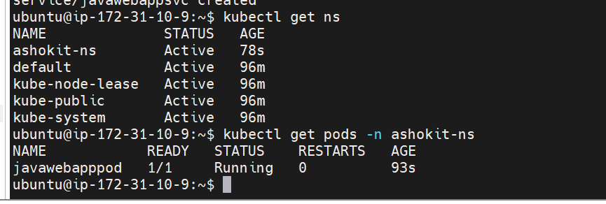

```bash
kubectl get service -n ashokit-ns
```

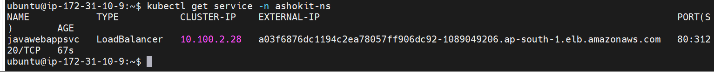

```bash
kubectl get all -n ashokit-ns
kubectl delete ns ashokit-ns
```

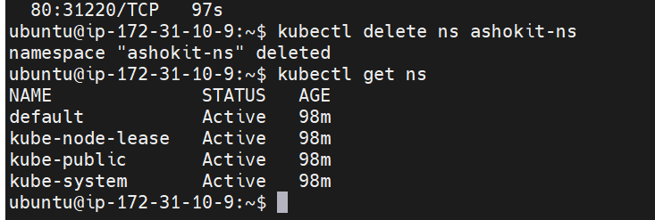

The namespace (and its pod and service) is deleted; only the built-in namespaces remain.

> The `80:31220/TCP` at the top of that screenshot shows that a **LoadBalancer** Service also gets a nodePort: the cloud load balancer sends traffic to that port on the nodes.

> ⚠ **Don't touch, rename or delete the namespaces that already exist** (`default`, `kube-system`, `kube-public`, `kube-node-lease`).

---

## 5. Interview questions (lectures 1–4)

| # | Question | Where to revise |
|---|----------|-----------------|
| 1 | What is orchestration? | Lecture 1 |
| 2 | Kubernetes introduction | Lecture 1 |
| 3 | Kubernetes advantages | Lecture 1 |
| 4 | Kubernetes architecture | Lecture 1 |
| 5 | Architecture components (API server, scheduler, controller manager, etcd, kubelet, kube-proxy) | Lecture 1 |
| 6 | Cluster setup (Minikube / kubeadm / EKS) | Lectures 1–2 |
| 7 | Kubernetes resources | Lecture 2 |
| 8 | What is a Pod? | Lectures 1–3 |
| 9 | What is a Service (ClusterIP, NodePort, LoadBalancer)? | Lectures 2–4 |
| 10 | What is a Namespace? | Lectures 2 & 4 |

---

## 6. Quick revision

| Topic | Key point |
|-------|-----------|
| NodePort | Port 30000–32767 on every node; `http://nodeIP:nodePort` |
| Fixed nodePort | Set `nodePort:` in the YAML (within range) |
| Security group | Open the nodePort on worker nodes |
| port / targetPort | Service port / container port |
| ClusterIP | Fixed internal IP + DNS name; inside the cluster only (DB pods) |
| Change type | Edit YAML → `kubectl apply` (pod unchanged, service configured) |
| Namespace | Logical group; delete it → everything inside is deleted |
| `-n <ns>` | Without it, kubectl uses `default` |
