# Kubernetes · Lecture 5: Self-Healing, ReplicaSet & Deployment

> We created the cluster from an **Ubuntu** host machine, so the SSH username is **`ubuntu`**.

---

## 1. Cluster commands (recap)

```bash
# create the cluster (takes ~15 minutes)
eksctl create cluster --name ashokit-cluster4 --region ap-south-1 --node-type t2.medium --zones ap-south-1a,ap-south-1b

# delete the cluster after practice (avoid billing)
eksctl delete cluster --name ashokit-cluster4 --region ap-south-1
```

| Command | What it does |
|---------|-------------|
| `kubectl delete all --all` | Delete pods, services, replicasets, deployments **in the current (default) namespace** |
| `kubectl get all -n <namespace>` | Show everything in a namespace |
| `kubectl apply -f <yml-file>` | Create / update resources from a manifest |
| `kubectl get ns` | List namespaces |

---

## 2. Self-healing in Kubernetes

Self-healing means: **if a pod is damaged, Kubernetes should create a new one automatically.** But in this test we deleted the pod and Kubernetes did **not** recreate it:

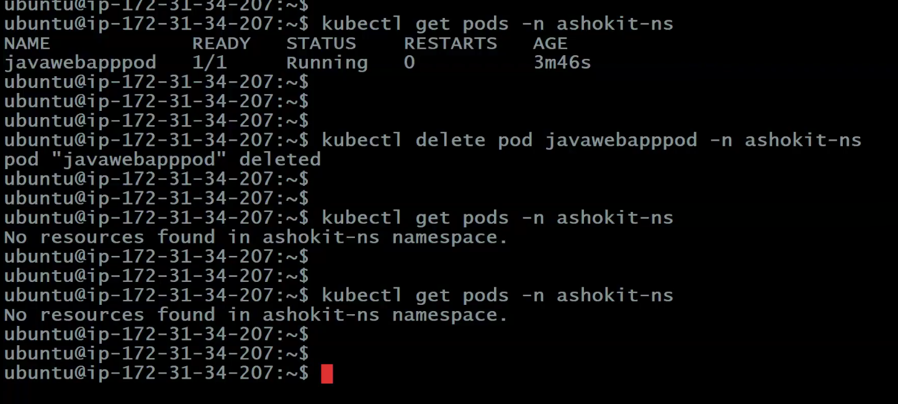

Why? Until now we created pods **directly** with a Pod manifest (`kind: Pod`).

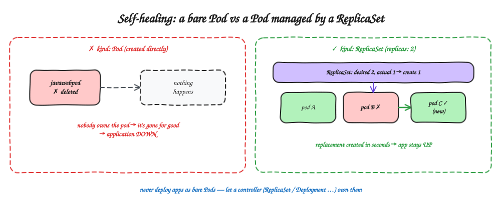

- A pod created directly has **no owner**, so it gets **no self-healing**.
- If it's damaged / crashed / deleted, Kubernetes **will not** create a new one, and the application goes **down**.

> ⚠ **Don't create pods directly to deploy applications.** Use a Kubernetes **resource (controller)** that creates the pods; then Kubernetes manages the pod life cycle.

### Resources that create pods

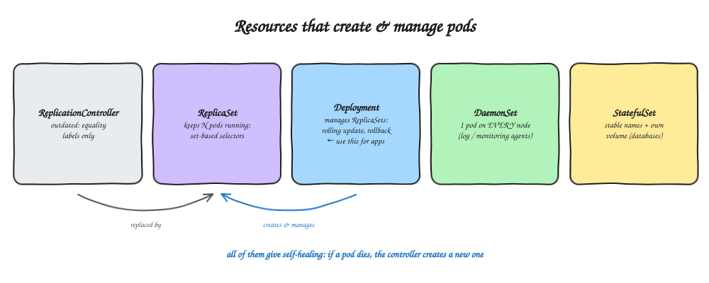

| Resource | Use |
|----------|-----|
| **ReplicationController (RC)** | Original way to keep N pods running (**outdated**) |
| **ReplicaSet (RS)** | Improved RC: keeps N pods running |
| **Deployment** | Manages ReplicaSets, adds rolling updates & rollback (**use this for apps**) |
| **DaemonSet** | Runs one pod on **every node** (log / monitoring agents) |
| **StatefulSet** | Pods with stable names and their own storage (databases, Kafka) |

All of them provide **self-healing**.

### ReplicationController vs ReplicaSet

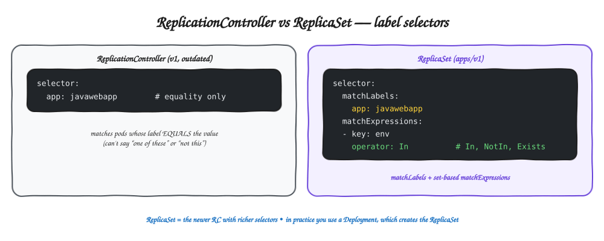

The real difference is the **label selector**:
- **RC** supports only **equality-based** selectors (`app = javawebapp`).
- **RS** also supports **set-based** selectors with `matchExpressions` (`env In (dev, qa)`, `NotIn`, `Exists`).

---

## 3. ReplicaSet

- A Kubernetes resource used to **create and manage pods**.
- It takes care of the **pod life cycle**: when a pod is damaged / crashed / deleted, the ReplicaSet **creates a new one**.
- It **always keeps the given number of pods** running, e.g. `replicas: 2`.
- This gives **high availability** (no downtime if one pod dies).
- You can **scale up / scale down** the number of pods.

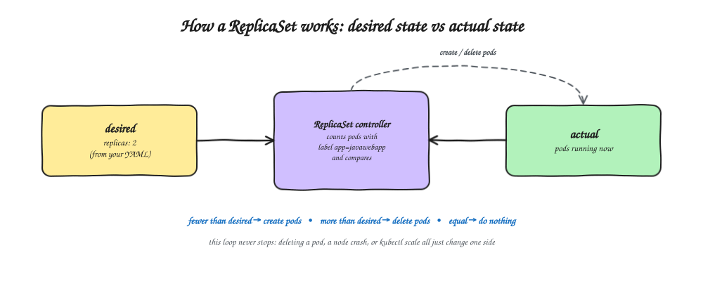

The ReplicaSet controller constantly compares **desired** (`replicas` in YAML) with **actual** (pods with matching labels): too few → create, too many → delete.

### ReplicaSet manifest

```yml
---
apiVersion: apps/v1
kind: ReplicaSet
metadata:
 name: javawebrs
spec:
 replicas: 2
 selector:
  matchLabels:
   app: javawebapp
 template:
  metadata:
   name: javawebpod
   labels:
    app: javawebapp
  spec:
   containers:
   - name: javawebcontainer
     image: ashokit/javawebapp
     ports:
      - containerPort: 8080
---
apiVersion: v1
kind: Namespace
metadata:
 name: ashokit-ns
---
apiVersion: v1
kind: Service
metadata:
 name: javawebappsvc
 namespace: ashokit-ns
spec:
 type: LoadBalancer
 selector:
  app: javawebapp
 ports:
  - port: 80
    targetPort: 8080
...
```

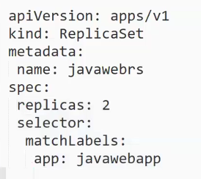

- `kind: ReplicaSet` (not `kind: Pod`).
- `selector.matchLabels` says **which pods** this ReplicaSet owns; it must match the labels in `template`.
- `replicas: 2` means two pods run; if one is deleted the other keeps serving and a replacement is created; if both are deleted, two new ones are created.
- `spec.template` holds the **pod details** (what used to be a Pod manifest).
- A `-` (hyphen) in YAML marks a **list item** (`containers`, `ports`).

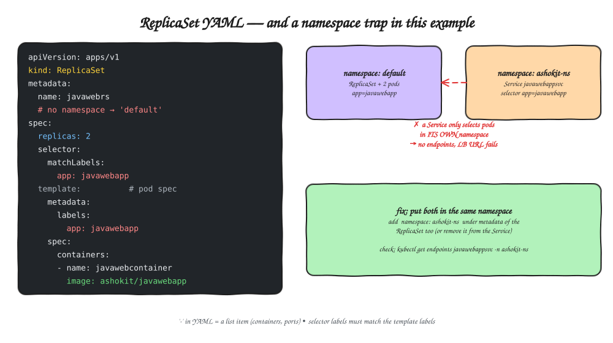

> ⚠ **Namespace trap in this example:** the ReplicaSet has no `namespace`, so its pods go to **`default`**, while the Service is in **`ashokit-ns`**. A Service only selects pods in **its own namespace**, so this Service has **no endpoints** and the LoadBalancer URL won't work. Fix: add `namespace: ashokit-ns` to the ReplicaSet's `metadata` too (or drop it from the Service). Check with `kubectl get endpoints javawebappsvc -n ashokit-ns`.

### Try it

```bash
kubectl get all
kubectl apply -f <yml-file>
```

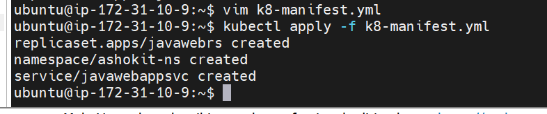

```bash
kubectl get pods
kubectl get rs                      # list ReplicaSets
kubectl delete pod <pod-name>       # delete one pod…
kubectl get pods                    # …and a new one appears (self-healing)
```

### Scaling a ReplicaSet

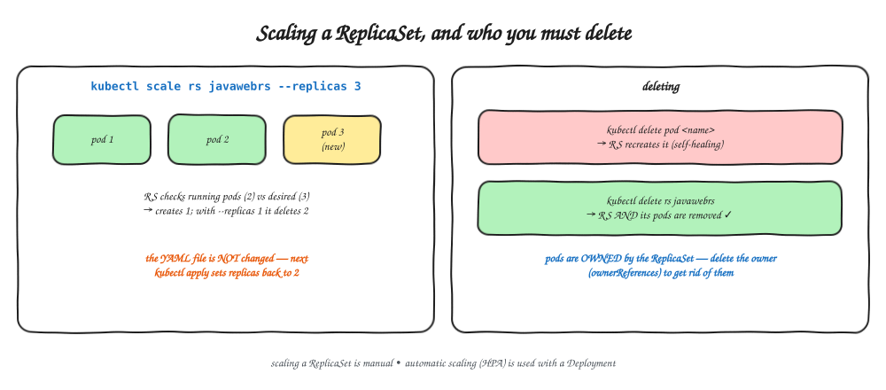

Increase pods by editing `replicas` in the YAML and re-applying, or with a command (which **does not change the YAML file**):
```bash
kubectl scale rs javawebrs --replicas 3
```
> The ReplicaSet checks how many pods are currently running and decides whether to **scale up or down**. The next `kubectl apply` of the old YAML will set it back to 2.

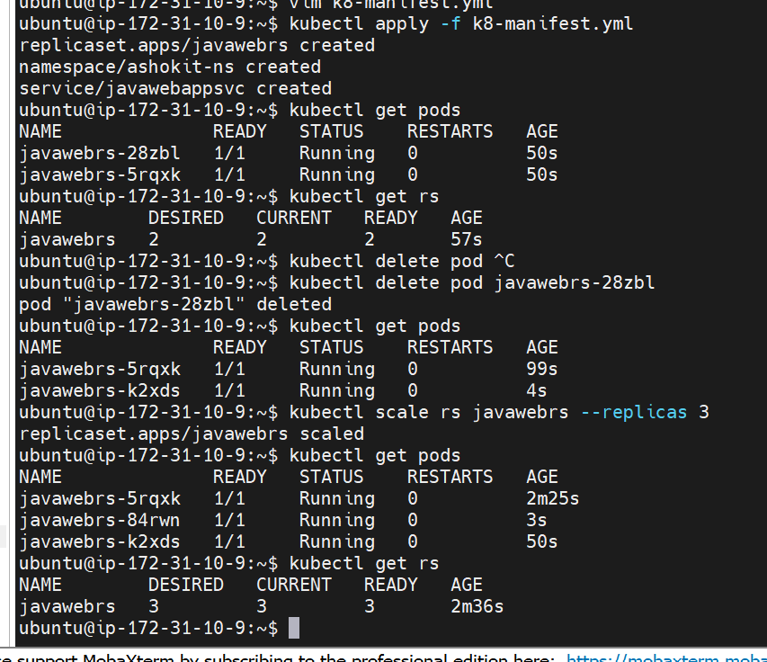

Scaling up and self-healing both work: 3 pods, ReplicaSet `DESIRED 3 / CURRENT 3 / READY 3`:

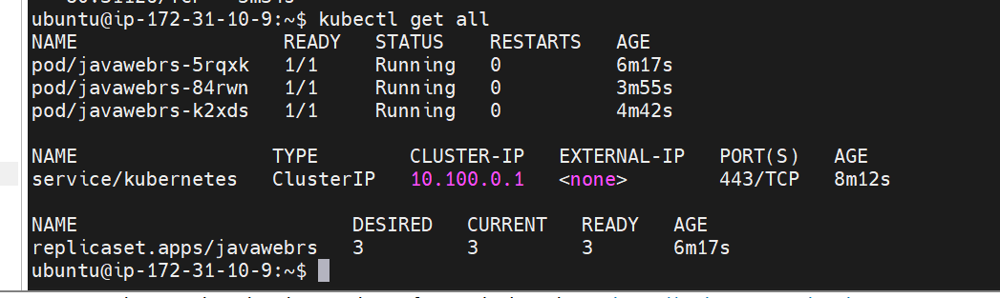

> Notice `javawebappsvc` is **missing** from this list: `kubectl get all` shows the `default` namespace, and the Service was created in `ashokit-ns`. That's the namespace trap described above.

### Deleting

> To get rid of the pods, delete the **resource that created them**. Deleting only a pod just triggers self-healing.

```bash
kubectl delete rs javawebrs     # deletes the ReplicaSet AND its pods
```

> In a ReplicaSet, scaling up / down is **manual**. Kubernetes **autoscaling** is used together with a **Deployment**.

---

## 4. Kubernetes Deployment

- A Kubernetes resource that **manages the pod life cycle** (through a ReplicaSet).
- **The most recommended way to deploy applications in Kubernetes.**

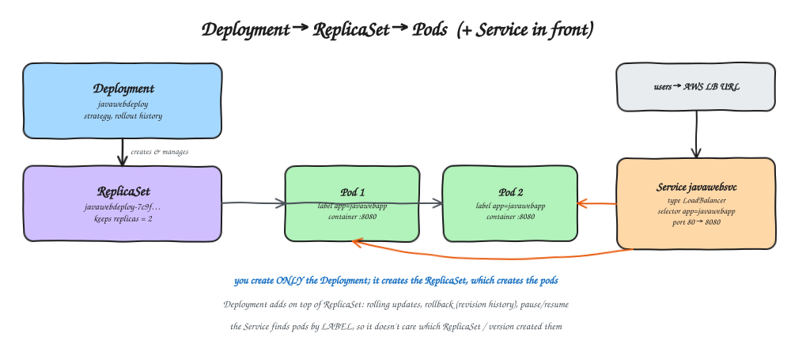

| Advantage | Meaning |
|-----------|---------|
| **Zero downtime** | Several pods; one failing is replaced while others serve |
| **Autoscaling** | With HPA, pods increase/decrease with load |
| **Rolling update & rollback** | New versions pod by pod; go back to the previous version if needed |

### Deployment strategies

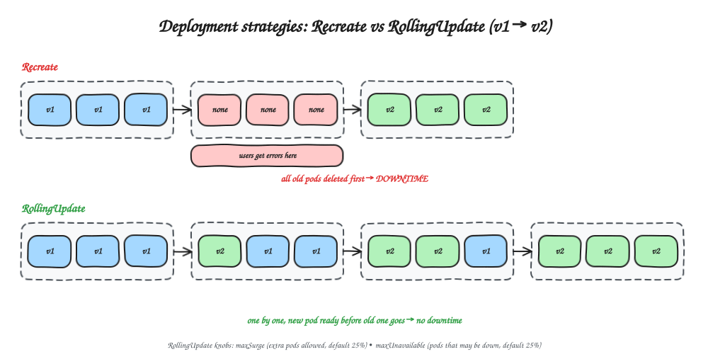

| Strategy | How | Downtime |
|----------|-----|----------|
| **Recreate** | Delete all existing pods, then create new ones | Yes |
| **RollingUpdate** (default) | Delete and create pods **one by one** | No |

```yml
---
apiVersion: apps/v1
kind: Deployment
metadata:
 name: javawebdeploy
spec:
 replicas: 2
 strategy:
  type: RollingUpdate
 selector:
  matchLabels:
   app: javawebapp
 template:
  metadata:
   name: javawebpod
   labels:
    app: javawebapp
  spec:
   containers:
   - name: javawebappcontainer
     image: ashokit/javawebapp
     ports:
     - containerPort: 8080
---
apiVersion: v1
kind: Service
metadata:
 name: javawebsvc
spec:
 type: LoadBalancer
 selector:
  app: javawebapp
 ports:
  - port: 80
    targetPort: 8080
...
```
Same structure as the ReplicaSet, with `kind: Deployment` and a `strategy`.

```bash
kubectl delete all --all
kubectl get all
kubectl apply -f <yml-file>
kubectl get all            # shows deployment + replicaset + pods + service
```
Access the app with the **LoadBalancer URL** (`kubectl get svc` → `EXTERNAL-IP`).

```bash
kubectl scale deployment javawebdeploy --replicas 4
kubectl get pods
kubectl scale deployment javawebdeploy --replicas 3

# rolling update & rollback
kubectl set image deployment/javawebdeploy javawebappcontainer=ashokit/javawebapp:v2
kubectl rollout status  deployment/javawebdeploy
kubectl rollout undo    deployment/javawebdeploy
```

---

## 5. Autoscaling

**Autoscaling** = increasing / decreasing infrastructure resources based on demand.

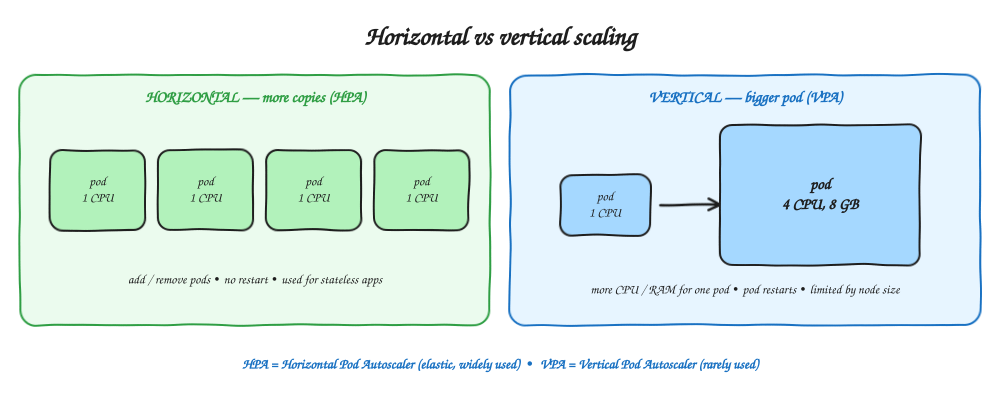

| Type | Meaning | K8s |
|------|---------|-----|
| **Horizontal scaling** | More instances / servers / pods | **HPA**: Horizontal Pod Autoscaler |
| **Vertical scaling** | More capacity (CPU/RAM) for one system | **VPA**: Vertical Pod Autoscaler (we don't use this) |

**HPA** scales the number of pod replicas up/down based on observed metrics (CPU or memory utilization).

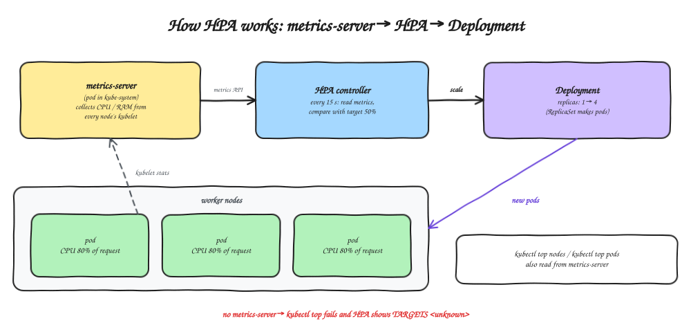

- HPA asks the **Metrics Server** for pod CPU/memory usage.
- **Metrics Server** collects CPU/RAM metrics from pods and nodes and keeps the latest values.

```bash
kubectl top nodes     # node metrics
kubectl top pods      # pod metrics
```

> ⚠ Metrics Server is **not installed by default**. Installing it and running a full HPA demo is covered in **Lecture 6** (`013.k8s-6`).

---

## 6. Quick revision

| Topic | Key point |
|-------|-----------|
| Bare Pod | No owner → no self-healing; don't deploy apps this way |
| RC vs RS | RS adds set-based selectors; RC is outdated |
| ReplicaSet | Keeps `replicas` pods running; recreates deleted ones |
| Labels | `selector.matchLabels` must match `template.metadata.labels` |
| Namespaces | A Service only selects pods in its own namespace |
| Scale | `kubectl scale rs/deployment <name> --replicas N` (YAML unchanged) |
| Delete pods for good | Delete the owner: `kubectl delete rs <name>` |
| Deployment | Recommended; manages ReplicaSets; rolling update & rollback |
| HPA | Autoscaling; needs Metrics Server |
