# Kubernetes · Lecture 6: Deployments, Scaling & HPA

> We created the cluster from an **Ubuntu** host machine, so the SSH username is **`ubuntu`**.

---

## 1. Cluster commands (recap)

```bash
# create the cluster (takes ~15 minutes)
eksctl create cluster --name ashokit-cluster4 --region ap-south-1 --node-type t2.medium --zones ap-south-1a,ap-south-1b

# delete the cluster after practice (avoid billing)
eksctl delete cluster --name ashokit-cluster4 --region ap-south-1
```

| Command | What it does |
|---------|-------------|
| `kubectl delete all --all` | Delete all pods, services, deployments, replicasets **in the current (default) namespace** |
| `kubectl get all -n <namespace>` | Show everything in a namespace |
| `kubectl apply -f <yml-file>` | Create / update resources from a manifest |
| `kubectl get ns` | List namespaces |

> ⚠ `delete all --all` only touches the current namespace, and "all" doesn't include ConfigMaps, Secrets or volumes.

---

## 2. Kubernetes Deployment

A **Deployment** is a Kubernetes resource that manages the **life cycle of your pods**.

> **Deployment is the most recommended way to deploy applications in Kubernetes.**

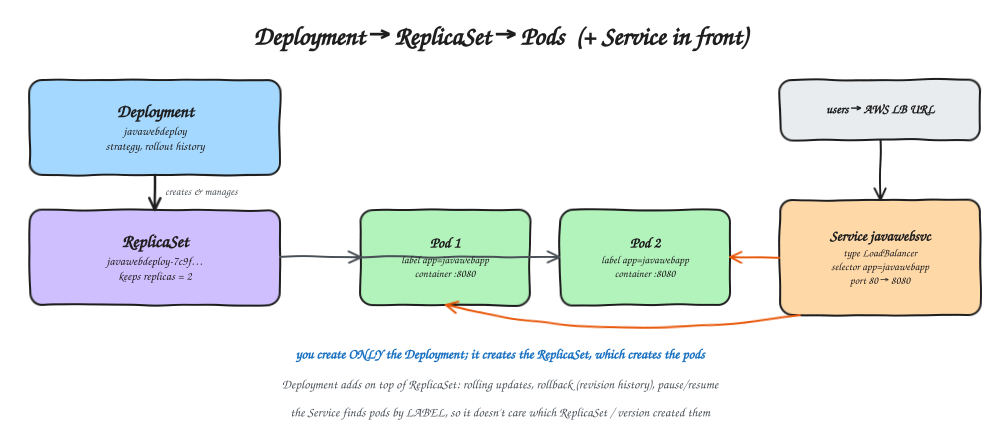

You create only the Deployment. It creates a **ReplicaSet**, which creates and watches the **pods**.

### Advantages

| Advantage | Meaning |
|-----------|---------|
| **Zero downtime** | Several pods run; if one goes down the others keep serving, and it's replaced |
| **Scaling** | Change the number of pods manually, or automatically with **HPA** |
| **Rolling update & rollback** | Deploy new versions pod by pod with no downtime; **roll back** to the previous version if something breaks |

### Deployment strategies

Suppose pods are already running and the code changes, so we must replace old pods with new ones. Two strategies:

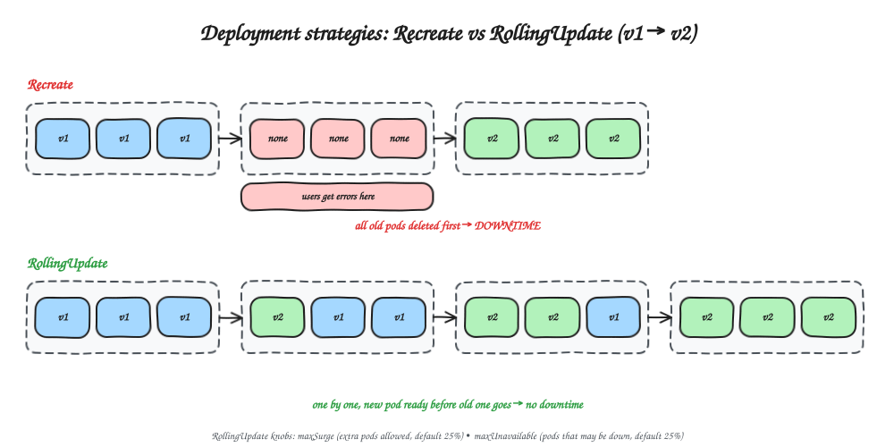

| Strategy | How | Downtime? |
|----------|-----|-----------|
| **Recreate** | Delete **all** existing pods, then create the new ones | ✗ Yes, briefly nothing is running |
| **RollingUpdate** (default) | Replace pods **one by one**: start a new one, then remove an old one | ✓ No downtime |

RollingUpdate can be tuned:
```yaml
strategy:
  type: RollingUpdate
  rollingUpdate:
    maxSurge: 1          # at most 1 extra pod during the update
    maxUnavailable: 0    # never go below the desired number of pods
```

### Deployment + Service manifest

```yml
---
apiVersion: apps/v1
kind: Deployment
metadata:
 name: javawebdeploy
spec:
 replicas: 2
 strategy:
  type: RollingUpdate
 selector:
  matchLabels:
   app: javawebapp
 template:
  metadata:
   name: javawebpod
   labels:
    app: javawebapp
  spec:
   containers:
   - name: javawebappcontainer
     image: ashokit/javawebapp
     ports:
     - containerPort: 8080
---
apiVersion: v1
kind: Service
metadata:
 name: javawebsvc
spec:
 type: LoadBalancer
 selector:
  app: javawebapp
 ports:
  - port: 80
    targetPort: 8080
...
```

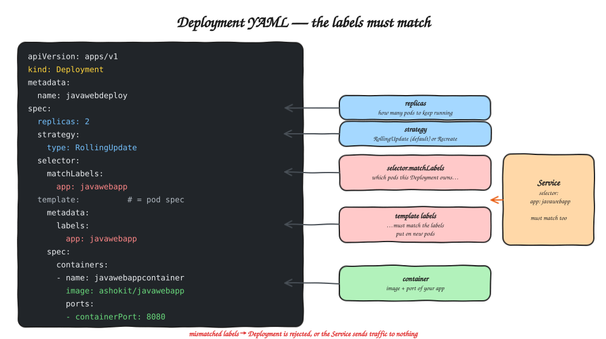

- The deployment **strategy** goes in the Deployment's `spec`.
- `spec.selector.matchLabels` **must match** `template.metadata.labels`, so the Deployment knows which pods it owns.
- The Service's `selector` uses the same label to find the pods.
- `port: 80` is the Service port users hit; `targetPort: 8080` is the container's port.

```bash
kubectl delete all --all
kubectl get all
kubectl apply -f <yml-file>
kubectl get all
```

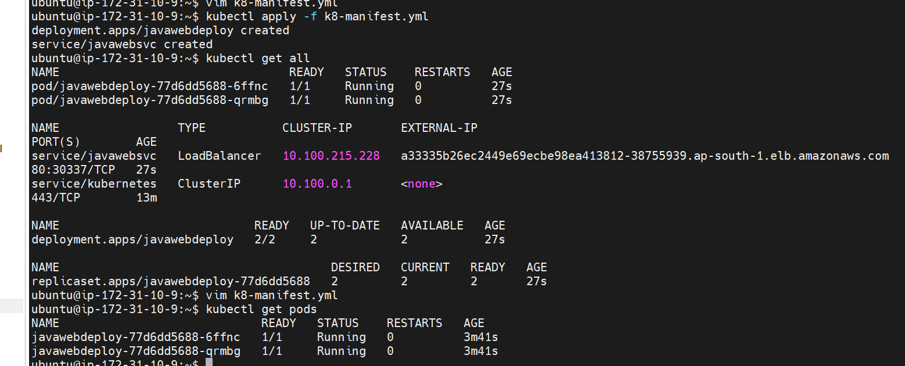

> A **ReplicaSet** was created: internally a Deployment always uses a ReplicaSet.

### Self-healing

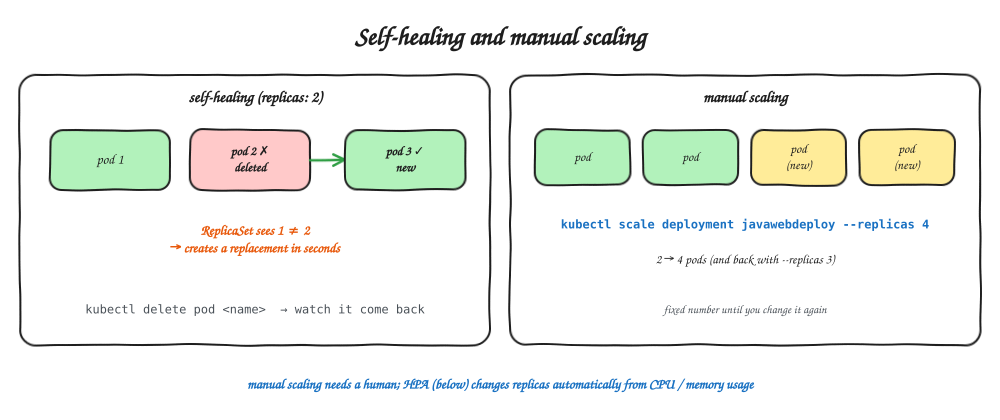

Delete a pod and the ReplicaSet immediately creates a replacement to keep `replicas: 2`:

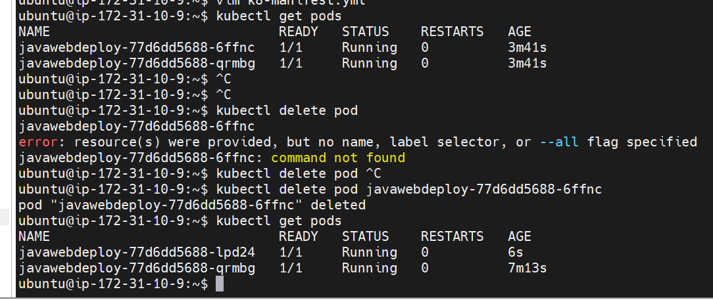

> Access the app using the **LoadBalancer URL** (`kubectl get svc` → `EXTERNAL-IP`):

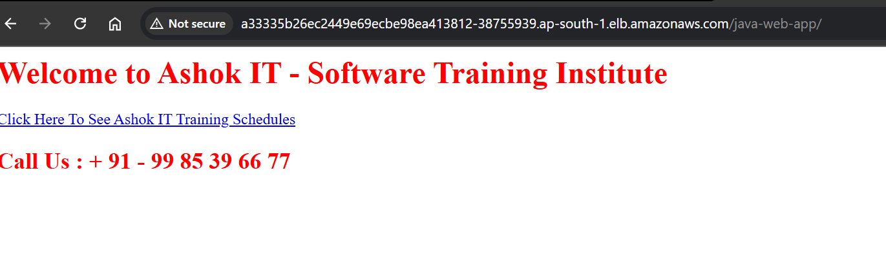

### Rolling update & rollback commands

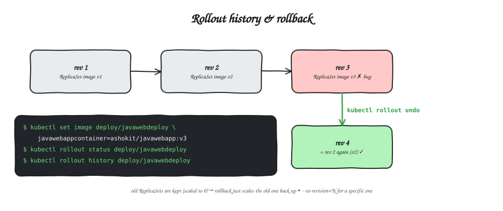

```bash
# deploy a new version (triggers a rolling update)
kubectl set image deployment/javawebdeploy javawebappcontainer=ashokit/javawebapp:v2

kubectl rollout status  deployment/javawebdeploy   # watch progress
kubectl rollout history deployment/javawebdeploy   # list revisions
kubectl rollout undo    deployment/javawebdeploy   # back to the previous revision
kubectl rollout undo    deployment/javawebdeploy --to-revision=1
```
Old ReplicaSets are kept (scaled to 0), so a rollback simply scales the old one back up.

### Manual scaling

```bash
kubectl scale deployment javawebdeploy --replicas 4
kubectl get pods
kubectl scale deployment javawebdeploy --replicas 3
```

> Manual scaling needs a human. **Autoscaling** needs some setup; it doesn't happen by itself.

---

## 3. Autoscaling

**Autoscaling** = automatically increasing / decreasing infrastructure resources based on demand.

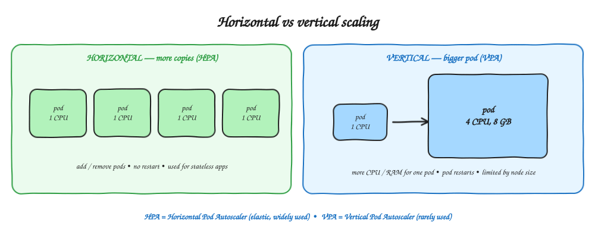

| Type | Meaning | In Kubernetes |
|------|---------|---------------|
| **Horizontal scaling** | Increase the **number** of instances / servers / pods | **HPA**: Horizontal Pod Autoscaler (elastic, widely used) |
| **Vertical scaling** | Increase the **capacity** (CPU / RAM) of a single system | **VPA**: Vertical Pod Autoscaler (we don't use this) |

### HPA (Horizontal Pod Autoscaler)

HPA **scales the number of pod replicas up or down based on observed metrics** (CPU or memory utilization).

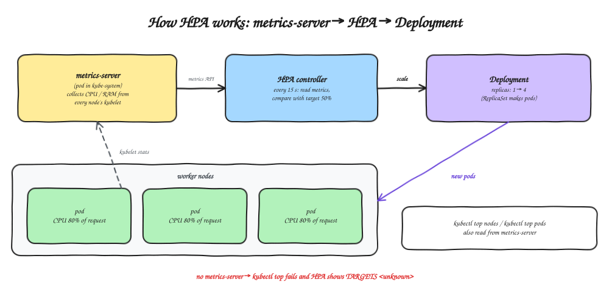

- HPA asks the **Metrics Server** for the current CPU/memory usage of the pods.
- **Metrics Server** is an application that collects resource metrics (CPU, RAM) from pods and nodes (via each node's kubelet) and keeps the latest values.
- Every ~15 seconds HPA compares usage with the target and changes the Deployment's `replicas`.

```bash
kubectl top nodes      # node CPU / memory
kubectl top pods       # pod CPU / memory
```

> ⚠ Metrics Server is **not installed by default** on EKS. Without it, `kubectl top` fails and HPA shows `TARGETS: <unknown>`.
> Metrics Server itself runs as **pods**, installed from YAML.

---

## 4. HPA hands-on

### Step 1: Install the Metrics Server

Git is already installed on Ubuntu (`git --version` to check).

```bash
git clone https://github.com/ashokitschool/k8s_metrics_server
cd k8s_metrics_server
ls deploy/1.8+/
kubectl apply -f deploy/1.8+/          # apply all manifests in that folder
```

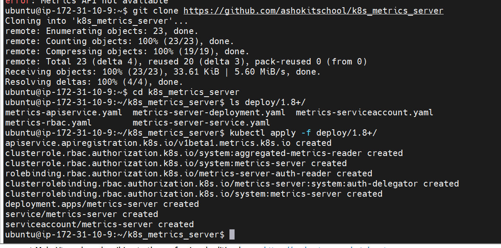

> It creates a service account, roles, role bindings, a Deployment and a Service: everything Metrics Server needs.

> 💡 Official alternative: `kubectl apply -f https://github.com/kubernetes-sigs/metrics-server/releases/latest/download/components.yaml`

```bash
kubectl get all -n kube-system    # metrics-server is installed in kube-system
kubectl top nodes
kubectl top pods
```

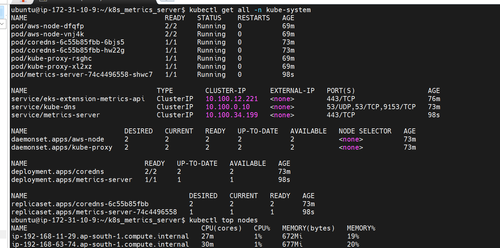

Metrics Server runs as a **pod**, with a **ClusterIP** Service, because it's only used internally (no public access needed). The output also shows the CPU usage of the worker nodes (EC2 instances):

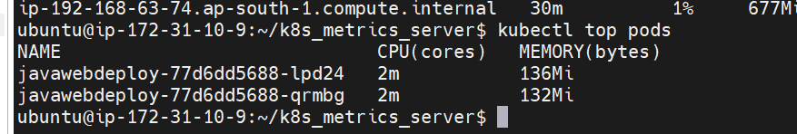

Now we get CPU and memory information.

### Step 2: Deploy a sample application with resource requests

We use an image provided by the Kubernetes project, with **resource requests/limits** set:

```yml
---
apiVersion: apps/v1
kind: Deployment
metadata:
 name: hpa-demo-deployment
spec:
 selector:
   matchLabels:
     run: hpa-demo-deployment
 replicas: 1
 template:
   metadata:
     labels:
       run: hpa-demo-deployment
   spec:
     containers:
     - name: hpa-demo-deployment
       image: registry.k8s.io/hpa-example     # older notes: k8s.gcr.io/hpa-example (registry moved)
       ports:
       - containerPort: 80
       resources:
         limits:
           cpu: 500m
         requests:
           cpu: 200m
...
```

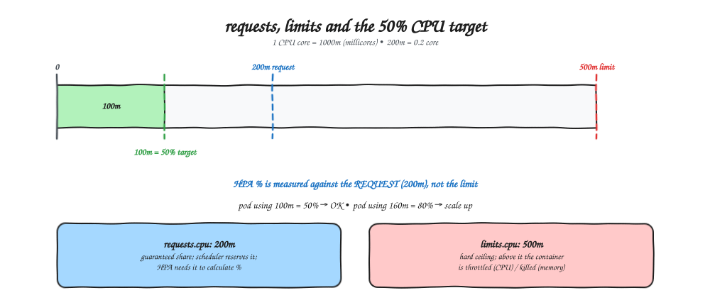

| Field | Meaning |
|-------|---------|
| `requests.cpu: 200m` | Guaranteed CPU (0.2 core); the scheduler reserves it. **HPA calculates its % against this value**, so HPA doesn't work without requests |
| `limits.cpu: 500m` | Maximum CPU; above it the container is throttled |

`m` = millicores: **1000m = 1 CPU core**.

### Step 3: Create a Service

The label is `run: hpa-demo-deployment`:
```yml
---
apiVersion: v1
kind: Service
metadata:
 name: hpa-demo-deployment
 labels:
   run: hpa-demo-deployment
spec:
 ports:
 - port: 80
 selector:
   run: hpa-demo-deployment
...
```
No `type` is given, so the default **ClusterIP** is used (fine, because the load test runs inside the cluster):

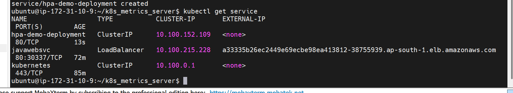

### Step 4: Create the HPA

```yml
---
apiVersion: autoscaling/v1
kind: HorizontalPodAutoscaler
metadata:
 name: hpa-demo-deployment
spec:
 scaleTargetRef:
  apiVersion: apps/v1
  kind: Deployment
  name: hpa-demo-deployment
 minReplicas: 1
 maxReplicas: 10
 targetCPUUtilizationPercentage: 50
...
```

`scaleTargetRef` says **what to scale**: the Deployment from Step 2.
```yml
 scaleTargetRef:
  apiVersion: apps/v1
  kind: Deployment
  name: hpa-demo-deployment
```
- If average CPU > **50% of the request** (> 100m per pod) → add pods, up to **10**.
- When load drops → remove pods, down to **1**.

Equivalent shortcut: `kubectl autoscale deployment hpa-demo-deployment --cpu-percent=50 --min=1 --max=10`

> Newer clusters also offer `autoscaling/v2`, which supports memory and custom metrics:
> ```yaml
> apiVersion: autoscaling/v2
> kind: HorizontalPodAutoscaler
> spec:
>   metrics:
>   - type: Resource
>     resource: { name: cpu, target: { type: Utilization, averageUtilization: 50 } }
> ```

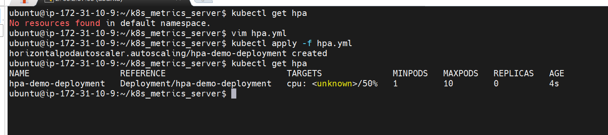

The HPA is created; after a short while its targets show real values.

### Step 5: Increase the load

```bash
kubectl get hpa
```

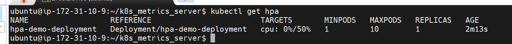

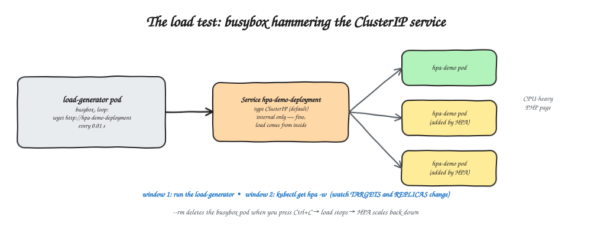

In a **new terminal**, start a load generator that calls the service in a loop:
```bash
kubectl run -i --tty load-generator --rm --image=busybox --restart=Never -- /bin/sh -c "while sleep 0.01; do wget -q -O- http://hpa-demo-deployment; done"
```

> After starting the load generator, open **another** Git Bash window, connect to the EKS host VM and watch the HPA:

```bash
kubectl get hpa -w        # -w = watch, updates live
```

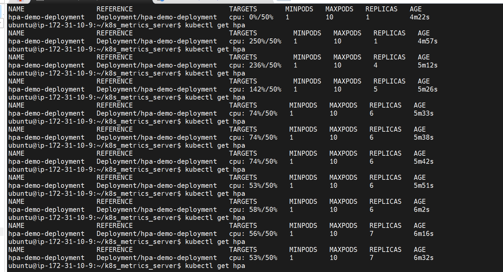

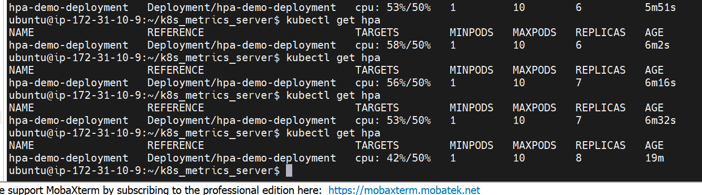

> CPU utilization goes up, so HPA adds replicas; as more pods share the load, CPU per pod comes back down towards the target.

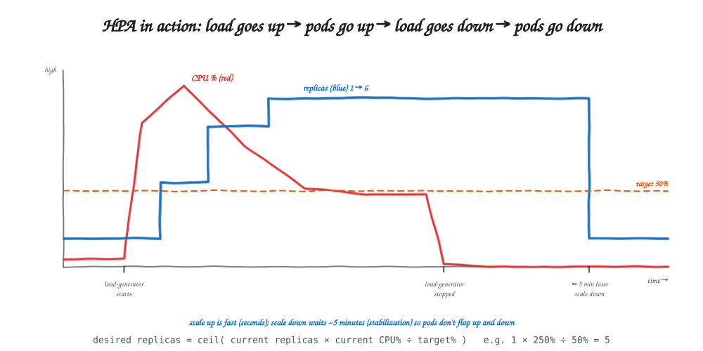

**How many pods?** HPA uses:
```
desired replicas = ceil( current replicas × current CPU% ÷ target CPU% )
e.g. 1 pod at 250% → ceil(1 × 250 / 50) = 5 pods
```

Useful commands while it runs:
```bash
kubectl describe deploy hpa-demo-deployment
kubectl get hpa
kubectl get events
kubectl top pods
kubectl get hpa
```

Now stop the load generator (`Ctrl+C`; `--rm` deletes the busybox pod), and the load drops:

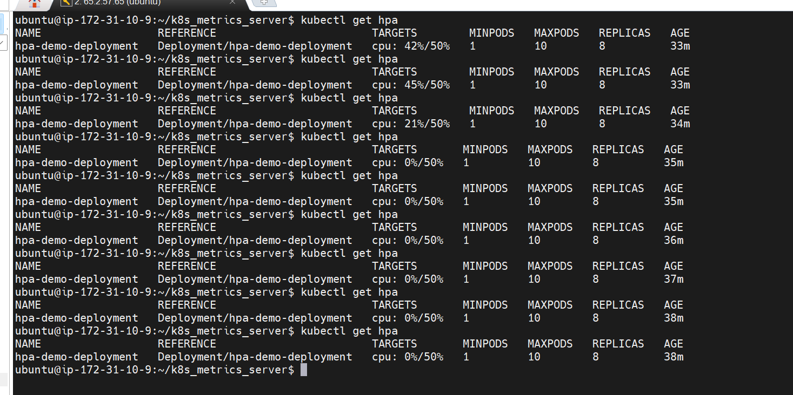

After some time the pods are reduced too:

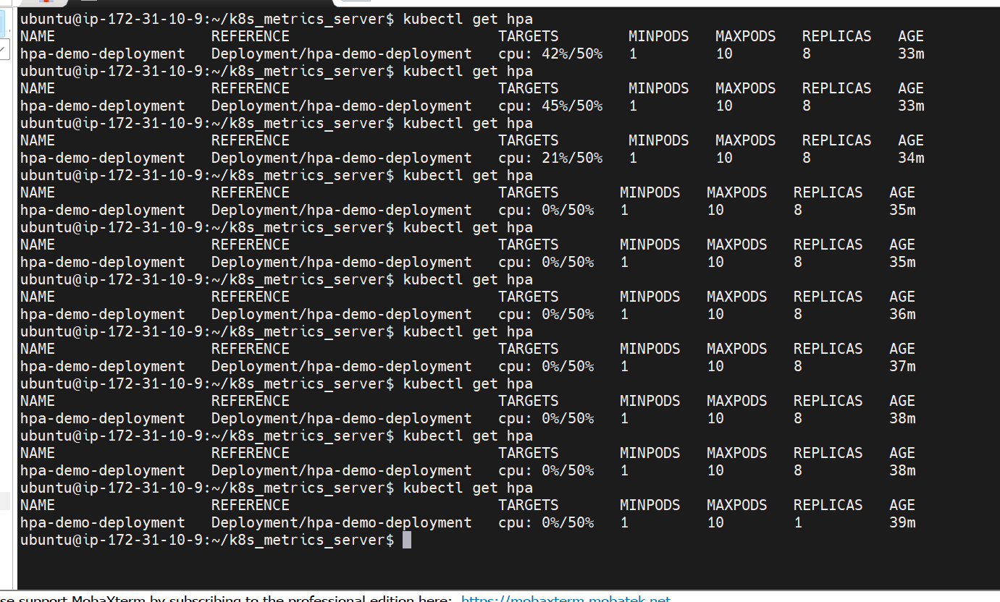

> Scale-down is deliberately **slow** (about **5 minutes** of stabilization) so pods don't flap up and down on short dips in load.

---

## 5. Quick revision

| Topic | Key point |
|-------|-----------|
| Deployment | Recommended way to run apps; manages a ReplicaSet → pods |
| Labels | `selector.matchLabels` = `template.metadata.labels` = Service `selector` |
| Recreate | Delete all, then create; downtime |
| RollingUpdate | One by one; no downtime (default) |
| Rollback | `kubectl rollout undo deployment/<name>` |
| Manual scaling | `kubectl scale deployment <name> --replicas N` |
| HPA | Changes replicas from CPU/memory metrics |
| Metrics Server | Required for HPA and `kubectl top`; runs in `kube-system` |
| requests.cpu | Needed for HPA; % is calculated against it |
| Scale down | Waits ~5 min to avoid flapping |
