# Kubernetes · Lecture 8: Blue-Green Deployment

> We created the cluster from an **Ubuntu** host machine, so the SSH username is **`ubuntu`**.

---

## 1. Cluster commands (recap)

```bash
# create the cluster (takes ~15 minutes)
eksctl create cluster --name ashokit-cluster4 --region ap-south-1 --node-type t2.medium --zones ap-south-1a,ap-south-1b

# delete the cluster after practice (avoid billing)
eksctl delete cluster --name ashokit-cluster4 --region ap-south-1
```

| Command | What it does |
|---------|-------------|
| `kubectl delete all --all` | Delete pods, services, deployments in the current (default) namespace |
| `kubectl get all -n <namespace>` | Show everything in a namespace |
| `kubectl apply -f <yml-file>` | Create / update resources from a manifest |
| `kubectl get ns` | List namespaces |

---

## 2. What is blue-green deployment?

Most companies use this release model to deploy with **zero downtime**.

- There are **two production environments**: **blue** and **green**.
- **Blue** = the **current** version that customers are using.
- **Green** = the **new** version. It's deployed next to blue and opened **only for testing** first.
- Once testing passes, the load balancer traffic is **switched to green**.
- If customers hit a problem, traffic is **switched back to blue** immediately.

So if the latest pods have a bug, you **roll back to blue** in seconds, with no downtime either way.

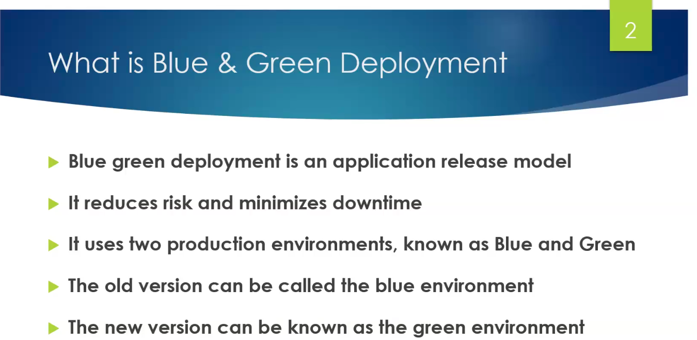

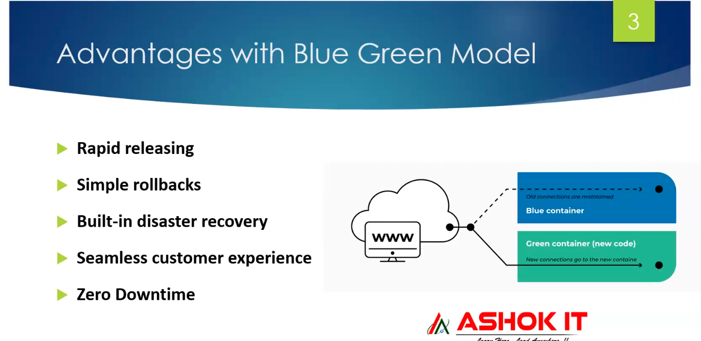

| Advantage | Why |
|-----------|-----|
| **Rapid releasing** | v2 is already running and tested; going live is just a switch |
| **Simple rollbacks** | Blue is still running, so switch back |
| **Built-in disaster recovery** | A full second environment always exists |
| **Seamless customer experience** | Old connections finish on blue; new ones go to green |
| **Zero downtime** | No "2-hour maintenance window" message to customers |

---

## 3. How it works in Kubernetes: labels & selectors

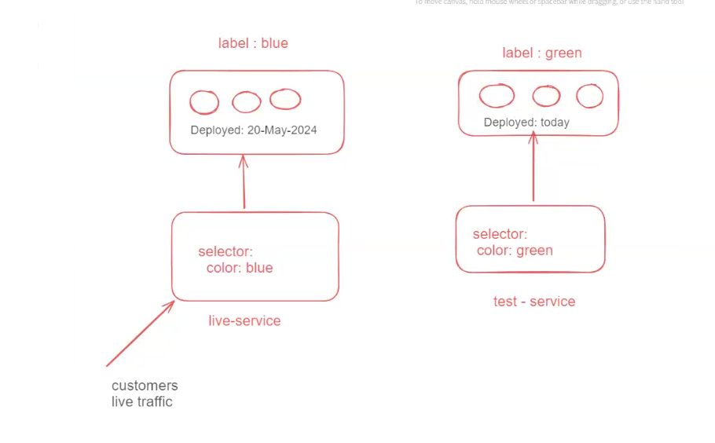

- **Blue pods** carry a label like `color: blue` (or `version: v1`); **green pods** carry `color: green` (or `version: v2`).
- **live-service** (customers' load balancer) selects the **blue** label.
- **test-service / pre-prod service** selects the **green** label. The **testing team** tests v2 through it, on real production infrastructure, before customers ever see it.

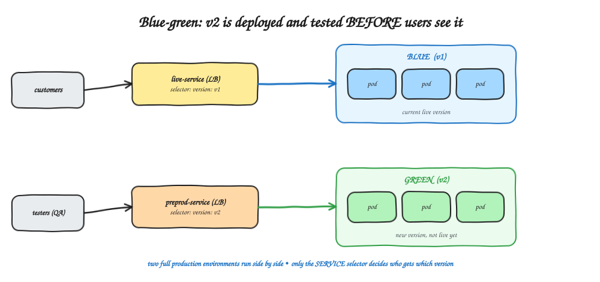

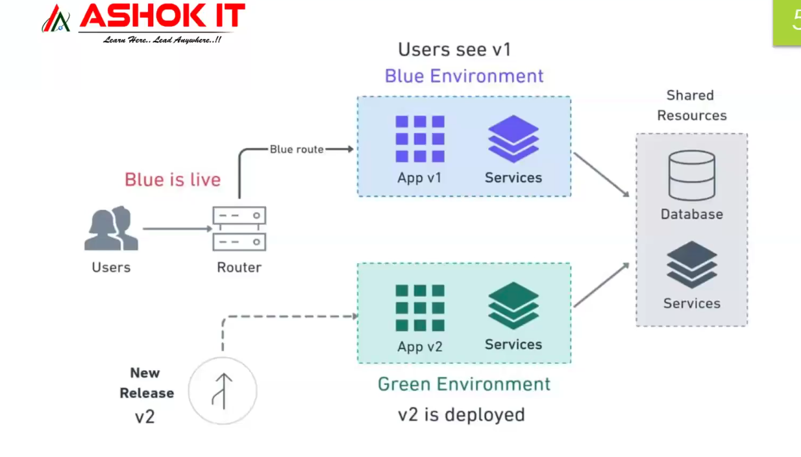

### Going live

To make green live, **change the selector label of live-service** to green (`color: green` / `version: v2`). The live service then sends all traffic to the green pods.

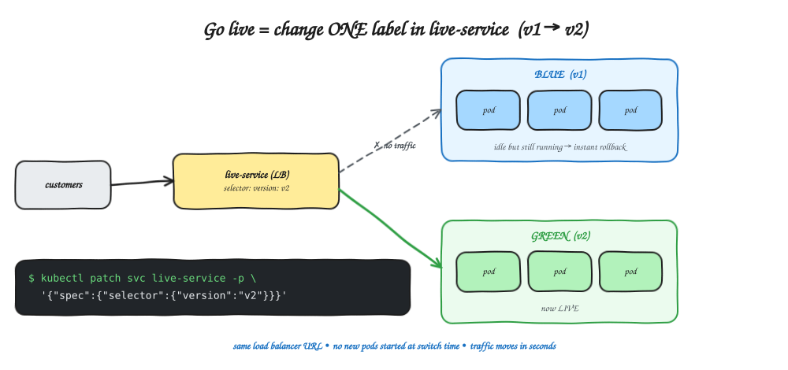

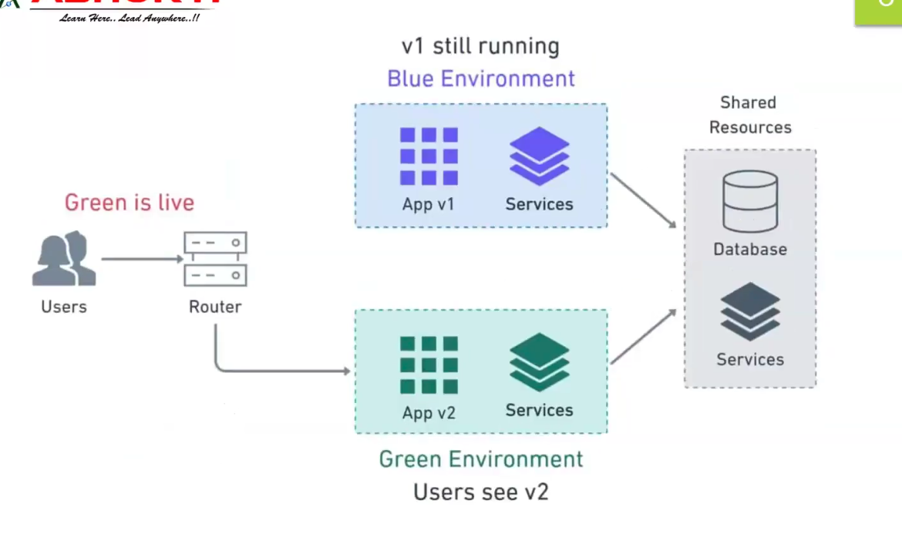

### Rollback

If there's any problem in green, change the label back to blue.

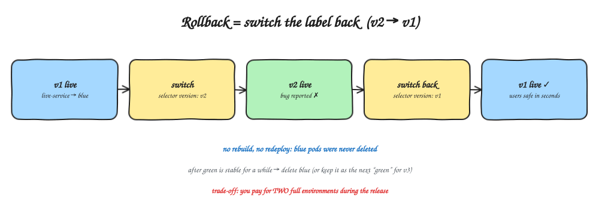

### The YAML behind it

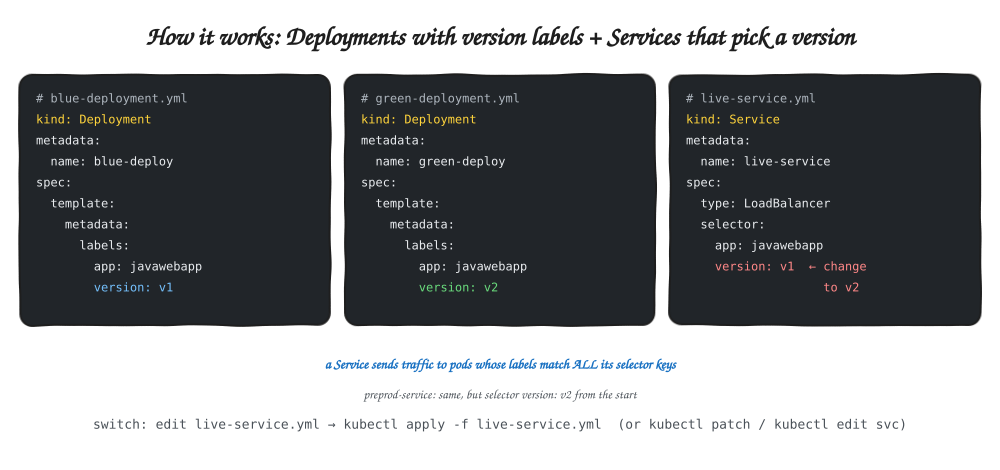

```yaml
# blue-deployment.yml (v1)
apiVersion: apps/v1
kind: Deployment
metadata:
  name: blue-deploy
spec:
  replicas: 3
  selector:
    matchLabels: { app: javawebapp, version: v1 }
  template:
    metadata:
      labels: { app: javawebapp, version: v1 }
    spec:
      containers:
      - name: app
        image: ashokit/javawebapp:v1
        ports: [{ containerPort: 8080 }]
---
# live-service.yml: customers
apiVersion: v1
kind: Service
metadata:
  name: live-service
spec:
  type: LoadBalancer
  selector: { app: javawebapp, version: v1 }   # ← change to v2 to go live
  ports: [{ port: 80, targetPort: 8080 }]
```
The green Deployment is identical with `name: green-deploy`, `version: v2` and image `:v2`. The **preprod-service** is like live-service but selects `version: v2` from the start.

**Switching** (any of these):
```bash
# 1. edit live-service.yml (version: v2) and apply
kubectl apply -f live-service.yml

# 2. patch in place
kubectl patch svc live-service -p '{"spec":{"selector":{"version":"v2"}}}'

# 3. interactive
kubectl edit svc live-service
```

---

## 4. What about users in the middle of a transaction?

> *A banking app: some people are doing transactions while we switch the label. What happens to them?*

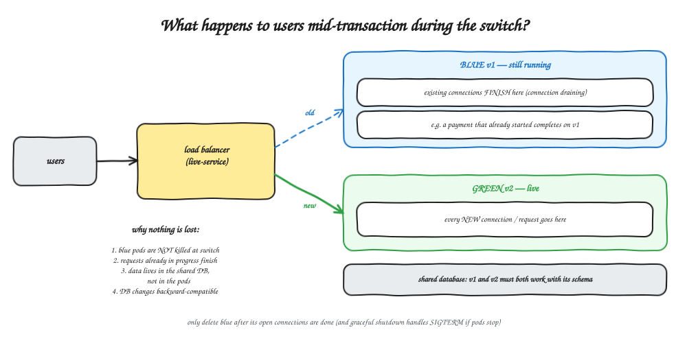

- **Blue pods are not deleted at the switch.** Only the Service's selector changes.
- Changing the selector affects **new connections**: new requests go to green. **Requests already in progress** finish on the blue pod that's handling them (*connection draining*).
- **Data lives in the shared database**, not in the pods, so a transaction committed on v1 is visible to v2.
- Requirements to make this safe:
  - Database changes must be **backward-compatible** (v1 and v2 both work with the schema during the switch).
  - Delete blue only **after** its open connections are done, and use **graceful shutdown** (the app finishes requests on SIGTERM).
  - Prefer **stateless** apps: sessions in a DB / Redis, not in pod memory.

---

## 5. Hands-on steps

**Step 0:** Clone the repo
```bash
git clone https://github.com/ashokitschool/kubernetes_manifest_yml_files.git
```

**Step 1:** Go to the blue-green directory
```bash
cd kubernetes_manifest_yml_files/blue-green
ls
```

**Step 2:** Create the **blue** pods Deployment (pod label `v1`)
```bash
kubectl apply -f blue-deployment.yml
```

**Step 3:** Create the **live service** to expose the blue pods
```bash
kubectl apply -f live-service.yml
```

**Step 4:** Access the app with the **live service's LB DNS URL** → you see the **blue (v1)** response
```bash
kubectl get svc live-service     # EXTERNAL-IP = LB DNS name
```

**Step 5:** Create the **green** pods Deployment (label `v2`)
```bash
kubectl apply -f green-deployment.yml
```

**Step 6:** Check all pods are running
```bash
kubectl get pods --show-labels   # blue pods with v1, green pods with v2
```

**Step 7:** Create the **pre-prod service**
```bash
kubectl apply -f preprod-service.yml
```

**Step 8:** Access the **green pods** using the pre-prod service URL (testers verify v2)

**Step 9:** Make green pods **live**: change the live service selector to `v2` and apply (or `kubectl patch`)

**Step 10:** Access the **live service** URL again → the **green (v2)** response now appears

**Rollback:** switch the live service selector back to `v1`.
**Cleanup after v2 is stable:** `kubectl delete -f blue-deployment.yml` (and `delete all --all` + delete the cluster after practice).

> File names may differ slightly in the repo; run `ls` in the folder and use the matching files.

---

## 6. Blue-green vs other strategies

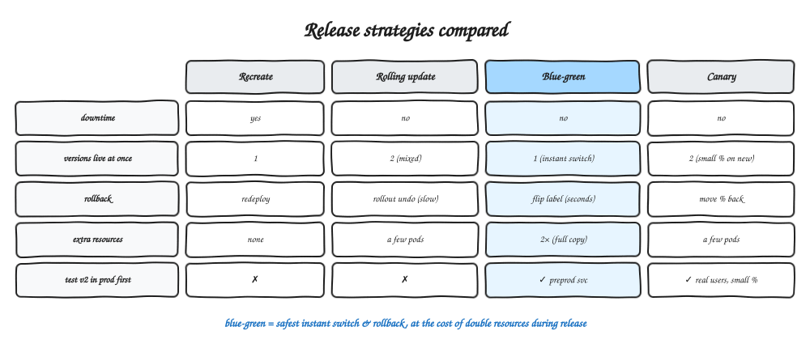

| | Recreate | Rolling update | Blue-green | Canary |
|---|---|---|---|---|
| Downtime | Yes | No | No | No |
| Versions live at once | 1 | 2 (mixed) | 1 (instant switch) | 2 (small % on new) |
| Rollback | Redeploy | `rollout undo` | **Flip the label (seconds)** | Move % back |
| Extra resources | None | A few pods | **2× during release** | A few pods |

---

## 7. Quick revision

| Topic | Key point |
|-------|-----------|
| Blue | Current live version (v1) |
| Green | New version (v2), tested through a pre-prod service |
| Switch | Change the live Service's selector label → v2 |
| Rollback | Change it back → v1 (blue never deleted) |
| In-flight requests | Finish on blue; new requests go to green; data in shared DB |
| Cost | Two full environments during the release |
