# Kubernetes · Lecture 9: Blue-Green Deployment (hands-on)

> We created the cluster from an **Ubuntu** host machine, so the SSH username is **`ubuntu`**.

---

## 1. Cluster commands (recap)

### Create cluster command
```bash
eksctl create cluster --name ashokit-cluster4 --region ap-south-1 --node-type t2.medium --zones ap-south-1a,ap-south-1b
```
> It takes time to start (~15 minutes).

### Delete cluster command
```bash
eksctl delete cluster --name ashokit-cluster4 --region ap-south-1
```

| Command | What it does |
|---------|-------------|
| `kubectl delete all --all` | Delete all the resources (pods, services, deployments…) we created in the current (default) namespace |
| `kubectl get all -n <namespace-name>` | Get everything in a namespace |
| `kubectl apply -f <yml-file>` | Execute a manifest YAML |
| `kubectl get ns` | Get all namespaces |

---

## 2. Blue-green deployment (recap)

Most applications use this model to deploy with **zero downtime**.

- There are **2 production environments**: **blue** and **green**.
- **Blue** is the **current version**; **green** is the **new version**.
- Green is first opened **for testing**. Once testing is done, the **load balancer traffic is moved to green**.
- If any customer faces an issue, traffic is **switched back to blue**.
- If there's any problem in green, just **change the label back to blue**.

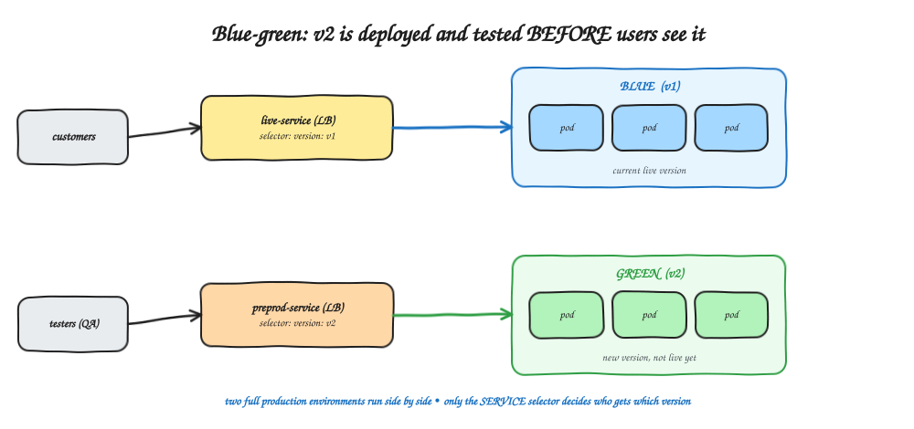

> In this lab the pre-prod service is a **NodePort** (for testing), not a LoadBalancer as drawn above; the idea is the same.

> **Open question from class:** what about people using the application **while we change the label**? E.g. in a banking application, some people are doing transactions while we deploy. What about their transactions? **Answered in section 6** below.

---

## 3. The setup

**Step 0:** Clone the git repo:
```bash
git clone https://github.com/ashokitschool/kubernetes_manifest_yml_files.git
```

We have **4 YAML files**:
1. **blue** pods (Deployment) and the **live** service
2. **green** pods (Deployment) and the **test (pre-prod)** service

All these YAML files are also under the folder **`k8s-yml-files`** in this repo.

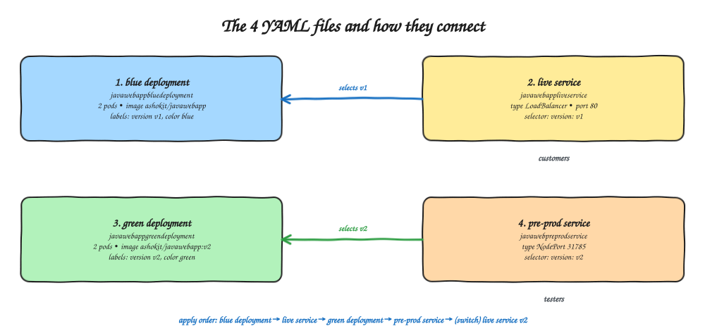

| Step | Action |
|------|--------|
| 1 | Navigate into the `blue-green` directory |
| 2 | Create the **blue** pods Deployment (pod label `v1`) |
| 3 | Create the **live service** to expose the blue pods |
| 4 | Access the app using the live service's **LB DNS URL** (the blue pods' response appears in the browser) |
| 5 | Create the **green** pods Deployment |
| 6 | Check all pods are running |
| 7 | Create the **pre-prod service** |
| 8 | Access the green pods using the pre-prod service |
| 9 | Make the green pods **live** |
| 10 | Access the live service (the green pods' response should come) |

---

## 4. Steps 1–4: blue deployment + live service

### Blue deployment (Deployment YAML)

```yml
---
apiVersion: apps/v1
kind: Deployment
metadata:
  name: javawebappbluedeployment
spec:
  replicas: 2
  strategy:
    type: RollingUpdate
  selector:
    matchLabels:
      app: java-web-app
      version: v1
      color: blue
  template:
    metadata:
      name: javawebapppod
      labels:
        app: java-web-app
        version: v1
        color: blue
    spec:
      containers:
      - name: javawebappcontainer
        image: ashokit/javawebapp
        imagePullPolicy: Always
        ports:
        - containerPort: 8080
...
```

Note the **3 labels** here: `app`, `version`, `color`.

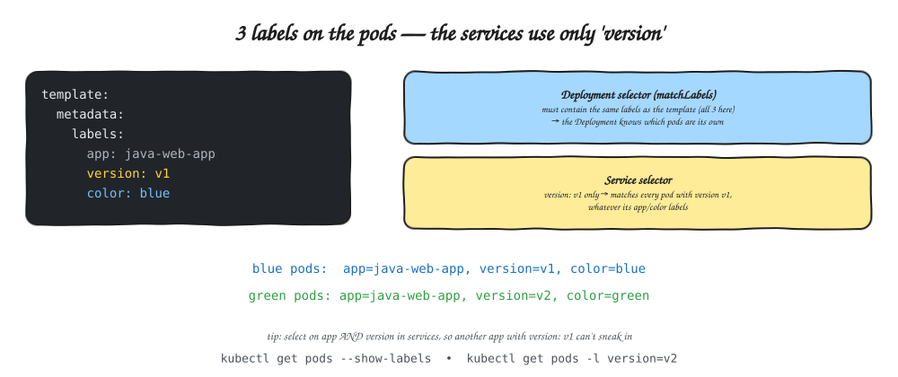

- `selector.matchLabels` must match the template labels, so the Deployment knows which pods it owns.
- `imagePullPolicy: Always` means the image is pulled from Docker Hub every time a pod starts, so you always get the latest push of that tag.

```bash
kubectl apply -f <blue-deployment-yml>
kubectl get pods
```

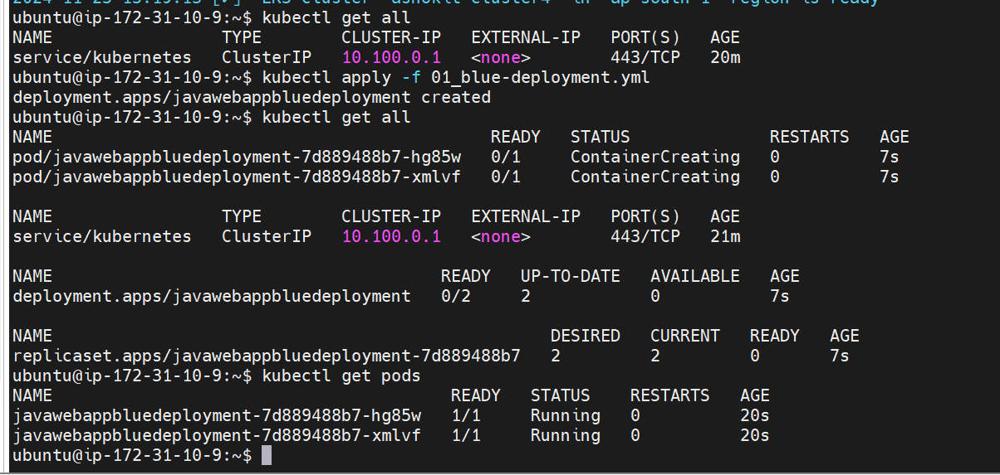

The blue pods are created. We can't access them from outside the cluster, so now we create a **service**.

### Live service

```yml
---
apiVersion: v1
kind: Service
metadata:
  name: javawebappliveservice
spec:
  type: LoadBalancer
  selector:
    version: v1
  ports:
  - port: 80
    targetPort: 8080
...
```

- `type: LoadBalancer` gives customers a public AWS load balancer URL.
- `selector: version: v1` makes the service send traffic only to pods labelled `version: v1` (the blue pods).

```bash
kubectl apply -f <live-service-yml>
kubectl get svc
```

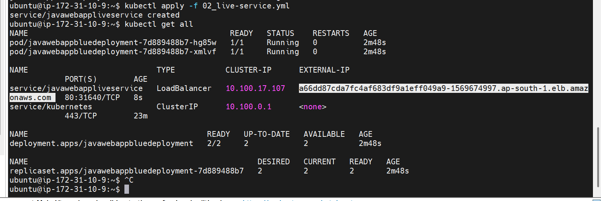

The LoadBalancer service is created; the blue pods are accessed through it.

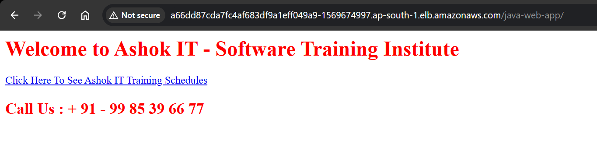

The blue pods (version **v1**) are accessible at `http://<LB-DNS>/java-web-app/`.

---

## 5. Steps 5–8: green deployment + pre-prod service

### Green deployment

```yml
---
apiVersion: apps/v1
kind: Deployment
metadata:
  name: javawebappgreendeployment
spec:
  replicas: 2
  strategy:
    type: RollingUpdate
  selector:
    matchLabels:
      app: java-web-app
      version: v2
      color: green
  template:
    metadata:
      name: javawebapppod
      labels:
        app: java-web-app
        version: v2
        color: green
    spec:
      containers:
      - name: javawebappcontainer
        image: ashokit/javawebapp:v2
        imagePullPolicy: Always
        ports:
        - containerPort: 8080
...
```

Here we use **another Docker image tag** (`ashokit/javawebapp:v2`): the same code, just version v2 (the new release). Labels are `version: v2`, `color: green`.

> The original notes had this YAML block indented by 4 extra spaces. YAML accepts it as long as the whole document is shifted consistently, but keep it flush-left like above to avoid mistakes.

```bash
kubectl apply -f <green-deployment-yml>
kubectl get pods                # Step 6: check all pods running
```

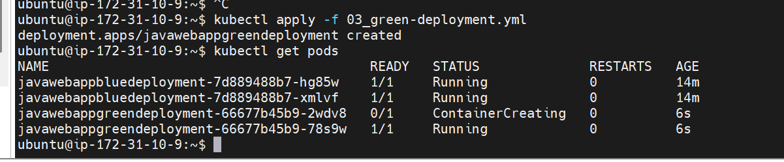

Blue pods and green pods are **both running**; the green ones have been running for only 6 seconds.

### Step 7: Pre-prod service

```yml
---
apiVersion: v1
kind: Service
metadata:
  name: javawebpreprodservice
spec:
  type: NodePort
  selector:
    version: v2
  ports:
  - port: 80
    targetPort: 8080
    nodePort: 31785
...
```

It's type **NodePort** because it's for **testing purposes** only (no need to pay for a second load balancer). It selects `version: v2`, the green pods.

```bash
kubectl apply -f <preprod-service-yml>
kubectl get pods -o wide
```

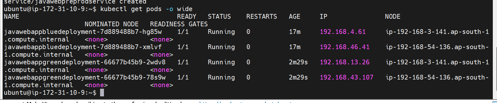

The first blue pod and the first green pod are on the **same worker node** (`ip-192-168-3-141`); the second of each is on `ip-192-168-54-136`.

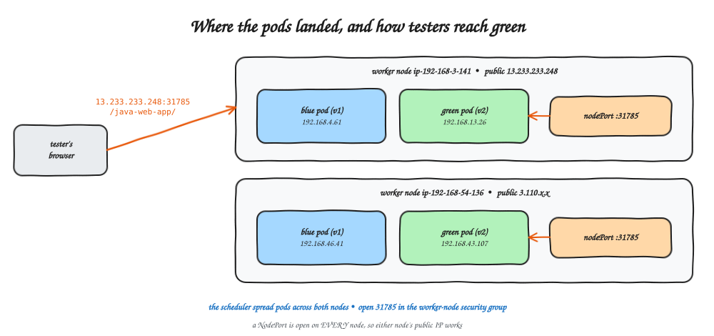

To check that green works, **enable port 31785** in the security group of the worker nodes. (A NodePort is opened on every node, so any worker node's public IP works.)

### Step 8: Access green pods using the pre-prod service

After enabling the port, access via the **node public IP**:

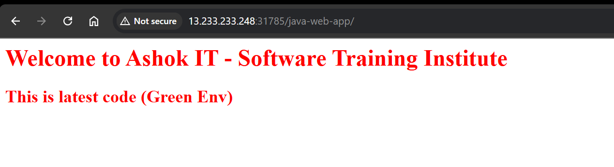

`http://13.233.233.248:31785/java-web-app/` shows **"This is latest code (Green Env)"**, so the testers verified v2.

Now we want the **load balancer** (customers) to get v2, the green version.

---

## 6. Steps 9–10: make green live

To make the latest code (green pods) live, we **change the selector of the live service**: just edit the live service YAML and change the selector to `v2`.

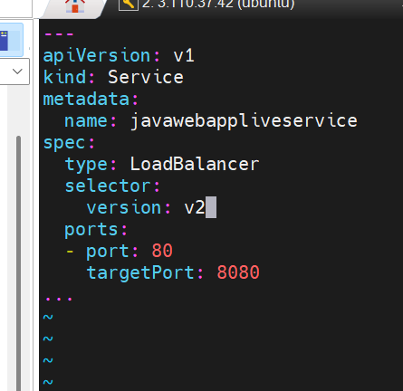

```bash
kubectl apply -f <live-service-yml>     # Step 9: make green pods live
```

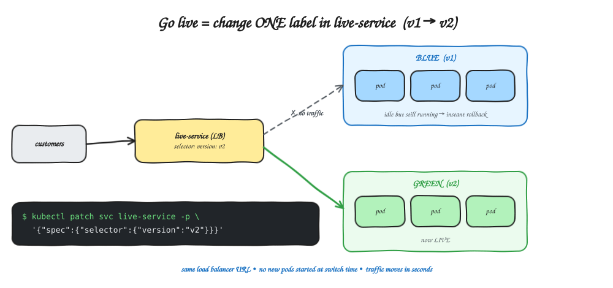

After applying, access the app with the **same load balancer URL**:

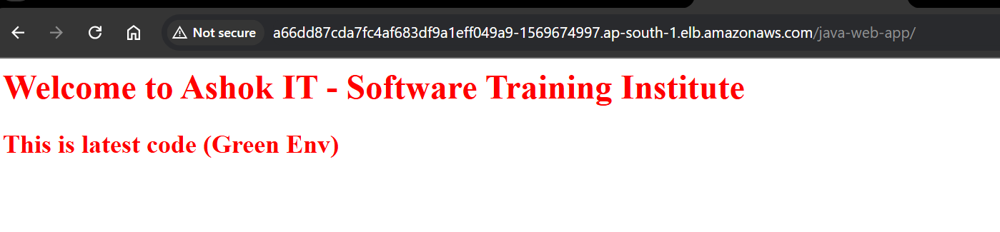

**Step 10:** the live service now returns the green pods' response: *"This is latest code (Green Env)"*.

### Rollback

> To divert traffic back to the old application, just change `v2` to `v1` in the live service.

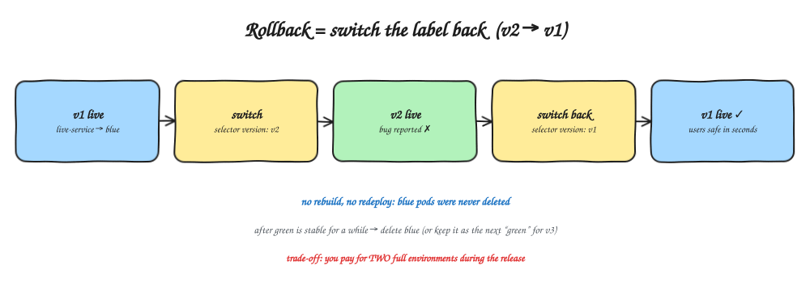

```bash
kubectl patch svc javawebappliveservice -p '{"spec":{"selector":{"version":"v1"}}}'
```

---

## 7. Zero downtime during the switch & users mid-transaction

**Q: How do we manage downtime while green is coming up and blue is going down? It's a fraction of a millisecond, but how do we manage it?**

**A:** An **HAProxy** server (or a similar smart load balancer) is configured for this.

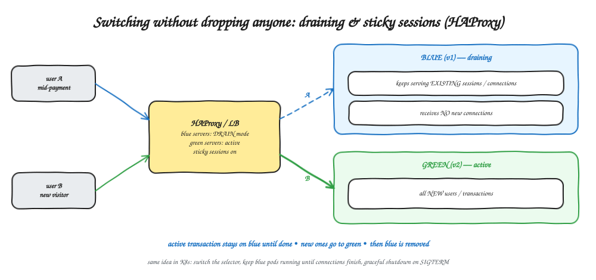

- For **long-lived TCP connections**, such as database connections or websockets, HAProxy can ensure that connections are **not dropped** during the switchover. Traffic from an **ongoing transaction continues to flow to the blue environment until it is completed**.
- Instead of an abrupt switch, you can **gradually shift new traffic** to the green environment while keeping ongoing sessions on the blue environment. This minimizes the risk of disrupting active users.
- When switching from blue to green, you can configure HAProxy to **stop sending new connections to blue while allowing existing connections to complete**. This is done using the **drain mode** for servers.

### Transaction routing behaviour
- **Active transactions:** if a user is mid-transaction in the blue environment, HAProxy keeps routing their requests to blue (via **sticky sessions** or **persistent connections**). Their transaction completes without interference.
- **New transactions:** new users or transactions are directed to the green environment based on the updated HAProxy configuration or rules.

### Gradual shift (optional)

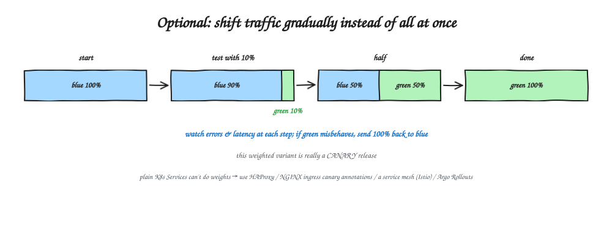

A weighted shift (10% → 50% → 100%) is really a **canary release**. Plain Kubernetes Services can't split by percentage; use HAProxy, NGINX Ingress canary annotations, a service mesh (Istio) or Argo Rollouts.

### What happens in plain Kubernetes?

Even without HAProxy, the switch is safe if you follow these rules:
- Changing the Service selector affects **new** connections; **blue pods keep running**, so requests already in progress finish on them.
- Don't delete the blue Deployment immediately: wait until its connections are done, and make the app handle **SIGTERM gracefully** (finish requests before exiting).
- Keep **data in the shared database** (not in the pods) and make DB changes **backward-compatible**, so v1 and v2 both work during the switch.

---

## 8. Quick revision

| Topic | Key point |
|-------|-----------|
| Blue Deployment | `version: v1`, `color: blue`, image `ashokit/javawebapp` |
| Green Deployment | `version: v2`, `color: green`, image `ashokit/javawebapp:v2` |
| Live service | LoadBalancer, `selector: version: v1` → customers on blue |
| Pre-prod service | NodePort 31785, `selector: version: v2` → testers on green |
| Go live | Change live service selector to `v2` and apply |
| Rollback | Change it back to `v1` |
| No dropped transactions | HAProxy drain mode + sticky sessions; in K8s keep blue running until connections finish |
