# Kubernetes · Lecture 10: Helm, Prometheus, Grafana & EFK

> We created the cluster from an **Ubuntu** host machine, so the SSH username is **`ubuntu`**.

---

## 1. Cluster commands (recap)

### Create cluster command
```bash
eksctl create cluster --name ashokit-cluster4 --region ap-south-1 --node-type t2.medium --zones ap-south-1a,ap-south-1b
```
> It takes time to start (~15 minutes).

### Delete cluster command
```bash
eksctl delete cluster --name ashokit-cluster4 --region ap-south-1
```

| Command | What it does |
|---------|-------------|
| `kubectl delete all --all` | Delete all the resources (pods, services…) we created in the current namespace |
| `kubectl get all -n <namespace-name>` | Get everything in a namespace |
| `kubectl apply -f <yml-file>` | Execute a manifest YAML |
| `kubectl get ns` | Get all namespaces |

---

## 2. Topics of this lecture

1. **Helm charts**: install software into the cluster
2. **Prometheus**: collect metrics
3. **Grafana**: visualize metrics
4. **EFK stack**: centralize logs

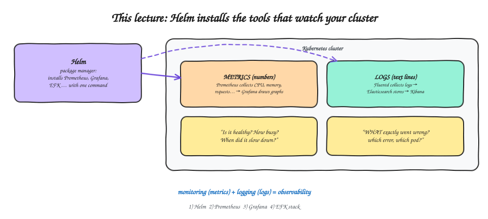

- **Metrics** are numbers over time (CPU %, memory, request count). They answer *"is it healthy, how busy, when did it slow down?"*
- **Logs** are the text lines your apps print. They answer *"what exactly went wrong, in which pod?"*
- Together these give you **observability**: the ability to see what's happening inside the cluster.

---

## 3. What is Helm?

- **Helm is a package manager** used to install required software in a Kubernetes cluster, just like `apt` (Ubuntu) or `yum` (Amazon Linux) install software on Linux.
- Helm uses **charts** to install packages, e.g. Grafana, Prometheus, EFK.
- **A chart is a collection of configuration files (manifest YAMLs)**.

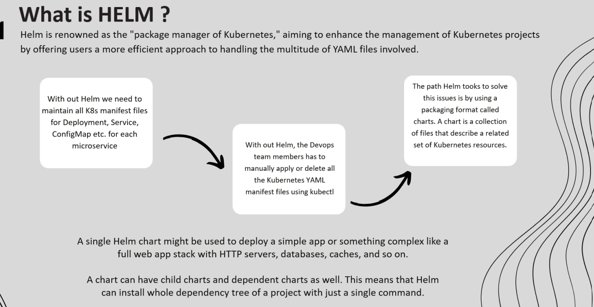

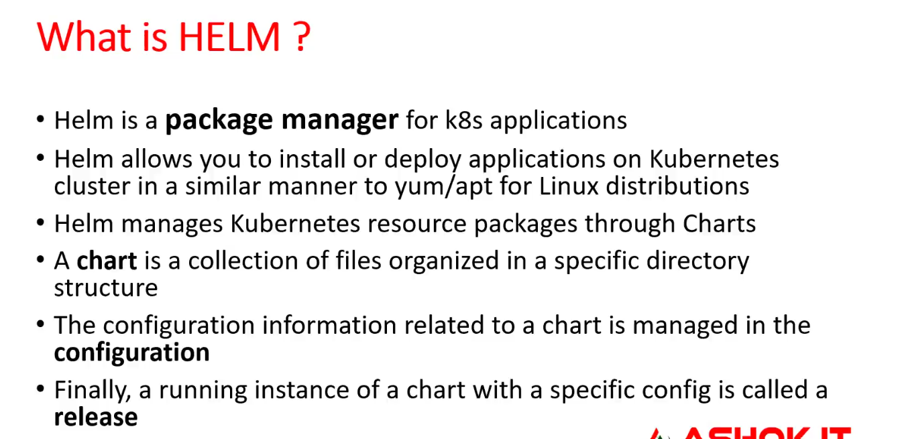

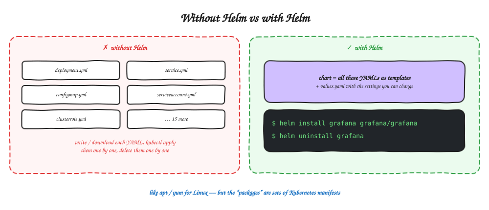

**Why it helps:** without Helm you maintain and `kubectl apply` every manifest (Deployment, Service, ConfigMap, ServiceAccount, roles…) for every app, and delete them one by one. With Helm, one chart holds them all and one command installs or removes them. A chart can also have **dependent charts**, so a whole stack installs with a single command.

### Helm charts
- Using a Helm chart we can install the **Prometheus** server.
- Using a Helm chart we can install the **Grafana** server.

> To install Grafana, I download Grafana's Helm chart and run it, and Grafana is installed in the cluster.

### Key vocabulary

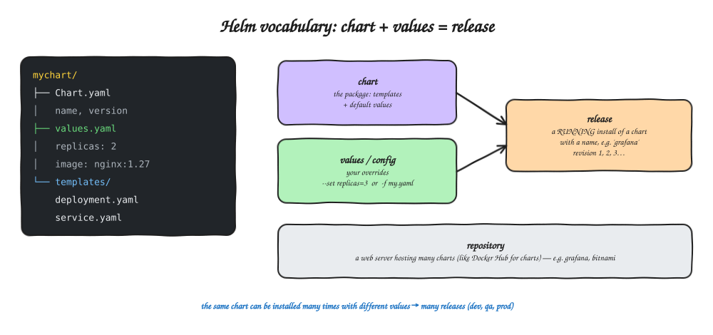

| Term | Meaning |
|------|---------|
| **Chart** | The package: a folder with `Chart.yaml`, `values.yaml` and `templates/` (manifest YAMLs with placeholders) |
| **Values / configuration** | Settings that fill the placeholders (`replicas`, `image`, `service.type`…); override with `--set key=value` or `-f my-values.yaml` |
| **Release** | A **running instance** of a chart with a specific configuration, e.g. a release named `grafana` |
| **Repository** | A server hosting many charts (like Docker Hub, but for charts) |

### Helm architecture

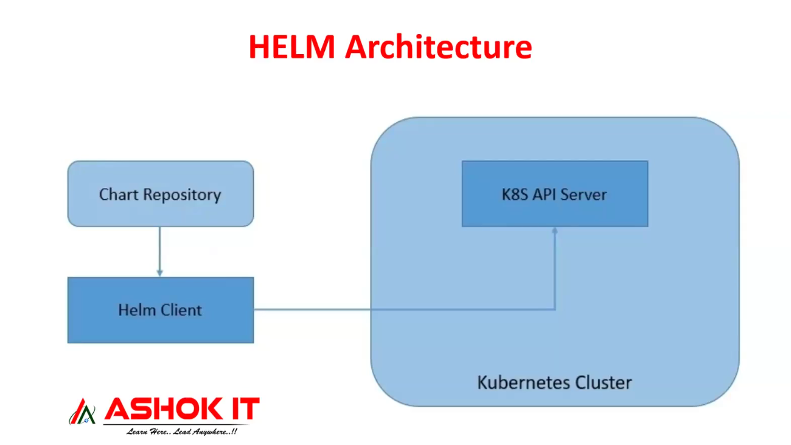

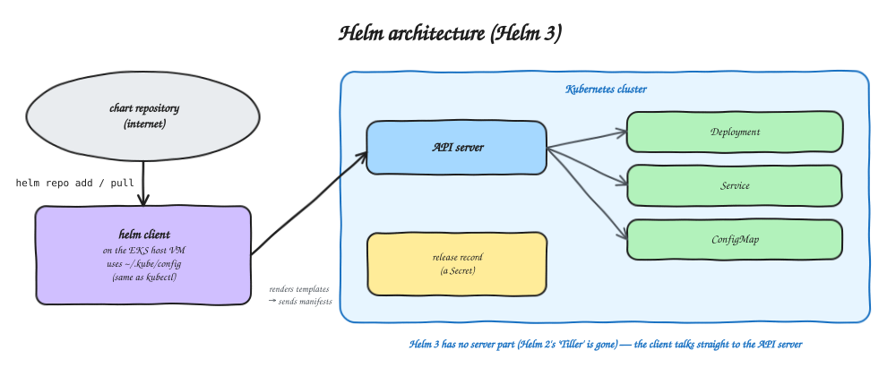

- Helm maintains **chart repositories** on the internet.
- We install the **Helm client** on the EKS host EC2 machine (where `kubectl` already works). It downloads charts from the chart repository.
- The Helm client **connects to the Kubernetes API server** (using the same `~/.kube/config` as kubectl), renders the chart's templates into manifests and sends them to the cluster, which creates the resources.
- Or we could write the manifest YAML files manually and create the pods ourselves. **With a Helm chart there's no need to write the YAML files.**

> Remember: **a Helm chart is basically a collection of manifest YAML files.**
>
> Helm charts are used to install things **inside the cluster**. We don't install Jenkins or a JVM on a machine with Helm.

> Helm 3 has **no server component**. Helm 2 needed a "Tiller" pod in the cluster; that's gone.

### Helm installation

```bash
curl -fsSL -o get_helm.sh https://raw.githubusercontent.com/helm/helm/main/scripts/get-helm-3
chmod 700 get_helm.sh      # make the script executable
./get_helm.sh              # downloads and installs the helm binary
helm                       # verify (shows help); or: helm version
```

### Example: install metrics-server with Helm

First, check whether metrics-server is on the cluster:
```bash
kubectl top pods
kubectl top nodes          # fails if metrics-server is missing
```

There are two ways to install software in the cluster:
1. Execute manifest YAMLs: we already did this in Lecture 6.
2. **Use a Helm chart:**

```bash
helm repo ls                                                            # check helm repos
helm repo add metrics-server https://kubernetes-sigs.github.io/metrics-server/   # add the repo
helm upgrade --install metrics-server metrics-server/metrics-server -n kube-system  # install the chart
```
`helm upgrade --install` **installs** the release if it doesn't exist, or **upgrades** it if it does, so it's safe to run again.

### Helm commands

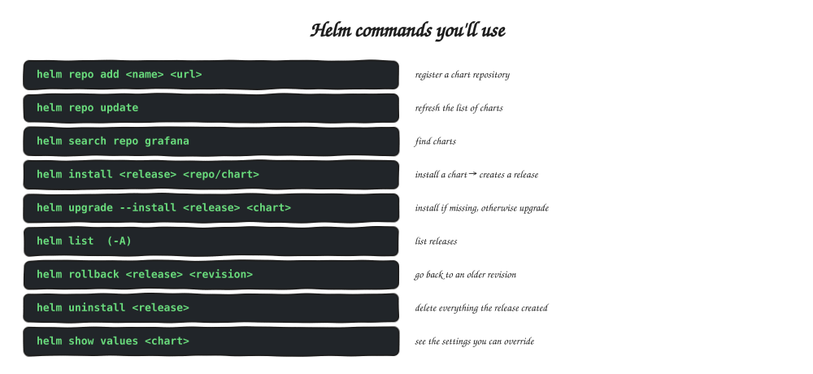

---

## 4. Kubernetes monitoring

We can monitor the Kubernetes cluster and its components with:
1. **Prometheus**
2. **Grafana**

### Prometheus

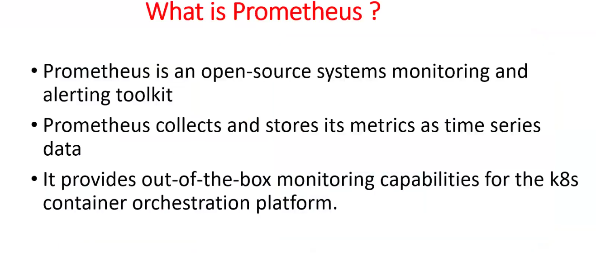

- An **open-source systems monitoring and alerting toolkit**.
- **Collects and stores metrics as time-series data**: every value has a timestamp and labels (e.g. `pod="order-1"`, `namespace="default"`).
- Provides **out-of-the-box monitoring for Kubernetes**.
- At every **time interval** (e.g. 15–30 seconds) it **collects (scrapes)** data from its targets.

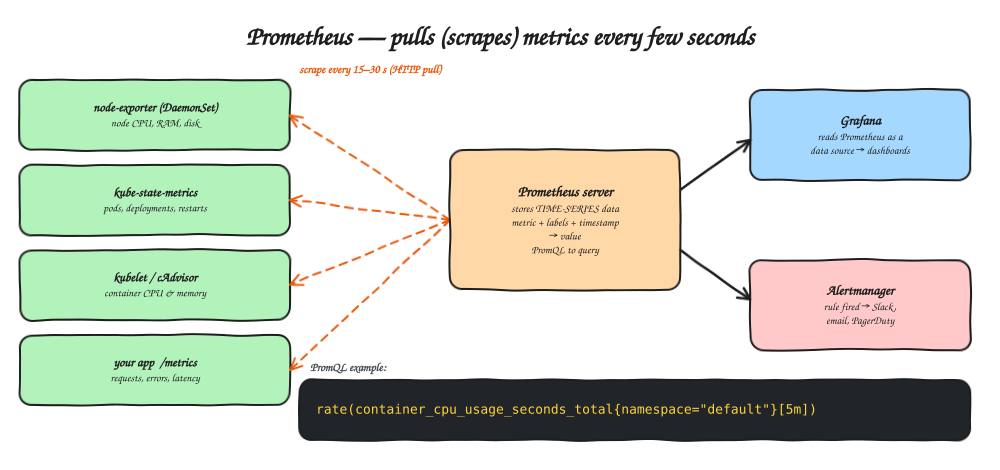

| Target | Gives |
|--------|-------|
| **node-exporter** (a DaemonSet: 1 pod per node) | Node CPU, memory, disk, network |
| **kube-state-metrics** | State of K8s objects: pods running/pending, deployment replicas, restarts |
| **kubelet / cAdvisor** | Per-container CPU and memory |
| **Your app's `/metrics` endpoint** | Request count, errors, latency (e.g. Spring Boot Actuator + Micrometer) |

- **Prometheus pulls** data over HTTP (it isn't pushed to).
- You query it with **PromQL**, e.g. `rate(container_cpu_usage_seconds_total[5m])`.
- **Alertmanager** sends alerts (Slack, email, PagerDuty) when a rule fires, e.g. *"pod restarted 5 times in 10 minutes"*.

> The **metrics server** we used before gives only **CPU and memory utilization**. Prometheus provides **much more detail** and keeps **history**.

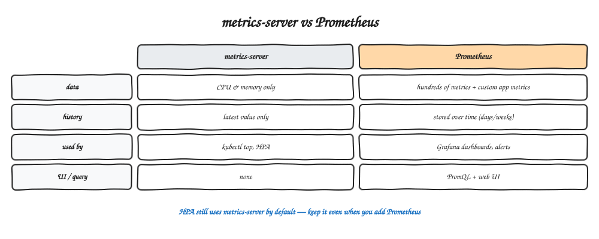

> ⚠ Correction: with Prometheus and Grafana you **still keep metrics-server** if you use **HPA** or `kubectl top`. They read from metrics-server, not from Prometheus (unless you add the Prometheus adapter).

> Prometheus and Grafana are **general monitoring tools**, not only for Kubernetes; they can monitor any application or server.

### Grafana

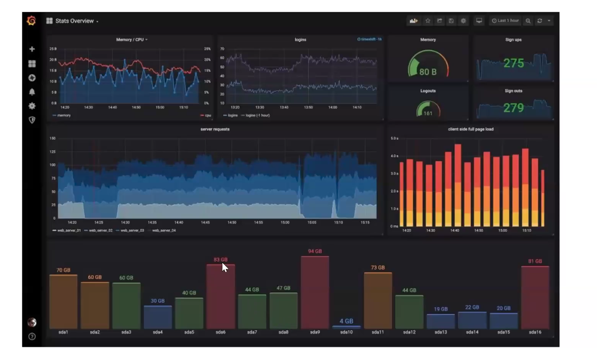

- Grafana is an **analysis and monitoring tool**.
- It provides **visualization** for monitoring.
- It provides **charts, graphs and alerts** in the browser when connected to supported **data sources**.

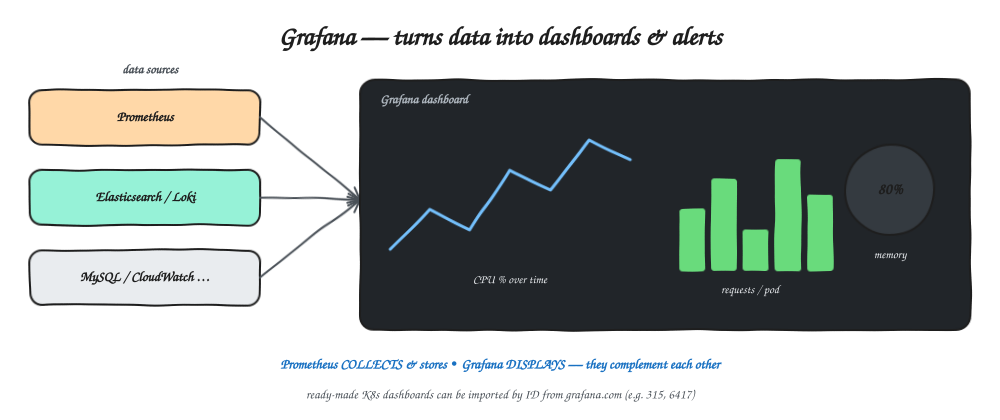

> **Grafana connects to Prometheus as its data source.** Prometheus **collects and stores** the data; Grafana **displays** it as graphs. The two complement each other.

Grafana can also read Elasticsearch, Loki, MySQL, CloudWatch and more. Ready-made Kubernetes dashboards can be **imported by ID** from grafana.com.

### Installing Prometheus + Grafana with Helm

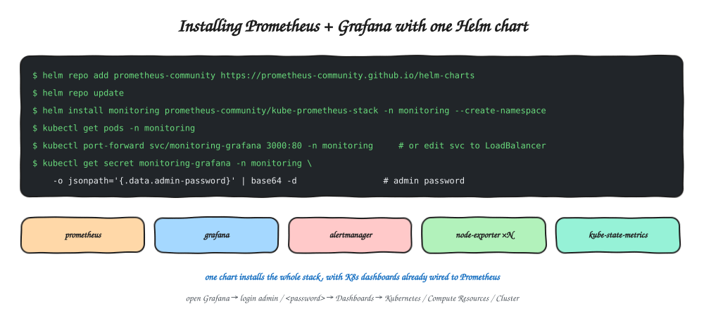

```bash
helm repo add prometheus-community https://prometheus-community.github.io/helm-charts
helm repo update
helm install monitoring prometheus-community/kube-prometheus-stack -n monitoring --create-namespace

kubectl get pods -n monitoring      # prometheus, grafana, alertmanager, node-exporter, kube-state-metrics

# reach Grafana (port-forward, or change the service type to LoadBalancer)
kubectl port-forward svc/monitoring-grafana 3000:80 -n monitoring
# admin password
kubectl get secret monitoring-grafana -n monitoring -o jsonpath='{.data.admin-password}' | base64 -d
```
Open Grafana → log in as `admin` → **Dashboards → Kubernetes / Compute Resources / Cluster** (already connected to Prometheus).

---

## 5. EFK stack: log monitoring

The EFK stack is used for **log monitoring**.

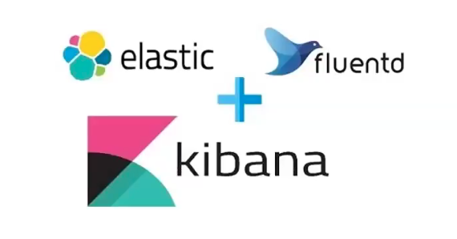

| Letter | Tool | Job |
|--------|------|-----|
| **E** | **Elasticsearch** | Stores and indexes logs: the **log lake**, searchable |
| **F** | **Fluentd** | **Shipping, processing** (parse, add pod/namespace info) and forwarding logs |
| **K** | **Kibana** | **Visualization** tool to search and monitor logs |

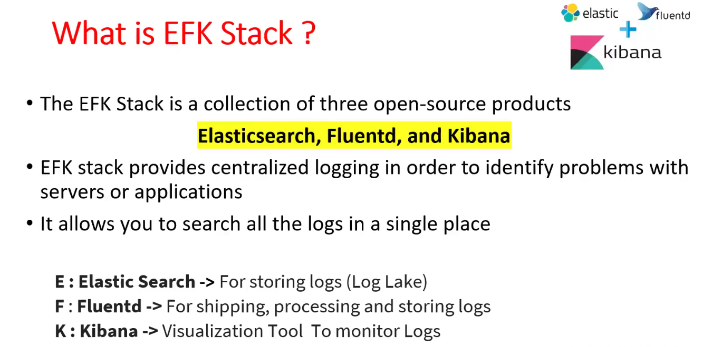

### Why centralized logging?

There are many microservices in Kubernetes and each one writes logs. We can use `kubectl logs`, but with **20 pods** that's not manageable: pods get recreated (and their logs disappear), and one request can pass through several services.

So we need **log centralization**: **all the logs stored in one place.**

### EFK architecture

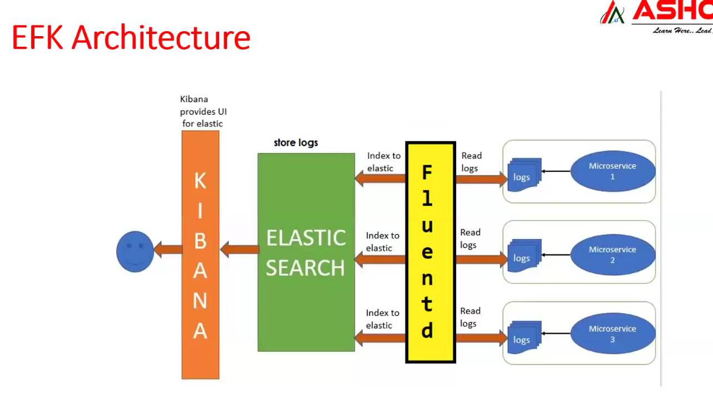

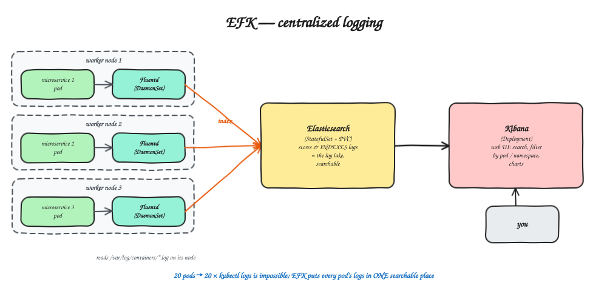

> Quite understandable from the diagram:

1. Each microservice writes logs (to stdout), which the container runtime saves as files on its node (`/var/log/containers/*.log`).
2. **Fluentd collects the logs from all the microservices** on its node, adds Kubernetes info (pod, namespace, container) and **sends them to Elasticsearch** ("index to elastic").
3. **Elasticsearch stores** and indexes them.
4. **Kibana provides the UI** on top of Elasticsearch: search by keyword, filter by pod/namespace, time histograms.

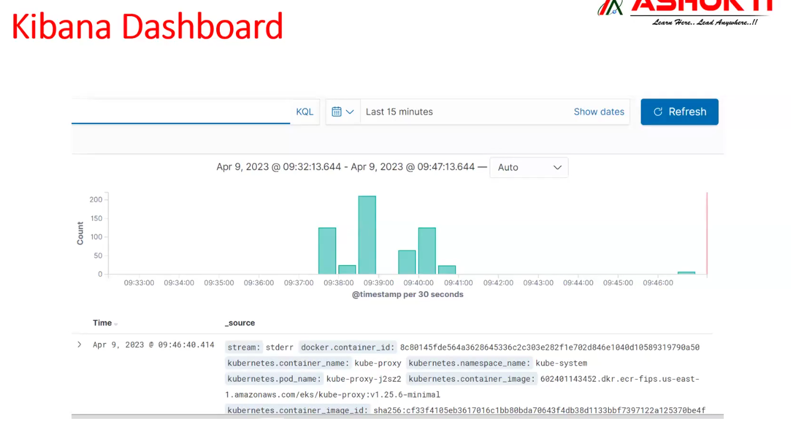

The Kibana screenshot shows a log-count histogram over time and each log entry with fields like `kubernetes.pod_name`, `kubernetes.namespace_name` and `kubernetes.container_name`. That's how you find one pod's logs among thousands.

> Some companies use **Splunk**, a **commercial** log-monitoring tool.

### How EFK is deployed in Kubernetes

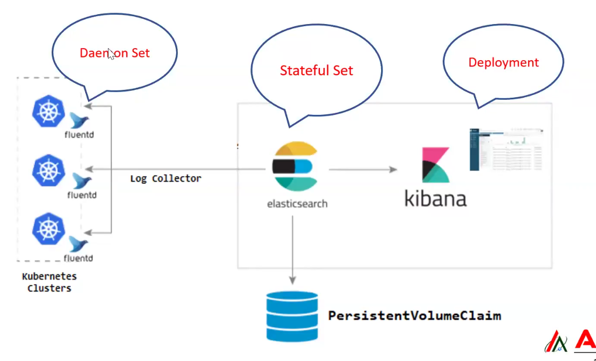

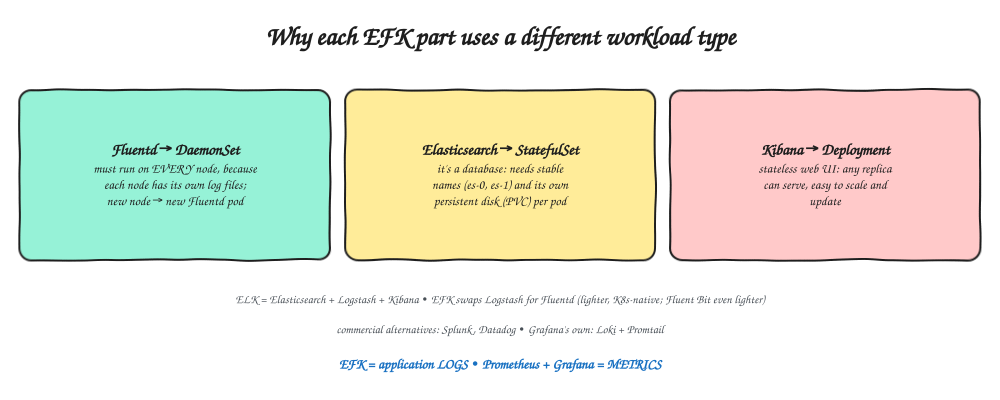

| Component | Kubernetes resource | Why |
|-----------|--------------------|-----|
| **Fluentd** | **DaemonSet** | Must run on **every node**, because each node has its own log files |
| **Elasticsearch** | **StatefulSet** (+ PersistentVolumeClaim) | It's a database: stable pod names and its **own persistent disk** |
| **Kibana** | **Deployment** | Stateless web UI; any replica can serve |

- Some people use **ELK**, where **L = Logstash**. **Fluentd is lighter and more Kubernetes-friendly than Logstash** (Fluent Bit is an even lighter option).
- All of these are **installed as pods** in the cluster (usually with Helm charts).
- **EFK is for application logs**; Prometheus + Grafana are for **metrics**.

---

## 6. Quick revision

| Topic | Key point |
|-------|-----------|
| Helm | Package manager for K8s (like apt/yum) |
| Chart | Collection of manifest YAML templates + values |
| Release | A running install of a chart |
| `helm upgrade --install` | Install or upgrade in one command |
| Prometheus | Scrapes & stores metrics as time series; PromQL; alerts |
| Grafana | Dashboards on top of Prometheus (and other data sources) |
| metrics-server | Still needed for HPA / `kubectl top` |
| EFK | Fluentd (DaemonSet) → Elasticsearch (StatefulSet) → Kibana (Deployment) |
| Why EFK | Centralized, searchable logs from all pods |
