# Lecture 1 · Jenkins & CI/CD

> **Jenkins** is a free, open-source **CI/CD server** that automates the **build & deployment** of any project.

---

## 1. The problem: manual build & deployment

### 1.1 What is "build & deployment"?

Before an application reaches users, these steps run **every time** the code changes:

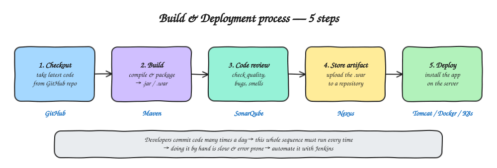

| # | Step | Tool | What it does |
|---|------|------|--------------|
| 1 | Take latest code | **GitHub** | Pull the newest commit from the repo |
| 2 | Build source code | **Maven** | Compile, run tests, package into a `.jar` / `.war` (the **artifact**) |
| 3 | Code review | **SonarQube** | Scan code for bugs, vulnerabilities, code smells |
| 4 | Upload artifact | **Nexus** | Store the `.war` in an artifact repository (versioned) |
| 5 | Deploy | **Tomcat / Docker / K8s** | Install the app on the server |

### 1.2 What is Nexus, and why is it needed?

**Nexus (Sonatype Nexus Repository Manager)** is an **artifact repository**: a central, versioned **warehouse** for the files your builds produce (`.jar`, `.war`, Docker images, npm packages…).

> GitHub stores **source code**. Nexus stores the **built output** of that code.

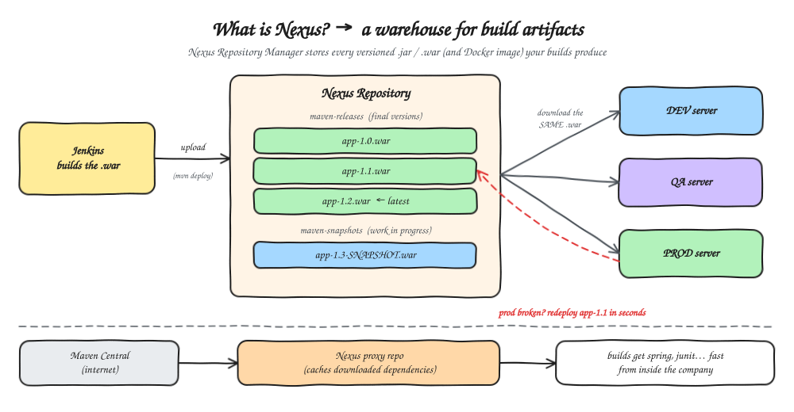

**Why not just keep the `.war` in the Jenkins workspace?**
The workspace is **overwritten on every build**. `target/maven-web-app.war` from build #41 is gone after build #42. So if today's release breaks production, you have no copy of yesterday's working version. Nexus fixes this:

| Need | How Nexus helps |
|------|-----------------|
| **Version history** | Every build is stored as `app-1.0.war`, `app-1.1.war`, `app-1.2.war`… nothing is overwritten |
| **Rollback** | Prod broken by 1.2? Redeploy `app-1.1.war` from Nexus in seconds, with no rebuild |
| **Same artifact everywhere** | Build **once**, then DEV, QA and PROD all download the **exact same file**, so what QA tested is what goes live |
| **Separate build from deploy** | Jenkins builds & uploads; the deploy step (or another team/tool) just downloads, so there's no need to rebuild on each server |
| **Sharing between teams** | Team A publishes a library `.jar`; Team B adds it as a Maven dependency from Nexus |
| **Dependency cache (proxy)** | Nexus caches libraries from Maven Central (spring, junit…), so builds are faster and still work if the internet is slow or blocked |
| **Security / control** | Login, permissions, only approved artifacts go to production |

**Two main repository types (for Maven):**
- **`maven-releases`**: final, fixed versions (e.g. `1.2`). Once uploaded, they never change.
- **`maven-snapshots`**: in-progress versions (e.g. `1.3-SNAPSHOT`). Can be re-uploaded many times during development.

**How it's used in the pipeline:**
```
GitHub → Jenkins (mvn clean package) → Sonar check → mvn deploy → Nexus → servers download the .war → deploy
```
`mvn deploy` uploads the artifact to Nexus. Its URL is configured in `pom.xml` (`<distributionManagement>`), and the Nexus username/password goes in Maven's `settings.xml`.

**Alternatives:** JFrog Artifactory, AWS CodeArtifact, GitHub Packages. Docker images often go to Docker Hub / AWS ECR instead.

### 1.3 Why manual is a problem

The development team **commits code to GitHub many times in a single day**, so these 5 steps have to be repeated many times a day, and for **multiple environments** (dev, QA, UAT, prod).

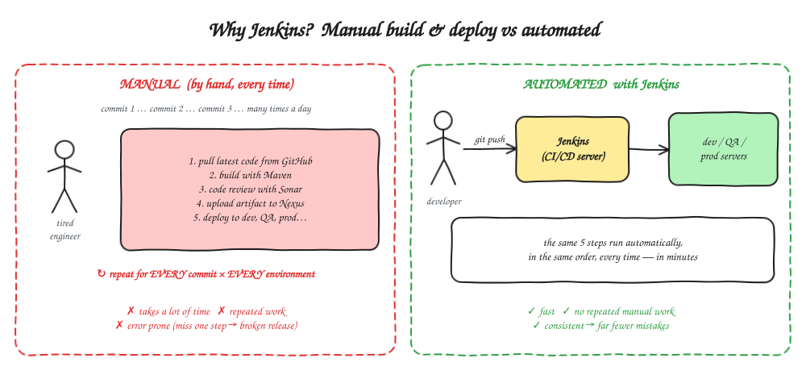

**Challenges of the manual process:**
- Every day we need to deploy the latest code
- Deploy code in multiple environments
- Takes a lot of time
- Repeated work
- **Error prone**: forget one step and the release breaks

**Solution:** automate the project build & deployment process. **To automate it, we use Jenkins.**

---

## 2. What is CI/CD?

> **CI/CD is an approach to automate the project build & deployment process.**

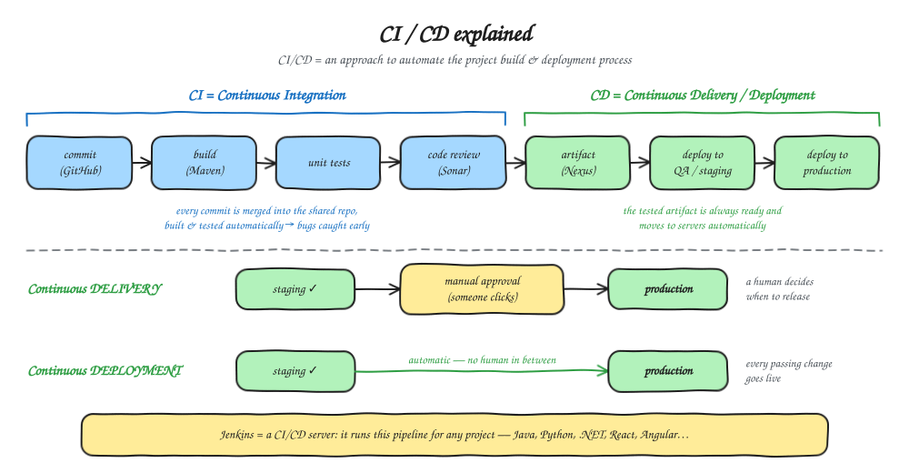

### CI: Continuous Integration
- Developers **integrate (merge)** their code into the shared repository **frequently**, many times a day.
- **Every commit automatically triggers** a build + tests (+ code review).
- Bugs are caught **early**, minutes after the commit instead of weeks later.
- Output: a tested **artifact** (e.g. `maven-web-app.war`).

### CD: Continuous Delivery vs Continuous Deployment
"CD" can mean two slightly different things:

| | Continuous **Delivery** | Continuous **Deployment** |
|---|---|---|
| Artifact is always ready to release | ✓ | ✓ |
| Auto-deployed to QA / staging | ✓ | ✓ |
| Goes to **production** | After a **manual approval** (someone clicks a button) | **Automatically**, no human step |
| Used when | Business wants control over release timing | Team has strong automated tests |

In these notes, **CD = Continuous Delivery**.

### Where Jenkins fits
**Jenkins is the CI/CD server**: the "robot" that watches the repo and runs every step of this pipeline for you.

---

## 3. What is Jenkins?

- **Open source** software, **free of cost**.
- **Developed in Java** → **to run Jenkins we must have Java installed** on the machine.
- Called a **CI/CD server** (**CI**: Continuous Integration, **CD**: Continuous Delivery).
- Can build & deploy **any type of project**: Java, Python, .NET, React, Angular…
- Has **thousands of plugins** (Git, Maven, Docker, Kubernetes, Slack…) to connect to almost any tool.
- Web UI runs on **port 8080** by default.

### Example: a Jenkins job with GitHub + Maven + Docker

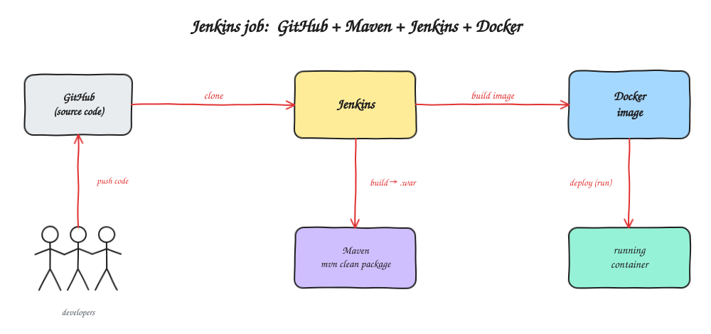

1. Developers **push code** to GitHub.
2. Jenkins **clones** the repo.
3. Jenkins asks **Maven to build** it → `.war` file.
4. Jenkins **builds a Docker image** containing the app.
5. The image is **deployed** as a running container.

---

## 4. Jenkins server setup on a Linux VM (Ubuntu on AWS EC2)

Reference docs: [01-Jenkins-Server-Setup.md](https://github.com/ashokitschool/DevOps-Documents/blob/main/01-Jenkins-Server-Setup.md) · official guide on [jenkins.io](https://www.jenkins.io/doc/book/installing/linux/)

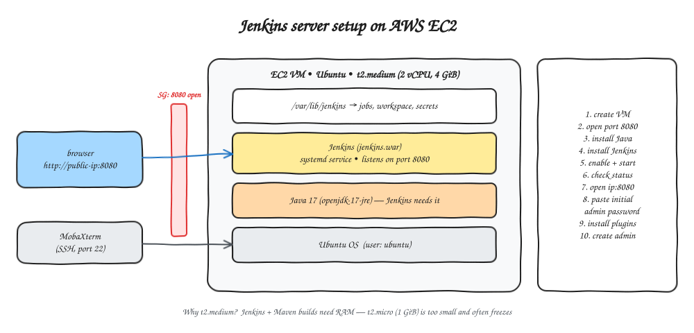

> On an Ubuntu EC2 machine the default username is **`ubuntu`**.

### Step 1: Create the Linux VM
1. Create an **Ubuntu VM** using AWS EC2 (**t2.medium**: Jenkins + Maven builds need ~4 GiB RAM; t2.micro freezes).
2. **Enable port 8080** in the Security Group **inbound rules** (Jenkins UI runs on 8080).
3. Connect to the VM using **MobaXterm** (SSH, port 22).

### Step 2: Install Java (Jenkins is a Java app)
```bash
sudo apt update
sudo apt install fontconfig openjdk-17-jre
java -version
```

### Step 3: Install Jenkins
```bash
# download Jenkins' signing key (so apt trusts the Jenkins repo)
sudo wget -O /usr/share/keyrings/jenkins-keyring.asc \
  https://pkg.jenkins.io/debian-stable/jenkins.io-2023.key

# add the Jenkins apt repository
echo deb [signed-by=/usr/share/keyrings/jenkins-keyring.asc] \
  https://pkg.jenkins.io/debian-stable binary/ | sudo tee \
  /etc/apt/sources.list.d/jenkins.list > /dev/null

# install
sudo apt-get update
sudo apt-get install jenkins
```

### Step 4: Start Jenkins
```bash
sudo systemctl enable jenkins   # start automatically on every boot
sudo systemctl start jenkins    # start it now
```

### Step 5: Verify Jenkins
```bash
sudo systemctl status jenkins
```
Look for **`active (running)`**. Notice the main process is `java ... -jar jenkins.war`: Jenkins really is just a Java program.

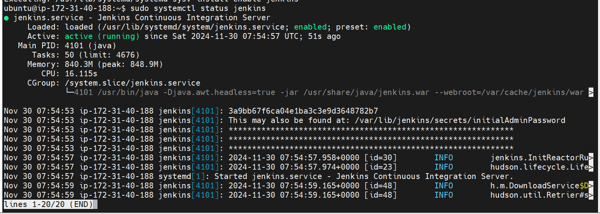

### Step 6: Open Jenkins in the browser
```
http://<public-ip>:8080/
```

### Step 7: Copy the initial admin password
```bash
sudo cat /var/lib/jenkins/secrets/initialAdminPassword
```

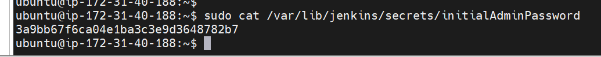

Paste it into the **Unlock Jenkins** screen:

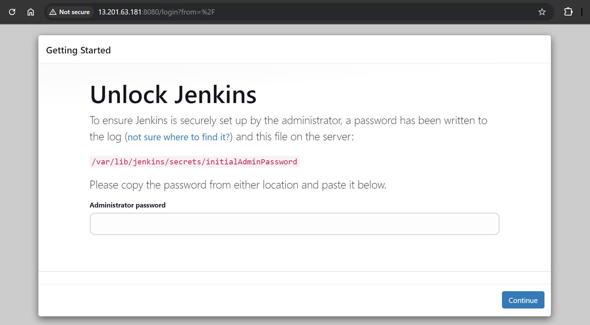

### Step 8: Install suggested plugins & create the admin account

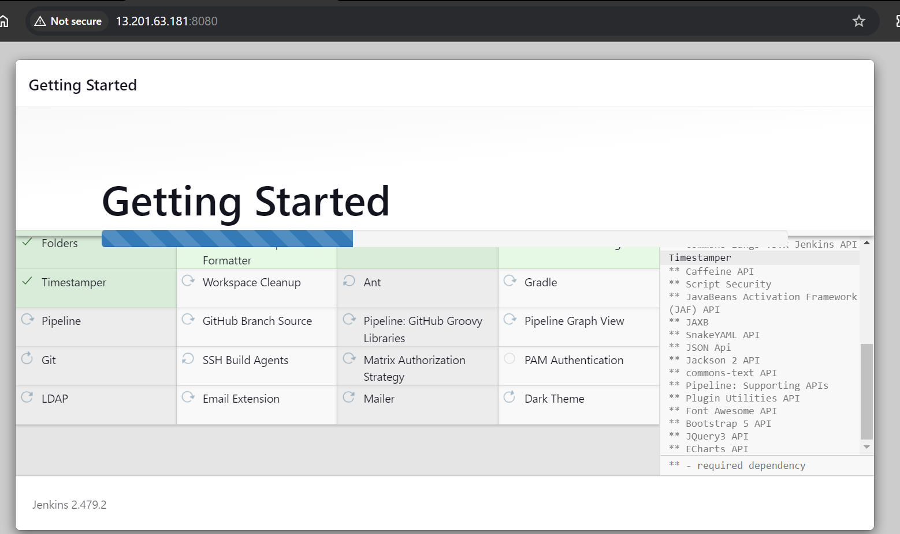

Then create the admin user, sign in, log out, and log in again to confirm the account works.

---

## 5. Q: Why must we install Java for Jenkins, but nothing for VS Code?

VS Code is written in TypeScript, yet we never install TypeScript/Node to run it. Jenkins, on the other hand, needs Java installed first. Why?

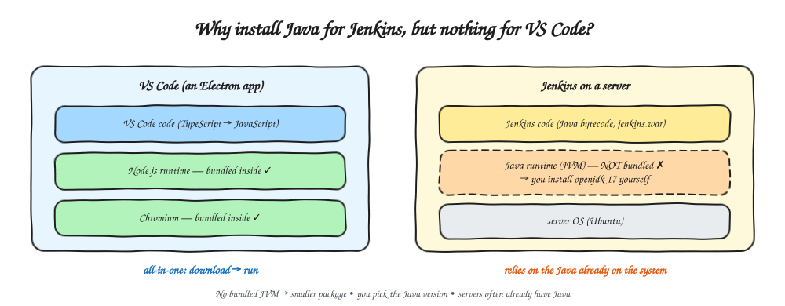

**1. VS Code: runtime is bundled**
- Built with **Electron**, which **packages Node.js + Chromium inside the app**.
- When you install VS Code, it already contains everything it needs → **self-contained**.

**2. Jenkins: runtime is an external dependency**
- Written in **Java** → needs a **JVM** to run.
- Jenkins **does not bundle the JVM**, to keep the package small and let you **choose your Java version**.
- **Separation of concerns:** the system provides the runtime; Jenkins stays lightweight and flexible, especially on servers/containers where Java is often pre-installed or centrally managed.

**Why they differ**

| | VS Code | Jenkins |
|---|---|---|
| Packaging | All-in-one | Relies on host's Java |
| Use case | Desktop app, should "just work" | Server software; Java is common on servers |
| Flexibility | Fixed bundled runtime | Reuse existing Java, no duplicate JVMs |

---

## 6. What is a Jenkins job?

> **JOB = a set of steps we give Jenkins to perform a task.**

Example job:
1. Take code from the Git repo
2. Perform a Maven build
3. Build a Docker image
4. Deploy the Docker image to a K8s cluster

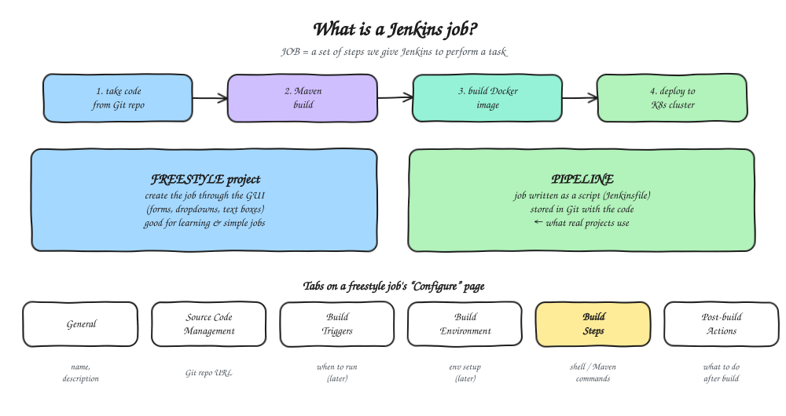

| Job type | How it's created | When used |
|----------|------------------|-----------|
| **Freestyle project** | Using the **GUI** (forms) | Learning, simple jobs |
| **Pipeline** | Using a **script** (`Jenkinsfile`) | **Real-time projects**: versioned in Git, repeatable |

---

## 7. Creating the first Jenkins job (Freestyle)

1. Go to the **Jenkins Dashboard**.
2. Click **New Item**:
   - Enter the **item name** (job name), e.g. `FirstJob`
   - Select **Freestyle project** → **OK**
   - Enter a description
   - Go to the **Build Steps** section → **Add build step** → **Execute shell**
3. Enter this shell script:

```bash
echo "Hello Guys,"
touch ashokit.txt                                          # create the file (if not there)
echo "Hello Guys, Welcome to Jenkins Classes" >> ashokit.txt  # >> APPENDS a line
echo "Done..!!"
```

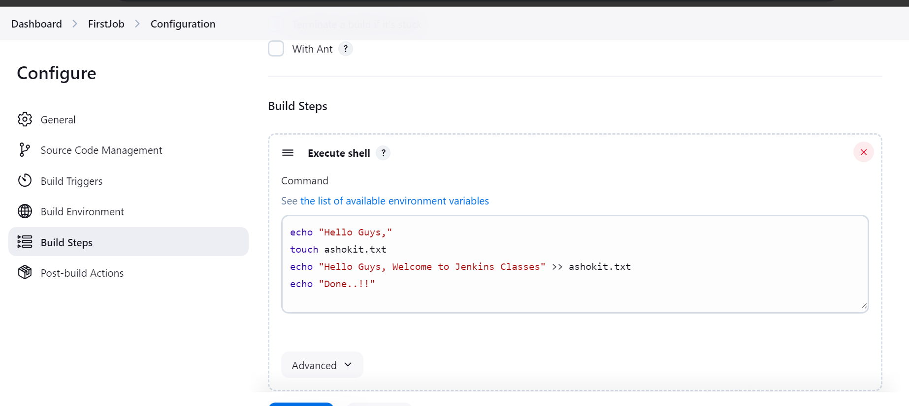

> **Post-build Actions** = what should happen *after* the build finishes (e.g. send an email, archive the artifact, trigger another job).

4. Click **Save**. The Jenkins job is created.

Inside the job page (from the dashboard):

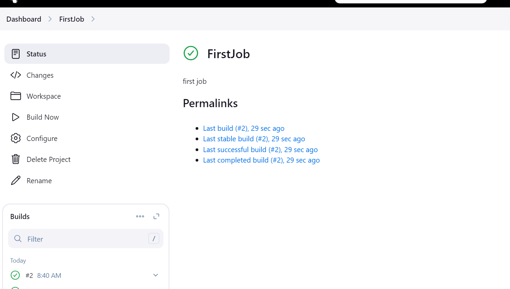

5. Click **Build Now** to start the job execution. Each run gets a **build number** (#1, #2…).

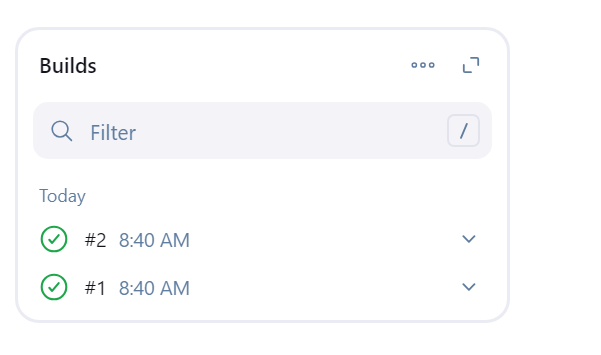

6. Click a **build number** → **Console Output** to see the execution details:

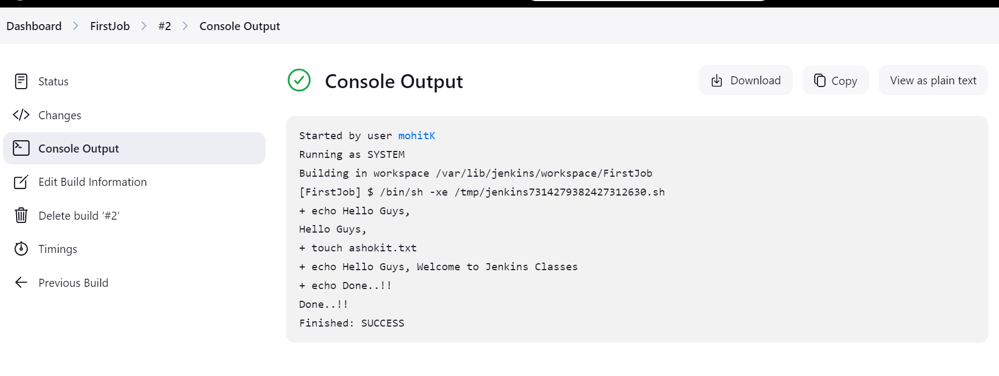

`Finished: SUCCESS` means every command ran without error.

### Where does the job actually run? The workspace

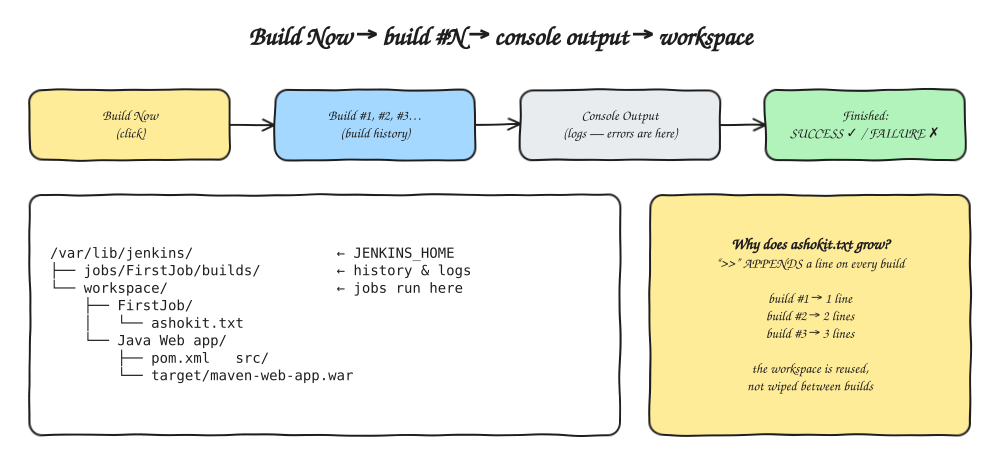

- Jenkins home: **`/var/lib/jenkins/`**
- Each job gets a folder in **`/var/lib/jenkins/workspace/<job-name>/`**. Whatever the job does happens here, and its output files live here.

```bash
cd /var/lib/jenkins/workspace/
```

7. Go to the workspace and check the job folder and the file created inside it:

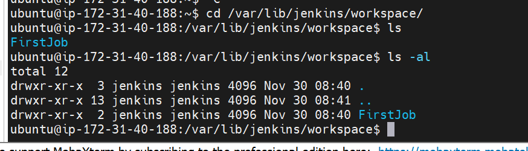

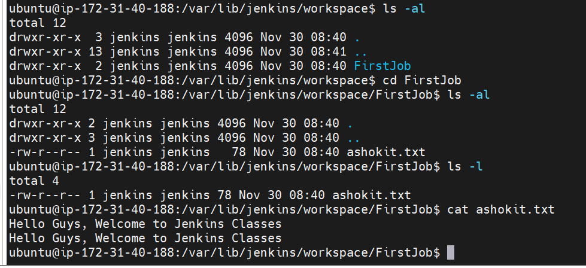

After 2 builds the file has **2 lines**. After build #3, **3 lines**, because `>>` appends and the workspace is **reused** between builds:

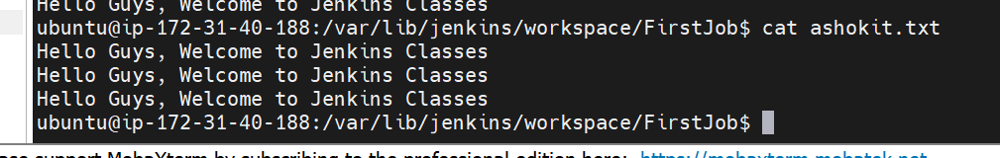

> **Note:** to investigate any error, look at the **Console Output (logs)**.

---

## 8. Jenkins job with GitHub + Maven integration

Goal: **clone a Git repo and build the code using Maven.**

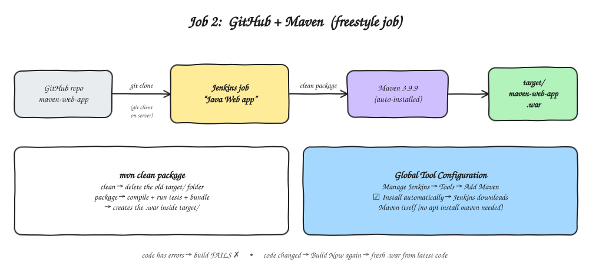

### Step 1: Install the Git client on the Jenkins server
```bash
sudo apt install git -y
```

### Step 2: Configure Maven as a global tool
> No need to install Maven manually. **We tell Jenkins to install Maven.**

**Dashboard → Manage Jenkins → Tools (Global Tool Configuration) → Add Maven** → name it, tick **Install automatically**, choose a version → **Apply** → **Save**.

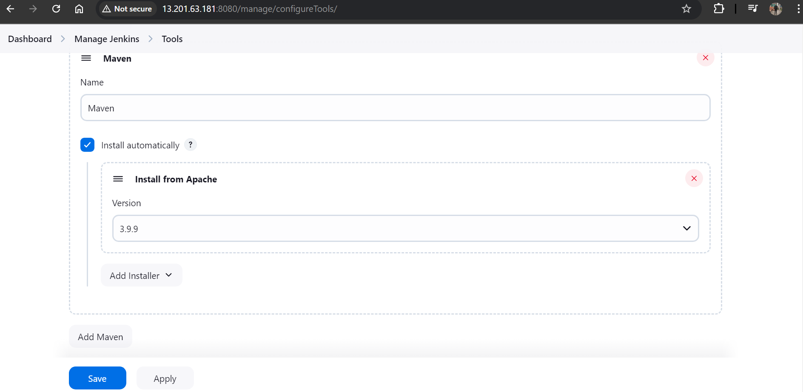

With this, Jenkins downloads & installs Maven itself the first time a job needs it.

### Step 3: Take the project Git repo
```
https://github.com/ashokitschool/maven-web-app.git
```

### Step 4: Create the Jenkins job
- **New Item** → enter item name (e.g. `Java Web app`) → **Freestyle project** → **OK**
- Enter a description
- **Source Code Management** → select **Git** → paste the **repo URL** (public repo → no credentials needed)
- *Build Triggers* and *Build Environment*: skip for now
- **Build Steps** → **Add build step** → **Invoke top-level Maven targets**
- Select the Maven installation and enter goals: **`clean package`**
  - `clean` deletes the old `target/` folder
  - `package` compiles, runs tests and bundles the app → `target/*.war`
- **Apply** → **Save**

### Step 5: Click **Build Now**

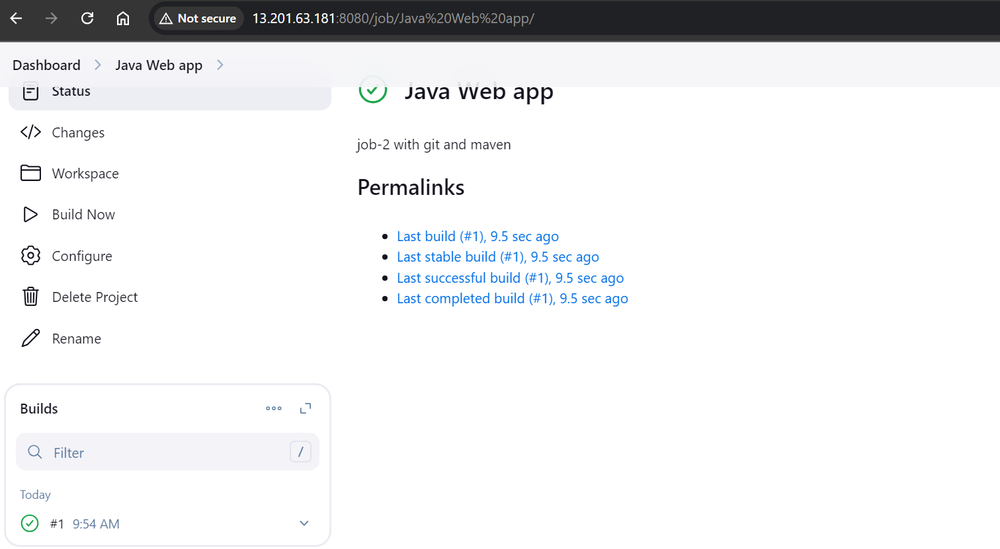

### Step 6: Build number → **Console Output**

Jenkins clones the repo into the workspace, then runs Maven:

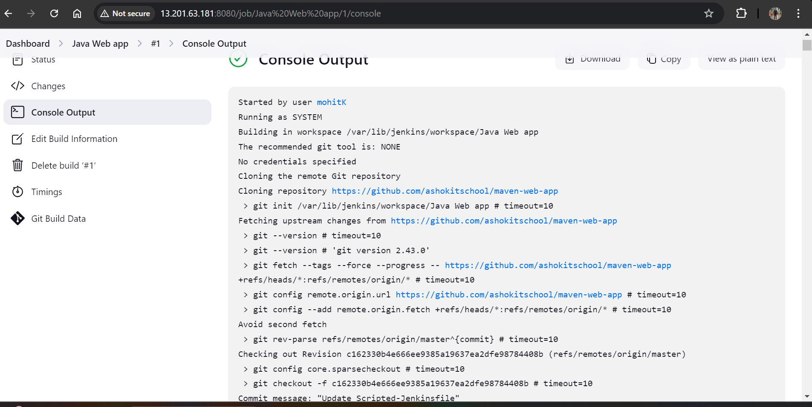

### Step 7: Find the `.war` file
Go to `/var/lib/jenkins/workspace/<job>/` → the cloned repo is there (`pom.xml`, `src/`, `target/`…):

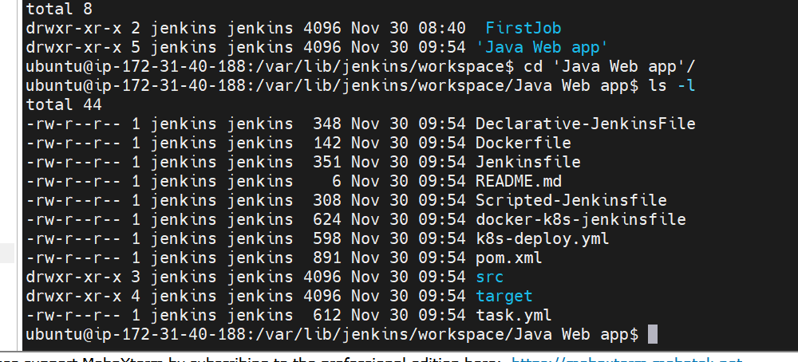

Inside **`target/`** the **`maven-web-app.war`** has been created:

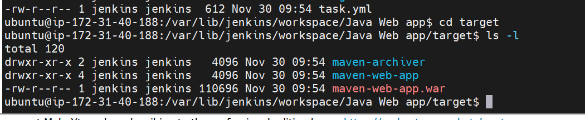

**Key behaviours**
- If the code has an error → **build fails** (red ✗), check the console output.
- If the code is modified → just **Build Now** again: Jenkins pulls the **latest code** and builds a **fresh `.war`**.

---

## 9. Assignment

Create a Jenkins job that:
1. Takes the source code from the Git repo
2. Builds that code using Maven
3. **Deploys the `.war` file into a Tomcat server** (running on a **different Linux VM**)

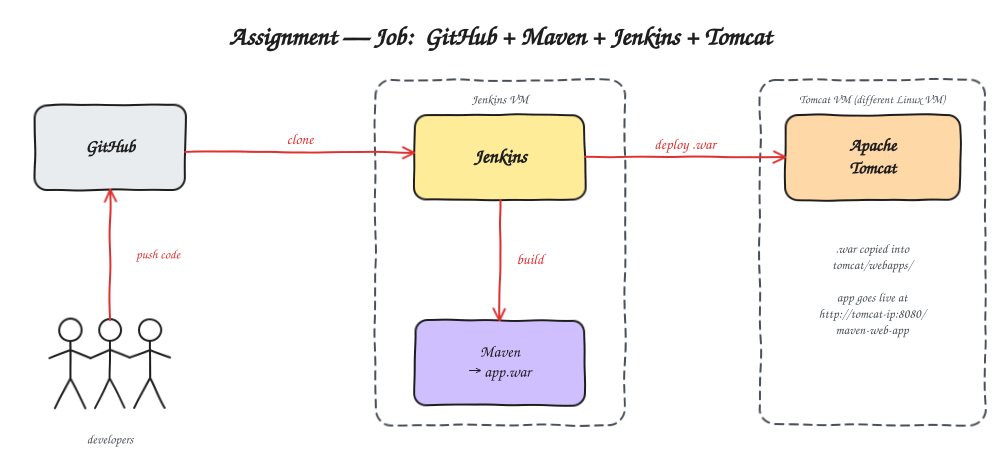

> **In real projects we don't use freestyle jobs. We use pipelines** (`Jenkinsfile`), covered in the next lectures.

---

## 10. Quick revision

- **Build & deployment** = checkout → build (Maven) → review (Sonar) → store (Nexus) → deploy.
- **Nexus** = artifact repository: stores every versioned `.war`/`.jar`, so you get rollback, build-once-deploy-everywhere, and a dependency cache.
- Manual = slow, repetitive, error prone → **automate with Jenkins**.
- **CI** = merge often + auto build/test. **CD** = artifact always releasable, auto-deployed (prod after approval in *Delivery*, fully automatic in *Deployment*).
- **Jenkins** = free, open-source, Java-based CI/CD server on **port 8080**. **Needs Java installed.**
- Unlock with `/var/lib/jenkins/secrets/initialAdminPassword`.
- **Job** = set of steps. **Freestyle** (GUI) vs **Pipeline** (script).
- Jobs run in **`/var/lib/jenkins/workspace/<job-name>/`**. Logs are in **Console Output**.
- Maven via **Manage Jenkins → Tools** (auto-install). Goals `clean package` → `.war` in `target/`.
