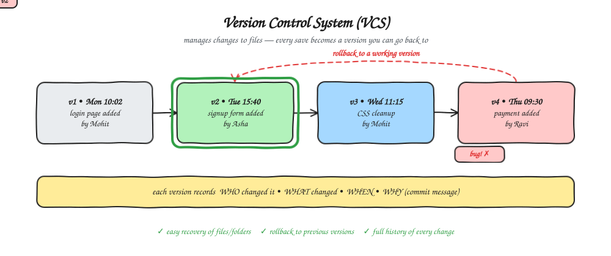
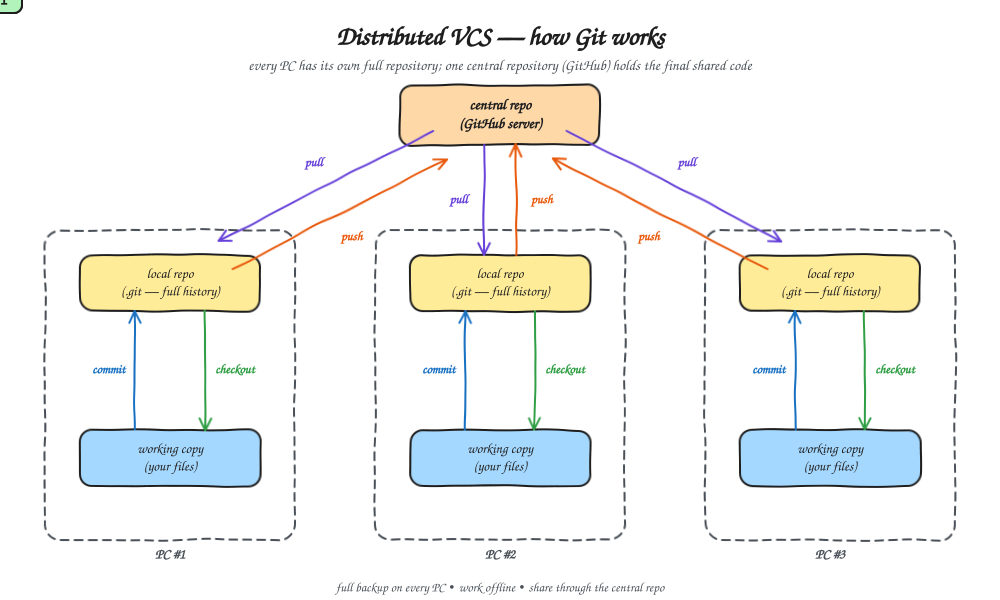
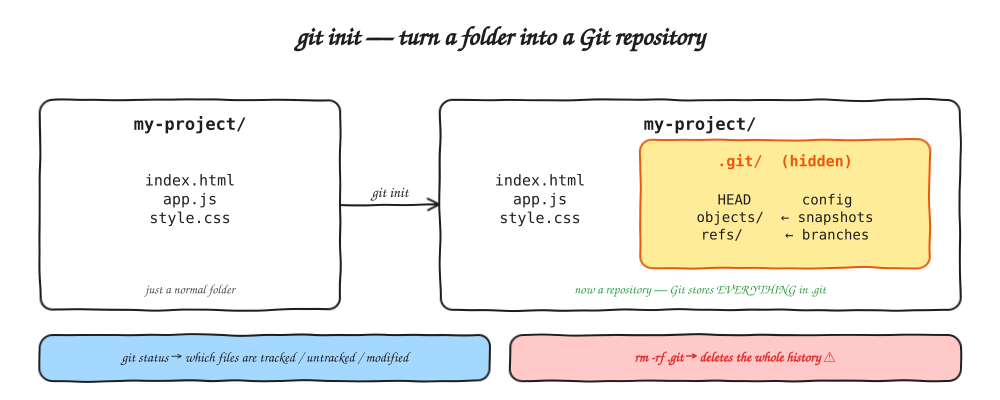
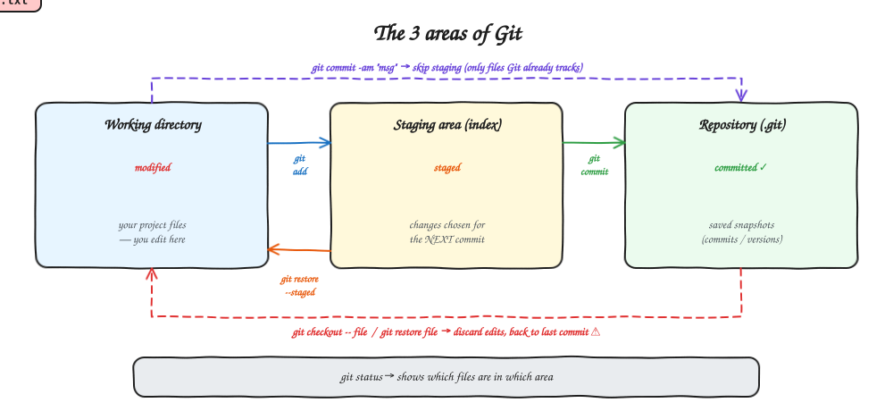
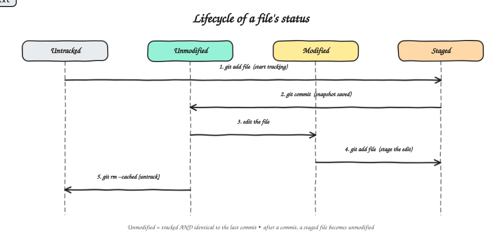
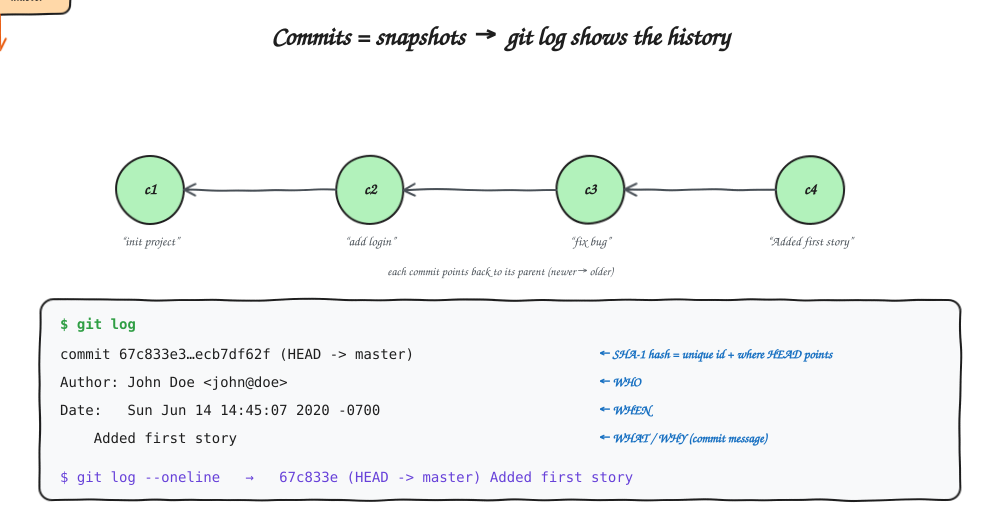
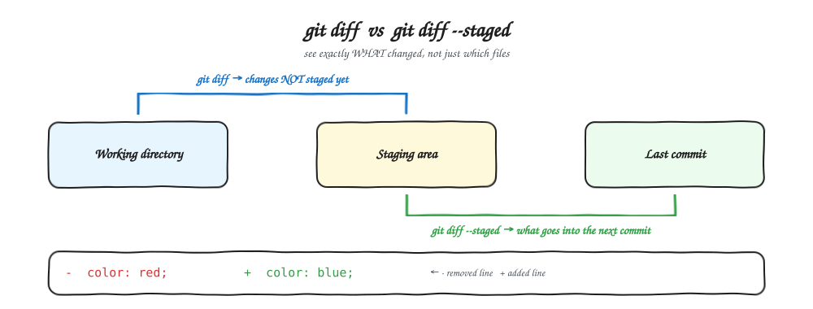
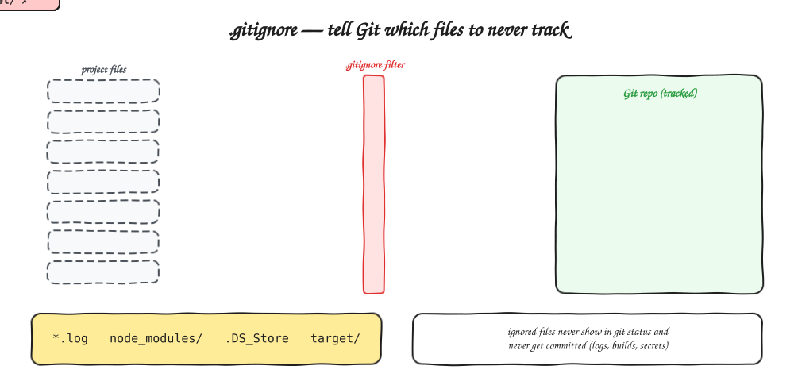
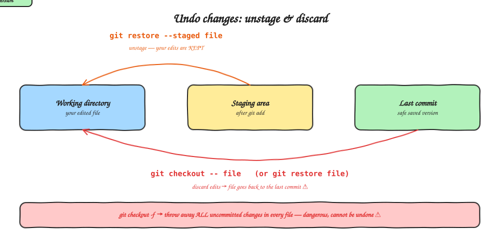

# Git & GitHub · Part 1: Git basics

> The diagrams are **animated**: open the preview to see files move between areas.

---

## 1. What is a Version Control System (VCS)?

A **version control system** is software that **manages changes** to computer programs, documents, large websites or any other collection of files.

Every time you save a change (a **commit**), the VCS keeps a **version / snapshot**, so you can always see the history and go back.



**Why use one?**
- **Easy recovery** of files/folders (deleted or broken something? get it back)
- **Rollback** to a previous working version
- Tells you **who** made a change, **what** changed, **when**, and **why** (the commit message)
- Many people can work on the same project without overwriting each other

---

## 2. Distributed VCS

- A **distributed** VCS has **multiple repositories**: **each user has their own local repository**, and there is a **central repository** where the final code lives (e.g. GitHub).
- Every local repo holds the **full history** → it **provides a full backup** of the project.
- **Git is an example of a distributed VCS.**



| Action | From → To | Meaning |
|--------|-----------|---------|
| **commit** | working copy → local repo | save a snapshot on *your* PC |
| **checkout / update** | local repo → working copy | put a version's files into your folder |
| **push** | local repo → central repo | share your commits with the team |
| **pull** | central repo → local repo | get the team's new commits |

> Watch the animation: PC #1 **commits** `C1`, **pushes** it to GitHub, then PC #2 and PC #3 **pull** it and check it out.

---

## 3. Git features



- **Distributed**: every developer has the complete repo + history.
- **Almost everything is local**: commit, log, diff, branch all work **offline**.
- **Non-linear / branching**: develop features on separate branches and merge them later.
- **Secure / integrity**: every commit is identified by a **SHA-1 hash** of its content; any change or corruption is detected.
- **Speed**: local operations are near-instant.

---

## 4. Setup & configuration

```bash
# check the installed git version
git --version

# configure your identity (stored in every commit you make)
git config --global user.name  "Your Name"
git config --global user.email "you@example.com"

# see all configured values
git config --list
```

`--global` writes to `~/.gitconfig` and applies to **all repos** for your user. Without `--global`, the setting applies only to the current repo.

---

## 5. Create a repository: `git init`

```bash
git init
```

This creates a hidden **`.git`** folder. **That's where Git stores everything**: all commits, branches and config.

```bash
git status      # shows the state of files: untracked / modified / staged
```



**Deleting a Git project** (removes all history; your files stay, but the folder is no longer a repo):
```bash
rm -rf .git
```

---

## 6. The 3 areas of Git

This is the most important idea in Git. A file moves through **three areas**:



| Area | What it is | Move into it with |
|------|-----------|-------------------|
| **Working directory** | Your normal project files; you edit here | (just edit files) |
| **Staging area (index)** | The changes you've **chosen for the next commit** | `git add` |
| **Repository (`.git`)** | Permanent **snapshots (commits)** | `git commit` |

> **With the `add` command we tell Git to track our files** (and stage their current content).

---

## 7. Tracking files

Each file in your working directory is in one of two states:

- **Tracked**: files Git knows about (they were in the last snapshot, or are staged).
- **Untracked**: any file that was **not in your last snapshot and is not in the staging area** (e.g. a brand-new file).

### Tracking / staging new files
```bash
git add <filename>   # one specific file
git add .            # all files & folders in the current directory
```
`git add` **stages the latest version** of the file. If you edit it again after adding, you must `git add` again.

### Lifecycle of a file's status



| # | Action | Status change |
|---|--------|---------------|
| 1 | `git add` a new file | Untracked → **Staged** |
| 2 | `git commit` | Staged → **Unmodified** |
| 3 | Edit the file | Unmodified → **Modified** |
| 4 | `git add` the file | Modified → **Staged** |
| 5 | `git rm --cached` | Unmodified → **Untracked** (Git stops tracking it, file stays on disk) |

---

## 8. Committing changes

**Moving files from the staging area into the `.git` repository is called a commit.**
Making commits creates **versions / snapshots** of your project. (Those commits are also what fills your GitHub contribution graph.)

```bash
git commit -m "Your commit message"
```

Write messages that explain **why** (e.g. `"Fix login crash on empty password"`, not `"changes"`).

### Skipping the staging area
```bash
git commit -a -m "Commit message"
# same as
git commit -am "Commit message"
```
`-a` automatically stages **all modified tracked files** and commits them in one step.
⚠ It does **not** include **new (untracked)** files; those still need `git add`.

---

## 9. Viewing the commit history: `git log`

You can see all the commits / versions of your project:

```bash
git log            # full details
git log --oneline  # one line per commit
```



Reading a `git log` entry:

| Part | Example | Meaning |
|------|---------|---------|
| **commit hash** | `67c833e3…ecb7df62f` | Unique **SHA-1 id** of the commit |
| **(HEAD -> master)** | | **HEAD** = where you are now; it points to branch `master`, which points to this commit |
| **Author** | `John Doe <john@doe>` | **Who** made it |
| **Date** | `Sun Jun 14 14:45:07 2020 -0700` | **When** |
| **Message** | `Added first story` | **What / why** |

`git log --oneline` shows the **short hash** (first 7 characters), the branch pointer and the message:
```
67c833e (HEAD -> master) Added first story
```

---

## 10. `git diff`: see exactly what changed

`git status` tells you **which** files changed; `git diff` tells you **exactly what** changed inside them.



```bash
git diff            # working directory vs staging area  → changes NOT staged yet
git diff --staged   # staging area vs last commit       → what will go into your next commit
```
Lines starting with `-` were removed, lines starting with `+` were added.

---

## 11. `.gitignore`: files Git should never track

Often we don't want Git to track auto-generated files like **logs, build output, `node_modules/`, `.DS_Store`**, or secrets like `.env`.
List those files, or patterns for them, in a **`.gitignore`** file at the root of the repo:



```gitignore
*.log           # every file ending in .log
node_modules/   # whole folder
.DS_Store
target/         # Maven build output
.env            # secrets
```

Ignored files don't appear in `git status` and can't be added by accident.
⚠ `.gitignore` only affects **untracked** files. If a file is already committed, run `git rm --cached <file>` first.

---

## 12. Moving & removing files

These commands **stage the change automatically**; no separate `git add` needed:

```bash
git rm filename.txt                       # delete the file AND stage the deletion
git mv filename.txt newfilename.txt       # rename/move the file AND stage it
```

---

## 13. Undo: unstaging & discarding changes



```bash
git restore --staged filename.txt   # UNSTAGE: staging → working dir (your edits are kept)

git checkout -- filename.txt        # DISCARD edits: file goes back to the last commit
git restore filename.txt            # newer equivalent of the line above

git checkout -f                     # roll back ALL files to the last commit
```

> ⚠ **Note:** `git checkout -- <file>` and especially `git checkout -f` are **dangerous**. They **discard all your uncommitted changes** in the working directory, and there is no undo.

| Command | Affects | Edits kept? |
|---------|---------|-------------|
| `git restore --staged file` | staging area only | ✓ yes |
| `git checkout -- file` / `git restore file` | one file in working dir | ✗ lost |
| `git checkout -f` | every file in working dir | ✗ lost |

---

## 14. Setting aliases (shortcuts)

```bash
git config --global alias.st status
git st                     # = git status

git config --global alias.unstage 'restore --staged --'
git unstage file.txt       # = git restore --staged -- file.txt
```

---

## 15. Quick revision

| Task | Command |
|------|---------|
| Check version | `git --version` |
| Set identity | `git config --global user.name / user.email` |
| New repo | `git init` |
| Status | `git status` |
| Stage | `git add <file>` / `git add .` |
| Commit | `git commit -m "msg"` |
| Stage + commit tracked files | `git commit -am "msg"` |
| History | `git log` / `git log --oneline` |
| What changed | `git diff` / `git diff --staged` |
| Ignore files | `.gitignore` |
| Remove / rename | `git rm` / `git mv` |
| Unstage | `git restore --staged <file>` |
| Discard edits | `git checkout -- <file>` / `git restore <file>` |
| Discard everything | `git checkout -f` ⚠ |
| Delete repo history | `rm -rf .git` ⚠ |
