# Git & GitHub · Part 2: Branching, Merge & Rebase

> All diagrams are **animated**. In every diagram, **arrows point from a commit to its parent** (that's how Git stores history), and labels like `master` / `HEAD` point at the commit they refer to.

---

## 1. What is a branch?

- A branch in Git is simply a **lightweight, movable pointer to a commit**.
- The default branch is called **`master`** (newer Git/GitHub use **`main`**).
- **Branching** means diverging from the main line of development, to work on a feature or fix without disturbing the main code.
- **HEAD** is a special pointer that says **which branch you are on right now**.

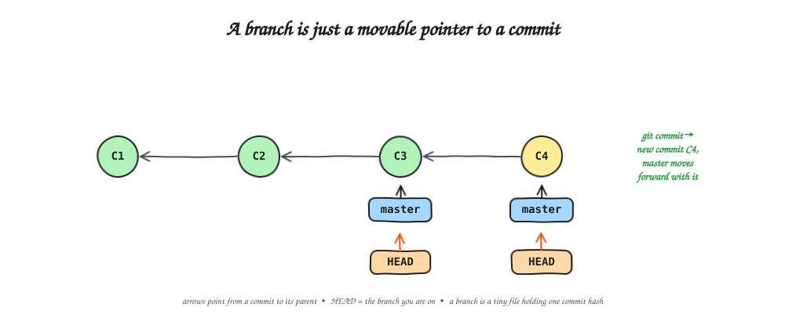

When you commit, the **current branch pointer moves forward** to the new commit automatically.

**Why branching in Git is cheap:** many older VCSs copy the whole project into a new folder for each branch. A Git branch is just a tiny file containing one commit hash, so **creating, switching and deleting branches is instant**.

---

## 2. Branch commands

```bash
git branch              # list branches (* marks the current one)
git branch -v           # list branches + the last commit on each
git branch <name>       # create a branch (does NOT switch to it)

git checkout <name>     # switch to a branch
git checkout -b <name>  # create AND switch in one step
# newer equivalents:
git switch <name>
git switch -c <name>
```

### Rename a branch
```bash
git branch -m new_name            # rename the CURRENT branch
git branch -m old_name new_name   # rename another branch without switching to it
```
```console
$ git branch
* master
  new_branch
$ git branch -m new_branch authentication_feature
$ git branch
  authentication_feature
* master
```

### Delete a branch
```bash
git branch -d <name>   # delete a MERGED branch (safe: refuses if work would be lost)
git branch -D <name>   # force-delete a NOT-merged branch (its unmerged commits are abandoned)
```
```console
$ git branch -d new_branch
Deleted branch new_branch (was 62aa179).
```

---

## 3. Create a branch and switch to it

Suppose we create a branch `develop` from `master`, then move to it:

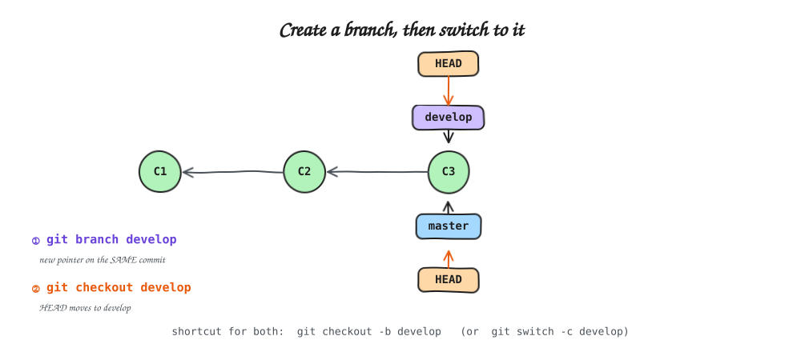

1. `git branch develop`: a **new pointer on the same commit**. HEAD is still on `master`.
2. `git checkout develop`: **HEAD moves** to `develop`. New commits will now move `develop`.

---

## 4. Commits on two branches: diverging history

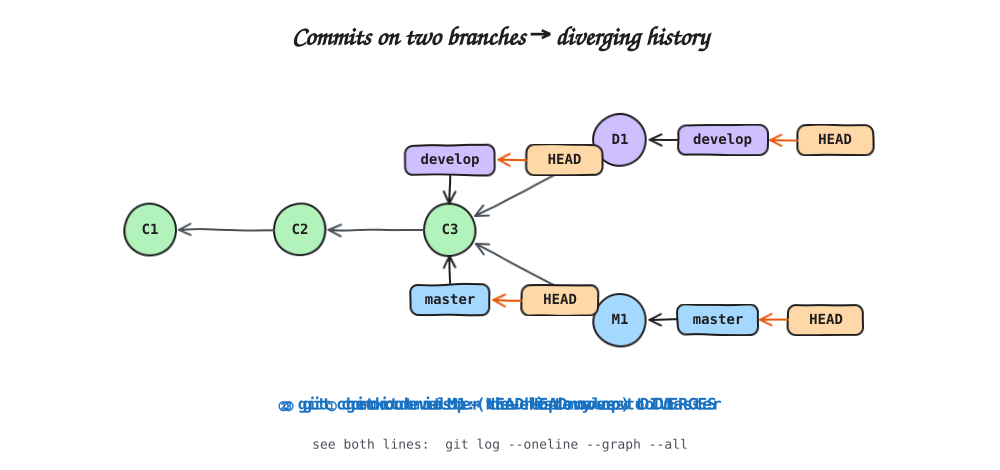

1. On `develop`, make a commit → `develop` moves to **D1** (`master` stays on C3).
2. `git checkout master` → HEAD moves back to `master`. Your files change back to the C3 version.
3. Make a commit on `master` → **M1**. Now the two branches have **diverged**: each has a commit the other doesn't.

### Seeing history
```bash
git log                           # history of the CURRENT branch only
git log --oneline                 # one line per commit
git log --oneline --graph         # with a branch graph
git log --oneline --graph --all   # graph of ALL branches
```
> `git log` only shows commits **reachable from the current branch**. The other branch's commits (like D1 when you're on master) appear only with `--all`.

---

## 5. Merge

Merging brings the work of another branch **into the branch you are currently on**:

```bash
git checkout <destination>   # e.g. master
git merge <source>           # e.g. develop
```

### 5.1 Fast-forward merge

We create `impfix` from `master` and commit a fix (C3) on it. `master` hasn't moved since. To bring the fix into master:

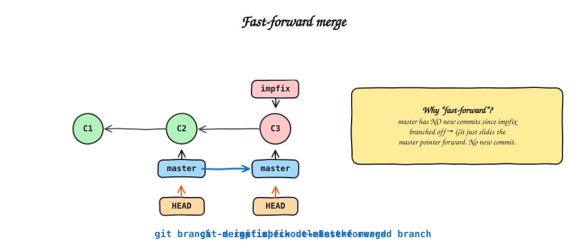

```bash
git checkout master
git merge impfix        # "Fast-forward"
git branch -d impfix    # the branch is merged → safe to delete
```

Because **master has no new commits of its own**, Git doesn't need to combine anything. It just **slides the `master` pointer forward** to C3. No new commit is created. That's a **fast-forward**.

> Why not do it the other way (`git merge master` while on develop)? You can, to bring master's latest changes into develop. But **master is the main branch**, so we merge *into* master only work that's ready and tested.

### 5.2 Three-way merge

Now both branches have new commits: `master` has C3, `develop` has D1 and D2. We want develop's changes in master:

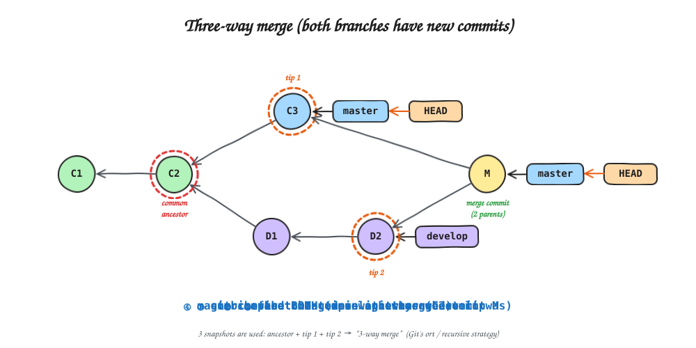

```bash
git checkout master
git merge develop       # Git opens an editor for the merge commit message
```

What Git does:
1. **Finds the common ancestor**: the last commit both branches share (C2). Check it with `git merge-base master develop`.
2. **Compares both branch tips** (C3 and D2) against that ancestor to see what each side changed.
3. **Combines both sets of changes into a new commit M**, the **merge commit**. It has **two parents**.
4. **`master` moves to M.** `develop` stays where it was.

It's called a **3-way merge** because it uses 3 snapshots: ancestor + tip 1 + tip 2. Git calls the algorithm the *recursive* strategy (older Git) or *ort* (Git 2.34+).

---

## 6. Merge conflicts

If **two branches change the same lines of the same file differently**, Git can't decide which version wins → **merge conflict**.

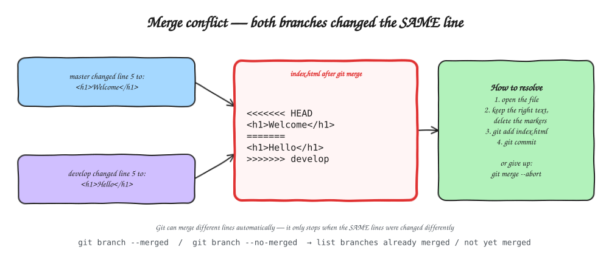

Git pauses the merge and marks the file:
```text
<<<<<<< HEAD
<h1>Welcome</h1>        ← your current branch's version
=======
<h1>Hello</h1>          ← the incoming branch's version
>>>>>>> develop
```

**Resolve:**
```bash
git status                 # lists the conflicted files
# edit the file: keep the correct text, delete the <<<<<<< ======= >>>>>>> lines
git add index.html
git commit                 # completes the merge

git merge --abort          # or: cancel and go back to before the merge
```

### Which branches are merged?
```bash
git branch --merged       # branches already merged into the current one (safe to delete)
git branch --no-merged    # branches with work not yet merged
```

---

## 7. Rebase

With **rebase** you take the commits from your branch and **replay them on top of another branch**, giving a **linear history** instead of a merge commit.

```bash
git rebase <new-base>
```
Git rewrites the commits of the **currently checked-out branch** and places them after `<new-base>`.

### Example
- `master` received commit **C3**, while `develop` independently got **D1** and **D2** (both started from C2).
- **Goal:** put D1 and D2 after C3, with **`master` not moving**.

```bash
git switch develop          # we are on the branch that will be rewritten
git branch --show-current   # → develop
git rebase master
```
Read it as: *"I am on `develop`. Take the commits unique to `develop` and replay them on top of `master`."*

> ⚠ Don't check out `master` and run `git rebase develop` for this goal. That reverses the direction and rewrites the wrong branch.

### How Git performs a rebase

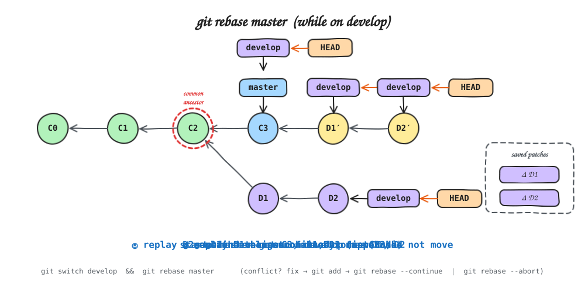

| Step | What happens |
|------|--------------|
| ① | Find the **common ancestor** of the two branches (C2). |
| ② | Compute the **changes (diffs) introduced by each commit** on your branch (D1, D2) and save them as temporary patches. |
| ③ | **Reset** your branch to the commit you're rebasing onto (C3). `master` itself doesn't move. |
| ④ | **Apply the first patch** → a new commit **D1′**. |
| ⑤ | **Apply the next patch** → **D2′**. `develop` now points to D2′. |

Result: `C0 → C1 → C2 → C3 → D1′ → D2′`, and `master` is still at C3.

**D1′ is not D1.** It has the same changes but a **different parent → different hash**. The old D1/D2 are no longer on `develop`.

### Conflicts during rebase
Rebase pauses at the commit that conflicts:
```bash
git status                 # see conflicted files, fix them
git add <resolved-file>
git rebase --continue      # go on to the next commit
git rebase --abort         # or: cancel, back to the state before the rebase
```

### After rebasing: fast-forward master
```bash
git switch master
git merge develop          # develop is directly ahead → fast-forward, no merge commit
```

### Key points
- **Same final files** as merging, but a **cleaner, linear history**: it looks like the work happened in series, even if it happened in parallel.
- Rebase **creates new commits with new hashes**.
- Best for **cleaning up your own private branch** before integrating it, e.g. so your commits apply cleanly on top of the latest remote branch.
- Always check which branch you're on first: `git branch --show-current`.

---

## 8. Merge vs Rebase

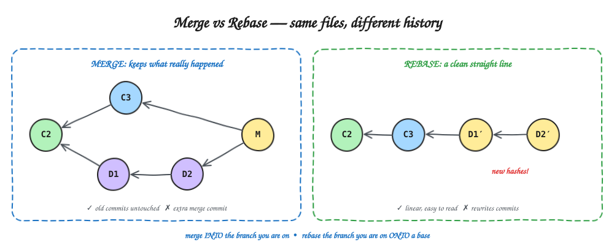

Two points of view: history as a **record of what actually happened** (merge) vs history as **the story of how the project was made** (rebase).

| Question | Merge | Rebase |
|---|---|---|
| Existing commits | Unchanged | Recreated (new hashes) |
| Merge commit | Yes (for diverged branches) | No |
| History shows | Real divergence & integration | Clean straight line |
| Best for | Shared / public branches | Your private feature branch |
| Main risk | Noisy history with many merge commits | Rewriting commits others already use |

```bash
# MERGE develop INTO master (preserve history)
git switch master
git merge develop

# REBASE develop ONTO master (linear history)
git switch develop
git rebase master
```

> **Merge *into* the branch you are on. Rebase the branch you are on *onto* the named base.**

---

## 9. When NOT to rebase

> **Do not rebase commits that exist outside your repository and that people may have based work on.**

Rebase **abandons existing commits and creates new, similar-but-different ones**. If teammates already built on the old ones, their history and yours no longer agree.

**"Exists outside your repository"** means another copy exists that you don't control alone:
- you **pushed** the branch to GitHub/GitLab,
- a teammate **fetched or pulled** it,
- a teammate **made commits on top** of it,
- a build/release already refers to those commit hashes.

### Example: Alice and Bob

`origin` is the shared GitHub repo; Alice and Bob each have their own clone.

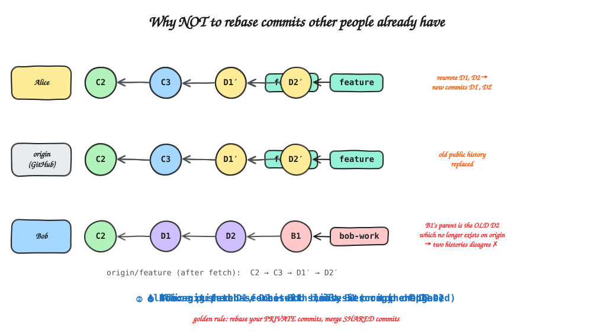

**State 0: Alice publishes a feature**
```bash
git switch -c feature
git commit -m "Alice: feature part 1"   # D1
git commit -m "Alice: feature part 2"   # D2
git push -u origin feature
```

**State 1: Bob builds on it**
```bash
git fetch origin
git switch -c bob-work origin/feature
git commit -m "Bob: add validation"     # B1, its parent is D2 (stored permanently in B1)
```

**State 2: `master` gets a new commit C3** (pushed by someone else).

**State 3: Alice rebases her feature onto master** (only *her* copy changes):
```bash
git switch feature
git rebase master        # C2 → C3 → D1′ → D2′
```

**State 4: Alice force-pushes**, replacing the public history:
```bash
git push --force-with-lease
```

**State 5: Bob fetches** and now has two histories:
```text
origin/feature: C2 → C3 → D1′ → D2′   (new)
bob-work:       C2 → D1 → D2 → B1     (his work still sits on the OLD D2)
```

| | Alice | origin | Bob |
|---|---|---|---|
| after rebase | new `D1′ D2′` | old `D1 D2` | old `D1 D2 B1` |
| after force-push | new | **new** | old |
| after Bob's fetch | new | new | `origin/feature` = new, `bob-work` = **old** |

`git fetch` updates `origin/feature` but **never rewrites Bob's local branch**. Bob now sees diverged history, duplicate-looking commits, rejected pushes or conflicts. `D1 ≠ D1′` even if the changes look identical.

### How Bob recovers

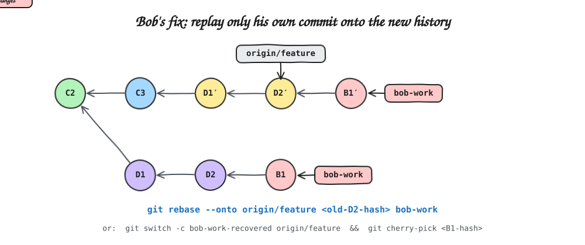

```bash
git switch bob-work
git branch backup/bob-work-before-recovery     # safety copy first
git log --oneline --graph --all                # find the hash of the OLD D2

git rebase --onto origin/feature <old-D2-hash> bob-work
```
*"Take the commits on `bob-work` after old D2 (just B1) and replay them onto the new `origin/feature`."* → creates **B1′** on top of D2′.

**Simpler for one or two commits: cherry-pick**
```bash
git switch -c bob-work-recovered origin/feature
git cherry-pick <B1-hash>
```

### Why merging is safe for shared work

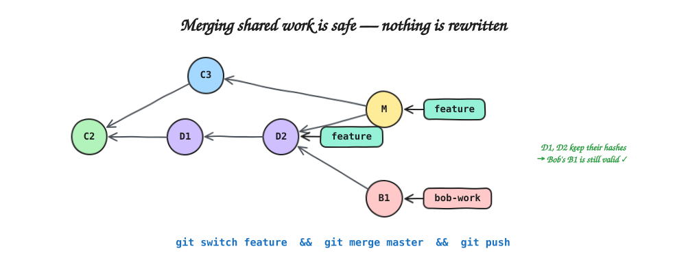

```bash
git switch feature
git merge master     # brings C3 in with a merge commit M
git push             # no force needed
```
D1 and D2 **keep their hashes**, so Bob's B1 still has a valid parent and nothing breaks.

### When is rebase safe?
- The commits exist **only in your local, private branch**, or
- you pushed them but **nobody else fetched or built on them**, and
- you're deliberately cleaning up your own branch before sharing it.

If a published branch *must* be rebased, coordinate with everyone first, and push with `--force-with-lease` (safer than `--force`: it refuses to overwrite remote work you haven't seen).

> **Golden rule: rebase your private commits; merge shared commits.**

---

## 10. Quick revision

| Task | Command |
|------|---------|
| List branches | `git branch` / `git branch -v` |
| Create | `git branch <name>` |
| Switch | `git checkout <name>` / `git switch <name>` |
| Create + switch | `git checkout -b <name>` / `git switch -c <name>` |
| Rename | `git branch -m [old] <new>` |
| Delete merged / force | `git branch -d` / `git branch -D` |
| History graph | `git log --oneline --graph --all` |
| Merge into current | `git merge <branch>` |
| Abort merge | `git merge --abort` |
| Merged / not merged | `git branch --merged` / `--no-merged` |
| Rebase current onto base | `git rebase <base>` |
| Continue / abort rebase | `git rebase --continue` / `--abort` |
| Common ancestor | `git merge-base <a> <b>` |
| Copy one commit | `git cherry-pick <hash>` |
| Safe force-push | `git push --force-with-lease` |
