# Git & GitHub · Part 3: GitHub, Stash, Undo & Cherry-pick

> All diagrams are **animated**. Arrows between commits point **from a commit to its parent**; labels (`main`, `HEAD`, `origin/main`…) point at the commit they refer to.

---

## 1. Working with a remote (GitHub)

A **remote** is a copy of your repository hosted somewhere else, e.g. GitHub. By convention the main remote is called **`origin`**.

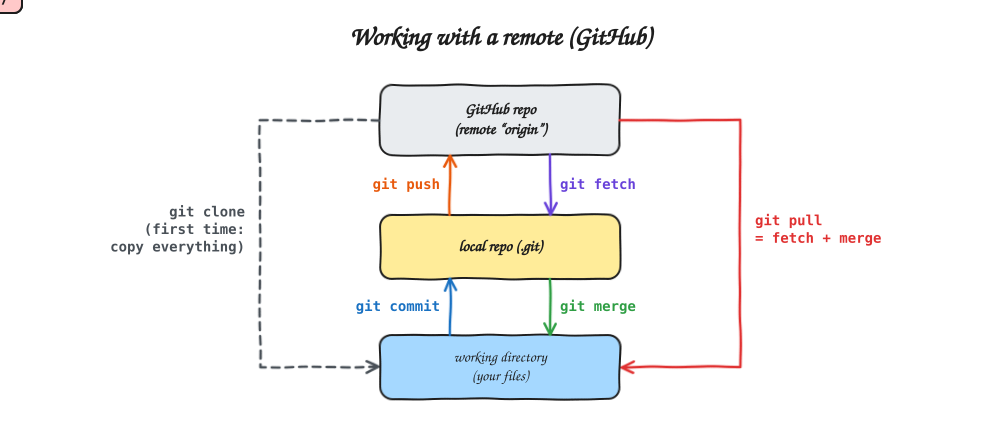

| Command | Direction | What it does |
|---------|-----------|--------------|
| `git clone <url>` | GitHub → your PC | First-time copy of the whole repo + history |
| `git commit` | working dir → local repo | Save a snapshot locally |
| `git push` | local repo → GitHub | Upload your commits |
| `git fetch` | GitHub → local repo | Download new commits (doesn't touch your files) |
| `git merge` | local repo → working dir | Combine fetched commits into your branch |
| `git pull` | GitHub → working dir | `fetch` + `merge` in one step |

```bash
git remote -v                         # show remotes
git remote add origin <repo-url>      # connect a local repo to GitHub
git push -u origin main               # first push; -u remembers the upstream
git push                              # later pushes
```

---

## 2. Fetch vs Pull

**`git fetch`** downloads commits, files and refs from a remote into your local repo. It updates **`origin/main`** (your local *copy* of where GitHub's main is) but **does not change your branch or your files**.

**`git pull` = `git fetch` + `git merge`**

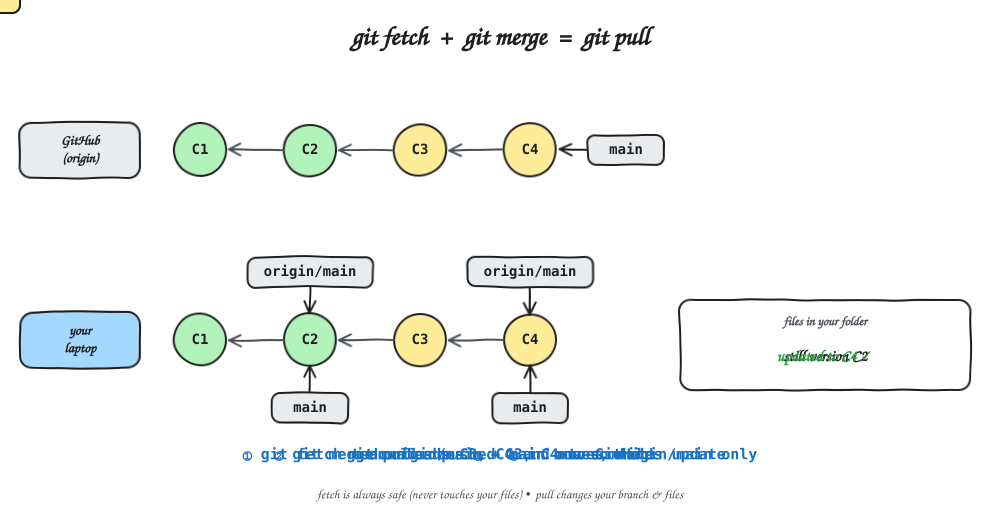

```bash
git fetch                  # 1. download; safe, never touches your work
git log main..origin/main  #    (optional) see what's new before merging
git merge origin/main      # 2. bring it into your branch

git pull                   # 1 + 2 together
```

> Use **fetch** when you want to *look* before integrating. Use **pull** when you just want to be up to date.

---

## 3. Pull Requests (PR)

A **pull request** is a request on GitHub to **merge your branch into another branch** (usually `main`). It's where the team **discusses, reviews code and runs automated checks (CI)** before the change lands.

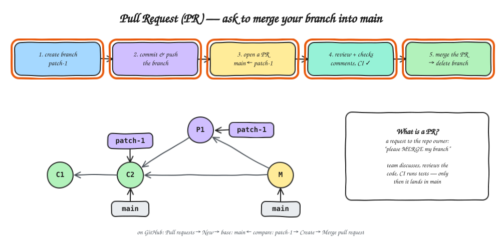

**Making a pull request**
1. Create a branch, e.g. `patch-1` (or edit a file on GitHub, which creates the branch for you).
2. Commit and **push** the branch.
3. On GitHub: **Pull requests → New pull request** → `base: main` ← `compare: patch-1` → add a title & description → **Create pull request**.
4. Reviewers comment and approve; GitHub shows whether the branch **has no conflicts** with the base and whether CI checks passed.

**Merging a pull request**

5. Click **Merge pull request** → GitHub creates the merge commit on `main` and the PR shows **Merged**.
6. **Delete branch**: the work is in main now, so the branch can be safely deleted.

After merging on GitHub, update your local copy: `git switch main && git pull`.

---

## 4. Forking a repository

A **fork** is **your own copy of someone else's repository, on GitHub, under your account**.

You can't push to a project you don't own (e.g. an open-source project like `facebook/react`). Instead you **fork** it, make changes in **your** copy, and then ask the owner to pull them in with a **Pull Request**.

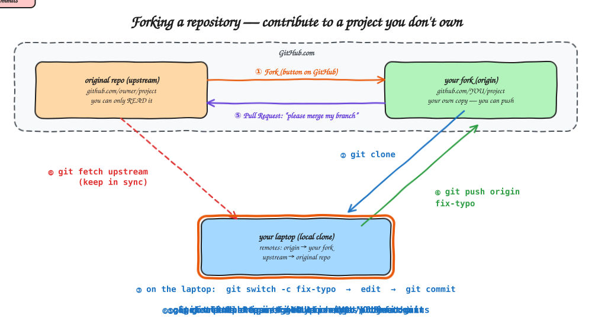

### The full fork workflow

**① Fork on GitHub.** Open the original repo → click **Fork** (top right) → choose your account → **Create fork**.
GitHub creates `github.com/YOU/project`, a full copy with all branches and history, linked to the original.

**② Clone YOUR fork** (not the original) to your laptop:
```bash
git clone https://github.com/YOU/project.git
cd project
git remote -v
# origin  https://github.com/YOU/project.git (fetch/push)   ← your fork
```

**Add the original repo as a second remote**, conventionally called `upstream`:
```bash
git remote add upstream https://github.com/owner/project.git
git remote -v
# origin    https://github.com/YOU/project.git    ← you can push here
# upstream  https://github.com/owner/project.git  ← read-only for you
```

**③ Create a branch and make your changes** (don't work directly on your fork's `main`):
```bash
git switch -c fix-typo
# ...edit files...
git add .
git commit -m "Fix typo in README"
```

**④ Push the branch to YOUR fork** (origin):
```bash
git push -u origin fix-typo
```

**⑤ Open a Pull Request** from your fork to the original.
GitHub shows a **"Compare & pull request"** button → check `base repository: owner/project`, `base: main` ← `head repository: YOU/project`, `compare: fix-typo` → describe the change → **Create pull request**.
The maintainers review it and may ask for changes. Just commit and push again to the same branch, and the PR updates automatically. Then they **merge** it.

**⑥ Keep your fork in sync** with the original (see below).

### Keeping a fork up to date

Your fork does **not** update automatically when the original repo gets new commits. It falls behind:

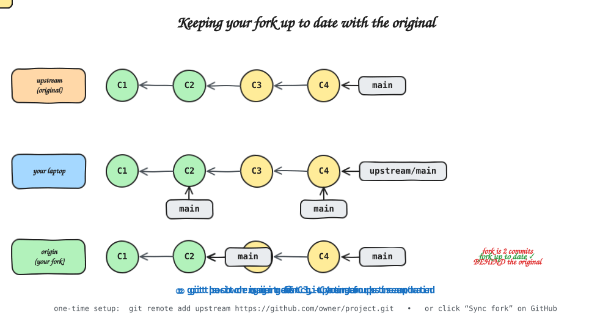

```bash
git fetch upstream              # ① download the owner's new commits
git switch main
git merge upstream/main         # ② bring them into your local main
git push origin main            # ③ update your fork on GitHub
```
Or click **"Sync fork" → "Update branch"** on your fork's GitHub page, then `git pull` locally.

> Sync **before** starting a new branch, so your work is based on the latest code and your PR has fewer conflicts.

### Fork vs Clone vs Branch


| | Fork | Clone | Branch |
|---|---|---|---|
| What | Copy of a repo **on GitHub** | Copy of a repo **on your computer** | Pointer **inside** a repo |
| Lives on | GitHub (server) | Your laptop | Any repo |
| Created by | "Fork" button on GitHub | `git clone <url>` | `git branch` / `git switch -c` |
| Purpose | Contribute **without write access** | Work locally | Separate line of work |
| Git command? | ✗ (a GitHub feature) | ✓ | ✓ |

**When to fork vs branch?**
- **No write access** to the repo (open source, another team's project) → **fork**.
- **You're a collaborator** with write access (your team's repo) → just create a **branch** in the same repo and open a PR from it.

---

## 5. Display the changes in a commit

```bash
git show <commit-id>     # author, date, message + the full diff of that commit
git show HEAD            # the latest commit
```

---

## 6. Stashing

**Stashing** takes the *dirty* state of your working directory (your **modified tracked files and staged changes**) and saves it on a **stack of unfinished changes** that you can reapply at any time.

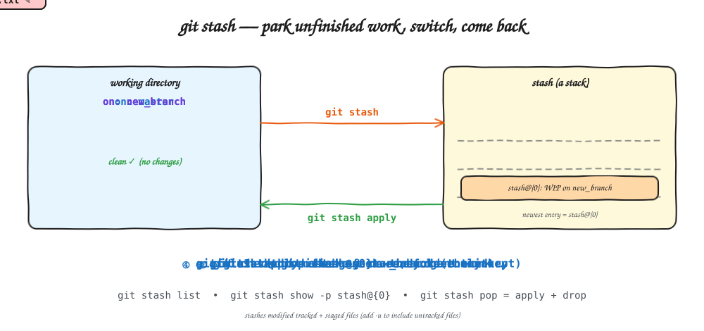

```bash
git stash                        # save changes, clean the working dir
git stash list                   # see all stashes
git stash apply stash@{0}        # re-apply a stash (it stays in the list)
git stash drop stash@{0}         # delete a stash
git stash pop                    # apply the latest + drop it
git stash show stash@{0}         # summary of the stash
git stash show --patch stash@{0} # full diff
git stash -u                     # also stash untracked files
```

The stash is **kept local** to your repository (not pushed). Each entry gets an automatic message like *"WIP on master"*.

### When to use it
You're on `new_branch`, halfway through changes to `file1.txt`, and you're suddenly needed on `master`. The work isn't ready to commit, but you don't want to lose it:

1. `git stash`: changes are saved, folder is clean.
2. `git checkout master`: do the urgent work.
3. `git checkout new_branch`: come back.
4. `git stash apply`: your changes are back.
5. `git status`: verify `file1.txt` shows as modified again.

```console
$ git stash
Saved working directory and index state WIP on new_branch: 25955d5 initial commit
$ git checkout master
Switched to branch 'master'
$ git checkout new_branch
Switched to branch 'new_branch'
$ git stash apply
On branch new_branch
Changes not staged for commit:
        modified:   file1.txt
```

**Without stash**, Git may refuse to switch branches (if your uncommitted changes would be overwritten). You'd have to either commit unfinished work and undo it later, or throw your changes away.

---

## 7. Cleaning the working directory: `git clean`

When you don't want to *stash* some files but simply **get rid of untracked files**, use `git clean`:

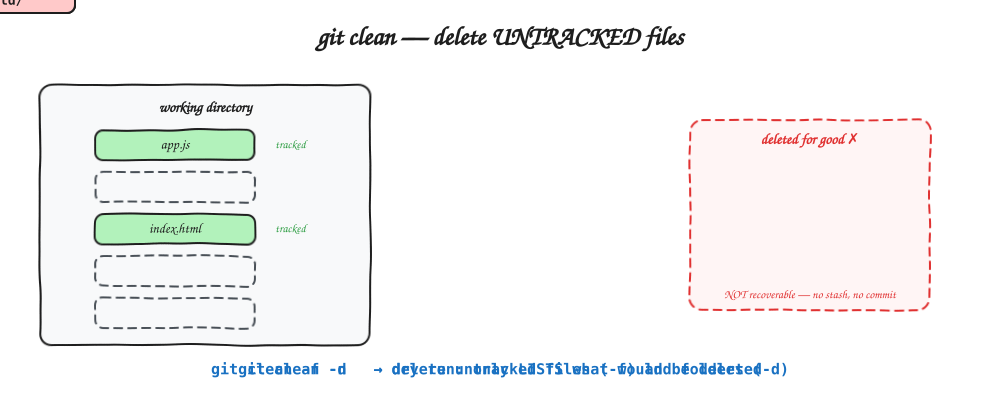

```bash
git clean -n      # dry run: list what WOULD be deleted (always run this first!)
git clean -f      # delete untracked files
git clean -f -d   # delete untracked files AND untracked directories
```
⚠ Deleted files are **gone for good**: they're not in a commit or a stash. Tracked files are never touched.

---

## 8. Changing the last commit: `--amend`

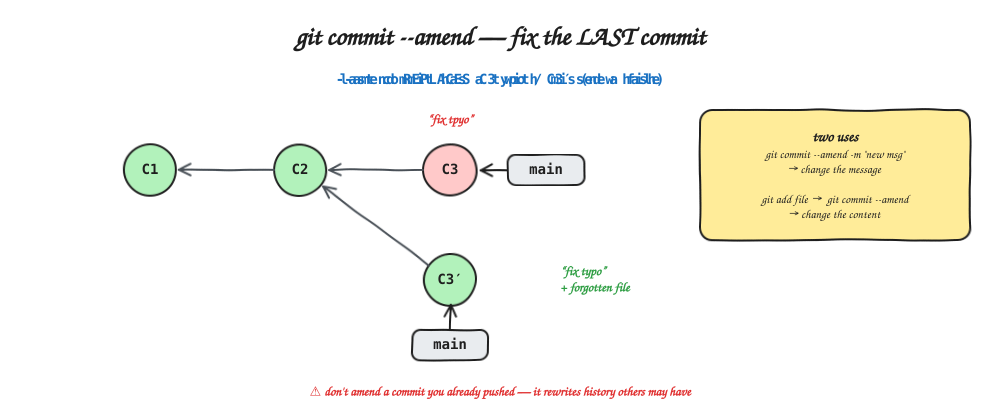

**Change the message** of the last commit:
```bash
git commit --amend -m "Correct message"   # or without -m to edit in an editor
```

**Change the content** of the last commit (forgot a file / small fix):
1. Make the changes in the working directory.
2. `git add` them to the staging area.
3. Run the same command: `git commit --amend` (add `--no-edit` to keep the message).

Amend **replaces** the last commit with a new one (new hash).
> ⚠ **Don't amend a commit you've already pushed.** It rewrites shared history.

---

## 9. Checkout a commit: time travel

You can go back in time to look at the project at any commit:

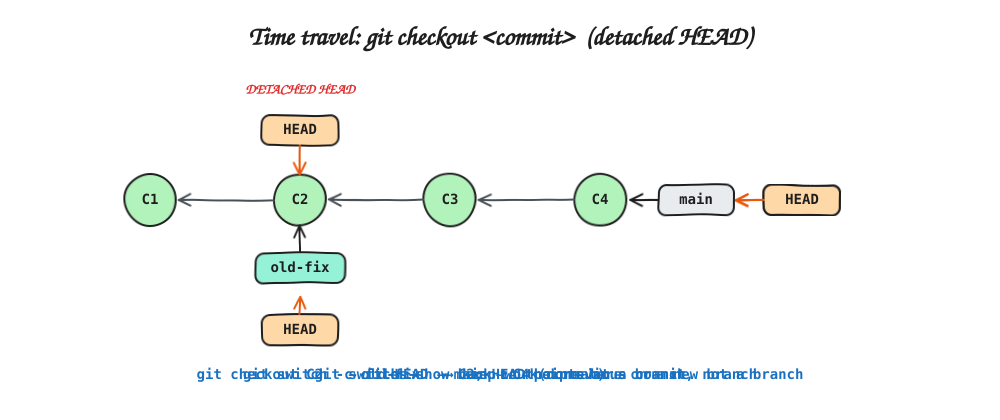

```bash
git checkout <commit-id>     # files now show that commit → "detached HEAD"
git switch -                 # go back to the branch you were on
git switch -c <branchname>   # want to keep work done here? create a branch at this point
```
**Detached HEAD** means HEAD points directly at a commit instead of a branch. New commits made here belong to no branch and can get lost, unless you create a branch with `git switch -c`.

---

## 10. Reset: move the branch back

`git reset` moves the current branch pointer back to an older commit. The commits after it **disappear from the history**. What happens to their *changes* depends on the mode:

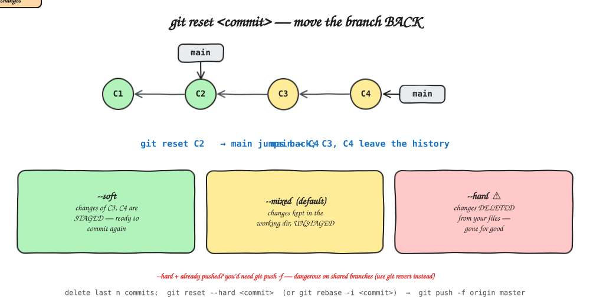

```bash
git reset --soft  <commit-id>   # changes kept and STAGED
git reset         <commit-id>   # (--mixed, default) changes kept, UNSTAGED
git reset --hard  <commit-id>   # changes DELETED ⚠ very dangerous
```

### Deleting the last n commits (already pushed)
```bash
git reset --hard <commit-id>    # go back to the commit you want to keep
git push -f origin master       # overwrite GitHub's history ⚠

# alternative: interactive rebase, drop the commits you don't want
git rebase -i <commit-id>
git push -f origin master
```
> ⚠ Force-pushing rewrites shared history. Only do it on branches nobody else uses; prefer `git push --force-with-lease`.

---

## 11. Revert: undo safely

`git revert` undoes the changes of **any** commit by creating a **new commit that does the opposite**. History is kept, so it's safe on shared/pushed branches.

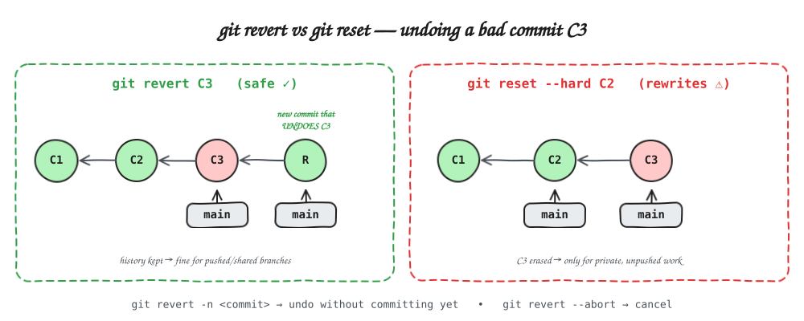

```bash
git revert <commit-id>        # create an "undo" commit
git revert -n <commit-id>     # apply the undo but don't commit yet (commit it yourself)
git revert --abort            # cancel a revert in progress (e.g. after a conflict)
```

| | `git revert` | `git reset --hard` |
|---|---|---|
| History | Kept, adds an undo commit | Rewritten, commits removed |
| Safe on pushed branches? | ✓ Yes | ✗ No (needs force-push) |
| Use when | Undoing something already shared | Cleaning up private, unpushed work |

---

## 12. Cherry-picking

**Cherry-picking** takes the **changes introduced by one specific commit** (from any branch) and applies them to the branch you're currently on, as a **new commit**.

```bash
git cherry-pick <commit-hash>
```
The original commit is **not moved**. The new commit has the same changes and message but a **different parent → different hash**.

### Example: copy one bug fix from `feature` to `master`

- `F1` = unfinished feature work (we **don't** want it).
- `F2` = urgent bug fix that `master` needs **now**.
- Merging `feature` would bring F1 too, so we cherry-pick only F2.

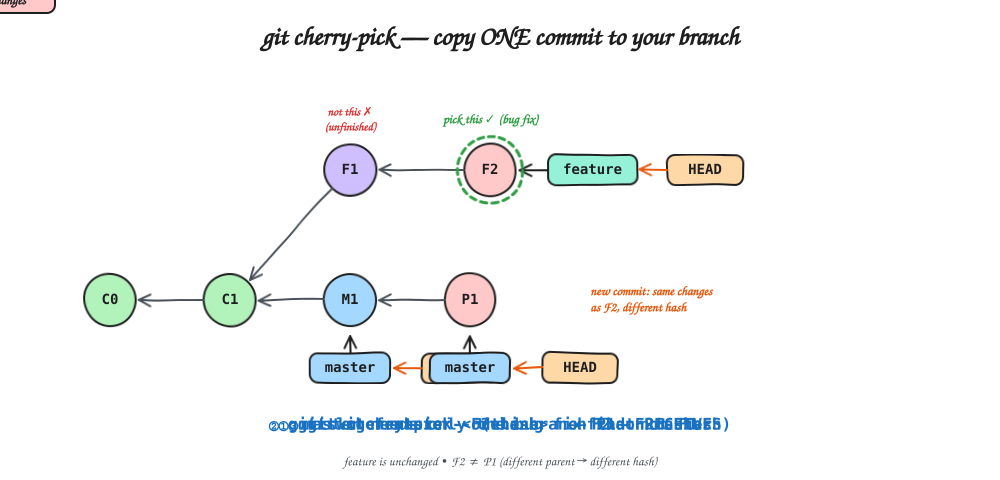

**Step 1: find and inspect the commit** (read-only, nothing moves):
```bash
git log feature --oneline
# f2a9c71 Fix payment validation   ← F2: want this
# 61bc408 Start payment redesign   ← F1: don't want this
git show f2a9c71                   # check exactly what it changes
```

**Step 2: switch to the branch that should RECEIVE the change:**
```bash
git switch master
git pull --ff-only origin master
git branch --show-current          # → master
```

**Step 3: cherry-pick:**
```bash
git cherry-pick f2a9c71
```
Result: a new commit **P1** on master with F2's changes. `feature` is unchanged, F1 was not copied, and `F2 ≠ P1`.

```bash
git log --oneline --graph --all    # verify
git push origin master
```

### What Git does internally
1. Finds the parent of F2.
2. Computes the diff between that parent and F2.
3. Applies that diff to your current branch.
4. Creates a new commit with the result.

> Cherry-pick copies a commit's **change**, not its identity or position in history.

### Conflicts during cherry-pick

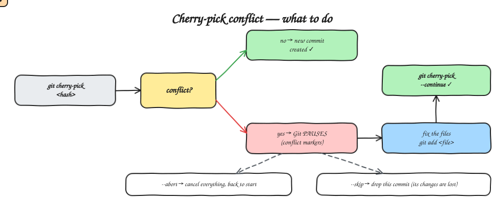

```bash
git status                     # see conflicted files, fix them, remove markers
git add <resolved-file>
git cherry-pick --continue     # finish (or go on to the next commit)

git cherry-pick --abort        # cancel everything, back to before
git cherry-pick --skip         # drop this commit and continue ⚠ its changes are not applied
```

### Multiple commits
```bash
git cherry-pick A B C          # apply A, then B, then C (order matters)
git cherry-pick A^..C          # range A through C inclusive (A..C would EXCLUDE A)
git cherry-pick -n <hash>      # --no-commit: apply changes, review/combine, then commit yourself
```

### When to use / not use it
✓ Copy an urgent fix to `master` · backport a fix to an older release branch · rescue a commit from a deleted branch · take one finished commit without a teammate's unfinished branch.

✗ Don't cherry-pick a whole branch commit by commit (merge or rebase instead) · don't repeatedly copy the same changes between permanent branches (duplicate commits complicate future merges) · check dependencies first (F2 may need code from F1).

### Cherry-pick vs Merge vs Rebase

| Operation | Brings | History |
|---|---|---|
| Cherry-pick | One or selected commits | New copies on the current branch |
| Merge | The whole other branch | Both histories kept (+ merge commit) |
| Rebase | Your branch's own commits | Recreated on a new base |

> **Cherry-pick when you need selected commits, merge when you need the whole branch, rebase when you need to reposition your own branch.**

---

## 13. Quick revision

| Task | Command |
|------|---------|
| Fork a repo | “Fork” button on GitHub |
| Add original as remote | `git remote add upstream <url>` |
| Sync fork | `git fetch upstream` → `git merge upstream/main` → `git push origin main` |
| Download only | `git fetch` |
| Download + integrate | `git pull` |
| Upload | `git push` |
| Show a commit | `git show <id>` |
| Park changes | `git stash` / `git stash pop` |
| List / apply / drop stash | `git stash list` / `apply` / `drop` |
| Delete untracked files | `git clean -n` then `git clean -f -d` |
| Fix last commit | `git commit --amend` |
| Visit old commit | `git checkout <id>` → `git switch -` |
| Move branch back | `git reset --soft / --mixed / --hard <id>` |
| Undo safely | `git revert <id>` |
| Copy one commit | `git cherry-pick <id>` |
