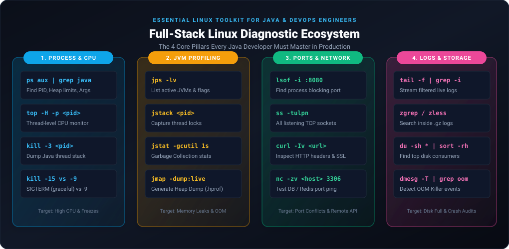
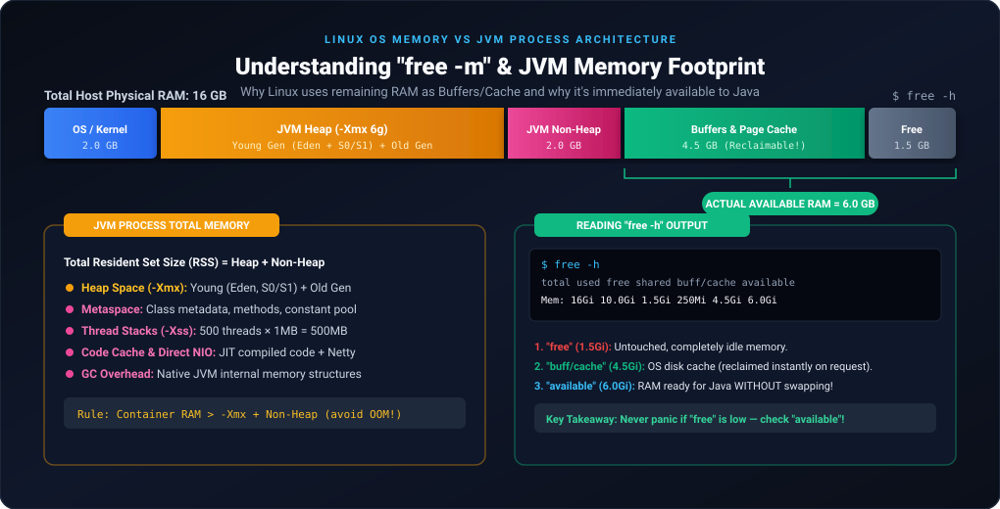

# Essential Linux Commands for Java Developers & DevOps Engineers

As a Java developer working with Spring Boot, Microservices, and cloud deployments, interacting with Linux is an everyday requirement. Whether diagnosing a **100% CPU spike**, fixing **`Address already in use`** errors, inspecting **OOM (Out Of Memory) crashes**, or reading **compressed production logs**, mastering these commands is essential.



---

## 1. Process Management & JVM Diagnostics

### A. Finding Running Java Processes: `ps`
The `ps` (process status) command displays active processes running on the system.

#### Command & Practical Usage:
```bash
# Detailed process listing with user, PID, CPU%, MEM%, and full launch command
ps aux | grep java

# Standard System V format showing Parent PID (PPID)
ps -ef | grep java
```

#### Realistic Production Output:
```text
USER       PID  %CPU %MEM    VSZ   RSS TTY      STAT START   TIME COMMAND
appuser   8492  48.2 18.5 6284912 3041288 ?    Sl   02:15  42:18 /usr/bin/java -Xms2g -Xmx4g -XX:+UseG1GC -jar /opt/app/order-service.jar --spring.profiles.active=prod
appuser  14210   0.0  0.0  112812   980 pts/0    S+   03:40   0:00 grep --color=auto java
```

> [!NOTE]
> **Key Fields to Inspect:**
> - **`PID` (8492):** Process Identifier needed for thread dumps, killing, and profiling.
> - **`%CPU` & `%MEM`:** Instantaneous resource consumption.
> - **`RSS` (Resident Set Size):** Actual physical RAM occupied by the JVM process (here $\approx 3\text{ GB}$).
> - **`COMMAND`:** Complete launch arguments including JVM options (`-Xms`, `-Xmx`, GC algorithm, Spring profile).

---

### B. Tracking Individual Java Threads: `top -H`
When a Java application hits 100% CPU, running plain `top` only shows the main `java` process. To find the **exact thread** inside Java causing the CPU spike, use thread mode (`-H`).

#### Command:
```bash
top -H -p <PID>
```

#### Realistic Production Output:
```text
top - 03:45:12 up 14 days,  2:30,  1 user,  load average: 3.82, 2.15, 1.40
Threads: 248 total,   1 running, 247 sleeping,   0 stopped,   0 zombie
%Cpu(s): 78.4 us,  8.2 sy,  0.0 ni, 12.8 id,  0.4 wa,  0.0 hi,  0.2 si,  0.0 st
MiB Mem :  16048.2 total,   1824.5 free,   9842.1 used,   4381.6 buff/cache

  PID USER      PR  NI    VIRT    RES    SHR S  %CPU  %MEM     TIME+ COMMAND
 8519 appuser   20   0 6284912 3.0g  28412 R  94.6  18.5  14:22.84 java
 8520 appuser   20   0 6284912 3.0g  28412 S   2.1  18.5   0:15.12 java
 8501 appuser   20   0 6284912 3.0g  28412 S   1.2  18.5   0:08.45 G1 Main Marker
```

> [!TIP]
> Notice thread **`PID 8519`** is consuming **94.6% CPU**!
> 1. Convert decimal thread ID to hexadecimal:
>    ```bash
>    printf "%x\n" 8519
>    # Output: 2147
>    ```
> 2. Search for `nid=0x2147` in a `jstack` dump to see the exact Java class and line number executing!

---

### C. Terminating Processes: `kill` Signals

| Signal | Name | Java Behavior | Usage |
| :---: | :---: | :--- | :--- |
| **`-15`** | `SIGTERM` | **Graceful Shutdown**: Triggers Spring Boot shutdown hooks, closes database connection pools, flushes caches. | **Always try this first!** |
| **`-9`** | `SIGKILL` | **Immediate Force Kill**: OS terminates the process immediately. No cleanup hooks execute. | Use only when app is hung/unresponsive. |
| **`-3`** | `SIGQUIT` | **Thread Dump**: JVM catches this signal and prints a full thread dump to standard out (`catalina.out` / systemd journal) without stopping the app! | Non-intrusive production troubleshooting. |

```bash
# 1. Request graceful shutdown
kill -15 8492

# 2. Capture a live thread dump directly into logs
kill -3 8492

# 3. Force kill if completely deadlocked
kill -9 8492
```

---

### D. Built-in JDK Diagnostics: `jps`, `jstat`, `jstack`, `jmap`, `jcmd`

#### 1. `jps` (Java Virtual Machine Process Status Tool)
Quickly lists JVM processes without needing long `ps` commands.
```bash
# -l: full package name, -v: passed JVM flags
jps -lv
```
*Output:*
```text
8492 org.springframework.boot.loader.JarLauncher -Xms2g -Xmx4g -XX:+UseG1GC
15201 jdk.jcmd/sun.tools.jps.Jps -lv -Dapplication.home=/usr/lib/jvm/java-17
```

#### 2. `jstat` (Garbage Collection Monitoring)
Monitors JVM memory pools and GC activity in real time.
```bash
# Syntax: jstat -gcutil <PID> <interval_ms> <count>
jstat -gcutil 8492 1000 3
```
*Output:*
```text
  S0     S1      E      O      M     CCS    YGC     YGCT    FGC    FGCT    CGC    CGCT     GCT   
  0.00  95.42  64.20  42.10  96.50  92.10     28    0.842     2    0.312    14    0.150    1.304
  0.00  95.42  82.10  42.10  96.50  92.10     28    0.842     2    0.312    14    0.150    1.304
 92.10   0.00  14.50  42.15  96.50  92.10     29    0.870     2    0.312    14    0.150    1.332
```
*Analysis: Eden space (`E`) filled up and triggered a Young GC (`YGC` incremented from 28 to 29) within 1 second.*

#### 3. `jstack` (Thread Dump Analyzer)
Captures stack traces of all Java threads to identify deadlocks and resource contention.
```bash
jstack -l 8492 > /tmp/threaddump_$(date +%F_%H%M%S).txt
```

#### 4. `jmap` (Memory Profiler & Heap Dump)
Generates an `.hprof` binary heap dump file for analysis in Eclipse Memory Analyzer (MAT) or JProfiler.
```bash
# Dump only live objects (triggers a Full GC first)
jmap -dump:live,format=b,file=/tmp/heapdump.hprof 8492
```

#### 5. `jcmd` (Modern All-in-One CLI)
```bash
# Print thread dump
jcmd 8492 Thread.print

# Print JVM heap breakdown
jcmd 8492 GC.heap_info
```

---

## 2. Networking, Ports & Microservice Connectivity

### A. Resolving "Port Already in Use": `lsof`
When Spring Boot fails to start with:
`Web server failed to start. Port 8080 was already in use.`

#### Command:
```bash
lsof -i :8080
```
#### Output:
```text
COMMAND   PID    USER   FD   TYPE DEVICE SIZE/OFF NODE NAME
java    18204 appuser   58u  IPv6 194821      0t0  TCP *:http-alt (LISTEN)
```
*Solution: Identify PID 18204 and stop it gracefully (`kill -15 18204`).*

---

### B. Inspecting Listening Sockets: `ss` vs `netstat`
Modern Linux distributions use `ss` (Socket Statistics) as a faster, modern replacement for `netstat`.

```bash
# -t (TCP), -u (UDP), -l (Listening), -p (Process), -n (Numeric ports)
ss -tulpn

# Filter specifically for your application port
ss -tulpn | grep 8080
```
#### Output:
```text
Netid  State   Recv-Q  Send-Q   Local Address:Port   Peer Address:Port  Process
tcp    LISTEN  0       128            *:8080               *:*          users:(("java",pid=8492,fd=58))
tcp    LISTEN  0       128            *:3306               *:*          users:(("mysqld",pid=1120,fd=32))
```

---

### C. Testing Remote Connectivity: `nc` (Netcat) & `curl`
When your microservice cannot reach MySQL, Kafka, or Redis, you must verify network reachability from the command line:

#### 1. Testing TCP Port Availability without DB client (`nc`):
```bash
# Syntax: nc -zv <hostname_or_ip> <port>
nc -zv mysql-database.internal 3306
```
*Output if accessible:*
```text
Connection to mysql-database.internal (10.0.1.45) 3306 port [tcp/mysql] succeeded!
```
*Output if blocked by firewall/security group:*
```text
nc: connect to mysql-database.internal (10.0.1.45) port 3306 (tcp) timed out: Operation now in progress
```

#### 2. Detailed HTTP API Verification (`curl`):
```bash
# -I: Fetch headers only, -v: Verbose handshake/SSL info
curl -Iv https://auth-service.internal/api/v1/health

# POST request with JSON payload & auth header
curl -X POST https://api.internal/v1/orders \
  -H "Content-Type: application/json" \
  -H "Authorization: Bearer eyJhbGciOi..." \
  -d '{"customerId": 101, "amount": 250.00}'
```

---

### D. DNS Resolution Checks: `nslookup` & `dig`
Crucial for troubleshooting Kubernetes service discovery and CoreDNS issues.
```bash
nslookup payment-service.default.svc.cluster.local
```

---

## 3. System Resources: Memory, CPU, and Disk



### A. Memory Inspection: `free -h`
```bash
free -h
```
#### Output:
```text
              total        used        free      shared  buff/cache   available
Mem:           15Gi       8.2Gi       1.1Gi       240Mi       6.1Gi       6.8Gi
Swap:         2.0Gi       120Mi       1.9Gi
```

> [!IMPORTANT]
> **Understanding the Memory Myth:**
> - `free` (1.1Gi) is memory that is completely untouched.
> - `buff/cache` (6.1Gi) is memory the Linux OS uses to cache disk blocks for maximum performance. **The OS immediately releases this memory if a Java process requests it!**
> - **`available` (6.8Gi)** is the **true amount of RAM** ready to be allocated without swapping!

---

### B. System Uptime & Load Average: `uptime`
```bash
uptime
```
#### Output:
```text
 04:12:30 up 45 days, 18:22,  2 users,  load average: 2.15, 1.80, 1.45
```
> [!NOTE]
> **Load Average Interpretation:**
> - The 3 numbers represent average CPU queue load over **1 minute**, **5 minutes**, and **15 minutes**.
> - Always compare against the number of CPU cores (`nproc`):
>   - On a **4-core CPU**, a load of `2.15` means the machine is at ~53% capacity (Healthy).
>   - On a **2-core CPU**, a load of `4.50` means CPU threads are constantly queueing and waiting!

---

### C. Disk Usage & Cleanup: `df` & `du`
When production disks fill up, databases stop writing and JVM logging freezes.

```bash
# 1. View overall disk usage across filesystems
df -h

# 2. Identify the top 10 largest folders/files in the current directory
du -sh * | sort -rh | head -n 10
```
#### Output:
```text
14G     /var/log
8.2G    /opt/app/heapdumps
1.4G    /var/lib/docker
```

---

## 4. Production Log Inspection & Troubleshooting

### A. Inspecting Huge Logs: `less`
Never use `cat` or `vi` on a 20 GB production log file (it will exhaust memory and crash the server)! Use `less`.

```bash
less /var/log/app/order-service.log
```
#### Essential `less` Navigation Shortcuts:
- **`Shift + G`**: Jump to the end of the file.
- **`g`**: Jump to the beginning of the file.
- **`/Exception`**: Search forward for "Exception" (Press `n` for next match, `N` for previous).
- **`?NullPointer`**: Search backward.
- **`Shift + F`**: Follow mode (behaves like `tail -f`; press `Ctrl+C` to return to search mode).

---

### B. Searching Compressed Rotated Logs: `zgrep` & `zcat`
Production servers rotate and compress logs into `.gz` files nightly (e.g., `app.log.2026-09-26.gz`). You **do not** need to unpack them to search!

```bash
# Search for NullPointerException inside a compressed .gz log
zgrep -i "NullPointerException" /var/log/app/order-service-2026-09-26.log.gz

# View compressed log with line numbers
zcat /var/log/app/order-service-2026-09-26.log.gz | grep -C 3 "OutOfMemoryError"
```

---

### C. Kernel Diagnostics & OOM-Killer: `dmesg -T`
When a Java process disappears without writing any stack trace to `app.log`, the Linux Kernel **Out-Of-Memory (OOM) Killer** likely terminated it.

```bash
# -T prints human-readable timestamps
dmesg -T | grep -i -E "oom|killed process"
```
#### Output:
```text
[Sun Sep 27 02:40:12 2026] Out of memory: Killed process 8492 (java) total-vm:6284912kB, anon-rss:3824100kB, file-rss:0kB, shmem-rss:0kB
[Sun Sep 27 02:40:12 2026] oom_reaper: reaped process 8492 (java), now anon-rss:0kB
```

---

## 5. Running Background Services & Automation

### A. Detached Execution: `nohup` & Backgrounding
```bash
nohup java -Xms1g -Xmx2g -jar /opt/app/order-service.jar > /var/log/app/order.log 2>&1 &
```
> [!NOTE]
> **Breakdown of `> /var/log/app/order.log 2>&1 &`:**
> - `nohup`: Prevents the process from receiving `SIGHUP` when you close your SSH terminal session.
> - `> /var/log/app/order.log`: Redirects **Standard Output (stdout, fd 1)** to the log file.
> - `2>&1`: Redirects **Standard Error (stderr, fd 2)** to wherever standard output goes (both logs in one place).
> - `&`: Puts the process into the background, returning terminal control immediately.

---

### B. Production Systemd Service Unit
In real-world production, background scripts are managed via `systemd` for auto-restarting on failure:

#### File: `/etc/systemd/system/order-service.service`
```ini
[Unit]
Description=Order Microservice Spring Boot Application
After=syslog.target network.target

[Service]
User=appuser
Group=appuser
WorkingDirectory=/opt/app
ExecStart=/usr/bin/java -Xms2g -Xmx4g -jar /opt/app/order-service.jar
Restart=always
RestartSec=10
SuccessExitStatus=143

[Install]
WantedBy=multi-user.target
```

#### Management Commands:
```bash
# Reload daemon configuration
sudo systemctl daemon-reload

# Start and enable on boot
sudo systemctl start order-service
sudo systemctl enable order-service

# Check status and live journal logs
sudo systemctl status order-service
journalctl -u order-service -f
```

---

## Summary Checklist for Java Developers

| Objective | Primary Command | Alternative / Companion |
| :--- | :--- | :--- |
| Find JVM Process ID (PID) | `ps aux \| grep java` | `jps -lv` |
| Pinpoint High CPU Java Thread | `top -H -p <PID>` | `printf "%x\n" <TID>` + `jstack` |
| Resolve Port Already in Use | `lsof -i :8080` | `ss -tulpn \| grep 8080` |
| Graceful Spring Boot Termination | `kill -15 <PID>` | `kill -9 <PID>` (Force only) |
| Non-intrusive Thread Dump | `kill -3 <PID>` | `jcmd <PID> Thread.print` |
| Check Real Available Memory | `free -h` | `vmstat 1 5` |
| Audit Kernel OOM Crashes | `dmesg -T \| grep -i oom` | `journalctl -k` |
| Search Rotated Log Archives | `zgrep -i "error" *.gz` | `zless *.gz` |
| Test DB/Remote Port Access | `nc -zv <host> <port>` | `curl -Iv <url>` |
| Clean Up Huge Log Dumps | `du -sh * \| sort -rh` | `df -h` |
