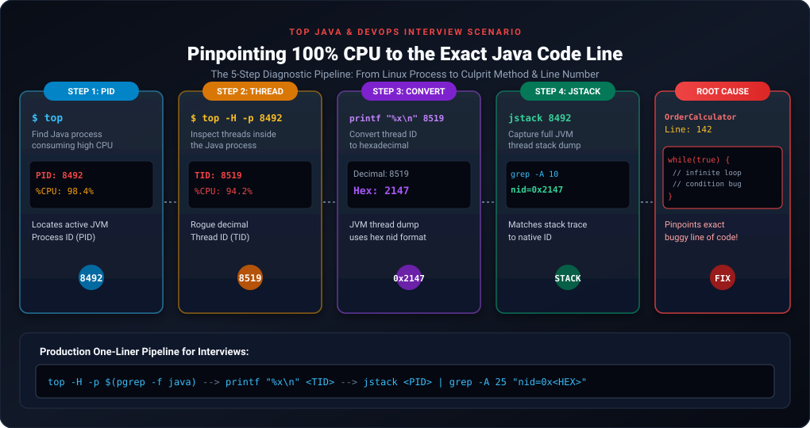
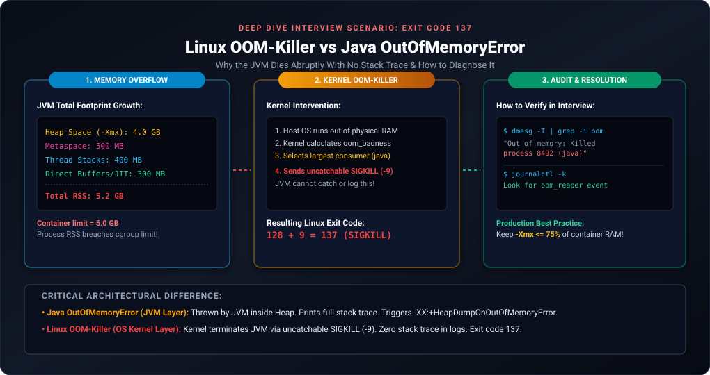
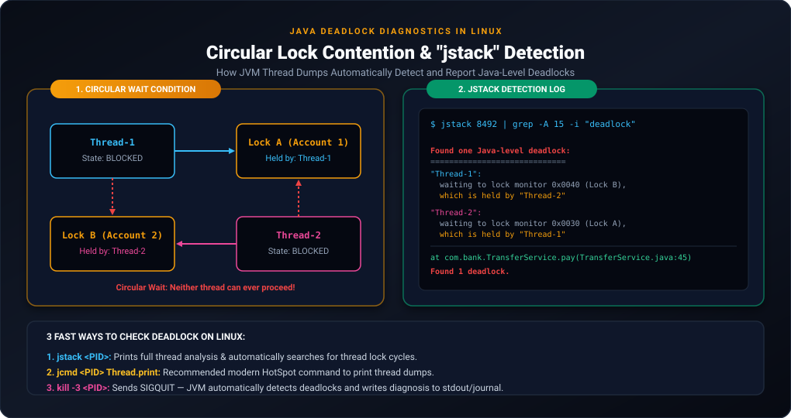

# Linux Interview Questions & Production Scenarios for Java Developers

This guide compiles the most critical, real-world Linux troubleshooting scenarios and technical questions asked during senior Java Developer, Backend Engineer, and DevOps interviews.

---

## Scenario 1: The 100% CPU Spike Investigation (#1 Most Asked Question)

> **Interviewer:** *"Your Spring Boot microservice running on an AWS EC2 instance is consuming 100% CPU. Users are reporting timeouts. Walk me through the exact step-by-step commands you run on the Linux terminal to find the culprit line in your Java code."*



### Step-by-Step Resolution:

#### Step 1: Identify the Rogue Java Process (PID)
Run `top` to locate the process with high `%CPU`:
```bash
top
```
*Output:*
```text
  PID USER      PR  NI    VIRT    RES    SHR S  %CPU  %MEM     TIME+ COMMAND
 8492 appuser   20   0 6284912 3.0g  28412 S  98.4  18.5  45:12.18 java
```
*Takeaway:* The JVM process ID is **`8492`**.

#### Step 2: Identify the Specific Thread Consuming CPU (TID)
Use the `-H` flag (Thread mode) focused on that process:
```bash
top -H -p 8492
```
*Output:*
```text
  PID USER      PR  NI    VIRT    RES    SHR S  %CPU  %MEM     TIME+ COMMAND
 8519 appuser   20   0 6284912 3.0g  28412 R  94.6  18.5  14:22.84 java
 8520 appuser   20   0 6284912 3.0g  28412 S   2.1  18.5   0:15.12 java
```
*Takeaway:* Thread ID **`8519`** is responsible for 94.6% of the CPU consumption.

#### Step 3: Convert the Thread ID to Hexadecimal
JVM thread dumps format native thread IDs in lowercase hexadecimal (`nid=0x...`):
```bash
printf "%x\n" 8519
```
*Output:*
```text
2147
```
*Takeaway:* Look for native thread ID **`nid=0x2147`**.

#### Step 4: Capture JVM Thread Dump and Search for the Thread
```bash
jstack 8492 | grep -A 25 "nid=0x2147"
```
*Output:*
```text
"http-nio-8080-exec-4" #32 daemon prio=5 os_prio=0 cpu=84210.12ms elapsed=912.45s tid=0x00007f8b94012800 nid=0x2147 runnable  [0x00007f8b7d4e2000]
   java.lang.Thread.State: RUNNABLE
        at com.ecommerce.order.service.OrderDiscountCalculator.applyDiscount(OrderDiscountCalculator.java:142)
        at com.ecommerce.order.service.OrderService.processOrder(OrderService.java:88)
        at com.ecommerce.order.controller.OrderController.createOrder(OrderController.java:45)
```

#### Step 5: Root Cause & Resolution
Look at line 142 in `OrderDiscountCalculator.java`. You will typically find:
- An **infinite loop** (e.g., `while(condition)` where condition is never updated).
- **Catastrophic backtracking** in a complex regular expression (`Pattern.compile(...)`).
- Unsynchronized concurrent modification or spinning locks on a shared resource.

---

## Scenario 2: Exit Code 137 & The Silent Crash (Linux OOM-Killer)

> **Interviewer:** *"Your Java microservice running in a Docker container or Kubernetes pod died abruptly. There is NO `OutOfMemoryError` or stack trace in `application.log`. The container exited with code 137. What happened, why is there no log, and how do you prove it?"*



### Answer & Deep Dive:

#### 1. Deciphering Exit Code 137:
In Linux/Unix, when a process terminates due to a signal, the exit code formula is:
$$\text{Exit Code} = 128 + \text{Signal Number}$$
- Signal 9 is `SIGKILL`.
- $\text{Exit Code} = 128 + 9 = \mathbf{137}$.
- This proves the process was forcefully killed by `SIGKILL`!

#### 2. Why is there NO Java Stack Trace?
- A standard Java OutOfMemoryError (`java.lang.OutOfMemoryError: Java heap space`) is thrown by the JVM itself when the heap is full, allowing the JVM to log the error.
- The **Linux Kernel OOM Killer** operates outside the JVM at the operating system / cgroup layer. When total memory (JVM Heap + Metaspace + Native Threads + OS buffers) exceeds the host/container RAM ceiling, the kernel sends an **uncatchable `SIGKILL (-9)`**. The JVM process is evicted instantly from memory before it can execute a single instruction or write a log line!

#### 3. Proving It on the Terminal:
Inspect the Linux kernel ring buffer using `dmesg`:
```bash
dmesg -T | grep -i -E "oom|killed process"
```
*Output:*
```text
[Sun Sep 27 03:15:22 2026] Out of memory: Killed process 8492 (java) total-vm:6284912kB, anon-rss:4194304kB, file-rss:0kB, shmem-rss:0kB
[Sun Sep 27 03:15:22 2026] oom_reaper: reaped process 8492 (java), now anon-rss:0kB
```

#### 4. The Fix:
Always set the JVM Max Heap (`-Xmx`) to **at most 70-75%** of the container/system RAM limit:
- Container RAM: `4 GB`
- Set `-Xmx`: `3 GB` (leaving 1 GB for Metaspace, Thread stacks, Direct Buffers, and OS).

---

## Scenario 3: `kill -15` vs `kill -9` vs `kill -3`

> **Interviewer:** *"What is the difference between `kill -15`, `kill -9`, and `kill -3` when managing a Java application in Linux?"*

| Signal | Name | Can be Caught? | Effect on Java / Spring Boot Application |
| :---: | :---: | :---: | :--- |
| **`kill -15`** | `SIGTERM` | **Yes** | **Graceful Shutdown**: Calls Spring's `@PreDestroy` methods, closes HikariCP database pools, finishes in-flight HTTP requests, removes microservice from Eureka/Consul discovery. |
| **`kill -9`** | `SIGKILL` | **No** | **Forced Termination**: OS kernel immediately wipes the process table entry. In-flight database transactions are aborted, files can be corrupted. |
| **`kill -3`** | `SIGQUIT` | **Yes** | **Non-Intrusive Thread Dump**: The JVM intercepts this signal, captures a full thread dump, and writes it directly to `stdout` (`catalina.out` or systemd journal). **The application does not stop!** |

---

## Scenario 4: Resolving "Address already in use: 8080"

> **Interviewer:** *"You deploy a new build of your Spring Boot service, but it fails to start with `java.net.BindException: Address already in use`. How do you resolve this?"*

### Terminal Commands:
```bash
# 1. Identify which process is holding port 8080
lsof -i :8080
```
*Output:*
```text
COMMAND   PID    USER   FD   TYPE DEVICE SIZE/OFF NODE NAME
java    19021 appuser   52u  IPv6 481029      0t0  TCP *:http-alt (LISTEN)
```

```bash
# 2. Verify process details before killing
ps -fp 19021
```
*Output:*
```text
UID        PID  PPID  C STIME TTY          TIME CMD
appuser  19021     1  0 Sep26 ?        00:04:12 /usr/bin/java -jar order-service-old.jar
```

```bash
# 3. Gracefully terminate the old zombie process
kill -15 19021

# 4. If it does not terminate after 10 seconds, force kill
kill -9 19021
```

---

## Scenario 5: Disk Space Full & "Ghost" Deleted Files

> **Interviewer:** *"The disk on your production server is 100% full (`No space left on device`). You used `rm app.log` to delete a massive 20GB log file, but `df -h` still shows the disk as 100% full! Why, and how do you fix it without restarting the application?"*

### Explanation:
In Linux, deleting a file with `rm` only removes the directory entry (name link). If an active Java process **still has an open file descriptor** pointing to that file inode, the OS will **not release the disk blocks** until the process closes the descriptor or terminates!

### Step-by-Step Fix:

#### 1. Identify open deleted files holding disk space:
```bash
lsof +L1 | grep deleted
```
*Output:*
```text
COMMAND   PID    USER   FD   TYPE DEVICE  SIZE/OFF NLINK   NODE NAME
java     8492 appuser    4w   REG  253,1 21474836480     0 849201 /var/log/app/app.log (deleted)
```
*Takeaway:* Process `8492` is holding 20 GB (`21474836480` bytes) on file descriptor `4w`!

#### 2. Free the disk space immediately without restarting Java:
Clear the file content through the `/proc` filesystem:
```bash
> /proc/8492/fd/4
```
*Result:* This immediately truncates the file content to 0 bytes, releasing the 20 GB back to the OS!

> [!TIP]
> **Pro-Tip:** Never delete active log files using `rm app.log`. Truncate them safely using:
> ```bash
> > /var/log/app/app.log
> # or
> truncate -s 0 /var/log/app/app.log
> ```

---

## Scenario 6: Testing Network Connectivity Without DB Client

> **Interviewer:** *"Your Java application cannot connect to an Oracle/MySQL database on host `10.0.1.50:3306`. The server does not have `mysql` client or `telnet` installed. How do you test if the port is open and accessible from your Linux instance?"*

### Solution 1: Using `nc` (Netcat)
```bash
nc -zv 10.0.1.50 3306
```
*Success:* `Connection to 10.0.1.50 3306 port [tcp/mysql] succeeded!`  
*Failure (Firewall/Security Group blocked):* `Connection timed out`

### Solution 2: Using Bash Built-in `/dev/tcp` (Zero dependencies required!)
```bash
timeout 3 bash -c "</dev/tcp/10.0.1.50/3306" && echo "PORT IS OPEN" || echo "PORT IS BLOCKED"
```

### Solution 3: Using `curl`
```bash
curl -v telnet://10.0.1.50:3306
```

---

## Scenario 7: Demystifying "free -m" & Page Cache

> **Interviewer:** *"Look at this output of `free -m`:*
> ```text
>               total        used        free      shared  buff/cache   available
> Mem:          16000       14200         400         120        1400        1800
> ```
> *Is this server about to run out of memory? Explain the difference between `free` and `available`."*

### Answer:
- **`free` (400 MB)** is memory that is completely empty and untouched.
- In Linux, unused RAM is wasted RAM! The kernel uses inactive memory for **`buff/cache`** (caching disk blocks, jar files, and database indexes) to make disk operations lightning fast.
- **`available` (1800 MB)** is the **true operational metric**. It estimates how much memory can be allocated to processes without triggering swap, by reclaiming non-dirty page cache.
- **Verdict:** If `available` drops close to zero and swap usage increases rapidly (`swpd` in `vmstat`), the server is in true memory distress. If `available` is healthy, a low `free` number is completely normal behavior in Linux.

---

## Scenario 8: Searching Across 30 Compressed Daily Logs

> **Interviewer:** *"We archive daily logs using gzip (`app-2026-09-01.log.gz` to `app-2026-09-30.log.gz`). You need to find all occurrences of `PaymentGatewayException` across all 30 days. How do you do it quickly without running `gunzip` on all files?"*

### Command:
```bash
zgrep -i "PaymentGatewayException" /var/log/app/app-*.log.gz
```
#### With Line Numbers and File Names:
```bash
zgrep -Hn -C 2 "PaymentGatewayException" /var/log/app/app-*.log.gz
```
*Explanation:* `zgrep` decompresses the stream on the fly in memory and searches directly, leaving the archive files compressed on disk!

---

## Scenario 9: Understanding System Load Average vs CPU Cores

> **Interviewer:** *"Running `uptime` shows:*
> `load average: 4.50, 4.10, 3.80`
> *Is the system overloaded?"*

### Answer:
- It **depends completely on the number of CPU cores**!
- Check total cores using:
  ```bash
  nproc
  ```
- **If `nproc` = 8:** A load of `4.50` means only ~56% of CPU capacity is being utilized. The system is healthy.
- **If `nproc` = 2:** A load of `4.50` means there are, on average, 2.5 threads waiting in the queue for CPU execution time. The system is heavily bottlenecked.

---

## Scenario 10: Dissecting the `nohup` Launch Command

> **Interviewer:** *"Explain every part of this command:*
> `nohup java -jar app.jar > app.log 2>&1 &`"

### Detailed Technical Breakdown:

```text
 nohup   java -jar app.jar   > app.log   2>&1   &
 ─────   ─────────────────   ─────────   ────   ─
   │             │               │         │    │
   │             │               │         │    └── 5. Background Execution: Runs job asynchronously in background.
   │             │               │         └─────── 4. Redirect Stderr (2) to Stdout (1): Both error & normal logs merge.
   │             │               └───────────────── 3. Redirect Stdout (1) to app.log (Overwrite/Create).
   │             └───────────────────────────────── 2. The Java Application Execution.
   └─────────────────────────────────────────────── 1. Immune to SIGHUP: Process keeps running when SSH disconnects.
```

1. **`nohup` (No Hang Up):** Prevents the process from receiving the `SIGHUP` (Signal Hang Up) signal sent when the controlling terminal or SSH session closes.
2. **`> app.log`:** Redirects File Descriptor 1 (`stdout`) to `app.log`.
3. **`2>&1`:** Redirects File Descriptor 2 (`stderr`) to the same location as File Descriptor 1 (`stdout`), ensuring stack traces and standard console outputs appear in the same file in chronological order.
4. **`&`:** Instructs the shell to spawn the process in the background, releasing the terminal prompt immediately.

---

## Scenario 11: Detecting and Diagnosing Java Deadlocks on Linux

> **Interviewer:** *"Your Spring Boot application has stopped responding to API calls. The CPU utilization is near 0%, but the Tomcat thread pool is exhausted, and health checks are timing out. How do you verify on Linux whether a deadlock is occurring?"*



### Understanding a Java Deadlock
A deadlock occurs when two or more threads are permanently blocked because each holds a lock that the other needs:
- **Thread 1** holds **Lock A** and waits to acquire **Lock B**.
- **Thread 2** holds **Lock B** and waits to acquire **Lock A**.
Neither thread can proceed, and both enter the **`BLOCKED`** state indefinitely.

---

### Step-by-Step Terminal Investigation:

#### Method 1: Using `jstack` (The Standard Production Approach)
The JVM HotSpot runtime has a built-in cycle-detection algorithm. When you take a thread dump, the JVM automatically inspects all monitor locks and reports any circular dependencies at the very bottom of the dump.

```bash
# 1. Find the Java process ID
jps -l
# Output: 8492 com.ecommerce.order.OrderApplication

# 2. Capture a complete thread dump with lock information (-l flag)
jstack -l 8492 > /tmp/threaddump.txt

# 3. Search for deadlock diagnosis
grep -A 30 -i "Found one Java-level deadlock" /tmp/threaddump.txt
```

#### Realistic Production Output:
```text
Found one Java-level deadlock:
=============================
"pool-2-thread-1":
  waiting to lock monitor 0x00007f8b940028a0 (object 0x000000076b100230, a java.lang.Object),
  which is held by "pool-2-thread-2"

"pool-2-thread-2":
  waiting to lock monitor 0x00007f8b940029b0 (object 0x000000076b100240, a java.lang.Object),
  which is held by "pool-2-thread-1"

Java stack information for the threads listed above:
===================================================
"pool-2-thread-1":
        at com.bank.TransferService.transferMoney(TransferService.java:45)
        - waiting to lock <0x000000076b100230> (a java.lang.Object)
        - locked <0x000000076b100240> (a java.lang.Object)
        at com.bank.TransferController.transfer(TransferController.java:28)
"pool-2-thread-2":
        at com.bank.TransferService.transferMoney(TransferService.java:45)
        - waiting to lock <0x000000076b100240> (a java.lang.Object)
        - locked <0x000000076b100230> (a java.lang.Object)
        at com.bank.TransferController.transfer(TransferController.java:28)

Found 1 deadlock.
```

> [!NOTE]
> **Takeaway:** The JVM pinpoints:
> - The exact threads involved (`pool-2-thread-1` and `pool-2-thread-2`).
> - The object monitor memory addresses being held and requested (`0x000000076b100230` vs `0x000000076b100240`).
> - The exact file and line number: `TransferService.java:45`.

---

#### Method 2: Using `jcmd` (Modern All-in-One CLI)
If you are on Java 11 or higher, `jcmd` is recommended by Oracle:
```bash
jcmd 8492 Thread.print | grep -A 25 "deadlock"
```

---

#### Method 3: Non-Intrusive Dump using `kill -3` (Zero Dependencies)
If JDK diagnostic tools (`jstack`, `jcmd`) are not installed on a minimal production container image:
```bash
# Sends SIGQUIT to the JVM without stopping it
kill -3 8492

# View stdout logs where the JVM dumped thread details
journalctl -u order-service -n 100 --no-pager | grep -A 25 "deadlock"
# or for Tomcat/plain jars:
tail -n 200 /var/log/app/order.log | grep -A 25 "deadlock"
```

---

#### Method 4: Checking Database-Level Deadlocks
If the deadlock is happening inside MySQL/PostgreSQL transactions rather than Java memory:
```sql
-- MySQL / MariaDB InnoDB lock status
SHOW ENGINE INNODB STATUS;
```
Look under the section header:
```text
------------------------
LATEST DETECTED DEADLOCK
------------------------
```
MySQL automatically resolves database deadlocks by selecting the transaction with the fewest modifications as the victim and throwing:
`Deadlock found when trying to get lock; try restarting transaction`

---

### How to Fix Deadlocks in Java Code:
1. **Enforce Consistent Lock Ordering:** Always acquire locks in a predetermined, globally consistent order (e.g., sort account IDs before locking: `lock(min(id1, id2))` followed by `lock(max(id1, id2))`).
2. **Use Timed Locks (`tryLock`):** Replace `synchronized` blocks with `ReentrantLock.tryLock(timeout, TimeUnit)` so threads back off instead of waiting indefinitely.
3. **Keep Critical Sections Minimal:** Avoid calling external microservices, database operations, or long-running computations inside synchronized blocks.

