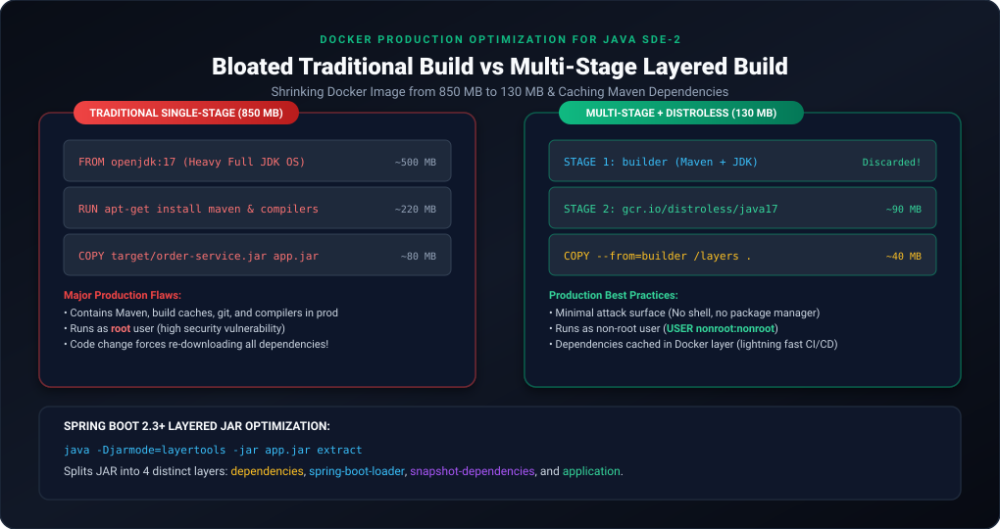
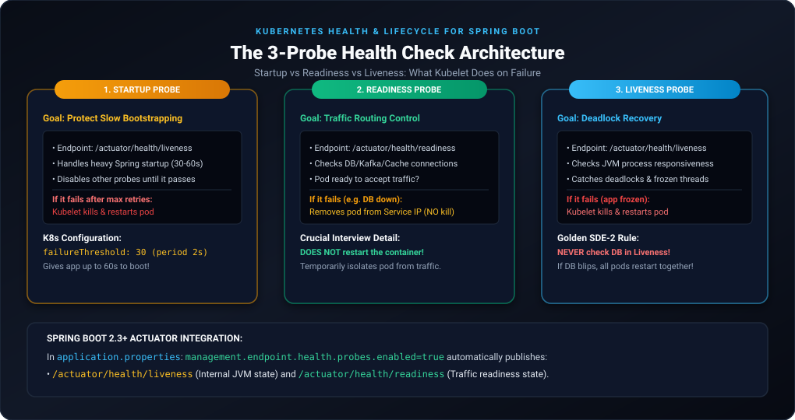
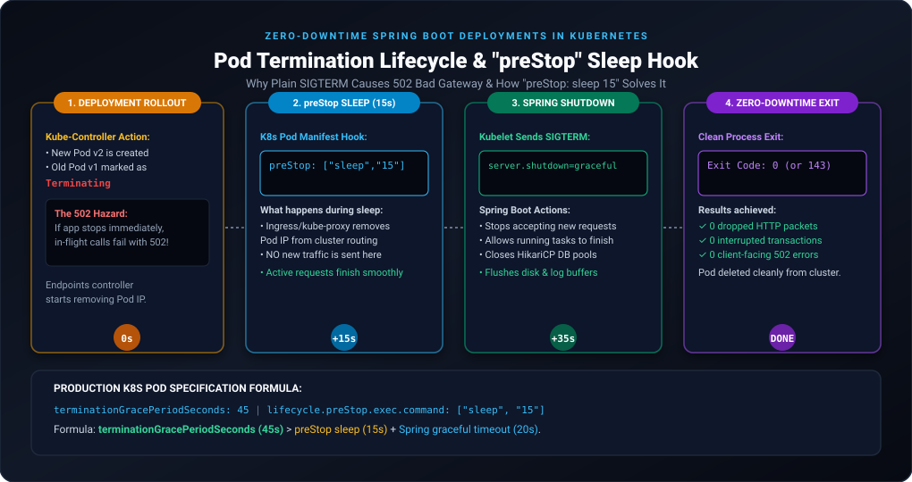

# Docker & Kubernetes for Java SDE-2: Advanced Concepts & Interview Scenarios

This guide bridges the gap between basic DevOps knowledge (covered in folders `003` to `021`) and the advanced containerization & orchestration patterns required in **Senior Java Developer (SDE-2 / Lead Backend)** interviews.

---

## 1. Syllabus Gap Analysis: What Was Covered vs What SDE-2 Requires

| Topic Area | Covered in Notes 003–021 | **CRITICAL SDE-2 Topics MISSED (Covered Here)** |
| :--- | :--- | :--- |
| **Docker Build** | Basic `Dockerfile`, `FROM`, `RUN`, `COPY`, single-stage image | **Multi-Stage builds**, **Spring Boot Layered JARs (`layertools`)**, **Distroless runtime**, **Non-root user security**, **Layer caching optimization**. |
| **JVM in Containers** | Plain `java -jar app.jar` | **JVM Container Awareness (`cgroups`)**, `-XX:MaxRAMPercentage`, **OOMKilled (Exit 137)** vs JVM Heap OOM. |
| **Process Lifecycle** | Basic `CMD` / `ENTRYPOINT` | **PID 1 Signal handling**, **Exec form vs Shell form**, **Graceful SIGTERM propagation**. |
| **K8s Health Checks** | Missing entirely | **Startup, Readiness, and Liveness Probes** with **Spring Boot Actuator**, Cascading failure prevention. |
| **Deployment & Rollout** | Blue/Green (manual switch), basic ReplicaSet | **Zero-Downtime Rolling Update**, `preStop` sleep hook, `terminationGracePeriodSeconds`, `server.shutdown=graceful`. |
| **Resource Management**| Missing | **Resource Requests vs Limits**, **CPU Throttling (CFS quota)**, **Kubernetes QoS Classes** (`Guaranteed`, `Burstable`). |
| **Traffic Ingress** | NodePort, LoadBalancer | **Ingress Controller (NGINX/ALB)**, Path-based microservice routing, SSL termination. |
| **Initialization** | Missing | **InitContainers** for Flyway/Liquibase database migrations and network dependency checks. |

---

## 2. Deep Dive: The Critical Missed SDE-2 Topics

---

### Topic 1: Docker Multi-Stage Builds & Layered JAR Optimization

In standard single-stage builds, the Docker image includes Maven, JDK compilers, and temporary dependencies, resulting in bloated images ($\approx 850\text{ MB}$).



#### Why Spring Boot 2.3+ Layered JARs?
In a fat JAR, dependencies change rarely, while application code changes every commit. By splitting the JAR into layers:
1. `dependencies` (rarely changes $\rightarrow$ cached in Docker layer)
2. `spring-boot-loader`
3. `snapshot-dependencies`
4. `application` (changes often $\rightarrow$ only this small layer is pushed/pulled!)

#### Production Multi-Stage `Dockerfile`:
```dockerfile
# ==========================================
# STAGE 1: Build & Extract Layers
# ==========================================
FROM eclipse-temurin:17-jdk-alpine AS builder
WORKDIR /workspace

# Step 1: Cache Maven dependencies separately
COPY pom.xml mvnw ./
COPY .mvn .mvn
RUN ./mvnw dependency:go-offline -B

# Step 2: Build fat JAR
COPY src src
RUN ./mvnw clean package -DskipTests

# Step 3: Extract Spring Boot layered JAR
WORKDIR /workspace/target
RUN java -Djarmode=layertools -jar *.jar extract

# ==========================================
# STAGE 2: Minimal Distroless / JRE Runtime
# ==========================================
FROM eclipse-temurin:17-jre-alpine
WORKDIR /application

# Create non-root user for security compliance
RUN addgroup -S spring && adduser -S spring -G spring
USER spring:spring

# Copy extracted layers in order of change frequency
COPY --from=builder /workspace/target/dependencies/ ./
COPY --from=builder /workspace/target/spring-boot-loader/ ./
COPY --from=builder /workspace/target/snapshot-dependencies/ ./
COPY --from=builder /workspace/target/application/ ./

# Container-aware JVM options
ENV JAVA_TOOL_OPTIONS="-XX:+UseContainerSupport -XX:MaxRAMPercentage=75.0 -XX:+ExitOnOutOfMemoryError"

ENTRYPOINT ["java", "org.springframework.boot.loader.JarLauncher"]
```

> [!NOTE]
> **Image Size Reduction:** From **850 MB** down to **$\approx 130\text{ MB}$**! Build and deploy times drop from minutes to seconds because Docker caches the `dependencies` layer.

---

### Topic 2: JVM Container Awareness & Memory Limits (`cgroups`)

> **The Disaster Scenario:** You assign a Docker/K8s memory limit of `1 GB` to a container running on an EC2 host with `64 GB` RAM. You run `java -jar app.jar` without flags.
> - **What happens in older JVMs (Java 8 < u191)?** The JVM queries the host OS, sees 64 GB RAM, sets its default heap to $64\text{ GB} / 4 = 16\text{ GB}$. As the app allocates memory past 1 GB, the **Linux Kernel immediately kills the container with `OOMKilled` (Exit code 137)**!

#### Modern Solution (Java 11 & Java 17+):
Modern JDKs feature **Container Support** enabled by default (`-XX:+UseContainerSupport`). Instead of hardcoded heap limits (`-Xmx2g`), configure percentage-based dynamic memory:

```bash
java -XX:+UseContainerSupport \
     -XX:MaxRAMPercentage=75.0 \
     -XX:InitialRAMPercentage=50.0 \
     -XX:+ExitOnOutOfMemoryError \
     -jar app.jar
```

- **Why 75%, not 100%?**  
  The JVM requires native memory for **Metaspace**, **Thread Stacks** (`-Xss1m` per thread), **Code Cache** (JIT compiler), and **Direct ByteBuffers** (Netty / WebFlux). If you set heap to 100%, total RSS memory breaches the container limit and the Linux OOM Killer kills the pod!

---

### Topic 3: Exec Form vs Shell Form & PID 1 Signal Handling

In Dockerfiles, `ENTRYPOINT` has two syntaxes:

```dockerfile
# 1. Shell Form (ANTI-PATTERN IN PRODUCTION!)
ENTRYPOINT java -jar app.jar

# 2. Exec Form (MANDATORY IN PRODUCTION!)
ENTRYPOINT ["java", "-jar", "app.jar"]
```

#### Why Shell Form Breaks Graceful Shutdown:
- **Shell Form:** Docker spawns `/bin/sh -c "java -jar app.jar"`. The shell process becomes **PID 1**. When Kubernetes sends a `SIGTERM` to shut down the pod, **the shell does NOT forward the signal to Java**.
- Java never receives `SIGTERM`. Spring Boot never executes its shutdown hooks. After 30 seconds, Kubernetes loses patience and sends an uncatchable `SIGKILL (-9)`, dropping all active client requests!
- **Exec Form:** Java runs directly as **PID 1** and receives the `SIGTERM` instantly, allowing Spring Boot to gracefully finish requests and close database pools.

---

### Topic 4: Kubernetes 3-Probe Health Check Architecture

In production, microservices cannot rely on a single ping. Kubernetes provides 3 specialized probes:



#### 1. Startup Probe
- **Purpose:** Protects slow-starting Spring Boot applications (which may take 30–60s initializing Spring context, Hibernate, and connecting to Kafka/DB).
- **Behavior:** Disables liveness and readiness checks until it succeeds. Prevents K8s from prematurely killing the pod during startup.

#### 2. Readiness Probe
- **Purpose:** Controls whether the Pod receives user traffic from K8s Services.
- **Behavior:** If it fails (e.g. database connection blip), Kubelet **removes the Pod IP from the Service endpoint**. **It DOES NOT restart the container!**

#### 3. Liveness Probe
- **Purpose:** Detects deadlocks, frozen worker threads, or unrecoverable states.
- **Behavior:** If it fails, Kubelet **kills the container and restarts it**.

> [!WARNING]
> **The #1 SDE-2 Interview Trap:**  
> *"Should you check database availability in your Liveness Probe?"*  
> **Answer: NEVER!** If your MySQL database restarts or experiences network latency, a Liveness probe that checks the database will fail across **all 50 microservice pods simultaneously**, causing Kubernetes to restart every pod at the exact same moment (a cascading restart storm that crashes the entire cluster)!  
> Database connectivity belongs strictly in the **Readiness Probe**.

#### Spring Boot 2.3+ & Kubernetes Manifest Configuration:

In `application.properties`:
```properties
# Enable Kubernetes probe endpoints
management.endpoint.health.probes.enabled=true
management.health.livenessstate.enabled=true
management.health.readinessstate.enabled=true
```

In Kubernetes Deployment YAML:
```yaml
ports:
  - containerPort: 8080
startupProbe:
  httpGet:
    path: /actuator/health/liveness
    port: 8080
  initialDelaySeconds: 10
  periodSeconds: 3
  failureThreshold: 20       # 10s + (20 * 3s) = up to 70s for startup!

readinessProbe:
  httpGet:
    path: /actuator/health/readiness
    port: 8080
  periodSeconds: 5
  failureThreshold: 2

livenessProbe:
  httpGet:
    path: /actuator/health/liveness
    port: 8080
  periodSeconds: 10
  failureThreshold: 3
```

---

### Topic 5: Zero-Downtime Deployment & The Graceful Shutdown Lifecycle

During a rolling update (`kubectl set image ...`), Kubernetes removes old pods while starting new ones. If not configured correctly, users encounter intermittent **`502 Bad Gateway`** errors.



#### Why 502 Errors Occur During Pod Termination:
1. Kubelet marks the old Pod as `Terminating`.
2. Simultaneously, Kubelet sends `SIGTERM` to Java **AND** tells Kube-Proxy/Ingress to remove the Pod IP from iptables.
3. Propagating iptables updates across all cluster nodes takes **2 to 5 seconds**.
4. If Spring Boot shuts down immediately upon receiving `SIGTERM`, Ingress continues routing traffic to the dying Pod for those 2–5 seconds, resulting in dropped TCP connections and 502 errors!

#### The Solution:
1. **Enable Spring Boot Graceful Shutdown** (`application.properties`):
   ```properties
   server.shutdown=graceful
   spring.lifecycle.timeout-per-shutdown-phase=20s
   ```
2. **Add a `preStop` Sleep Hook & Grace Period** (Deployment YAML):
   ```yaml
   spec:
     terminationGracePeriodSeconds: 45
     containers:
       - name: order-service
         lifecycle:
           preStop:
             exec:
               command: ["sleep", "15"]
   ```

> [!NOTE]
> **The Flow:**
> - When termination begins, the container executes `sleep 15`.
> - During those 15 seconds, Kube-Proxy and Ingress completely remove the Pod IP from all routing tables. No new requests arrive.
> - Only after the 15-second sleep finishes is `SIGTERM` sent to Java.
> - Spring Boot finishes all in-flight requests within its 20-second graceful window.
> - The pod exits cleanly without dropping a single packet!

---

### Topic 6: Resource Requests, Limits & K8s Quality of Service (QoS)

```yaml
resources:
  requests:
    cpu: "500m"      # 0.5 CPU core
    memory: "1Gi"    # 1 GB RAM
  limits:
    cpu: "2000m"     # 2 CPU cores
    memory: "2Gi"    # 2 GB RAM
```

#### What Happens When Limits Are Exceeded?

| Resource | When Pod Exceeds Limit | Linux Kernel Mechanism | Result |
| :--- | :--- | :--- | :--- |
| **Memory** | Pod allocates $> \text{limit}$ | **Linux OOM-Killer** | **Pod is killed instantly (`OOMKilled`, Exit code 137).** |
| **CPU** | Pod demands $> \text{limit}$ | **CFS (Completely Fair Scheduler) Quotas** | **CPU is throttled.** The app does NOT crash, but request latency spikes significantly! |

#### Kubernetes QoS Classes (Eviction Priority):
1. **Guaranteed (`requests == limits` for all containers):** Top priority. Never evicted unless the node physically runs out of memory.
2. **Burstable (`requests < limits`):** Medium priority. Evicted when system memory is depleted.
3. **BestEffort (No requests or limits specified):** Lowest priority. First to be terminated during node starvation!

---

### Topic 7: Ingress Controllers & Microservice Routing

In folders `009.k8s-2`, services were exposed using `NodePort` and `LoadBalancer`.

#### Why NodePort / LoadBalancer Fail in Production:
- If you have 50 microservices, creating 50 Cloud Load Balancers costs thousands of dollars and creates 50 separate public IPs and SSL certificates.
- `NodePort` uses unstandardized ports (30000–32767).

#### The Enterprise Ingress Pattern:
An **Ingress Controller** (e.g. NGINX Ingress, AWS ALB Ingress Controller) acts as a reverse proxy with a single external IP and manages path-based routing:

```yaml
apiVersion: networking.k8s.io/v1
kind: Ingress
metadata:
  name: api-gateway-ingress
  annotations:
    kubernetes.io/ingress.class: "nginx"
    cert-manager.io/cluster-issuer: "letsencrypt-prod"
spec:
  tls:
    - hosts:
        - api.mycompany.com
      secretName: api-tls-cert
  rules:
    - host: api.mycompany.com
      http:
        paths:
          - path: /api/v1/orders
            pathType: Prefix
            backend:
              service:
                name: order-service
                port:
                  number: 8080
          - path: /api/v1/users
            pathType: Prefix
            backend:
              service:
                name: user-service
                port:
                  number: 8081
```

---

### Topic 8: InitContainers for Schema Migrations & Dependencies

An **InitContainer** runs to completion *before* the application container starts. If an InitContainer fails, the main container never starts.

#### Production Use Cases:
1. **Database Schema Migration (Flyway / Liquibase):** Avoid running schema migrations in application code where multiple replicas might run migrations concurrently.
2. **Waiting for Dependent Services:** Ensuring MySQL or Kafka is reachable before Spring Boot boots up.

```yaml
spec:
  initContainers:
    # 1. Wait for MySQL TCP port 3306 to be open
    - name: wait-for-mysql
      image: busybox:1.36
      command: ['sh', '-c', 'until nc -z -w 2 mysql-service 3306; do echo waiting for mysql...; sleep 2; done;']
    # 2. Run Flyway schema migration
    - name: flyway-migration
      image: flyway/flyway:9-alpine
      command: ["flyway", "-url=jdbc:mysql://mysql-service:3306/orders", "-user=root", "-password=secret", "migrate"]
  containers:
    - name: order-service
      image: myregistry/order-service:v1
```

---

## 3. Top 15 SDE-2 Interview Questions & Answers

### Q1: What is the difference between `COPY` and `ADD` in a Dockerfile?
- **`COPY`:** Directly copies local files/directories from the build context into the container. Recommended for all regular files.
- **`ADD`:** Copies files with two extra features: (1) automatically extracts tar archives (`.tar.gz`), and (2) fetches remote URLs. Best practice is to use `COPY` unless you explicitly need local tar auto-extraction.

---

### Q2: Why should you avoid running containers as `root`?
If a container runs as `root` (default) and a vulnerability allows container breakout, the attacker gains `root` access to the underlying host node. In production Dockerfiles, always create and switch to a non-root user:
```dockerfile
RUN addgroup -S appgroup && adduser -S appuser -G appgroup
USER appuser
```

---

### Q3: What is the difference between `CMD` and `ENTRYPOINT`?
- **`ENTRYPOINT`:** Defines the fixed executable command that always runs when the container starts (e.g. `["java", "-jar", "app.jar"]`).
- **`CMD`:** Provides default parameters/arguments that can be overridden at runtime via `docker run <image> <override-args>`.

---

### Q4: What is the difference between Kubernetes `Deployment` and `StatefulSet`?
- **`Deployment`:** For stateless applications (Spring Boot microservices). Pods are interchangeable, have random generated names (`order-pod-7f9b8c-x4z`), and do not maintain dedicated volume identity.
- **`StatefulSet`:** For stateful systems (Kafka, MySQL, Redis, Elasticsearch). Pods have stable, predictable network identities (`kafka-0`, `kafka-1`), boot in sequential order, and each attaches to its own dedicated PersistentVolumeClaim that persists across pod restarts.

---

### Q5: What is a `DaemonSet`? Give a real-world Java/DevOps use case.
A **DaemonSet** ensures that exactly one copy of a Pod runs on every single worker node in the Kubernetes cluster.
- **Use Cases:**
  1. Log collection daemons (e.g. Fluentd / Fluentbit forwarding `/var/log` to Elasticsearch).
  2. Monitoring agents (e.g. Datadog agent, Prometheus Node Exporter).

---

### Q6: How does Kubernetes Service load balancing work under the hood?
Kubernetes Services are virtual IPs (ClusterIP), not physical load balancers. **Kube-Proxy** runs on every worker node and configures Linux kernel **iptables** or **IPVS** rules. When a packet is addressed to the Service ClusterIP, the Linux kernel randomly rewrites the destination IP to one of the healthy Pod IPs backing that service.

---

### Q7: What is the difference between `maxSurge` and `maxUnavailable` in rolling updates?
- **`maxSurge`:** The maximum number of extra Pods that can be scheduled above the desired replica count during an update (e.g., `maxSurge: 25%`).
- **`maxUnavailable`:** The maximum number of Pods that can be unavailable during the update process (e.g., `maxUnavailable: 0` ensures zero-downtime by creating new pods before deleting old ones).

---

### Q8: What is a Pod Disruption Budget (PDB)?
A **PDB** limits the number of pods of a replicated application that can be down simultaneously during voluntary disruptions (e.g., cluster upgrades, node draining, node autoscaling).
```yaml
apiVersion: policy/v1
kind: PodDisruptionBudget
metadata:
  name: order-service-pdb
spec:
  minAvailable: 2
  selector:
    matchLabels:
      app: order-service
```
*Ensures at least 2 order-service replicas remain live during any cluster maintenance.*

---

### Q9: What happens when a container reaches its CPU limit vs Memory limit?
- **Memory:** Process is terminated immediately by the Linux OOM Killer (`Exit 137`).
- **CPU:** Process is **throttled** via Linux CFS quota periods (CPU cycles are paused). The application slows down, but does not crash.

---

### Q10: How do you pass database credentials securely into a Spring Boot Pod?
Never hardcode passwords in Dockerfiles or Git repositories! Store them in a Kubernetes **Secret** and inject them as environment variables:
```yaml
env:
  - name: SPRING_DATASOURCE_PASSWORD
    valueFrom:
      secretKeyRef:
        name: db-credentials
        key: db-password
```

---

### Q11: What is a Headless Service in Kubernetes?
A Service with `clusterIP: None`. Instead of load-balancing traffic across pods, a DNS query to a headless service returns the individual IP addresses of all backing pods directly. Used for stateful clustering (e.g. Eureka peer replication, Kafka broker discovery).

---

### Q12: How do you debug a Pod in `CrashLoopBackOff` state?
```bash
# 1. Inspect pod events and failure reasons
kubectl describe pod <pod-name>

# 2. View current container crash logs
kubectl logs <pod-name>

# 3. View logs of the PREVIOUS crashed instance
kubectl logs <pod-name> --previous

# 4. Check for OOMKilled events
kubectl get pod <pod-name> -o jsonpath='{.status.containerStatuses[0].lastState.terminated.reason}'
```

---

### Q13: What is the difference between Docker `bind mounts` and `named volumes`?
- **Bind Mounts:** Maps an exact path on the host filesystem (`-v /var/log/myhost:/logs`) into the container. Dependent on host OS directory structure.
- **Named Volumes:** Managed completely by Docker in `/var/lib/docker/volumes/`. High performance, isolated, portable across environments, and can be shared safely between multiple containers.

---

### Q14: How does Spring Boot connect to another service in Kubernetes?
Kubernetes has built-in cluster DNS (CoreDNS). If `payment-service` is in the `default` namespace on port `8080`, your `order-service` connects using the standard internal DNS hostname:
```text
http://payment-service.default.svc.cluster.local:8080
# or simply (if in the same namespace):
http://payment-service:8080
```

---

### Q15: Why is `management.endpoint.health.probes.enabled=true` recommended over `/actuator/health` in Kubernetes?
By default, Spring Boot's `/actuator/health` endpoint checks all registered health indicators (database, disk, Redis, RabbitMQ). If one non-critical component or database experiences a brief hiccup, the whole `/actuator/health` returns `DOWN` (HTTP 503).  
Enabling dedicated probes separates concerns:
- `/actuator/health/liveness` reflects only internal JVM readiness (doesn't check DB).
- `/actuator/health/readiness` reflects external connection readiness.
